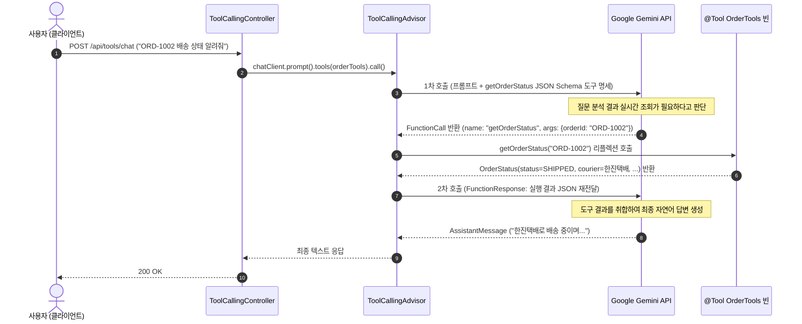

> 대규모 언어 모델(LLM)은 뛰어난 언어 이해력과 추론 능력을 가졌지만, **"자체 학습 시점 이후의 최신 정보 부재"**와 **"기업 내부 데이터베이스(주문, 결제, 회원) 직접 접근 불가"**라는 근본적인 한계를 지닙니다. 이러한 지식 단절을 해결하는 표준 메커니즘이 바로 **도구 호출(Tool Calling / Function Calling)**입니다. Spring AI 2.0.1은 스프링 빈 메서드에 **`@Tool`** 어노테이션을 붙이는 것만으로 메서드 시그니처와 파라미터 메타데이터를 정밀한 **JSON Schema 도구 명세**로 변환하여 모델에 제공합니다. 본 글에서는 Google Gemini 모델과 `@Tool` 기반 도구를 연동하고, Spring AI 2.0.1의 도구 예외 처리 결함을 보완하는 견고한 아키텍처를 구현해 봅니다.

---

## Tool Calling의 내부 동작 루프

Spring AI의 `ToolCallingAdvisor`는 클라이언트, LLM(Gemini), 그리고 스프링 애플리케이션 빈 사이에서 다음과 같은 다회전(Multi-turn) 중계 과정을 자동으로 처리합니다:



사용자는 단 한 번의 HTTP 요청을 보내지만, 내부적으로는 모델의 도구 호출 판단 ➔ 스프링 빈 메서드 실행 ➔ 결과 전달 ➔ 최종 문장 생성으로 이어지는 2회의 LLM 왕복 통신이 투명하게 일어납니다.

---

## 프로젝트 환경 및 의존성 설정

본 실습 코드는 [spring-ai-examples (tool-calling)](https://github.com/cmsong111/spring-ai-examples/tree/master/tool-calling) 모듈을 기반으로 합니다.

### build.gradle.kts

```kotlin
plugins {
    kotlin("jvm") version "2.3.21"
    kotlin("plugin.spring") version "2.3.21"
    id("org.springframework.boot") version "4.1.1"
    id("io.spring.dependency-management") version "1.1.7"
}

dependencies {
    implementation("org.springframework.boot:spring-boot-starter-web")
    implementation("org.springframework.ai:spring-ai-starter-model-google-genai")
    implementation("tools.jackson.module:jackson-module-kotlin")

    testImplementation("org.springframework.boot:spring-boot-starter-test")
    testImplementation("org.jetbrains.kotlin:kotlin-test-junit5")
}
```

### application.yaml 설정

무한 루프 방지를 위한 도구 호출 횟수 제한과 디버깅 로깅을 구성합니다:

```yaml
server:
  port: 8088

spring:
  application:
    name: tool-calling
  ai:
    google:
      genai:
        api-key: ${SPRING_AI_GOOGLE_GENAI_API_KEY:demo-key}
        chat:
          model: gemini-3.5-flash-lite
    tools:
      # 도구 내부 예외 발생 시 프레임워크 에러로 터뜨리지 않고 모델에게 결과를 돌려줌
      throw-exception-on-error: false
      limits:
        # 단일 요청 내 동일 도구 최대 5회, 전체 도구 최대 10회로 제한
        max-calls-per-tool-default: 5
        max-total-tool-calls: 10
        on-limit-exceeded: return-error-response

logging:
  level:
    # 도구 호출 Advisor의 인자 및 결과 디버그 로그 활성화
    org.springframework.ai.model.tool: DEBUG
```

---

## @Tool과 @ToolParam을 활용한 비즈니스 도구 작성

`@Tool`의 `description`과 `@ToolParam`의 `description`은 모델이 **"이 도구를 언제 호출해야 하는지"**와 **"파라미터에 어떤 형식의 값을 넣어야 하는지"**를 결정하는 핵심 지침서가 됩니다. 설명이 부실하면 모델이 엉뚱한 파라미터를 넘기거나 도구 호출 자체를 누락하게 됩니다.

### tools/OrderTools.kt

```kotlin
package io.github.cmsong111.tool_calling.tools

import io.github.cmsong111.tool_calling.dto.DeliveryStatus
import io.github.cmsong111.tool_calling.dto.OrderStatus
import org.slf4j.LoggerFactory
import org.springframework.ai.tool.annotation.Tool
import org.springframework.ai.tool.annotation.ToolParam
import org.springframework.stereotype.Component
import java.time.LocalDate

@Component
class OrderTools {

    private val log = LoggerFactory.getLogger(javaClass)

    private val orders: Map<String, OrderStatus> = listOf(
        OrderStatus("ORD-1001", "김남주", "기계식 키보드", DeliveryStatus.DELIVERED, "CJ대한통운", "6894-1234-0001", LocalDate.of(2026, 10, 8)),
        OrderStatus("ORD-1002", "김남주", "27인치 모니터", DeliveryStatus.SHIPPED, "한진택배", "4021-5678-0002", LocalDate.of(2026, 10, 13)),
        OrderStatus("ORD-1003", "이영희", "무선 마우스", DeliveryStatus.PREPARING, null, null, LocalDate.of(2026, 10, 15)),
        OrderStatus("ORD-1004", "박철수", "USB-C 허브", DeliveryStatus.CANCELLED, null, null, null),
    ).associateBy { it.orderId }

    @Tool(description = "주문번호로 주문의 상품명, 배송 상태, 택배사, 운송장 번호, 도착 예정일을 조회합니다. 주문번호 형식은 'ORD-' 뒤에 숫자 4자리입니다.")
    fun getOrderStatus(
        @ToolParam(description = "조회할 주문번호 (예: ORD-1002)") orderId: String
    ): OrderStatus {
        log.info("[Tool] getOrderStatus(orderId={})", orderId)

        val normalized = orderId.trim().uppercase()
        require(ORDER_ID_PATTERN.matches(normalized)) {
            "주문번호 형식이 올바르지 않습니다: '$orderId'. 'ORD-' 뒤에 숫자 4자리 형식이어야 합니다 (예: ORD-1002)."
        }

        return orders[normalized] ?: throw OrderNotFoundException(normalized)
    }

    @Tool(description = "고객 이름으로 해당 고객의 전체 주문 목록을 조회합니다.")
    fun findOrdersByCustomer(
        @ToolParam(description = "고객 이름 (예: 김남주)") customerName: String
    ): List<OrderStatus> {
        log.info("[Tool] findOrdersByCustomer(customerName={})", customerName)
        require(customerName.isNotBlank()) { "고객 이름은 비어 있을 수 없습니다." }

        return orders.values.filter { it.customerName == customerName.trim() }
    }

    companion object {
        private val ORDER_ID_PATTERN = Regex("^ORD-\\d{4}$")
    }
}
```

---

## Spring AI 2.0.1의 함정: 도구 예외 문자열과 JSON 파싱 실패

스프링 AI를 실무에 도입할 때 반드시 마주치는 치명적인 버그가 있습니다:

> **⚠️ Spring AI 2.0.1 GoogleGenAiChatModel 도구 예외 파싱 오류**:
> 사용자가 존재하지 않는 주문번호(`ORD-9999`)를 물어보았을 때, 도구 내부에서 `OrderNotFoundException`이 발생합니다.
> Spring AI의 기본 `DefaultToolExecutionExceptionProcessor`는 이 예외를 문자열(`"ORD-9999를 찾을 수 없습니다."`)로 반환합니다.
> 그러나 Google GenAI SDK는 모델에게 도구 결과를 보낼 때 **Map 구조의 JSON 객체**를 요구합니다. Spring AI 2.0.1의 `GoogleGenAiChatModel`은 도구 결과 문자열을 무조건 JSON으로 파싱(`JsonParser.fromJson`)하려고 시도하며, 일반 텍스트 문자열이 들어오면 **`org.springframework.ai.retry.NonTransientAiException: Failed to parse JSON`**을 던지며 전체 요청이 실패합니다!

이 문제를 해결하려면 도구 실행 예외를 항상 JSON 형태(`{"error": "..."}`)로 감싸서 반환하는 커스텀 `ToolExecutionExceptionProcessor` 빈을 등록해야 합니다:

### ToolCallingApplication.kt 설정 빈

```kotlin
@SpringBootApplication
class ToolCallingApplication {

    @Bean
    fun chatClient(builder: ChatClient.Builder): ChatClient {
        return builder
            .defaultSystem(
                """
                당신은 온라인 쇼핑몰의 고객 지원 AI 어시스턴트입니다.
                주문, 배송, 날씨 등 실시간 정보가 필요한 질문은 반드시 제공된 도구를 호출해 확인한 뒤 답변하세요.
                도구가 오류를 반환하면 그 내용을 사용자에게 정중하게 설명하고, 추측으로 정보를 만들어내지 마세요.
                """.trimIndent()
            )
            .build()
    }

    /**
     * GoogleGenAiChatModel의 Failed to parse JSON 에러 방지를 위한 커스텀 예외 처리기 빈
     */
    @Bean
    fun toolExecutionExceptionProcessor(): ToolExecutionExceptionProcessor {
        return ToolExecutionExceptionProcessor { exception ->
            JsonParser.toJson(mapOf("error" to exception.message))
        }
    }
}
```


_그림 1. DefaultToolExecutionExceptionProcessor 파싱 실패 에러와 커스텀 JSON 처리기 적용 후 정상 안내 로그_

커스텀 빈을 등록하면 Gemini는 `{"error": "주문번호 ORD-9999를 찾을 수 없습니다."}`라는 JSON 응답을 정상적으로 수신하고, *"고객님, 요청하신 ORD-9999 주문 내역을 찾을 수 없습니다. 번호를 다시 확인해 주시겠어요?"*라는 정중한 한국어 답변을 클라이언트에 생성해 줍니다.

---

## ChatClient Fluent API에서 도구 바인딩

서비스 레이어에서는 `ChatClient` 호출 시 `.tools(orderTools, weatherTools)`를 전달하기만 하면 됩니다:

### service/ToolCallingService.kt

```kotlin
@Service
class ToolCallingService(
    private val chatClient: ChatClient,
    private val orderTools: OrderTools,
    private val weatherTools: WeatherTools
) {

    fun chat(message: String): String {
        return chatClient.prompt()
            .user(message)
            .tools(orderTools, weatherTools)
            .call()
            .content() ?: ""
    }

    fun chatWithoutTools(message: String): String {
        return chatClient.prompt()
            .user(message)
            .call()
            .content() ?: ""
    }
}
```

---

## 실행 및 검증

### 단위 테스트 및 통합 테스트

도구 시그니처가 JSON Schema로 정상 변환되는지 검증하는 단위 테스트와, Gemini 모델이 실제로 도구를 호출하는 통합 테스트를 수행합니다:

```bash
./gradlew :tool-calling:test
```


_그림 2. 도구 스키마 생성, 커스텀 예외 처리기, 멀티 툴 조합 통합 테스트 통과 콘솔_

### API 호출 확인

```bash
curl -s -X POST http://localhost:8088/api/tools/chat \
  -H "Content-Type: application/json" \
  -d '{"message": "주문번호 ORD-1002 배송 상태 알려줘"}' | jq .
```


_그림 3. Gemini가 ORD-1002 파라미터로 OrderTools를 호출하고 생성한 실시간 배송 상태 답변_

```json
{
  "answer": "주문하신 27인치 모니터(ORD-1002)는 현재 한진택배로 배송 중이며, 운송장 번호는 4021-5678-0002입니다. 도착 예정일은 2026년 10월 13일입니다."
}
```

---

## 정리

- Spring AI 2.0.1의 **`@Tool`**과 **`@ToolParam`**을 활용하면 스프링 빈 메서드가 JSON Schema 도구 정의로 자동 등록됩니다.
- Gemini 모델은 질문의 의도를 분석하여 적절한 도구와 인자를 자율적으로 선택하고, **`ToolCallingAdvisor`**가 백엔드 메서드를 대리 실행합니다.
- Spring AI 2.0.1 + Google GenAI 조합에서는 도구 예외가 단순 문자열로 반환될 때 `Failed to parse JSON` 오류가 발생하므로, 반드시 **커스텀 `ToolExecutionExceptionProcessor` 빈으로 JSON 래핑**을 적용해야 합니다.
- 다음 글에서는 구글의 방대한 실시간 검색 인덱스를 LLM의 지식 베이스로 직접 결합하는 **Google Search Grounding 실시간 웹 검색 연동**을 다룹니다.
