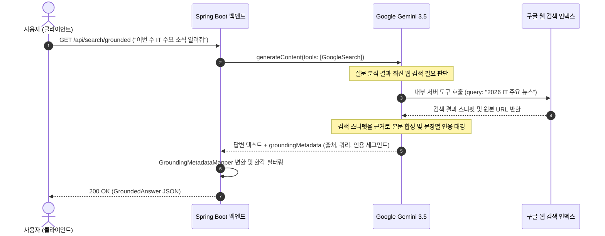

> 엔터프라이즈 환경에서 최신 웹 정보(오늘의 환율, 주가, 법령 개정안, IT 뉴스 등)를 LLM에 전달하기 위해 자체 웹 크롤러와 벡터 데이터베이스를 구축하는 RAG(검색 증강 생성) 파이프라인은 높은 인프라 운영 비용과 지연 시간을 수반합니다. Google Gemini는 구글의 실시간 검색 인덱스를 LLM의 추론 엔진에 직접 결합하는 **Google Search Grounding(그라운딩)** 기능을 네이티브로 제공합니다. 이를 활용하면 별도의 검색 엔진 API 연동 없이도 최신 웹 데이터 기반의 정확한 답변과 **출처 웹사이트 URL, 실제 실행된 검색 쿼리, 문장별 인용(Citation) 신뢰도**를 받아볼 수 있습니다. 본 글에서는 Spring AI 2.0.1에서 Search Grounding을 구성하는 두 가지 방식과 출처 메타데이터 추출 기법을 다룹니다.

---

## Google Search Grounding 아키텍처와 출처 인용 구조

Gemini 모델은 사용자의 질문을 받으면 자체 지식만으로 답변할 수 있는지, 아니면 실시간 웹 검색이 필요한지 스스로 판단합니다:



- **Grounding Chunks (출처 목록)**: 모델이 참고한 실제 웹 페이지 제목, 도메인, 구글 리다이렉트 URI 목록
- **Grounding Supports (인용 매핑)**: 생성된 텍스트 중 어떤 문장(`segment`)이 몇 번 출처(`groundingChunkIndices`)를 근거로 작성되었는지, 신뢰도 점수(`confidenceScores`)와 함께 제공
- **Search Entry Point**: 구글 검색 규정에 따라 사용자 화면에 반드시 노출해야 하는 검색 추천 칩 HTML

---

## 프로젝트 환경 및 의존성 구성

본 실습 코드는 [spring-ai-examples (search-grounding)](https://github.com/cmsong111/spring-ai-examples/tree/master/search-grounding) 모듈을 기반으로 합니다.

### build.gradle.kts

```kotlin
plugins {
    kotlin("jvm") version "2.3.21"
    kotlin("plugin.spring") version "2.3.21"
    id("org.springframework.boot") version "4.1.1"
    id("io.spring.dependency-management") version "1.1.7"
}

dependencies {
    implementation("org.springframework.boot:spring-boot-starter-web")
    implementation("org.springframework.ai:spring-ai-starter-model-google-genai")
    implementation("tools.jackson.module:jackson-module-kotlin")

    testImplementation("org.springframework.boot:spring-boot-starter-test")
    testImplementation("org.jetbrains.kotlin:kotlin-test-junit5")
}
```

### application.yaml

```yaml
server:
  port: 8089

spring:
  application:
    name: search-grounding
  ai:
    google:
      genai:
        api-key: ${SPRING_AI_GOOGLE_GENAI_API_KEY:demo-key}
        chat:
          model: gemini-3.5-flash-lite
```

---

## Spring AI 2.0.1의 두 가지 구현 방식과 한계

Spring AI 2.0.1 환경에서 Search Grounding을 구현할 때는 프레임워크의 지원 범위를 정확히 이해해야 합니다:

### 1. ChatClient 방식 (기본 지원)

Spring AI의 `GoogleGenAiChatOptions` 빌더는 `googleSearchRetrieval(true)` 옵션을 제공합니다:

```kotlin
val options = GoogleGenAiChatOptions.builder()
    .googleSearchRetrieval(true)
    .includeServerSideToolInvocations(true)
    .build()

val chatResponse = chatClient.prompt()
    .user("오늘 원달러 환율 알려줘")
    .options(options)
    .call()
    .chatResponse()
```

- **장점**: Spring AI 표준 Fluent API(`ChatClient`)를 그대로 사용 가능
- **서버 측 호출 내역 확인**: `includeServerSideToolInvocations(true)`를 지정하면 `AssistantMessage.metadata["serverSideToolInvocations"]`를 통해 구글 검색 도구가 호출되었는지 확인할 수 있습니다.
- **한계점 (Pitfall)**: Spring AI 2.0.1의 `GoogleGenAiChatModel`은 Gemini 응답 객체에 포함된 **`groundingMetadata`(출처 웹사이트 URL, 세그먼트별 인용 번호, 검색 쿼리)**를 `ChatResponse`로 매핑해주지 않고 버립니다!


_그림 1. GoogleGenAiChatOptions의 googleSearchRetrieval 활성화 및 서버 측 도구 호출 로그_

---

## 완전한 출처 메타데이터 추출: Google GenAI SDK Client 연동

엔터프라이즈 포털이나 챗봇 UI에서 사용자가 답변의 근거가 된 뉴스 기사나 공식 문서를 직접 클릭해 확인할 수 있는 **"출처 링크(Link)"**를 제공하려면, Spring AI 스타터가 스프링 컨텍스트에 자동 등록해 둔 `com.google.genai.Client` 빈을 직접 활용해야 합니다.

### dto/GroundedAnswer.kt

```kotlin
package io.github.cmsong111.search_grounding.dto

data class GroundedAnswer(
    val answer: String,
    val grounded: Boolean,
    val webSearchQueries: List<String>,
    val sources: List<GroundingSource>,
    val citations: List<Citation>,
    val searchEntryPointHtml: String?
)

data class GroundingSource(
    val index: Int,
    val title: String?,
    val uri: String?,
    val domain: String?
)

data class Citation(
    val text: String,
    val sourceIndices: List<Int>,
    val confidenceScores: List<Double>
)
```

### service/GroundingMetadataMapper.kt

Google GenAI SDK 응답(`GenerateContentResponse`)의 `groundingMetadata`를 DTO로 변환하는 매퍼입니다:

```kotlin
package io.github.cmsong111.search_grounding.service

import com.google.genai.types.GenerateContentResponse
import io.github.cmsong111.search_grounding.dto.Citation
import io.github.cmsong111.search_grounding.dto.GroundedAnswer
import io.github.cmsong111.search_grounding.dto.GroundingSource

object GroundingMetadataMapper {

    fun toGroundedAnswer(response: GenerateContentResponse): GroundedAnswer {
        val answer = response.text() ?: ""
        val metadata = response.candidates().orElse(emptyList())
            .firstOrNull()
            ?.groundingMetadata()
            ?.orElse(null)
            ?: return GroundedAnswer(answer, false, emptyList(), emptyList(), emptyList(), null)

        val sources = metadata.groundingChunks().orElse(emptyList())
            .mapIndexedNotNull { index, chunk ->
                chunk.web().map { web ->
                    GroundingSource(
                        index = index,
                        title = web.title().orElse(null),
                        uri = web.uri().orElse(null),
                        domain = web.domain().orElse(null)
                    )
                }.orElse(null)
            }

        val citations = metadata.groundingSupports().orElse(emptyList())
            .map { support ->
                Citation(
                    text = support.segment().flatMap { it.text() }.orElse(""),
                    sourceIndices = support.groundingChunkIndices().orElse(emptyList()),
                    confidenceScores = support.confidenceScores().orElse(emptyList())
                )
            }

        return GroundedAnswer(
            answer = answer,
            grounded = sources.isNotEmpty(),
            webSearchQueries = metadata.webSearchQueries().orElse(emptyList()),
            sources = sources,
            citations = citations,
            searchEntryPointHtml = metadata.searchEntryPoint().flatMap { it.renderedContent() }.orElse(null)
        )
    }
}
```

---

## 환각(Hallucination) 방지 Strict 정책과 서비스 구현

사용자가 최신 이슈를 물어봤음에도 모델이 검색 결과를 찾지 못하고 과거 사전 지식만으로 그럴듯하게 지어내는 환각을 방지하기 위해 `strict` 플래그 정책을 구현합니다. 출처가 하나도 없는 답변(`sources.isEmpty()`)은 강제로 차단하고 대체 안내 문구를 반환합니다:

### service/SearchGroundingService.kt

```kotlin
package io.github.cmsong111.search_grounding.service

import com.google.genai.Client
import com.google.genai.types.*
import io.github.cmsong111.search_grounding.dto.GroundedAnswer
import org.springframework.beans.factory.annotation.Value
import org.springframework.stereotype.Service

@Service
class SearchGroundingService(
    private val genAiClient: Client,
    @Value("\${spring.ai.google.genai.chat.model:gemini-3.5-flash-lite}")
    private val model: String
) {

    fun askWithGrounding(question: String, strict: Boolean): GroundedAnswer {
        val config = GenerateContentConfig.builder()
            .systemInstruction(Content.fromParts(Part.fromText(SYSTEM_INSTRUCTION)))
            .tools(Tool.builder().googleSearch(GoogleSearch.builder().build()).build())
            .build()

        val response = genAiClient.models.generateContent(model, question, config)
        val groundedAnswer = GroundingMetadataMapper.toGroundedAnswer(response)

        return applyGroundingPolicy(groundedAnswer, strict)
    }

    companion object {
        private const val SYSTEM_INSTRUCTION = "당신은 최신 정보를 정확하게 전달하는 AI 어시스턴트입니다. 반드시 Google 검색 결과를 근거로 한국어로 답변하세요."
        const val UNGROUNDED_MESSAGE = "검색 출처를 확인할 수 없어 답변을 제공하지 않습니다. 질문을 더 구체적으로 작성해 주세요."

        fun applyGroundingPolicy(answer: GroundedAnswer, strict: Boolean): GroundedAnswer {
            if (!strict || answer.grounded) return answer
            return answer.copy(answer = UNGROUNDED_MESSAGE)
        }
    }
}
```

---

## 실행 및 검증

### 단위 테스트 및 통합 테스트 수행

출처 매핑 로직 및 strict 정책을 검증하는 단위 테스트와, 실제 구글 검색 인덱스를 경유하는 통합 테스트를 실행합니다:

```bash
./gradlew :search-grounding:test
```


_그림 2. 출처 웹사이트/검색 쿼리/인용 세그먼트 매핑 및 Gemini 검색 통합 테스트 통과 콘솔_

### API 호출 및 출처 메타데이터 확인

```bash
curl -s -G "http://localhost:8089/api/search/grounded" \
  --data-urlencode "question=이번 주 IT 업계 주요 소식 알려줘" \
  --data-urlencode "strict=true" | jq .
```


_그림 3. Gemini가 구글 검색을 수행하고 원본 출처 URL과 문장별 신뢰도를 함께 반환한 JSON_

반환된 응답의 `sources[0].uri`는 `https://vertexaisearch.cloud.google.com/grounding-api-redirect/...` 형태의 구글 공식 리다이렉트 링크이며, 클릭 시 원본 기사나 블로그 포스트로 이동합니다.

---

## 구글 브랜딩 및 검색 추천 칩(Search Suggestions) 정책

Google AI Studio API 정책에 따라 Search Grounding 기능을 프로덕션 UI에 노출할 때는 다음 가이드라인을 준수해야 합니다:

1. **출처 링크 보존**: 모델이 제공한 `sources`의 URL을 수정하거나 제거하지 않고 사용자에게 직접 접근할 수 있는 하이퍼링크로 제공해야 합니다.
2. **Search Entry Point 렌더링**: 응답에 포함된 `searchEntryPointHtml`에는 Google 검색창 및 연관 검색어 칩이 포함되어 있으며, 검색 결과 하단에 이를 렌더링하는 것이 권장됩니다.

---

## 정리

- Gemini의 **Google Search Grounding**은 별도의 웹 크롤러나 벡터 DB 없이도 최신 실시간 정보를 LLM에 연동할 수 있는 가장 경제적인 솔루션입니다.
- Spring AI 2.0.1의 `ChatClient` 옵션(`googleSearchRetrieval`)으로 검색 기능을 활성화할 수 있으나, 출처 URL과 문장별 인용 그래프는 누락됩니다.
- 프로덕션 수준의 신뢰성 있는 출처 링크를 제공하려면, 자동 구성된 **`com.google.genai.Client` 빈으로 `groundingMetadata`를 직접 매핑**하고 `strict` 환각 방지 정책을 결합해야 합니다.
- 다음 글에서는 수십 개 이상의 사내 도구가 등록되어 있을 때 토큰 낭비를 줄이고 라우팅 효율을 극대화하는 **ToolSearchToolCallingAdvisor를 활용한 동적 도구 검색 최적화**를 다룹니다.
