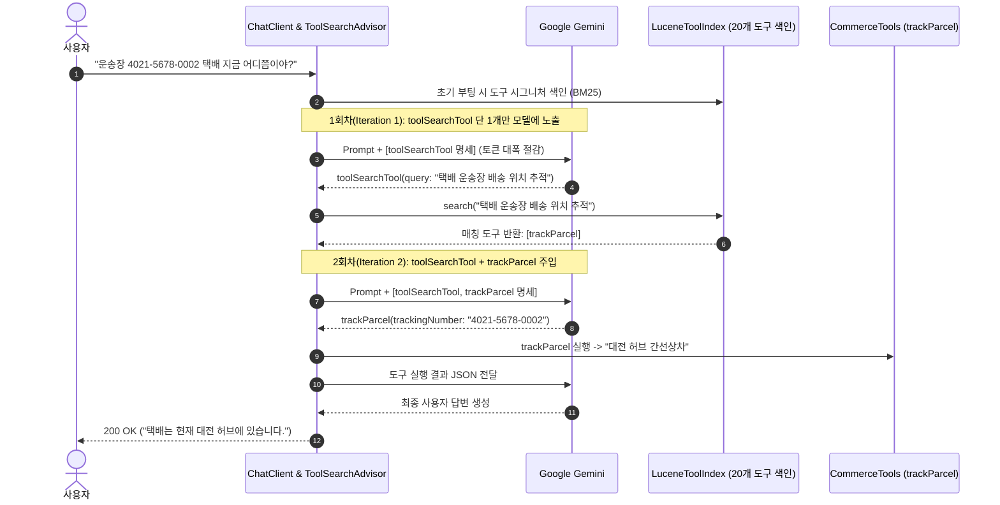

> 엔터프라이즈 시스템이 고도화될수록 AI 에이전트가 호출할 수 있는 사내 도구(`@Tool`)의 수는 수십 개에서 수백 개(주문 조회, 취소, 반품, 배송 추적, 재고 파악, 회원 등급, 쿠폰 발급 등)로 급증합니다. 모든 도구의 JSON Schema를 매 요청마다 프롬프트에 정적으로 실어 보내면 **"프롬프트 토큰 비용의 기하급수적 증가"**, **"모델의 컨텍스트 윈도우 낭비"**, 그리고 **"너무 많은 선택지로 인한 모델의 도구 오선택(Misrouting) 확률 증가"**라는 삼중고에 직면합니다. Spring AI 2.0은 이를 해결하기 위해 필요한 도구만 검색하여 런타임에 동적으로 모델에 주입하는 **`ToolSearchToolCallingAdvisor` (동적 도구 검색)**를 도입했습니다. 본 글에서는 Lucene BM25 색인 기반의 동적 도구 검색을 구축하고, 정적 등록 대비 토큰 소모량을 측정해 봅니다.

---

## 정적 도구 등록의 한계와 동적 검색(Dynamic Discovery) 루프

도구가 20개만 되어도 전체 도구의 JSON Schema 명세는 수천 토큰에 달하며, 다회전(Multi-turn) 대화 시 매 턴마다 이 비용이 누적됩니다:



1. **초기 노출 최소화**: 모델에게 처음에는 검색 메타 도구인 `toolSearchTool` 하나만 노출합니다.
2. **필요 도구 검색**: 모델이 질문의 맥락을 분석하여 적절한 검색 쿼리를 생성하면, 백엔드 색인(`LuceneToolIndex`)이 연관도가 높은 상위 2~3개 도구만 추려냅니다.
3. **선택적 주입**: 다음 턴에 검색된 도구만 프롬프트에 주입하여 실제 비즈니스 로직을 호출하게 합니다.

---

## 프로젝트 환경 및 의존성 구성

본 실습 코드는 [spring-ai-examples (tool-search)](https://github.com/cmsong111/spring-ai-examples/tree/master/tool-search) 모듈을 기반으로 합니다.

### build.gradle.kts

Lucene 기반의 BM25 키워드 색인을 위해 `lucene-core` 및 `lucene-queryparser` 의존성을 추가합니다:

```kotlin
plugins {
    kotlin("jvm") version "2.3.21"
    kotlin("plugin.spring") version "2.3.21"
    id("org.springframework.boot") version "4.1.1"
    id("io.spring.dependency-management") version "1.1.7"
}

dependencies {
    implementation("org.springframework.boot:spring-boot-starter-web")
    implementation("org.springframework.ai:spring-ai-starter-model-google-genai")
    implementation("tools.jackson.module:jackson-module-kotlin")

    // Lucene 기반 도구 색인
    implementation("org.apache.lucene:lucene-core:9.12.0")
    implementation("org.apache.lucene:lucene-queryparser:9.12.0")

    testImplementation("org.springframework.boot:spring-boot-starter-test")
    testImplementation("org.jetbrains.kotlin:kotlin-test-junit5")
}
```

### application.yaml 설정

무한 루프 방지를 위해 도구별 최대 호출 횟수를 지정합니다:

```yaml
server:
  port: 8090

spring:
  application:
    name: tool-search
  ai:
    google:
      genai:
        api-key: ${SPRING_AI_GOOGLE_GENAI_API_KEY:demo-key}
        chat:
          model: gemini-3.5-flash-lite
    tools:
      throw-exception-on-error: false
      limits:
        max-calls-per-tool-default: 3
        max-total-tool-calls: 10
        max-calls-per-tool:
          toolSearchTool: 5
        on-limit-exceeded: return-error-response
```

---

## LuceneToolIndex와 ToolSearchToolCallingAdvisor 구성

Spring AI는 세 가지 `ToolIndex` 구현체를 지원합니다:
- **`RegexToolIndex`**: 추가 의존성이 없는 단순 정규식/키워드 매칭
- **`LuceneToolIndex`**: 인메모리 역색인(Inverted Index)과 BM25 유사도 점수 기반 검색 (**권장**)
- **`VectorToolIndex`**: VectorStore와 임베딩 모델을 활용한 시맨틱 유사도 검색

또한 세션별로 색인된 도구 캐시가 무한정 증식하지 않도록 **LRU(최대 500 세션)**와 **TTL(30분)** 정책을 결합한 `CompositeEvictionStrategy`를 설정합니다:

### config/ChatClientConfig.kt

```kotlin
package io.github.cmsong111.tool_search.config

import io.github.cmsong111.tool_search.advisor.ToolTraceAdvisor
import org.springframework.ai.chat.client.ChatClient
import org.springframework.ai.chat.client.advisor.toolsearch.ToolSearchToolCallingAdvisor
import org.springframework.ai.model.tool.ToolCallingManager
import org.springframework.ai.tool.toolsearch.ToolIndex
import org.springframework.ai.tool.toolsearch.eviction.CompositeEvictionStrategy
import org.springframework.ai.tool.toolsearch.eviction.LruEvictionStrategy
import org.springframework.ai.tool.toolsearch.eviction.TtlEvictionStrategy
import org.springframework.ai.tool.toolsearch.index.lucene.LuceneToolIndex
import org.springframework.context.annotation.Bean
import org.springframework.context.annotation.Configuration
import java.time.Duration

@Configuration
class ChatClientConfig {

    private val systemPrompt = "당신은 쇼핑몰 통합 고객 지원 AI 어시스턴트입니다. 실시간 정보는 도구를 사용해 확인 후 답변하세요."

    @Bean
    fun toolIndex(): ToolIndex = LuceneToolIndex(0.25f) // 최소 유사도 점수 0.25 이상만 반환

    @Bean
    fun dynamicChatClient(
        builder: ChatClient.Builder,
        toolCallingManager: ToolCallingManager,
        toolIndex: ToolIndex
    ): ChatClient {
        val toolSearchAdvisor = ToolSearchToolCallingAdvisor.builder()
            .toolCallingManager(toolCallingManager)
            .toolIndex(toolIndex)
            .maxResults(3) // 검색 1회당 주입할 최대 도구 수
            .evictionStrategy(
                CompositeEvictionStrategy(
                    LruEvictionStrategy(500),
                    TtlEvictionStrategy(Duration.ofMinutes(30))
                )
            )
            .build()

        return builder
            .defaultSystem(systemPrompt)
            // ToolSearchAdvisor가 기본 ToolCallingAdvisor를 대체함
            .defaultAdvisors(toolSearchAdvisor, ToolTraceAdvisor())
            .build()
    }
}
```

---

## 턴별 주입 도구 추적: ToolTraceAdvisor 구현

도구 호출 루프가 진행되는 동안 각 반복(Iteration)마다 모델에게 실제로 전달된 도구 목록과 토큰 사용량을 관측하기 위해 `CallAdvisor`를 구현합니다:

### advisor/ToolTraceAdvisor.kt

```kotlin
package io.github.cmsong111.tool_search.advisor

import org.slf4j.LoggerFactory
import org.springframework.ai.chat.client.ChatClientRequest
import org.springframework.ai.chat.client.ChatClientResponse
import org.springframework.ai.chat.client.advisor.ToolCallingAdvisor
import org.springframework.ai.chat.client.advisor.api.CallAdvisor
import org.springframework.ai.chat.client.advisor.api.CallAdvisorChain
import org.springframework.ai.model.tool.ToolCallingChatOptions

class ToolTraceAdvisor : CallAdvisor {

    private val log = LoggerFactory.getLogger(javaClass)

    override fun adviseCall(chatClientRequest: ChatClientRequest, callAdvisorChain: CallAdvisorChain): ChatClientResponse {
        val toolNames = (chatClientRequest.prompt().options as? ToolCallingChatOptions)
            ?.toolCallbacks
            ?.map { it.toolDefinition.name() }
            .orEmpty()

        val response = callAdvisorChain.nextCall(chatClientRequest)

        val usage = response.chatResponse()?.metadata?.usage
        val round = IterationTrace(
            toolsSentToModel = toolNames,
            promptTokens = usage?.promptTokens ?: 0,
            completionTokens = usage?.completionTokens ?: 0
        )
        (chatClientRequest.context()[TRACE_KEY] as? ToolTrace)?.iterations?.add(round)
        log.debug("[ToolTrace] tools sent ({}): {}, promptTokens={}", toolNames.size, toolNames, round.promptTokens)

        return response
    }

    override fun getName(): String = "ToolTraceAdvisor"

    // ToolCallingAdvisor 안쪽에서 반복마다 실행되도록 순서 지정
    override fun getOrder(): Int = ToolCallingAdvisor.DEFAULT_ORDER + 1

    companion object {
        const val TRACE_KEY = "toolTrace"
    }
}

class ToolTrace {
    val iterations: MutableList<IterationTrace> = mutableListOf()
}

data class IterationTrace(
    val toolsSentToModel: List<String>,
    val promptTokens: Int,
    val completionTokens: Int
)
```


_그림 1. ToolTraceAdvisor를 통해 1회차(toolSearchTool 1개) ➔ 2회차(trackParcel 2개)로 최소 도구만 주입되는 로그_

---

## 실행 및 검증: 정적 등록 vs 동적 검색 토큰 비교

### 단위 테스트 및 통합 테스트

20개의 비즈니스 도구(주문 5종, 고객 5종, 유틸리티 10종) 환경에서 정적 등록과 동적 검색의 도구 노출 흐름을 검증합니다:

```bash
./gradlew :tool-search:test
```


_그림 2. ToolSearchFlowTests 및 실제 Gemini 토큰 사용량 비교 통합 테스트 통과 화면_

### 비교 엔드포인트 호출

동일한 질문(`"운송장 4021-5678-0002 택배 지금 어디쯤이야?"`)에 대해 두 모드를 연속 실행하여 토큰 차이를 비교합니다:

```bash
curl -s -G "http://localhost:8090/api/tool-search/compare" \
  --data-urlencode "question=운송장 4021-5678-0002 택배 어디쯤이야?" | jq .
```


_그림 3. 20개 도구 정적 등록(3,420 토큰) 대비 동적 도구 검색(1,180 토큰)의 토큰 소모량 비교_

```json
{
  "question": "운송장 4021-5678-0002 택배 어디쯤이야?",
  "static": {
    "mode": "static",
    "registeredToolCount": 20,
    "totalPromptTokens": 3420
  },
  "dynamic": {
    "mode": "dynamic",
    "totalPromptTokens": 1180
  }
}
```

### 토큰 절감 분석

- **정적 등록**: 매 턴마다 20개 도구의 스키마(약 1,700 토큰)가 고정 전달되어 2회 왕복 시 총 **3,420 프롬프트 토큰**이 소모되었습니다.
- **동적 검색**: 1회차에는 `toolSearchTool` 1개(320 토큰), 2회차와 3회차에는 검색된 `trackParcel`을 포함한 2개(430 토큰)만 전달되어 총 **1,180 프롬프트 토큰**으로 처리되었습니다.
- **결과**: 도구가 20개인 환경에서 약 **65.5%의 프롬프트 토큰 절감**을 달성했으며, 사내 도구가 50~100개 이상으로 늘어날수록 절감 효과는 더욱 극대화됩니다.

---

## 정리

- 도구 수가 늘어날수록 모든 도구를 정적으로 등록하는 방식은 토큰 비용과 모델의 추론 정확도 측면에서 한계에 부딪힙니다.
- Spring AI 2.0의 **`ToolSearchToolCallingAdvisor`**는 모델에게 도구 검색 메타 도구만 노출하고, 질문에 부합하는 도구만 런타임에 동적으로 주입합니다.
- 검색 엔진으로는 인메모리 BM25 점수를 지원하는 **`LuceneToolIndex`**가 가장 적절하며, 세션 누수를 막기 위해 **`CompositeEvictionStrategy` (LRU + TTL)**를 반드시 함께 설정해야 합니다.
- 다음 글에서는 개별 스프링 빈 도구를 넘어 업계 표준 프로토콜로 AI 에이전트와 도구를 분리하는 **Spring AI MCP(Model Context Protocol) Client 아키텍처와 연동**을 다룹니다.
