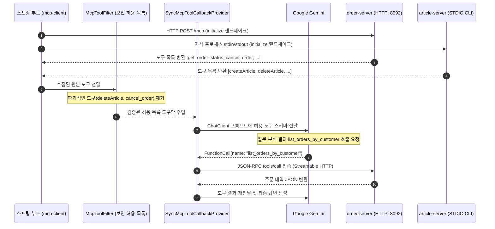

> 단일 애플리케이션 내부에 `@Tool` 빈을 직접 작성하는 방식은 도구의 개수가 늘어나거나 여러 팀이 각자의 도구(DB 조회 도구, 외부 결제 연동 도구, 인프라 배포 도구 등)를 독립적으로 배포할 때 모놀리식 의존성 결합을 발생시킵니다. **Model Context Protocol (MCP)**는 LLM 애플리케이션(호스트/클라이언트)과 외부 도구 제공자(MCP 서버) 간의 통신을 표준 JSON-RPC 기반으로 격리하는 개방형 프로토콜입니다. Spring AI 2.0.1은 **`spring-ai-starter-mcp-client`**를 통해 복잡한 핸드셰이크와 전송 계층을 자동 구성으로 추상화합니다. 본 글에서는 원격 마이크로서비스(Streamable HTTP)와 로컬 CLI(STDIO) 형태의 두 MCP 서버에 동시 연결하고, 보안 필터(`McpToolFilter`)를 적용하여 안전하게 Gemini와 연동하는 실무 기법을 다룹니다.

---

## MCP Client 아키텍처와 도구 라이프사이클

Spring AI의 MCP Client는 외부 서버와 세션을 맺고 도구 목록을 조회하여 스프링의 표준 `ToolCallback` 인터페이스로 래핑합니다:



- **느슨한 결합**: 클라이언트는 주문이나 게시글 도구의 내부 자바 코드를 알 필요가 없으며, 원격 서버의 언어(Java, Go, Python, Node.js)와 무관하게 도구를 소비합니다.
- **보안 격리**: 외부 서버가 제공하는 전체 도구 중 사내 보안 정책상 허용된 도구만 화이트리스트(`McpToolFilter`)로 통과시킵니다.

---

## 프로젝트 환경 및 의존성 구성

본 실습 코드는 [spring-ai-examples (mcp-client)](https://github.com/cmsong111/spring-ai-examples/tree/master/mcp-client) 모듈을 기반으로 합니다.

### build.gradle.kts

```kotlin
plugins {
    kotlin("jvm") version "2.3.21"
    kotlin("plugin.spring") version "2.3.21"
    id("org.springframework.boot") version "4.1.1"
    id("io.spring.dependency-management") version "1.1.7"
}

dependencies {
    implementation("org.springframework.boot:spring-boot-starter-web")
    implementation("org.springframework.ai:spring-ai-starter-model-google-genai")
    implementation("org.springframework.ai:spring-ai-starter-mcp-client")
    implementation("tools.jackson.module:jackson-module-kotlin")

    testImplementation("org.springframework.boot:spring-boot-starter-test")
    testImplementation("org.jetbrains.kotlin:kotlin-test-junit5")
}
```

---

## 두 가지 전송 프로토콜 연결 설정 (HTTP & STDIO)

Spring AI는 프로파일을 통해 대상 서버의 물리적 위치와 프로토콜에 따라 유연하게 클라이언트를 구성할 수 있습니다:

### application-http.yaml (원격 HTTP 서버 연결)

`mcp-server-webmvc` 마이크로서비스가 제공하는 표준 Streamable HTTP 엔드포인트(`http://localhost:8092/mcp`)에 연결합니다:

```yaml
spring:
  ai:
    mcp:
      client:
        type: sync
        request-timeout: 30s
        streamable-http:
          connections:
            order-server:
              url: http://localhost:8092
              endpoint: /mcp
```

### application-stdio.yaml (로컬 자식 프로세스 연결)

`mcp-server-stdio`의 독립 실행형 jar 파일을 자식 프로세스로 직접 fork하여 표준 입출력(stdio) 파이프로 통신합니다:

```yaml
spring:
  ai:
    mcp:
      client:
        type: sync
        request-timeout: 30s
        stdio:
          connections:
            article-server:
              command: ${java.home}/bin/java
              args:
                - "-jar"
                - "../mcp-server-stdio/build/libs/mcp-server-stdio-0.1.0.jar"
```

---

## 보안 허용 목록: McpToolFilter를 통한 파괴적 도구 차단

외부 MCP 서버가 `deleteArticle`이나 `cancel_order`와 같은 파괴적인 쓰기/삭제 도구를 노출하고 있을 때, 모델이 이를 임의로 호출하지 못하도록 클라이언트 단에서 사전에 필터링해야 합니다.

### config/McpClientConfig.kt

```kotlin
@Configuration
@EnableConfigurationProperties(McpToolSecurityProperties::class)
class McpClientConfig {

    /**
     * 서버별 도구 허용 목록(Allowlist) 필터
     */
    @Bean
    fun mcpToolFilter(properties: McpToolSecurityProperties): McpToolFilter {
        return McpToolFilter { connectionInfo, tool ->
            val serverName = connectionInfo.initializeResult()?.serverInfo()?.name()
            // 허용 목록에 등록된 도구만 통과
            properties.allowedTools[serverName]?.contains(tool.name()) == true
        }
    }

    /**
     * 자동 구성된 MCP 도구 콜백들을 ChatClient 기본 도구로 주입
     */
    @Bean
    fun chatClient(
        builder: ChatClient.Builder,
        mcpToolCallbacks: ObjectProvider<SyncMcpToolCallbackProvider>
    ): ChatClient {
        mcpToolCallbacks.ifAvailable { builder.defaultToolCallbacks(it) }
        return builder
            .defaultSystem("당신은 쇼핑몰 및 사내 게시판 지원 AI입니다. 연동된 MCP 도구를 활용해 정확하게 답변하세요.")
            .build()
    }
}
```

### application.yaml 허용 목록 프로퍼티

```yaml
app:
  mcp:
    allowed-tools:
      article-server:
        - createArticle
        - getArticle
        - listArticles
        - updateArticle
        # deleteArticle 은 제외하여 차단
      order-server:
        - get_order_status
        - list_orders_by_customer
        # cancel_order 는 제외하여 차단
```


_그림 1. 서버가 노출한 원본 도구 목록(/api/mcp/servers) 중 파괴적 도구가 제외되어 Gemini에 전달되는 도구(/api/mcp/tools)_

---

## 실행 및 검증

### 단위 테스트 및 STDIO 통합 테스트 수행

`mcp-server-stdio` jar를 직접 기동하여 STDIO 핸드셰이크와 보안 필터 동작을 검증합니다:

```bash
./gradlew :mcp-client:test
```


_그림 2. STDIO 자식 프로세스 핸드셰이크, 도구 필터링, Gemini MCP E2E 테스트 통과 콘솔_

### API 호출 및 원격 도구 호출 확인

```bash
curl -s -X POST http://localhost:8091/api/mcp/chat \
  -H "Content-Type: application/json" \
  -d '{"message": "김남주 고객의 주문 중 배송 중인 건 상품명과 주문번호 알려줘"}' | jq .
```


_그림 3. Gemini가 원격 order-server의 list_orders_by_customer 도구를 호출하여 생성한 응답_

```json
{
  "answer": "김남주 고객님의 주문 내역을 확인한 결과, '27인치 모니터'(주문번호: ORD-1002)가 현재 한진택배를 통해 배송 중입니다."
}
```

---

## 정리

- **Model Context Protocol (MCP)**는 LLM 클라이언트와 도구 제공자 간의 통신을 JSON-RPC 기반으로 표준화하여 마이크로서비스 간의 도구 공유를 실현합니다.
- Spring AI 2.0.1의 **`spring-ai-starter-mcp-client`**는 **Streamable HTTP**와 **STDIO** 전송 방식을 모두 지원하며, `McpSyncClient`를 통해 손쉽게 핸드셰이크를 수행합니다.
- 외부 MCP 서버의 임의 도구 실행을 방지하기 위해 **`McpToolFilter`**를 등록하여 사내 보안 정책에 맞는 도구만 선택적으로 노출하는 화이트리스트 전략이 필수적입니다.
- 다음 글에서는 반대로 우리 스프링 부트 애플리케이션의 비즈니스 로직을 외부 AI 클라이언트에 제공하는 **Spring Boot MCP Server(STDIO / WebMVC Streamable HTTP) 구축**을 다룹니다.
