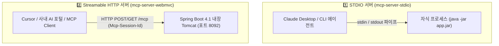

> 앞선 포스트에서 스프링 부트가 외부 MCP 서버의 도구를 소비하는 **MCP Client**를 다루었다면, 이번에는 반대로 **"우리가 보유한 스프링 부트 사내 시스템(주문 도메인, 게시판, ERP DB 등)을 AI 에이전트가 호출할 수 있는 MCP Server로 노출하는 방법"**을 살펴봅니다. Spring AI 2.0.1은 로컬 개발 환경용 프로세스 파이프 방식인 **STDIO 전송**(`spring-ai-starter-mcp-server`)과 엔터프라이즈 마이크로서비스 배포용 표준 프로토콜인 **WebMVC Streamable HTTP 전송**(`spring-ai-starter-mcp-server-webmvc`)을 공식 지원합니다. 본 글에서는 두 방식의 서버 구축과 **`@McpTool`**, **`@McpResource`** 어노테이션 기반 엔드포인트 설계법을 구현해 봅니다.

---

## 두 가지 MCP 서버 아키텍처 비교

MCP 서버는 배포 환경과 연결할 AI 클라이언트에 따라 적합한 전송 계층을 선택해야 합니다:



| 구분 | STDIO (`mcp-server-stdio`) | Streamable HTTP (`mcp-server-webmvc`) |
| :--- | :--- | :--- |
| **통신 방식** | 프로세스 표준 입출력 (`stdin`/`stdout`) | 단일 HTTP 엔드포인트 (`POST/GET /mcp`) |
| **적합한 환경** | 로컬 개발 도구 (Claude Desktop, 로컬 CLI) | 운영 마이크로서비스, 사내 공유 AI 서버 |
| **스타터** | `spring-ai-starter-mcp-server` | `spring-ai-starter-mcp-server-webmvc` |
| **세션 관리** | 프로세스 라이프사이클과 동일 | `Mcp-Session-Id` 헤더 기반 멀티 세션 |

---

## 1. WebMVC Streamable HTTP MCP Server 구축

운영 환경에서 다수의 AI 클라이언트가 공유할 수 있는 마이크로서비스형 서버를 구축합니다.

### build.gradle.kts

```kotlin
plugins {
    kotlin("jvm") version "2.3.21"
    kotlin("plugin.spring") version "2.3.21"
    id("org.springframework.boot") version "4.1.1"
    id("io.spring.dependency-management") version "1.1.7"
}

dependencies {
    implementation("org.springframework.boot:spring-boot-starter-web")
    implementation("org.springframework.ai:spring-ai-starter-mcp-server-webmvc")
    implementation("tools.jackson.module:jackson-module-kotlin")

    testImplementation("org.springframework.boot:spring-boot-starter-test")
    testImplementation("org.jetbrains.kotlin:kotlin-test-junit5")
}
```

### application.yaml

최신 MCP 표준인 `streamable` 프로토콜을 활성화하고 엔드포인트를 `/mcp`로 지정합니다:

```yaml
server:
  port: 8092

spring:
  application:
    name: mcp-server-webmvc
  ai:
    mcp:
      server:
        name: order-server
        version: 0.1.0
        type: sync
        protocol: streamable     # streamable(기본값) | sse | stateless
        streamable-http:
          mcp-endpoint: /mcp
```

### @McpTool과 @McpResource 어노테이션 정의

스프링 빈에 `@McpTool`과 `@McpResource`를 선언하면 Spring AI 어노테이션 스캐너가 부팅 시 자동으로 MCP 기능으로 등록합니다:

```kotlin
package io.github.cmsong111.mcp_server_webmvc.tools

import io.github.cmsong111.mcp_server_webmvc.domain.Order
import io.github.cmsong111.mcp_server_webmvc.repository.OrderRepository
import org.springframework.ai.mcp.annotation.McpResource
import org.springframework.ai.mcp.annotation.McpTool
import org.springframework.ai.mcp.annotation.McpToolParam
import org.springframework.stereotype.Component

@Component
class OrderTools(
    private val orderRepository: OrderRepository
) {

    // 1. 단건 주문 조회 도구 (readOnlyHint 메타데이터 명시)
    @McpTool(
        name = "get_order_status",
        description = "주문번호로 주문 상세와 현재 배송 상태를 조회합니다.",
        annotations = McpTool.McpAnnotations(readOnlyHint = true)
    )
    fun getOrderStatus(
        @McpToolParam(description = "조회할 주문번호 (예: ORD-1002)", required = true) orderId: String
    ): Order {
        return orderRepository.findById(orderId)
            ?: throw IllegalArgumentException("주문번호 '$orderId'에 해당하는 주문이 없습니다.")
    }

    // 2. 주문 취소 도구 (destructiveHint 메타데이터 명시)
    @McpTool(
        name = "cancel_order",
        description = "주문을 취소합니다. 이미 배송된 주문은 취소할 수 없습니다.",
        annotations = McpTool.McpAnnotations(destructiveHint = true)
    )
    fun cancelOrder(
        @McpToolParam(description = "취소할 주문번호", required = true) orderId: String,
        @McpToolParam(description = "취소 사유", required = true) reason: String
    ): Order {
        return orderRepository.cancel(orderId, reason)
    }

    // 3. URI 템플릿 기반 리소스 노출
    @McpResource(
        uri = "order://{orderId}",
        name = "order-detail-resource",
        description = "주문 번호에 대응하는 주문 텍스트 리소스"
    )
    fun orderResource(orderId: String): String {
        val order = orderRepository.findById(orderId) ?: return "주문 없음"
        return "주문번호: ${order.orderId}, 상품: ${order.item}, 상태: ${order.status}"
    }
}
```

> **💡 안전성 힌트 (`readOnlyHint` & `destructiveHint`)**:
> Claude Desktop이나 Cursor 같은 최신 AI 클라이언트는 `destructiveHint: true`로 마킹된 도구(`cancel_order`)를 호출할 때 **"정말 실행하시겠습니까?"**라는 사용자 승인 모달을 띄워 돌이킬 수 없는 데이터 변경을 예방합니다.

---

## 2. STDIO MCP Server 구축 및 패키징

Claude Desktop 등 로컬 도구에서 직접 실행할 수 있는 STDIO 서버는 `spring-ai-starter-mcp-server`를 사용합니다:

### config 및 서비스 구현

```kotlin
@Component
class ArticleService(
    private val articleRepository: ArticleRepository
) {

    @Tool(description = "새로운 아티클(게시글)을 생성합니다.")
    fun createArticle(form: ArticleCreateForm): Article {
        return articleRepository.save(Article.create(form.title, form.content, form.author))
    }

    @Tool(description = "모든 아티클을 목록으로 반환합니다.")
    fun listArticles(): List<Article> = articleRepository.findAll()

    @Tool(description = "아티클을 삭제합니다.")
    fun deleteArticle(id: Long): Boolean = articleRepository.deleteById(id)
}
```

### jar 빌드 및 Claude Desktop 연동

STDIO 서버는 표준 입출력을 오염시키지 않도록 로깅을 `stderr`나 파일로 격리해야 합니다. `./gradlew :mcp-server-stdio:bootJar`로 빌드한 후 `claude_desktop_config.json`에 등록합니다:

```json
{
  "mcpServers": {
    "article-server": {
      "command": "/usr/bin/java",
      "args": [
        "-jar",
        "/path/to/spring-ai-examples/mcp-server-stdio/build/libs/mcp-server-stdio-0.1.0.jar"
      ]
    }
  }
}
```

---

## 실행 및 검증

### 단위 테스트 및 통합 테스트 수행

두 서버 모듈의 전체 단위 및 프로토콜 검증 테스트를 실행합니다:

```bash
./gradlew :mcp-server-stdio:test :mcp-server-webmvc:test
```


_그림 1. mcp-server-stdio 및 mcp-server-webmvc 프로토콜 테스트 통과 화면_

### curl로 Streamable HTTP JSON-RPC 핸드셰이크 호출

MCP 클라이언트 없이 순수 `curl` 명령어로 프로토콜 핸드셰이크와 세션 발급을 확인합니다:

```bash
curl -i -X POST http://localhost:8092/mcp \
  -H "Content-Type: application/json" \
  -H "Accept: application/json, text/event-stream" \
  -d '{
    "jsonrpc": "2.0",
    "id": 1,
    "method": "initialize",
    "params": {
      "protocolVersion": "2025-06-18",
      "clientInfo": {"name": "curl-agent", "version": "1.0"}
    }
  }'
```


_그림 2. HTTP 200 OK와 함께 Mcp-Session-Id 세션 헤더가 발급된 초기화 응답_

### 발급된 세션으로 tools/call 원격 실행

```bash
curl -s -X POST http://localhost:8092/mcp \
  -H "Content-Type: application/json" \
  -H "Mcp-Session-Id: 9f72b380-41da-4589-9a21-99521ef32091" \
  -d '{
    "jsonrpc": "2.0",
    "id": 2,
    "method": "tools/call",
    "params": {
      "name": "get_order_status",
      "arguments": {"orderId": "ORD-1002"}
    }
  }' | jq .
```


_그림 3. Spring Boot가 실행한 OrderTools의 결과 JSON이 MCP text 콘텐츠로 반환된 응답_

---

## 외부 AI 클라이언트 연동 가이드

- **Cursor (`~/.cursor/mcp.json`)**:
  ```json
  {
    "mcpServers": {
      "order-server": { "url": "http://localhost:8092/mcp" }
    }
  }
  ```
- **Claude Code**:
  ```bash
  claude mcp add --transport http order-server http://localhost:8092/mcp
  ```

---

## 정리

- Spring AI 2.0.1은 **`spring-ai-starter-mcp-server-webmvc`**를 통해 내장 톰캣 기반의 **Streamable HTTP** 표준 MCP 서버를 손쉽게 제공합니다.
- **`@McpTool`**과 **`@McpResource`** 어노테이션으로 기존 스프링 빈 메서드를 AI 에이전트의 액션 및 지식 리소스로 노출할 수 있습니다.
- `destructiveHint` 메타데이터를 활용하여 위험한 CUD 작업에 대해 AI 클라이언트의 사용자 승인(Human-in-the-loop)을 유도할 수 있습니다.
- 다음 글에서는 사내 대용량 비정형 문서를 파싱하여 검색 가능한 청크로 분할하는 **문서 수집 ETL 파이프라인과 TokenTextSplitter 청킹 전략**을 다룹니다.
