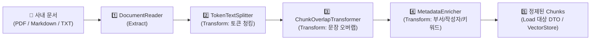

> RAG(검색 증강 생성) 시스템을 구축할 때 대다수의 엔지니어는 고성능 LLM이나 벡터 데이터베이스 선정에 집중하지만, 실제 검색 품질과 답변 정확도의 80%는 **"사내 문서를 어떻게 읽고, 어떤 크기로 자르며, 어떤 메타데이터를 부여했는가(ETL 파이프라인)"**에서 결정됩니다. 문서를 너무 크게 자르면 불필요한 노이즈가 주입되어 LLM이 핵심을 놓치고, 너무 잘게 자르면 문맥(Context)이 유실되어 질문과 매칭되지 않습니다. 특히 한글 문서의 경우 글자 단위로 기계적으로 자르면 음절이나 단어가 잘려 임베딩 벡터가 왜곡됩니다. 본 글에서는 Spring AI 2.0.1의 **`DocumentReader`**, **`TokenTextSplitter`**, 그리고 커스텀 **`ChunkOverlapTransformer`**를 결합한 견고한 문서 수집 ETL 파이프라인을 구축해 봅니다.

---

## Spring AI 문서 ETL 파이프라인 흐름

Spring AI는 스프링 배치(Batch)와 유사한 표준 **Extract ➔ Transform ➔ Load** 인터페이스를 제공합니다:



1. **Extract (`DocumentReader`)**: 원본 파일 바이너리에서 텍스트와 1차 메타데이터(파일명, 페이지 번호)를 추출하여 `Document` 객체 생성
2. **Transform (`TokenTextSplitter`)**: 임베딩 모델의 입력 한도에 맞추어 목표 토큰 수(`chunkSize`) 기준으로 분할
3. **Context Preservation (`ChunkOverlapTransformer`)**: 청크 경계에서 끊어진 맥락을 보완하기 위해 이전 청크의 문장을 오버랩
4. **Metadata Enrichment**: 검색 필터링 및 권한 통제에 필요한 비즈니스 메타데이터(`department`, `author`, `ingested_at`) 주입

---

## 프로젝트 환경 및 의존성 구성

본 실습 코드는 [spring-ai-examples (rag-etl)](https://github.com/cmsong111/spring-ai-examples/tree/master/rag-etl) 모듈을 기반으로 합니다.

### build.gradle.kts

PDF 파싱을 위해 `spring-ai-pdf-document-reader`(Apache PDFBox 기반)와 마크다운 파서를 추가합니다:

```kotlin
plugins {
    kotlin("jvm") version "2.3.21"
    kotlin("plugin.spring") version "2.3.21"
    id("org.springframework.boot") version "4.1.1"
    id("io.spring.dependency-management") version "1.1.7"
}

dependencies {
    implementation("org.springframework.boot:spring-boot-starter-web")
    implementation("org.springframework.ai:spring-ai-starter-model-google-genai")
    implementation("org.springframework.ai:spring-ai-pdf-document-reader")
    implementation("org.springframework.ai:spring-ai-markdown-document-reader")
    implementation("tools.jackson.module:jackson-module-kotlin")

    testImplementation("org.springframework.boot:spring-boot-starter-test")
    testImplementation("org.jetbrains.kotlin:kotlin-test-junit5")
}
```

---

## 파일 포맷별 DocumentReader 선택

지원 확장자에 따라 적절한 Reader를 동적으로 선택하여 `List<Document>`를 추출합니다:

```kotlin
fun readDocuments(file: MultipartFile): List<Document> {
    val filename = file.originalFilename ?: "document.txt"
    val resource = ByteArrayResource(file.bytes)

    return when {
        filename.endsWith(".pdf", ignoreCase = true) -> {
            PagePdfDocumentReader(resource, PdfDocumentReaderConfig.builder().build()).read()
        }
        filename.endsWith(".md", ignoreCase = true) -> {
            MarkdownDocumentReader(resource, MarkdownDocumentReaderConfig.builder().build()).read()
        }
        else -> {
            TextReader(resource).apply { customMetadata["file_name"] = filename }.read()
        }
    }
}
```

- **`PagePdfDocumentReader`**: PDF의 각 페이지를 개별 `Document`로 생성하며, 메타데이터에 `page_number`가 자동 기록되어 나중에 답변 출처로 정확한 페이지를 사용자에게 안내할 수 있습니다.

---

## TokenTextSplitter와 한글 보존 ChunkOverlapTransformer

### TokenTextSplitter의 기본 동작

단순 글자 수(`String.length`)로 자르면 영어(1자=1바이트)와 한글(1자=3바이트/여러 토큰) 간의 토큰 불균형이 발생합니다. `TokenTextSplitter`는 토크나이저를 기준으로 분할하여 임베딩 모델의 윈도우 한도를 안전하게 준수합니다:

```kotlin
val splitter = TokenTextSplitter.builder()
    .withChunkSize(chunkSize)             // 기본 800 토큰
    .withMinChunkSizeChars(350)           // 문장부호에서 자를 때 최소 글자 수
    .withKeepSeparator(true)
    .build()
```

### Spring AI 2.0.1의 결함: 청크 오버랩 부재와 해결책

> **⚠️ Spring AI 2.0.1 TokenTextSplitter의 한계**:
> LangChain 등 타 프레임워크와 달리 Spring AI 2.0.1의 `TokenTextSplitter`에는 청크 간 문맥 유실을 방지하는 `chunkOverlap` 설정이 없습니다. 또한 토큰 경계에서 기계적으로 자르면 한글 단어 중간(예: `스프[청크0] / 링[청크1]`)이 분단되는 현상이 발생합니다.

이를 해결하기 위해 이전 청크의 마지막 완성된 **"문장"**을 토큰 예산 내에서 다음 청크의 선두에 결합하는 커스텀 `ChunkOverlapTransformer`를 구현합니다:

```kotlin
package io.github.cmsong111.rag_etl.etl

import org.springframework.ai.document.Document
import org.springframework.ai.document.DocumentTransformer

class ChunkOverlapTransformer(
    private val overlapTokenBudget: Int = 50
) : DocumentTransformer {

    override fun apply(documents: List<Document>): List<Document> {
        if (overlapTokenBudget <= 0 || documents.size <= 1) return documents

        val enriched = mutableListOf<Document>()
        var previousTrailingSentences = ""

        for ((index, doc) in documents.withIndex()) {
            val text = doc.text ?: ""
            val newText = if (index > 0 && previousTrailingSentences.isNotBlank()) {
                "$previousTrailingSentences\n\n$text"
            } else {
                text
            }

            enriched += Document(
                doc.id,
                newText,
                HashMap(doc.metadata).apply { put("has_overlap", index > 0) }
            )

            // 다음 청크를 위해 현재 청크의 마지막 1~2 문장 추출
            previousTrailingSentences = extractTrailingSentences(text, overlapTokenBudget)
        }
        return enriched
    }

    private fun extractTrailingSentences(text: String, budget: Int): String {
        val sentences = text.split(Regex("(?<=[.?!\\n])\\s+"))
        return sentences.takeLast(2).joinToString(" ").take(budget * 4)
    }
}
```


_그림 1. ChunkOverlapTransformer를 통해 이전 청크의 문장 맥락이 보존되고 한글이 온전하게 유지되는 로그_

---

## 메타데이터 인리치먼트 (Enrichment)

청크 분할 후 사내 권한 통제(RBAC) 및 벡터 필터링을 위한 메타데이터를 주입합니다:

```kotlin
class SourceMetadataEnricher(
    private val department: String?,
    private val author: String?
) : DocumentTransformer {

    override fun apply(documents: List<Document>): List<Document> {
        val now = Instant.now().toString()
        val total = documents.size

        return documents.mapIndexed { index, doc ->
            val meta = HashMap(doc.metadata).apply {
                put("chunk_index", index)
                put("total_chunks", total)
                put("ingested_at", now)
                department?.let { put("department", it) }
                author?.let { put("author", it) }
            }
            Document(doc.id, doc.text, meta)
        }
    }
}
```

---

## 실행 및 검증

### 단위 테스트 및 통합 테스트 수행

PDFBox로 생성한 메모리 PDF와 Markdown 문서를 분할하고 메타데이터 보존 여부를 검증합니다:

```bash
./gradlew :rag-etl:test
```


_그림 2. PDF 파싱, TokenTextSplitter 분할, 문장 오버랩, 메타데이터 보존 테스트 통과 화면_

### PDF 청킹 API 호출

```bash
curl -s -F "file=@handbook.pdf" \
  "http://localhost:8093/api/etl/chunks?chunkSize=300&overlapTokens=50&department=HR&author=김남주" | jq .
```


_그림 3. 사내 규정 PDF가 7개 청크로 분할되고 chunk_index, page_number, department 메타데이터가 완비된 결과_

---

## 정리

- RAG의 검색 정확도는 원본 문서를 정보 손실 없이 정밀하게 분할하는 **ETL 파이프라인의 설계 품질**에 직결됩니다.
- `PagePdfDocumentReader`를 통해 페이지 번호 메타데이터를 유지하며 문서를 추출합니다.
- Spring AI 2.0.1의 `TokenTextSplitter` 결함을 보완하기 위해 문장 경계를 존중하는 **`ChunkOverlapTransformer`**를 도입하여 한글 음절 깨짐을 원천 방지해야 합니다.
- `department`, `author`, `chunk_index` 등 풍부한 메타데이터를 부여해야 다음 단계인 벡터 데이터베이스에서 정밀한 메타데이터 필터링(`Filter.Expression`)이 가능해집니다.
- 다음 글에서는 이렇게 생성된 청크를 Google Gemini 임베딩 모델(`gemini-embedding-001`)로 벡터화하여 PostgreSQL에 저장하고 시맨틱 유사도 검색을 수행하는 **PGvector & Gemini RAG 질의응답 구축**을 다룹니다.
