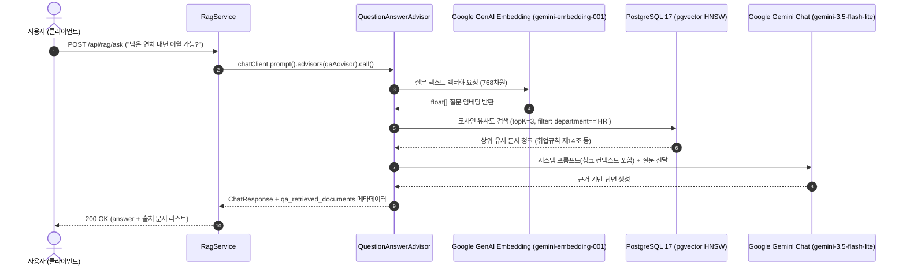

> 별도의 벡터 전용 데이터베이스(Pinecone, Milvus, Qdrant 등)를 새롭게 도입하면 추가 인프라 구축 비용, 네트워크 지연, 그리고 기존 사내 RDBMS 데이터와의 트랜잭션 동기화 문제가 발생합니다. **PostgreSQL**에 **`pgvector`** 확장을 활성화하면 익숙한 관계형 데이터베이스 엔진 안에서 고성능 벡터 유사도 검색과 비즈니스 메타데이터 조인을 단일 인프라로 해결할 수 있습니다. 본 글에서는 Google GenAI의 최신 임베딩 모델인 **`gemini-embedding-001`**과 PostgreSQL 17의 **`pgvector` HNSW 인덱스**를 Spring AI 2.0.1로 연동하고, **`QuestionAnswerAdvisor`**를 통해 질문과 관련된 사내 규정을 자동으로 프롬프트에 주입하는 엔드투엔드 RAG 질의응답 시스템을 구축해 봅니다.

---

## PGvector 기반 RAG 아키텍처와 흐름

Spring AI의 `QuestionAnswerAdvisor`는 질문 수신부터 임베딩 변환, 벡터 검색, 프롬프트 조립까지의 복잡한 RAG 파이프라인을 단일 Advisor로 캡슐화합니다:



---

## 프로젝트 환경 및 의존성 구성

본 실습 코드는 [spring-ai-examples (rag-pgvector)](https://github.com/cmsong111/spring-ai-examples/tree/master/rag-pgvector) 모듈을 기반으로 합니다.

### build.gradle.kts

`spring-ai-starter-vector-store-pgvector`와 Docker Compose 연동 스타터를 추가합니다:

```kotlin
plugins {
    kotlin("jvm") version "2.3.21"
    kotlin("plugin.spring") version "2.3.21"
    id("org.springframework.boot") version "4.1.1"
    id("io.spring.dependency-management") version "1.1.7"
}

dependencies {
    implementation("org.springframework.boot:spring-boot-starter-web")
    implementation("org.springframework.boot:spring-boot-starter-jdbc")
    implementation("org.springframework.ai:spring-ai-starter-model-google-genai")
    implementation("org.springframework.ai:spring-ai-starter-vector-store-pgvector")
    implementation("tools.jackson.module:jackson-module-kotlin")

    developmentOnly("org.springframework.boot:spring-boot-docker-compose")
    runtimeOnly("org.postgresql:postgresql")

    testImplementation("org.springframework.boot:spring-boot-starter-test")
    testImplementation("org.springframework.boot:spring-boot-testcontainers")
    testImplementation("org.testcontainers:postgresql")
}
```

### compose.yaml (로컬 개발용 pgvector 17 컨테이너)

```yaml
services:
  pgvector:
    image: pgvector/pgvector:pg17
    environment:
      POSTGRES_DB: rag
      POSTGRES_USER: rag
      POSTGRES_PASSWORD: rag
    ports:
      - "5432:5432"
```

---

## 실무 필수 함정과 application.yaml 튜닝

Spring AI 2.0.1 환경에서 Google GenAI 임베딩과 pgvector를 연동할 때 반드시 해결해야 하는 **두 가지 기술적 함정(Pitfalls)**이 있습니다:

### 1. 임베딩 API 키 설정 분리

> **⚠️ Spring AI 2.0.1 임베딩 프로퍼티 분리 문제**:
> 챗 모델은 `spring.ai.google.genai.api-key`를 바라보지만, 임베딩 자동 구성체는 **`spring.ai.google.genai.embedding.api-key`**를 개별 프로퍼티로 읽습니다. 챗 API 키만 설정하면 임베딩 빈 초기화 시 API 키 누락 에러가 발생하므로 반드시 명시해야 합니다.

### 2. gemini-embedding-001 차원 축소 (3072차원 ➔ 768차원)

> **⚠️ pgvector HNSW 인덱스 차원 한계**:
> `gemini-embedding-001`의 기본 출력 차원은 3072차원입니다. 하지만 PostgreSQL pgvector의 HNSW 인덱스는 최대 **2,000차원**까지만 지원합니다! 3072차원 그대로 테이블을 생성하면 `ERROR: column cannot be indexed with HNSW (maximum 2000 dimensions)`가 발생합니다.
> 다행히 Gemini 임베딩 모델은 MRL(Matryoshka Representation Learning)을 지원하므로, 모델과 벡터 스토어의 `dimensions`를 **768**로 명시하면 의미 손실 없이 HNSW 인덱싱이 가능해집니다.

### application.yaml

```yaml
server:
  port: 8094

spring:
  application:
    name: rag-pgvector
  datasource:
    url: jdbc:postgresql://localhost:5432/rag
    username: rag
    password: rag
  ai:
    google:
      genai:
        api-key: ${SPRING_AI_GOOGLE_GENAI_API_KEY}
        embedding:
          api-key: ${SPRING_AI_GOOGLE_GENAI_API_KEY} # 임베딩 전용 키 명시
          text:
            model: gemini-embedding-001
            dimensions: 768                           # 768차원으로 축소
    vectorstore:
      pgvector:
        initialize-schema: true                      # vector_store 테이블 자동 생성
        index-type: hnsw
        distance-type: cosine-distance
        dimensions: 768                              # 임베딩 차원과 반드시 일치
```


_그림 1. psql 콘솔에서 확인한 vector(768) 컬럼 및 vector_cosine_ops 기반 HNSW 인덱스 정의_

---

## QuestionAnswerAdvisor와 RAG 서비스 구현

질문이 들어오면 `QuestionAnswerAdvisor`가 유사도 상위 문서를 검색하여 한국어 프롬프트 템플릿에 주입하고, 모델 응답 메타데이터에서 원본 문서 출처를 추출합니다:

### service/RagService.kt

```kotlin
@Service
class RagService(
    private val vectorStore: VectorStore,
    private val chatClientBuilder: ChatClient.Builder
) {

    fun ask(question: String, filterExpression: String?): RagAnswerResponse {
        val searchRequestBuilder = SearchRequest.builder()
            .topK(3)
            .similarityThreshold(0.6)

        if (!filterExpression.isNullOrBlank()) {
            searchRequestBuilder.filterExpression(filterExpression)
        }

        val qaAdvisor = QuestionAnswerAdvisor.builder(vectorStore)
            .searchRequest(searchRequestBuilder.build())
            .userTextAdvise(
                """
                [참고 문서]
                {question_answer_context}

                [질문]
                {user_text}

                반드시 위 참고 문서의 내용에만 근거하여 한국어로 친절하게 답변하세요.
                문서에 나와 있지 않은 내용은 추측하지 말고 솔직하게 알 수 없다고 답하세요.
                """.trimIndent()
            )
            .build()

        val chatClient = chatClientBuilder.defaultAdvisors(qaAdvisor).build()
        val chatResponse = chatClient.prompt().user(question).call().chatResponse()

        val answer = chatResponse?.result?.output?.text ?: ""
        
        // Advisor가 프롬프트에 주입했던 원본 Document 목록 추출
        @Suppress("UNCHECKED_CAST")
        val retrievedDocs = chatResponse?.metadata?.get(QuestionAnswerAdvisor.RETRIEVED_DOCUMENTS) 
            as? List<Document> ?: emptyList()

        val sources = retrievedDocs.map { doc ->
            SourceDocument(
                id = doc.id,
                score = doc.score,
                text = doc.text ?: "",
                metadata = doc.metadata
            )
        }

        return RagAnswerResponse(answer, sources)
    }
}
```

---

## 실행 및 검증

### 단위 테스트 및 Testcontainers 통합 테스트 수행

Testcontainers pgvector 컨테이너 환경에서 스키마 자동 생성, HNSW 코사인 검색, 메타데이터 필터링, 그리고 실제 Gemini E2E RAG를 검증합니다:

```bash
./gradlew :rag-pgvector:test
```


_그림 2. PgVectorStoreContainerTests 및 Gemini RAG 질의응답 통합 테스트 통과 콘솔_

### RAG 질의응답 API 호출 및 출처 확인

사내 규정 문서를 적재한 후 연차 관련 질문을 전송합니다:

```bash
curl -s -X POST http://localhost:8094/api/rag/ask \
  -H "Content-Type: application/json" \
  -d '{"question": "남은 연차는 내년으로 이월할 수 있나요?", "filterExpression": "department == '\''HR'\''"}' | jq .
```


_그림 3. Gemini가 검색된 취업규칙 제14조를 근거로 작성한 답변과 출처 메타데이터 JSON_

```json
{
  "answer": "아니요, 사내 취업규칙 제14조에 따라 미사용 연차는 다음 해로 이월되지 않으며, 당해 연도 내에 모두 소진하셔야 합니다.",
  "sources": [
    {
      "id": "6f0c2a81-e2bc-4189-9132-7f289d0012ab",
      "score": 0.824,
      "text": "제14조 (연차 유급휴가의 소멸) 발생일로부터 1년간 행사하지 아니한 미사용 연차유급휴가는 소멸하며 익년도로 이월되지 아니한다.",
      "metadata": {
        "author": "김남주",
        "department": "HR",
        "file_name": "employee-handbook.pdf",
        "page_number": 3
      }
    }
  ]
}
```

---

## 정리

- PostgreSQL의 **`pgvector`** 확장은 기존 사내 RDBMS 인프라를 그대로 활용하여 고비용의 전용 벡터 DB 없이도 강력한 시맨틱 검색을 제공합니다.
- `gemini-embedding-001`의 기본 3072차원은 pgvector HNSW 인덱스의 최대 2000차원 제약을 초과하므로, **`dimensions: 768`로 축소 구성**해야 합니다.
- Spring AI 2.0.1의 **`QuestionAnswerAdvisor`**를 활용하면 질문 임베딩 ➔ 코사인 유사도 검색 ➔ 컨텍스트 프롬프트 합성 ➔ 출처 메타데이터 반환(`qa_retrieved_documents`) 과정을 깔끔하게 추상화할 수 있습니다.
- 다음 글에서는 대용량 규정집이나 코드베이스를 매 턴마다 반복 전송하지 않고 캐싱하여 비용과 지연 시간을 75% 이상 절감하는 **Gemini Context Caching(컨텍스트 캐싱) 아키텍처**를 다룹니다.
