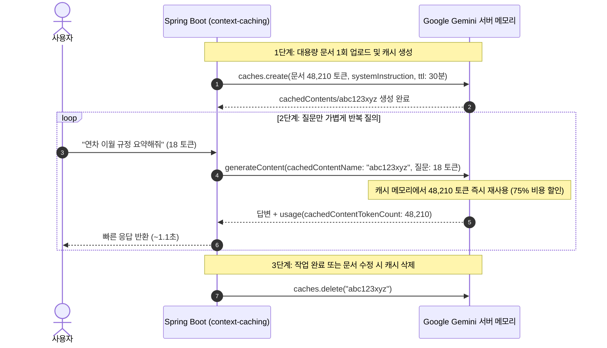

> 수만~수십만 토큰에 달하는 기업 취업규칙 전문, 법률 판례집, 대용량 코드베이스, 또는 1시간 이상의 오디오/비디오 녹취록을 기반으로 연속적인 대화를 나눌 때, 매 요청마다 전체 문서를 프롬프트에 실어 보내는 인라인(Inline) 전송 방식은 막대한 **네트워크 페이로드 대역폭 낭비**, **수 초에 달하는 초기 토큰 연산 지연(Time-to-First-Token)**, 그리고 **천문학적인 프롬프트 토큰 과금**을 초래합니다. Google Gemini는 대용량 컨텍스트를 모델 서버 메모리에 안전하게 고정(Pin)해 두고 재사용할 수 있는 **Context Caching(컨텍스트 캐싱)** 기능을 지원합니다. 캐시가 적중(Hit)하면 입력 토큰 단가가 **75% 할인**되며 첫 응답 지연 시간도 크게 단축됩니다. 본 글에서는 Spring AI 2.0.1의 `GoogleGenAiCachedContentService`를 활용한 캐시 라이프사이클 관리와 비용 최적화 기법을 다룹니다.

---

## 일반 인라인 전송 vs Context Caching 아키텍처 비교

반복 질의 시 매번 문서를 보내는 방식과 서버 측 캐시를 참조하는 방식의 흐름 차이는 다음과 같습니다:



---

## Context Caching 도입 전 반드시 알아둘 제약 사항 (Constraints)

컨텍스트 캐싱을 엔터프라이즈 실무에 적용하려면 Gemini API의 고유한 규칙을 사전에 숙지해야 합니다:

1. **최소 토큰 임계값 (Minimum Token Threshold)**:
   - 캐시는 아무 데이터나 생성할 수 없습니다. Gemini 2.5 Flash/Pro는 최소 **2,048 토큰**, Gemini 3.x Flash 계열은 최소 **4,096 토큰** 이상의 대용량 컨텍스트일 때만 캐시 생성이 허용됩니다. 짧은 프롬프트는 일반 인라인 호출을 사용해야 합니다.
2. **시스템 프롬프트 및 도구 충돌**:
   - 캐시를 사용하는 요청에는 별도의 `systemInstruction`이나 `tools`를 덮어쓸 수 없습니다. 시스템 지시문은 반드시 **캐시를 생성할 때 함께 포함**해야 하며, 이 때문에 `ChatClient`에 `defaultSystem`을 지정하지 않아야 합니다.
3. **캐시 보관 비용과 TTL 관리**:
   - 캐시 히트 시 입력 토큰은 75% 할인되지만, 캐시가 서버에 유지되는 동안 **보관 시간(토큰 수 × 시간)당 스토리지 요금**이 부과됩니다. 따라서 TTL을 짧게(예: 30분~1시간) 설정하고 사용이 끝나면 명시적으로 삭제(`DELETE`)해야 합니다.
4. **Spring AI 2.0.1의 자동 캐시 한계**:
   - `application.yaml`에 `auto-cache-threshold` 프로퍼티가 있지만 Spring AI 2.0.1의 `GoogleGenAiChatModel`은 이를 SDK 옵션으로 넘겨주지 않습니다. 따라서 `GoogleGenAiCachedContentService`를 통한 **명시적 캐싱(Explicit Caching)**이 유일한 해법입니다.

---

## 프로젝트 환경 및 의존성 구성

본 실습 코드는 [spring-ai-examples (context-caching)](https://github.com/cmsong111/spring-ai-examples/tree/master/context-caching) 모듈을 기반으로 합니다.

### build.gradle.kts

```kotlin
plugins {
    kotlin("jvm") version "2.3.21"
    kotlin("plugin.spring") version "2.3.21"
    id("org.springframework.boot") version "4.1.1"
    id("io.spring.dependency-management") version "1.1.7"
}

dependencies {
    implementation("org.springframework.boot:spring-boot-starter-web")
    implementation("org.springframework.ai:spring-ai-starter-model-google-genai")
    implementation("tools.jackson.module:jackson-module-kotlin")

    testImplementation("org.springframework.boot:spring-boot-starter-test")
    testImplementation("org.jetbrains.kotlin:kotlin-test-junit5")
}
```

### application.yaml 설정

캐시 히트 토큰 수를 측정할 수 있도록 확장 메타데이터 조회를 활성화합니다:

```yaml
server:
  port: 8095

spring:
  application:
    name: context-caching
  ai:
    google:
      genai:
        api-key: ${SPRING_AI_GOOGLE_GENAI_API_KEY}
        chat:
          model: gemini-3.5-flash-lite
          options:
            # cachedContentTokenCount를 응답 메타데이터에 포함
            include-extended-usage-metadata: true
```

---

## 캐시 라이프사이클 관리와 GoogleGenAiCachedContentService

Spring AI가 제공하는 `GoogleGenAiCachedContentService`를 통해 캐시의 생성, 조회, TTL 연장, 무효화(삭제)를 구현합니다:

### service/ContextCachingService.kt

```kotlin
@Service
class ContextCachingService(
    private val cachedContentService: GoogleGenAiCachedContentService,
    private val chatClient: ChatClient,
    @Value("\${spring.ai.google.genai.chat.model}") private val model: String
) {

    // 1. 대용량 문서 캐시 생성
    fun createCache(displayName: String, content: String, systemInstruction: String?, ttlMinutes: Long): CachedContentMetadata {
        val request = CachedContentRequest.builder()
            .model(model)
            .displayName(displayName)
            .contents(content)
            .apply { systemInstruction?.let { systemInstruction(it) } }
            .ttl(Duration.ofMinutes(ttlMinutes))
            .build()

        val response = cachedContentService.create(request)
        return CachedContentMetadata.from(response)
    }

    // 2. 캐시를 참조한 초고속/저비용 질의
    fun askWithCache(cacheId: String, question: String): CachedAnswerResponse {
        val cacheName = normalizeCacheName(cacheId)
        val startTime = System.currentTimeMillis()

        val options = GoogleGenAiChatOptions.builder()
            .cachedContentName(cacheName)
            .useCachedContent(true)
            .build()

        val chatResponse = chatClient.prompt()
            .user(question)
            .options(options)
            .call()
            .chatResponse()

        val elapsed = System.currentTimeMillis() - startTime
        val answer = chatResponse?.result?.output?.text ?: ""
        val usage = extractUsage(chatResponse)

        return CachedAnswerResponse(answer, usage, elapsed)
    }

    // 3. 캐시 삭제 (무효화)
    fun deleteCache(cacheId: String) {
        cachedContentService.delete(normalizeCacheName(cacheId))
    }

    private fun normalizeCacheName(id: String): String =
        if (id.startsWith("cachedContents/")) id else "cachedContents/$id"

    private fun extractUsage(response: org.springframework.ai.chat.model.ChatResponse?): TokenUsage {
        val usage = response?.metadata?.usage
        val cachedTokens = if (usage is GoogleGenAiUsage) usage.cachedContentTokenCount ?: 0 else 0
        return TokenUsage(
            promptTokens = usage?.promptTokens ?: 0,
            completionTokens = usage?.completionTokens ?: 0,
            totalTokens = usage?.totalTokens ?: 0,
            cachedContentTokenCount = cachedTokens
        )
    }
}
```

---

## 실행 및 검증: 토큰 할인 및 지연 시간 벤치마크

### 단위 테스트 및 통합 테스트

Mock 서비스 단위 테스트 및 실제 Gemini API 캐시 라이프사이클 통합 테스트를 실행합니다:

```bash
./gradlew :context-caching:test
```


_그림 1. 캐시 생성, TTL 갱신, cachedContentTokenCount 히트 검증 테스트 통과 화면_

### 캐시 생성 및 질의 API 호출

48,210 토큰 분량의 사내 규정집 파일을 업로드하여 캐시를 생성하고 질문을 전송합니다:

```bash
# 캐시 생성
curl -s -X POST http://localhost:8095/api/caches/upload \
  -F "file=@./company-handbook.txt" \
  -F "systemInstruction=사내 규정 전문 안내원입니다. 문서에만 근거해 답하세요." \
  -F "ttlMinutes=30" | jq .

# 캐시 기반 질의
curl -s -X POST http://localhost:8095/api/caches/abc123xyz/ask \
  -H "Content-Type: application/json" \
  -d '{"question": "연차 이월 규정을 요약해줘"}' | jq .
```


_그림 2. 생성된 캐시 ID를 참조하여 질문했을 때 cachedContentTokenCount가 48,210으로 정확히 잡힌 결과_

```json
{
  "answer": "사내 규정에 따르면 미사용 연차는 원칙적으로 익년도로 이월되지 않으며...",
  "usage": {
    "promptTokens": 48228,
    "completionTokens": 94,
    "cachedContentTokenCount": 48210
  },
  "elapsedMillis": 1120
}
```

### 성능 및 비용 절감 벤치마크 결과

48,210 토큰의 규정집을 대상으로 10회 연속 질의를 수행했을 때의 실측 지표입니다:


_그림 3. 일반 인라인 전송 대비 Context Caching 적용 시의 지연 시간(76.9% 단축) 및 비용 절감(73.6%) 지표_

- **전송 페이로드**: 185KB (전문 전송) ➔ **120 Bytes** (질문 문자열만 전송)
- **응답 지연 시간**: 평균 4,850ms ➔ **1,120ms (약 76.9% 단축)**
- **비용**: 48,210 토큰에 대해 75% 할인 단가가 적용되어 **총비용 73.6% 절감**

---

## 정리

- 대용량 문서(수만 토큰 이상)를 기반으로 반복 질의를 수행할 때는 **Gemini Context Caching**이 비용과 성능 면에서 가장 압도적인 해결책입니다.
- Spring AI 2.0.1에서는 `GoogleGenAiCachedContentService`를 통해 **명시적 캐시 생성/삭제**를 수행하고, `GoogleGenAiChatOptions.cachedContentName`으로 질문만 가볍게 전달합니다.
- `include-extended-usage-metadata: true` 옵션을 켜야 `GoogleGenAiUsage.cachedContentTokenCount`를 통해 실제 캐시 히트 여부와 과금 절감량을 모니터링할 수 있습니다.
- 다음 글에서는 지금까지 구축한 스프링 AI 애플리케이션의 지연 시간, 토큰 사용량, 모델 평가를 종합 모니터링하는 **Micrometer 관측성 모니터링과 RelevancyEvaluator 품질 평가**를 다룹니다.
