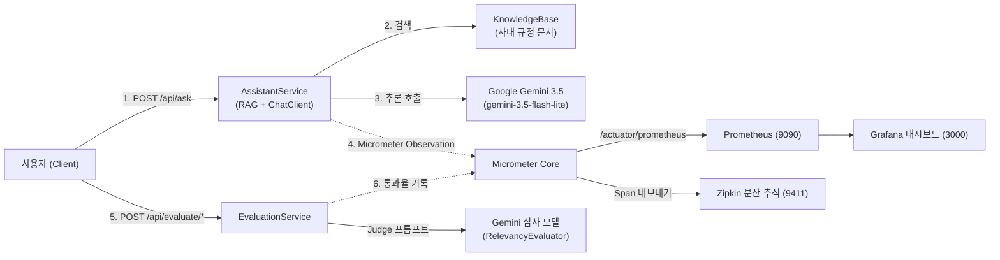

> 생성형 AI 서비스를 상용 프로덕션 환경에 서빙할 때 엔지니어링 조직이 매일 마주하는 가장 치명적인 두 가지 의문은 **"우리의 AI 인프라 비용(토큰)이 실시간으로 얼마나 나가고 있는가?"**와 **"배포된 모델의 답변 품질이 일관되며 환각(Hallucination) 없이 문맥을 준수하고 있는가?"**입니다. 일반적인 API 모니터링만으로는 LLM 특유의 프롬프트/완성 토큰 비율, 모델 추론 지연 시간, 그리고 답변의 사실 부합 여부를 검증하기 어렵습니다. Spring AI 2.0.1은 스프링 생태계의 표준 계측 프레임워크인 **Micrometer Observation**을 내장하여 토큰 사용량과 분산 추적(Tracing)을 자동 기록하며, **`RelevancyEvaluator`**와 **`FactCheckingEvaluator`**를 통해 답변 품질을 자동 채점하는 **LLM-as-a-Judge** 파이프라인을 지원합니다. 본 글에서는 이 둘을 결합한 프로덕션 관측성 및 품질 회귀 테스트 아키텍처를 구축해 봅니다.

---

## AI 관측성 및 품질 평가 통합 아키텍처

사용자 요청부터 메트릭 수집, 분산 추적, 그리고 비동기 품질 채점까지의 전체 데이터 파이프라인입니다:



---

## 프로젝트 환경 및 의존성 구성

본 실습 코드는 [spring-ai-examples (observability-evaluation)](https://github.com/cmsong111/spring-ai-examples/tree/master/observability-evaluation) 모듈을 기반으로 합니다.

### build.gradle.kts

Spring Boot Actuator, Prometheus 마이크로미터 레지스트리, 그리고 Brave 분산 추적 의존성을 추가합니다:

```kotlin
plugins {
    kotlin("jvm") version "2.3.21"
    kotlin("plugin.spring") version "2.3.21"
    id("org.springframework.boot") version "4.1.1"
    id("io.spring.dependency-management") version "1.1.7"
}

dependencies {
    implementation("org.springframework.boot:spring-boot-starter-web")
    implementation("org.springframework.boot:spring-boot-starter-actuator")
    implementation("org.springframework.ai:spring-ai-starter-model-google-genai")
    implementation("tools.jackson.module:jackson-module-kotlin")

    // 메트릭 및 분산 추적
    implementation("io.micrometer:micrometer-registry-prometheus")
    implementation("io.micrometer:micrometer-tracing-bridge-brave")
    implementation("io.zipkin.reporter2:zipkin-reporter-brave")

    developmentOnly("org.springframework.boot:spring-boot-docker-compose")

    testImplementation("org.springframework.boot:spring-boot-starter-test")
    testImplementation("org.jetbrains.kotlin:kotlin-test-junit5")
}
```

### application.yaml 설정

Spring AI의 관측성 계측을 활성화하고 프로메테우스 엔드포인트를 노출합니다:

```yaml
server:
  port: 8096

spring:
  application:
    name: observability-evaluation
  ai:
    google:
      genai:
        api-key: ${SPRING_AI_GOOGLE_GENAI_API_KEY:demo-key}
        chat:
          model: gemini-3.5-flash-lite
          options:
            include-extended-usage-metadata: true

management:
  endpoints:
    web:
      exposure:
        include: health, info, prometheus
  tracing:
    sampling:
      probability: 1.0 # 개발/검증 환경에서는 100% 샘플링
  zipkin:
    tracing:
      endpoint: http://localhost:9411/api/v2/spans
```

---

## Spring AI 자동 계측 메트릭과 Prometheus 수집

Spring AI는 `ChatModel`과 `ChatClient`가 동작할 때 다음과 같은 핵심 메트릭을 자동으로 기록합니다:

1. **`gen_ai.client.token.usage` (카운터)**:
   - 태그: `gen_ai.system="google_genai"`, `gen_ai.request.model="gemini-3.5-flash-lite"`, `gen_ai.token.type=|"input"|"output"|"total"`
   - 실시간 토큰 소모 속도와 과금 예상액을 계산하는 근거가 됩니다.
2. **`gen_ai.client.operation` (타이머)**:
   - 모델 네트워크 통신 및 추론에 소요된 순수 지연 시간을 측정합니다.
3. **`spring.ai.chat.client` (타이머)**:
   - Advisor 체인(메모리 검색, 도구 호출 등)을 포함한 백엔드 전체 처리 시간을 측정합니다.


_그림 1. /actuator/prometheus에서 확인한 Spring AI 자동 계측 토큰 사용량 및 작업 지연 시간 카운터_

### Grafana PromQL 대시보드 쿼리 가이드

- **분당 토큰 소비율 (Token Rate per Minute)**:
  ```promql
  sum by (gen_ai_token_type) (rate(gen_ai_client_token_usage_total[1m])) * 60
  ```
- **모델 추론 p95 지연 시간 (Latency)**:
  ```promql
  histogram_quantile(0.95, sum by (le) (rate(gen_ai_client_operation_seconds_bucket[5m])))
  ```

---

## LLM-as-a-Judge 품질 평가기: RelevancyEvaluator

문맥 기반 RAG 답변이 실제 검색된 사내 문서를 벗어나거나 엉뚱한 환각을 일으키는지 검증하기 위해 Spring AI의 **`RelevancyEvaluator`**와 **`FactCheckingEvaluator`**를 구성합니다:

### service/EvaluationService.kt

```kotlin
@Service
class EvaluationService(
    private val assistantService: AssistantService,
    private val chatClientBuilder: ChatClient.Builder,
    meterRegistry: MeterRegistry
) {

    // 1. Relevancy Evaluator (답변이 문맥에 부합하는가?)
    private val relevancyEvaluator = RelevancyEvaluator.builder()
        .chatClientBuilder(chatClientBuilder)
        .build()

    // 2. Fact Checking Evaluator (주장이 문서에 명시된 사실인가?)
    private val factCheckingEvaluator = FactCheckingEvaluator.builder()
        .chatClientBuilder(chatClientBuilder)
        .build()

    // 평가 통과율 메트릭
    private val passCounter = meterRegistry.counter("ai.evaluation.result", "evaluator", "relevancy", "pass", "true")
    private val failCounter = meterRegistry.counter("ai.evaluation.result", "evaluator", "relevancy", "pass", "false")

    fun evaluateRelevancy(question: String): EvaluationView {
        val (answer, docs) = assistantService.askWithContext(question)

        val request = EvaluationRequest(question, docs, answer)
        val response = relevancyEvaluator.evaluate(request)

        if (response.isPass) passCounter.increment() else failCounter.increment()

        return EvaluationView(
            evaluator = "relevancy",
            target = question,
            answer = answer,
            pass = response.isPass,
            score = response.score,
            sourceDocumentIds = docs.map { it.id }
        )
    }

    fun evaluateFactCheck(claim: String): FactCheckView {
        val docs = assistantService.allReferenceDocuments()
        val request = EvaluationRequest(claim, docs, "")
        val response = factCheckingEvaluator.evaluate(request)

        return FactCheckView(
            evaluator = "fact_check",
            claim = claim,
            pass = response.isPass,
            score = response.score
        )
    }
}
```


_그림 2. 정상 문맥 답변은 pass: true (1.0), 거짓 주장(교육비 500만 원)은 pass: false (0.0)로 자동 판정된 콘솔_

---

## CI/CD 품질 회귀 테스트 자동화 파이프라인

프롬프트 엔지니어링을 수정하거나 모델 버전을 올릴 때 이전 테스트 케이스들이 망가지지 않았는지 GitHub Actions를 통해 자동으로 검증할 수 있습니다:

### .github/workflows/ai-quality.yml

```yaml
name: AI Quality Regression

on:
  pull_request:
    paths:
      - 'observability-evaluation/**'
  workflow_dispatch:

jobs:
  evaluate:
    runs-on: ubuntu-latest
    steps:
      - uses: actions/checkout@v4
      - uses: actions/setup-java@v4
        with:
          distribution: temurin
          java-version: '25'
      - uses: gradle/actions/setup-gradle@v4

      - name: Run evaluation tests
        env:
          SPRING_AI_GOOGLE_GENAI_API_KEY: ${{ secrets.SPRING_AI_GOOGLE_GENAI_API_KEY }}
        run: ./gradlew :observability-evaluation:test --tests "*IntegrationTests"

      - name: Upload test report
        if: always()
        uses: actions/upload-artifact@v4
        with:
          name: evaluation-report
          path: observability-evaluation/build/reports/tests/test
```

---

## 실행 및 검증

### 단위 테스트 및 통합 테스트 수행

메트릭 기록 여부와 Relevancy/FactCheck 평가기의 통과/실패 판정을 검증합니다:

```bash
./gradlew :observability-evaluation:test
```


_그림 3. 토큰 카운터 계측, RelevancyEvaluator, FactCheckingEvaluator 단위/통합 테스트 통과 콘솔_

---

## 정리

- 프로덕션 생성형 AI 운영의 핵심은 **"비용(토큰) 계측"**과 **"품질(환각) 통제"**입니다.
- Spring AI 2.0.1의 **Micrometer Observation**을 활용하면 별도의 커스텀 AOP 없이도 `gen_ai.client.token.usage`와 작업 지연 시간이 Prometheus/Grafana로 자동 계측됩니다.
- **`RelevancyEvaluator`**와 **`FactCheckingEvaluator`**를 도입하면 사람이 일일이 검수하지 않아도 CI/CD 파이프라인 안에서 모델의 문맥 준수 여부와 사실 왜곡을 자동으로 채점하여 배포 안정성을 확보할 수 있습니다.
- 이것으로 Google Gemini와 Spring AI 2.0.1을 결합한 17편의 실전 엔지니어링 가이드 연재를 마칩니다.
