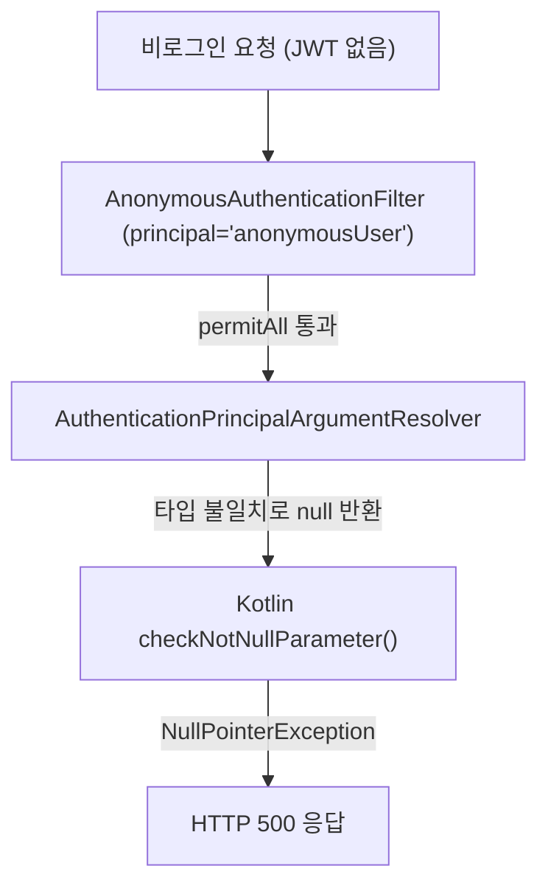

> Kotlin + Spring Boot 환경에서 `permitAll()` 기반 JWT 인증을 구성할 때, 비로그인 요청이 non-null `@AuthenticationPrincipal` 파라미터를 만나면 `401/403` 대신 `500 Internal Server Error`가 발생합니다. 이 글에서는 Spring Security 내장 리졸버와 Kotlin null-safety가 충돌하는 내부 원인을 분석하고, 대안 비교와 커스텀 `HandlerMethodArgumentResolver` 등록 방법까지 정리합니다.

> 기준 환경: **Spring Boot 3.4 / Spring Security 6.4 / Kotlin 2.x (WebMVC)**
{: .prompt-info }

## 문제 상황

JWT 기반 API 서버를 개발할 때, 초기 개발 편의를 위해 `SecurityFilterChain`에서 기본적으로 모든 요청을 `permitAll()`로 열어 두고 인증이 필요한 엔드포인트에서만 `@PreAuthorize`나 컨트롤러 파라미터를 통해 사용자 정보를 꺼내 쓰는 방식을 종종 사용합니다.

```kotlin
// config/SecurityConfig.kt
@Configuration
@EnableMethodSecurity
class SecurityConfig(
    private val jwtProvider: JwtProvider,
) {
    @Bean
    fun securityFilterChain(http: HttpSecurity): SecurityFilterChain {
        return http
            .csrf { it.disable() }
            .headers { it.disable() }
            .sessionManagement { it.sessionCreationPolicy(SessionCreationPolicy.STATELESS) }
            .authorizeHttpRequests { request ->
                request.anyRequest().permitAll()
            }
            .addFilterBefore(
                JwtTokenFilter(jwtProvider),
                BasicAuthenticationFilter::class.java,
            )
            .build()
    }
}
```

이 상태에서 토큰 없이 아래 알림 조회 API를 호출하면, 필터에서 `401 Unauthorized`나 `403 Forbidden`이 내려오기를 기대하지만 실제로는 컨트롤러 본문이 실행되기도 전에 **500 오류**가 반환됩니다.

```kotlin
// controller/NotificationController.kt
@RestController
@RequestMapping("/api/v1/notifications")
class NotificationController(
    private val notificationService: NotificationService,
) {
    @GetMapping
    fun getNotifications(
        @AuthenticationPrincipal authenticatedUser: AuthenticatedUser,
        pageable: Pageable,
    ): ResponseEntity<PagedModel<NotificationResponse>> {
        val page = notificationService.findAllByUserId(authenticatedUser.id, pageable)
        return ResponseEntity.ok(PagedModel(page))
    }
}
```

서버 로그를 확인해 보면 서비스 로직이 아니라 컨트롤러 메서드 진입 직전의 Kotlin null 체크에서 예외가 터진 것을 볼 수 있습니다.

```text
java.lang.NullPointerException: Parameter specified as non-null is null:
    method com.example.notification.NotificationController.getNotifications, parameter authenticatedUser
    at com.example.notification.NotificationController.getNotifications(NotificationController.kt)
    at java.base/jdk.internal.reflect.DirectMethodHandleAccessor.invoke(DirectMethodHandleAccessor.java:103)
```

Java였다면 컨트롤러 내부에서 `authenticatedUser.getId()`를 호출하는 시점에 NPE가 나겠지만, Kotlin은 컴파일 시점에 non-null 파라미터마다 `Intrinsics.checkNotNullParameter()` 바이트코드를 삽입하기 때문에 메서드 진입 순간 곧바로 `NullPointerException`(HTTP 500)이 발생합니다.

## 원인 분석: Spring Security 내장 리졸버의 null 반환

핵심 원인은 `SecurityFilterChain`을 통과한 비로그인 요청이 Spring MVC의 `HandlerMethodArgumentResolver` 단계에서 어떻게 처리되는지에 있습니다.



1. **익명 인증 객체 주입**: `Authorization` 헤더가 없어 `JwtTokenFilter`가 `SecurityContextHolder`에 인증 정보를 채우지 않으면, 뒤이어 실행되는 `AnonymousAuthenticationFilter`가 `principal` 값이 `"anonymousUser"`(`String`)인 `AnonymousAuthenticationToken`을 컨텍스트에 넣습니다.
2. **필터 인가 통과**: `anyRequest().permitAll()` 설정 때문에 `AuthorizationFilter`는 익명 사용자 요청을 차단하지 않고 그대로 `DispatcherServlet`으로 넘깁니다.
3. **내장 리졸버의 조용한 `null` 반환**: Spring Security가 자동 등록하는 `org.springframework.security.web.method.annotation.AuthenticationPrincipalArgumentResolver`는 `authentication.principal`을 꺼낸 뒤 파라미터 타입(`AuthenticatedUser`)과 대입 가능 여부를 검사합니다. `"anonymousUser"`(`String`)는 `AuthenticatedUser`에 대입할 수 없으므로, 별도 옵션이 없으면 예외를 던지지 않고 **`null`을 반환**합니다.
4. **Kotlin Non-Null 검증 실패**: `InvocableHandlerMethod`가 `null` 인자를 넘기며 컨트롤러를 호출하는 순간, Kotlin의 non-null 파라미터 검증이 `NullPointerException`을 발생시키고 최종 응답이 `500`으로 떨어집니다.

## 해결 방법 비교와 선택 기준

이 문제는 단순히 null을 막는 것보다 **인증 실패를 어느 계층에서 책임질 것인가**에 따라 선택지가 달라집니다.

| 방식 | 동작 원리 | 응답 코드 제어 | 적합한 상황 |
| :--- | :--- | :--- | :--- |
| **1. 인가 규칙 명시 (`authenticated()` / `@PreAuthorize`)** | 필터 또는 메서드 AOP에서 컨트롤러 진입 전 차단 | `AuthenticationEntryPoint`로 `401` 일관 응답 | **운영 서비스 표준** (보안 방어선 우선) |
| **2. Nullable 파라미터 (`AuthenticatedUser?`)** | `null`을 정상 값으로 허용해 분기 처리 | 엔드포인트 내부 정책에 따라 자유 처리 | 비로그인·로그인 모두 접근하는 공용 조회 API |
| **3. `@AuthenticationPrincipal(errorOnInvalidType = true)`** | 타입 불일치 시 `ClassCastException` 발생 | `@RestControllerAdvice`에서 `401` 변환 필요 | 익명 요청 타입 오류만 빠르게 구분할 때 (`principal == null` 자체는 미차단) |
| **4. 커스텀 `ArgumentResolver` + 전용 어노테이션** | 바인딩 시점에 인증 부재 시 도메인 예외(`UnauthorizedException`) 발생 | 전역 예외 핸들러에서 `401` 통일 응답 | `permitAll()` 기반 개발 또는 인증 필수 파라미터를 명시적으로 분리할 때 |

> **언제 커스텀 `ArgumentResolver`를 쓰지 말아야 하는가**
>
> 단순히 인증이 필요한 경로를 막는 것이 목적이라면 커스텀 리졸버보다 `SecurityFilterChain`의 URL 인가 규칙이나 `@PreAuthorize("isAuthenticated()")`를 쓰는 편이 정석입니다. 인증 검사를 Spring MVC 파라미터 바인딩 단계까지 미루면, 컨트롤러에 `@AuthenticationPrincipal` 파라미터를 선언하지 않은 인증 필수 API가 그대로 뚫리는 보안 구멍이 생기기 쉽습니다. 필터 체인 설계 자체를 분리하는 패턴은 [Spring Security 멀티 FilterChain 구성 글](/posts/spring-security-multi-filter-chain-jwt-session/)에서 다룬 화이트리스트 방식을 권장합니다.
{: .prompt-warning }

## 커스텀 ArgumentResolver 구현과 등록 시 주의점

비로그인 접근이 열려 있는 API 구조에서 파라미터 바인딩 시점에 명확하게 `401 Unauthorized`를 던지고 싶다면 `HandlerMethodArgumentResolver`를 구현할 수 있습니다. 다만 실무에서 **가장 자주 놓치는 함정**이 하나 있습니다.

### 주의: `@AuthenticationPrincipal`을 직접 가로채면 생기는 순서 충돌

`WebMvcConfigurer.addArgumentResolvers()`에 커스텀 리졸버를 등록할 때, Spring Security의 `WebMvcSecurityConfiguration` 역시 동일한 방식으로 내장 `AuthenticationPrincipalArgumentResolver`를 등록합니다. 따라서 커스텀 리졸버가 똑같이 `@AuthenticationPrincipal`을 대상으로 `supportsParameter()`를 구현하면, 설정 빈의 등록 순서에 따라 **Spring Security 내장 리졸버가 먼저 매칭되어 여전히 `null`을 반환**하는 문제가 생길 수 있습니다.

이 충돌을 원천 차단하려면 전용 커스텀 어노테이션(`@CurrentUser`)을 분리해 책임을 명확히 나누는 편이 훨씬 안전합니다.

```kotlin
// security/CurrentUser.kt
@Target(AnnotationTarget.VALUE_PARAMETER)
@Retention(AnnotationRetention.RUNTIME)
annotation class CurrentUser
```

```kotlin
// security/CurrentUserArgumentResolver.kt
@Component
class CurrentUserArgumentResolver : HandlerMethodArgumentResolver {
    override fun supportsParameter(parameter: MethodParameter): Boolean {
        return parameter.hasParameterAnnotation(CurrentUser::class.java) &&
            AuthenticatedUser::class.java.isAssignableFrom(parameter.parameterType)
    }

    override fun resolveArgument(
        parameter: MethodParameter,
        mavContainer: ModelAndViewContainer?,
        webRequest: NativeWebRequest,
        binderFactory: WebDataBinderFactory?,
    ): Any? {
        val auth = SecurityContextHolder.getContext().authentication
        val principal = auth?.principal as? AuthenticatedUser

        if (principal == null) {
            if (parameter.isOptional || isKotlinNullable(parameter)) {
                return null
            }
            throw UnauthorizedException("인증되지 않은 사용자입니다.")
        }
        return principal
    }

    private fun isKotlinNullable(parameter: MethodParameter): Boolean {
        val kParam = parameter.method?.kotlinFunction?.valueParameters
            ?.getOrNull(parameter.parameterIndex)
        return kParam?.type?.isMarkedNullable == true
    }
}
```

위 구현은 두 가지 장점을 함께 챙깁니다.
- `AuthenticatedUser`처럼 non-null 타입으로 선언하면 인증 정보가 없거나 `"anonymousUser"`일 때 즉시 `UnauthorizedException`을 던집니다.
- `AuthenticatedUser?`처럼 nullable 타입으로 선언하면 비로그인 요청에서도 예외 대신 `null`을 넘겨 공용 조회 API에서도 같은 어노테이션을 재사용할 수 있습니다.

### `WebMvcConfigurer` 등록과 `401` 예외 매핑

리졸버 클래스를 `@Component`로만 등록하면 Spring MVC 파이프라인에 자동 연결되지 않으므로 반드시 `WebMvcConfigurer.addArgumentResolvers()`에 등록해야 합니다.

```kotlin
// config/WebMvcConfig.kt
@Configuration
class WebMvcConfig(
    private val currentUserArgumentResolver: CurrentUserArgumentResolver,
) : WebMvcConfigurer {
    override fun addArgumentResolvers(resolvers: MutableList<HandlerMethodArgumentResolver>) {
        resolvers.add(currentUserArgumentResolver)
    }
}
```

이어서 `UnauthorizedException`을 `401 Unauthorized` 응답으로 변환하는 전역 예외 핸들러를 연결하고, 컨트롤러에서는 `@CurrentUser`를 사용합니다.

```kotlin
// exception/GlobalExceptionHandler.kt
class UnauthorizedException(message: String) : RuntimeException(message)

@RestControllerAdvice
class GlobalExceptionHandler {
    @ExceptionHandler(UnauthorizedException::class)
    fun handleUnauthorized(ex: UnauthorizedException): ResponseEntity<ProblemDetail> {
        val detail = ProblemDetail.forStatusAndDetail(HttpStatus.UNAUTHORIZED, ex.message ?: "Unauthorized")
        return ResponseEntity.status(HttpStatus.UNAUTHORIZED).body(detail)
    }
}
```

```kotlin
// controller/NotificationController.kt
@GetMapping
fun getNotifications(
    @CurrentUser authenticatedUser: AuthenticatedUser,
    pageable: Pageable,
): ResponseEntity<PagedModel<NotificationResponse>> {
    val page = notificationService.findAllByUserId(authenticatedUser.id, pageable)
    return ResponseEntity.ok(PagedModel(page))
}
```

## 결과 검증

로컬 서버에서 토큰 없이 요청했을 때 더 이상 `500 Internal Server Error`가 아닌 `401 Unauthorized`가 일관된 `ProblemDetail` JSON으로 반환되는지 `curl`로 확인합니다.

```bash
curl -i http://localhost:8080/api/v1/notifications
```

```http
HTTP/1.1 401 Unauthorized
Content-Type: application/problem+json

{
  "type": "about:blank",
  "title": "Unauthorized",
  "status": 401,
  "detail": "인증되지 않은 사용자입니다.",
  "instance": "/api/v1/notifications"
}
```

회귀 방지를 위해 `MockMvc` 테스트에서도 비로그인 요청과 인증 요청의 상태 코드를 함께 고정해 두면 안전합니다(Spring Security 테스트 컨텍스트 설정의 세부 구성은 [Spring Security MockMvc 테스트 가이드](/posts/spring-security-mockmvc-complete-guide/)를 참고할 수 있습니다).

```kotlin
// controller/NotificationControllerTest.kt
@Test
fun `토큰 없이 알림 조회 API를 호출하면 500이 아닌 401을 반환한다`() {
    mockMvc.get("/api/v1/notifications")
        .andExpect {
            status { isUnauthorized() }
            jsonPath("$.detail") { value("인증되지 않은 사용자입니다.") }
        }
}
```

## 운영 시 주의사항 및 정리

Kotlin의 강력한 null-safety는 의도치 않은 NPE를 컴파일 타임에 막아 주지만, Java 기반 프레임워크의 리졸버가 `null`을 반환하는 경계 지점에서는 오히려 `401`이 되어야 할 인증 실패를 `500` 장애로 둔갑시키기도 합니다. 실무 적용 전 아래 체크리스트를 함께 점검해 두면 같은 실수를 예방할 수 있습니다.

- **기본 거부(Default-Deny) 원칙 유지**: 프로덕션 `SecurityFilterChain`에서는 `anyRequest().permitAll()` 대신 공개 경로만 화이트리스트로 허용하고 `anyRequest().authenticated()`를 기본값으로 설정합니다.
- **내장 리졸버 충돌 회피**: 커스텀 인증 바인딩 로직이 필요하다면 `@AuthenticationPrincipal`을 덮어쓰려 하기보다 `@CurrentUser` 같은 전용 어노테이션으로 분리합니다.
- **Nullable 파라미터 분기 지원**: 비로그인·로그인 공용 API에서 `AuthenticatedUser?`를 쓸 수 있도록 리졸버에서 `isMarkedNullable`을 함께 검사합니다.
- **비로그인 회귀 테스트 고정**: 인증이 필요한 컨트롤러마다 토큰 없는 요청이 `500`이 아니라 `401`을 반환하는지 `MockMvc` 테스트를 1건 이상 유지합니다.
