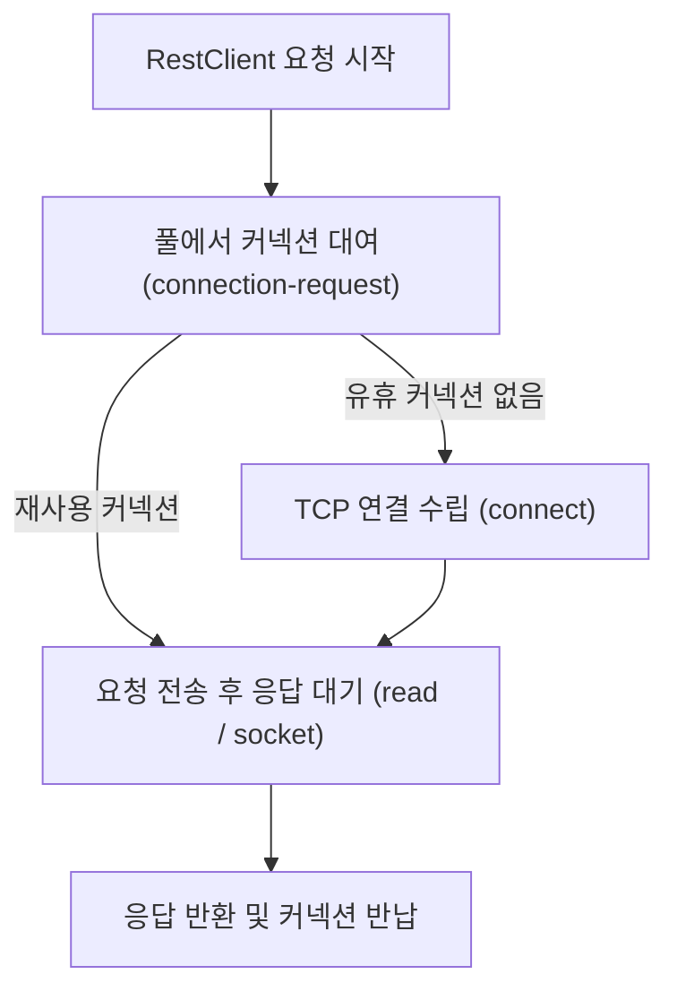

> 외부 API 한 곳이 느려졌을 뿐인데 동아리 서비스 전체가 응답하지 않는 장애를 겪었습니다. RestClient의 타임아웃이 어떤 계층으로 나뉘는지, 커넥션 풀이 고갈될 때 무엇을 봐야 하는지, Spring Boot 3.5에서 어떻게 설정하는지 정리합니다.

> 본 글은 **Spring Boot 3.5.3(Spring Framework 6.2), Java 21, Kotlin 2.1.21, Apache HttpClient 5(Boot BOM 관리 버전)** 환경을 기준으로 작성했습니다.
{: .prompt-info }

## 문제 상황

동아리 행사 신청 서비스는 신청이 들어오면 학교 공지 게시판 API에서 행사 정보를 조회합니다. 평소 응답은 100ms 안팎이었는데, 학기 초 어느 날 그 API가 수십 초씩 응답을 붙잡기 시작했습니다. 그 직후 행사 조회와 무관한 로그인·마이페이지 API까지 모두 멈췄습니다.

스레드 덤프를 떠 보니 Tomcat 워커 스레드 대부분이 소켓 읽기에서 대기 중이었고, 나머지는 커넥션 풀에서 커넥션을 빌리려고 줄을 서 있었습니다. 원인은 두 가지였습니다. 읽기 타임아웃을 지정하지 않았고, Apache HttpClient 5의 기본 풀 크기(라우트당 5개, 전체 25개)를 그대로 쓰고 있었습니다. 외부 API 하나의 지연이 서버 스레드 전체를 잠식한 것입니다.

## 타임아웃 세 계층과 동작 원리

HTTP 호출 한 번은 커넥션 획득, TCP 연결, 응답 대기의 세 구간을 지나고 구간마다 타임아웃이 따로 있습니다.



| 타임아웃 | 측정 구간 | 너무 길 때 증상 | 권장 출발점 |
| :--- | :--- | :--- | :--- |
| connection-request | 풀에서 커넥션을 빌릴 때까지 | 풀 고갈 시 요청 스레드가 줄줄이 대기 | 0.5~1초 |
| connect | TCP 3-way handshake 완료까지 | 상대 서버가 죽었을 때 SYN 재전송 동안 대기 | 1~2초 |
| read(socket) | 마지막 패킷 수신 후 다음 패킷까지 | 느린 API가 스레드를 무한히 점유 | API p99 × 2~3 |

한 단계 더 들어가면, Boot가 만든 `HttpComponentsClientHttpRequestFactory`는 connect 타임아웃을 팩토리의 `setConnectTimeout()`으로, read 타임아웃을 커넥션 매니저의 `SocketConfig.soTimeout`으로 적용합니다. 반면 connection-request 타임아웃은 Boot 설정 키가 없어 HttpClient 5의 `RequestConfig` 기본값인 **3분**이 그대로 남습니다. 풀이 고갈되면 요청 스레드가 최대 3분간 멈춰 있게 되는 셈입니다.

read 타임아웃은 "응답 전체 시간"이 아니라 **패킷 사이의 공백 시간**이라는 점도 중요합니다. 1초마다 1바이트씩 흘려보내는 서버라면 read 타임아웃 3초로는 끊기지 않습니다. 전체 시간 상한이 필요하다면 서킷 브레이커나 비동기 타임아웃 같은 상위 계층에서 따로 걸어야 합니다. 커넥션 재사용이 왜 중요한지는 [TCP 핸드셰이크와 커넥션 재사용](/posts/tcp-handshake-time-wait-connection-reuse/) 글에서 다뤘습니다.

## ClientHttpRequestFactory 구현체 선택 기준

Spring Boot 3.4부터 `ClientHttpRequestFactoryBuilder`가 클래스패스를 보고 구현체를 고르며, 우선순위는 Apache HttpClient 5 → Jetty → Reactor Netty → JDK HttpClient → `SimpleClientHttpRequestFactory` 순입니다. `spring.http.client.factory`로 명시할 수도 있습니다.

| 구현체 | 커넥션 풀 제어 | connection-request 타임아웃 | 적합한 상황 |
| :--- | :--- | :--- | :--- |
| Apache HttpClient 5 | 라우트별·전체 상한 세밀 제어 | 있음(기본 3분) | 외부 API 여러 곳을 동기 호출하는 MVC 서비스 |
| JDK HttpClient | 상한 설정 불가(내부 풀) | 없음 | 의존성 없이 가볍게 시작할 때 |
| Reactor Netty | `ConnectionProvider`로 제어 | `pendingAcquireTimeout` | 이미 WebFlux·WebClient를 함께 쓰는 프로젝트 |
| Simple(`HttpURLConnection`) | JVM keep-alive 캐시에 의존 | 없음 | 테스트나 일회성 스크립트 |

**언제 쓰지 말아야 하는가**도 분명합니다. JDK HttpClient는 동시 연결 수 상한을 걸 수 없어 상대 서버 보호가 필요한 연동에는 맞지 않습니다. Reactor Netty는 MVC 프로젝트에 Netty 이벤트 루프를 추가로 띄우는 비용이 있어, 동기 호출만 한다면 굳이 들일 이유가 없습니다. Simple 구현체는 타임아웃 기본값이 무한대라 운영 코드에서는 피하는 편이 안전합니다.

## Apache HttpClient 5 기반 설정 코드

```kotlin
// build.gradle.kts
dependencies {
    implementation("org.springframework.boot:spring-boot-starter-web")
    implementation("org.apache.httpcomponents.client5:httpclient5") // 버전은 Boot BOM이 관리
    implementation("com.fasterxml.jackson.module:jackson-module-kotlin")
}
```

```yaml
# src/main/resources/application.yml
spring:
  http:
    client:
      factory: http-components
      connect-timeout: 2s
      read-timeout: 3s
```

connect·read 타임아웃은 프로퍼티로 충분하지만, 풀 크기와 connection-request 타임아웃은 빌더 빈을 직접 등록해야 합니다. 이 빈을 등록하면 Boot의 기본 빌더 대신 사용되고, 위 프로퍼티는 그대로 함께 적용됩니다.

```kotlin
// src/main/kotlin/com/example/club/config/HttpClientConfig.kt
package com.example.club.config

import org.apache.hc.core5.util.TimeValue
import org.apache.hc.core5.util.Timeout
import org.springframework.boot.http.client.ClientHttpRequestFactoryBuilder
import org.springframework.boot.http.client.HttpComponentsClientHttpRequestFactoryBuilder
import org.springframework.context.annotation.Bean
import org.springframework.context.annotation.Configuration

@Configuration
class HttpClientConfig {

    @Bean
    fun clientHttpRequestFactoryBuilder(): HttpComponentsClientHttpRequestFactoryBuilder =
        ClientHttpRequestFactoryBuilder.httpComponents()
            .withConnectionManagerCustomizer { manager ->
                manager.setMaxConnTotal(50)
                manager.setMaxConnPerRoute(20)
            }
            .withDefaultRequestConfigCustomizer { request ->
                request.setConnectionRequestTimeout(Timeout.ofSeconds(1))
            }
            .withHttpClientCustomizer { client ->
                client.evictExpiredConnections()
                client.evictIdleConnections(TimeValue.ofSeconds(30))
            }
}
```

```kotlin
// src/main/kotlin/com/example/club/notice/NoticeApiClient.kt
package com.example.club.notice

import org.springframework.stereotype.Component
import org.springframework.web.client.RestClient
import org.springframework.web.client.body

data class NoticeResponse(val id: Long, val title: String)

@Component
class NoticeApiClient(builder: RestClient.Builder) {

    private val restClient = builder
        .baseUrl("https://notice.example.ac.kr")
        .build()

    fun fetchNotices(): List<NoticeResponse> =
        restClient.get()
            .uri("/api/notices?size=20")
            .retrieve()
            .body<List<NoticeResponse>>()
            .orEmpty()
}
```

`RestClient.create()`로 직접 만들면 Boot 설정이 전혀 적용되지 않습니다. 자동 구성된 `RestClient.Builder`를 주입받아야 위 타임아웃과 풀 설정이 반영됩니다.

## 느린 서버로 직접 재현하고 진단하기

운영 장애를 기다릴 필요 없이 `go-httpbin`의 `/delay` 엔드포인트로 느린 API를 만들 수 있습니다.

```bash
# 응답을 지연시키는 목 서버 실행 (/delay/{초})
docker run --rm -p 8081:8080 mccutchen/go-httpbin

# 단건 호출 구간별 시간 측정
curl -s -o /dev/null \
  -w "connect=%{time_connect}s ttfb=%{time_starttransfer}s total=%{time_total}s\n" \
  http://localhost:8081/delay/5

# connect 타임아웃 재현: 응답하지 않는 사설 IP로 연결 시도
curl -s -o /dev/null --connect-timeout 2 -w "%{time_total}s\n" http://10.255.255.1/

# 풀 고갈 재현: 내 API를 30개 동시 호출
seq 30 | xargs -P 30 -I{} curl -s -o /dev/null \
  -w "%{http_code} %{time_total}s\n" http://localhost:8080/api/events/1

# 대기 중인 스레드 확인
jcmd $(pgrep -f club-api) Thread.print | grep -c "PoolingHttpClientConnectionManager"
```

`baseUrl`을 `http://localhost:8081`로 바꾸고 `/delay/5`를 호출하도록 하면, 설정 전에는 30개 요청이 5초 단위 계단 모양으로 끝납니다. 라우트당 5개씩만 처리되고 나머지는 풀에서 줄을 서기 때문입니다. 설정 후에는 read 타임아웃 3초에 걸린 요청과 connection-request 1초에 걸린 요청이 빠르게 실패로 돌아옵니다. 덤프에서 `PoolingHttpClientConnectionManager`를 품은 스레드 수가 많다면 풀 고갈을, `NioSocketImpl.read`(Java 13 이후 소켓 구현)에서 멈춘 스레드가 많다면 read 타임아웃 부재를 먼저 의심하면 됩니다.

## 운영 함정 및 정리

> 풀 크기를 무작정 늘리는 것은 해결책이 아닙니다. 상대 서버가 느려진 상황에서 라우트당 커넥션을 200개로 늘리면 우리 서버 스레드는 덜 막히지만 상대 서버에 부하를 더 얹어 회복을 늦춥니다. 또한 read 타임아웃 뒤 재시도를 붙일 때는 POST처럼 멱등하지 않은 요청이 중복 실행될 수 있으니, 재시도 대상 메서드를 반드시 구분해야 합니다.
{: .prompt-warning }

타임아웃은 장애를 없애 주지 않습니다. 대신 장애의 폭발 반경을 "느린 API를 호출한 요청"으로 좁혀 줍니다. 이후에는 반복 실패 자체를 빨리 끊어 내는 서킷 브레이커를 얹을 차례입니다.

- [ ] `spring.http.client.connect-timeout`, `read-timeout`을 명시했는가?
- [ ] connection-request 타임아웃을 기본값 3분에서 1초 안팎으로 줄였는가?
- [ ] 라우트당 최대 커넥션을 동시 호출량과 상대 서버 허용량 사이에서 정했는가?
- [ ] `RestClient.create()` 대신 자동 구성된 `RestClient.Builder`를 쓰는가?
- [ ] 느린 목 서버로 동시 호출 테스트를 돌려 실패 시간이 예상 범위인지 확인했는가?
