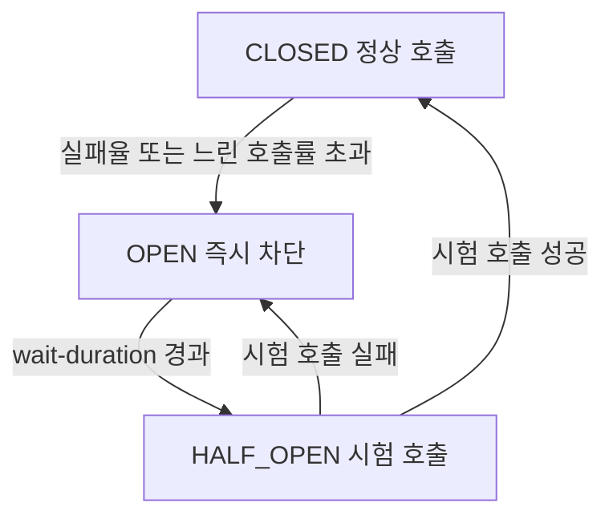

> 타임아웃만으로는 이미 망가진 외부 API를 계속 두드리는 낭비를 막지 못합니다. Resilience4j 서킷 브레이커로 반복 실패를 빠르게 차단하고, Bulkhead로 동시 호출 수를 제한해 장애를 격리한 과정을 정리합니다.

> 본 글은 **Spring Boot 3.5.3, Java 21, Kotlin 2.1.21, Resilience4j 2.3.0(`resilience4j-spring-boot3`)** 환경을 기준으로 작성했습니다.
{: .prompt-info }

## 배경

지난번 동아리 행사 신청 서비스에서 학교 공지 API 지연이 서버 전체를 멈춘 일을 겪은 뒤, [RestClient 타임아웃과 커넥션 풀 설정](/posts/restclient-timeout-connection-pool/)을 먼저 정비했습니다. 그런데 공지 API가 아예 내려간 날에는 여전히 문제가 남았습니다. 모든 요청이 read 타임아웃 3초를 꼬박 채우고 실패했고, 그동안 Tomcat 스레드는 묶여 있었습니다.

실패할 것이 뻔한 호출이라면 3초를 기다릴 이유가 없습니다. 최근 호출의 실패율이 높으면 아예 호출하지 않고 즉시 대체 응답을 돌려주는 장치가 서킷 브레이커입니다. 여기에 공지 API 호출이 동시에 몇 개까지 진행될 수 있는지 상한을 거는 장치가 Bulkhead입니다.

## 서킷 브레이커 상태 전이와 내부 동작



`CircuitBreakerStateMachine`은 현재 상태를 `AtomicReference`로 들고, 호출마다 `acquirePermission()`으로 통과 여부를 묻습니다. OPEN 상태라면 `CallNotPermittedException`을 던져 실제 HTTP 호출 자체를 건너뜁니다. 호출이 끝나면 결과를 슬라이딩 윈도우에 기록하고 임계치를 다시 계산합니다.

슬라이딩 윈도우는 두 가지입니다. `COUNT_BASED`는 최근 N건을 원형 배열(`FixedSizeSlidingWindowMetrics`)에 담아 가장 오래된 측정값을 빼고 새 값을 더하는 방식이라 O(1)로 집계합니다. `TIME_BASED`는 초 단위 버킷 N개(`SlidingTimeWindowMetrics`)에 부분 집계를 쌓습니다. 트래픽이 들쭉날쭉한 동아리 서비스는 한산한 시간에 오래된 표본이 남기 쉬워, 최근 20건 기준의 `COUNT_BASED`를 택했습니다.

느린 호출도 실패만큼 위험합니다. `slow-call-duration-threshold`보다 오래 걸린 호출은 성공이어도 느린 호출로 세고, 그 비율이 `slow-call-rate-threshold`를 넘으면 회로가 열립니다. 이 값은 read 타임아웃보다 짧게 잡아야 타임아웃으로 끊기기 전에 "느려지는 중"을 감지할 수 있습니다.

## Bulkhead 방식 비교와 선택 기준

| 구분 | Semaphore Bulkhead | ThreadPool Bulkhead |
| :--- | :--- | :--- |
| 동작 방식 | 호출 스레드에서 실행, 동시 진입 수만 제한 | 별도 스레드 풀에서 실행 |
| 반환 타입 | 제약 없음 | `CompletableFuture` 필요 |
| 기본값 | 동시 25개, 대기 0 | 코어 수 기반 풀, 큐 100 |
| 적합한 상황 | 동기 RestClient 호출 | 비동기 결과 조합, 전체 시간 상한이 필요할 때 |

동기 MVC 서비스라면 세마포어 방식으로 충분합니다. 스레드 풀 방식은 호출 스레드를 해방하는 대신 스레드 전환과 `CompletableFuture` 전환 비용을 치릅니다.

**언제 쓰지 말아야 하는가**도 정리해 둡니다. 호출량이 분당 몇 건 수준이면 `minimum-number-of-calls`를 채우지 못해 회로가 거의 열리지 않으니, 타임아웃과 재시도만으로 충분합니다. 결제처럼 대체 응답이 성립하지 않는 호출에 폴백으로 "성공한 척"을 하면 데이터가 어긋납니다. 내부 DB 호출에 서킷 브레이커를 거는 것도 대개 과잉입니다.

## 애스펙트 순서와 설정 코드

어노테이션 방식의 기본 적용 순서는 바깥부터 `Retry → CircuitBreaker → RateLimiter → TimeLimiter → Bulkhead → 메서드`입니다. 즉 Retry가 가장 바깥에서 서킷 브레이커를 감싸므로 재시도한 횟수가 각각 실패로 기록됩니다. 순서는 `resilience4j.retry.retry-aspect-order` 같은 속성으로 바꿀 수 있고 값이 클수록 우선순위가 높습니다. TimeLimiter 어노테이션은 `CompletableFuture`나 리액티브 타입에만 동작하므로 동기 호출의 상한은 read 타임아웃이 맡습니다.

```kotlin
// build.gradle.kts
dependencies {
    implementation("org.springframework.boot:spring-boot-starter-web")
    implementation("org.springframework.boot:spring-boot-starter-aop")
    implementation("org.springframework.boot:spring-boot-starter-actuator")
    implementation("io.github.resilience4j:resilience4j-spring-boot3:2.3.0")
    runtimeOnly("io.micrometer:micrometer-registry-prometheus")
}
```

```yaml
# src/main/resources/application.yml
resilience4j:
  circuitbreaker:
    instances:
      noticeApi:
        sliding-window-type: COUNT_BASED
        sliding-window-size: 20
        minimum-number-of-calls: 10
        failure-rate-threshold: 50
        slow-call-duration-threshold: 2s
        slow-call-rate-threshold: 60
        wait-duration-in-open-state: 30s
        permitted-number-of-calls-in-half-open-state: 3
        automatic-transition-from-open-to-half-open-enabled: true
        register-health-indicator: true
        record-exceptions:
          - org.springframework.web.client.ResourceAccessException
          - org.springframework.web.client.HttpServerErrorException
        ignore-exceptions:
          - io.github.resilience4j.bulkhead.BulkheadFullException
  bulkhead:
    instances:
      noticeApi:
        max-concurrent-calls: 10
        max-wait-duration: 0
  retry:
    instances:
      noticeApi:
        max-attempts: 2
        wait-duration: 300ms
        retry-exceptions:
          - org.springframework.web.client.ResourceAccessException

management:
  health:
    circuitbreakers:
      enabled: true
  endpoint:
    health:
      show-details: always
  endpoints:
    web:
      exposure:
        include: health,metrics,prometheus,circuitbreakers,circuitbreakerevents
```

```kotlin
// src/main/kotlin/com/example/club/notice/NoticeQueryService.kt
package com.example.club.notice

import io.github.resilience4j.bulkhead.annotation.Bulkhead
import io.github.resilience4j.circuitbreaker.annotation.CircuitBreaker
import io.github.resilience4j.retry.annotation.Retry
import org.slf4j.LoggerFactory
import org.springframework.stereotype.Service

@Service
class NoticeQueryService(
    private val noticeApiClient: NoticeApiClient,
    private val noticeCache: NoticeCache,
) {
    private val log = LoggerFactory.getLogger(javaClass)

    @Retry(name = "noticeApi", fallbackMethod = "fallback")
    @CircuitBreaker(name = "noticeApi")
    @Bulkhead(name = "noticeApi", type = Bulkhead.Type.SEMAPHORE)
    fun getNotices(): List<NoticeResponse> {
        val notices = noticeApiClient.fetchNotices()
        noticeCache.save(notices)
        return notices
    }

    // 원본과 같은 시그니처 + 예외 파라미터 1개, 같은 클래스에 위치해야 합니다
    fun fallback(e: Exception): List<NoticeResponse> {
        log.warn("공지 API 폴백 응답 사용: {}", e.javaClass.simpleName)
        return noticeCache.lastKnown()
    }
}
```

```kotlin
// src/main/kotlin/com/example/club/notice/NoticeCache.kt
package com.example.club.notice

import org.springframework.stereotype.Component
import java.util.concurrent.atomic.AtomicReference

@Component
class NoticeCache {
    private val latest = AtomicReference<List<NoticeResponse>>(emptyList())

    fun save(notices: List<NoticeResponse>) = latest.set(notices)

    fun lastKnown(): List<NoticeResponse> = latest.get()
}
```

폴백을 가장 바깥인 `@Retry`에 단 것이 핵심입니다. `@CircuitBreaker`에 폴백을 달면 예외가 그 안에서 삼켜져 바깥의 Retry가 재시도할 기회 자체가 사라집니다. 또 회로가 열렸을 때 나오는 `CallNotPermittedException`은 `retry-exceptions`에 없으므로 재시도 없이 곧바로 폴백으로 넘어갑니다.

## 동작 확인과 모니터링

```bash
# 서킷 브레이커 상태 (기본값: CLOSED=UP, OPEN=CIRCUIT_OPEN, HALF_OPEN=CIRCUIT_HALF_OPEN)
curl -s localhost:8080/actuator/health | jq '.components.circuitBreakers'

# 최근 상태 전이·실패 이벤트
curl -s localhost:8080/actuator/circuitbreakerevents/noticeApi | jq '.circuitBreakerEvents[-3:]'

# 상태와 Bulkhead 여유 슬롯 메트릭
curl -s "localhost:8080/actuator/metrics/resilience4j.circuitbreaker.state?tag=name:noticeApi&tag=state:open"
curl -s "localhost:8080/actuator/metrics/resilience4j.bulkhead.available.concurrent.calls?tag=name:noticeApi"
```

이전 글의 `go-httpbin` 목 서버를 내리고 `/api/notices`를 15번 호출하면, Retry가 요청마다 두 번씩 호출하므로 다섯 번째 요청 무렵 최소 호출 수 10건이 채워지고 회로가 OPEN으로 바뀌는 이벤트가 찍힙니다. 이후 요청은 외부 호출 없이 수 밀리초 안에 캐시된 공지를 돌려줍니다. 30초 뒤 목 서버를 다시 올리면 HALF_OPEN 시험 호출 3건이 성공하며 CLOSED로 돌아옵니다.

## 운영 함정 및 정리

> `record-exceptions`를 지정하면 목록에 없는 예외는 **성공으로 집계**됩니다. 그래서 `BulkheadFullException`처럼 우리 쪽 보호 장치가 던진 예외는 `ignore-exceptions`에 넣어 통계에서 아예 빼야 합니다. 또 `allow-health-indicator-to-fail: true`로 OPEN을 DOWN으로 보고하게 바꾼 채 쿠버네티스나 Docker 헬스체크를 걸면, 외부 API 장애 때문에 우리 서버가 재시작되는 연쇄 장애가 생길 수 있으니 readiness·liveness 판단에서는 분리하는 것이 안전합니다.
{: .prompt-warning }

- [ ] 슬라이딩 윈도우 크기와 `minimum-number-of-calls`가 실제 호출량에 비해 적절한가?
- [ ] `slow-call-duration-threshold`가 read 타임아웃보다 짧은가?
- [ ] 폴백을 가장 바깥 애스펙트에 두어 Retry가 정상 동작하는가?
- [ ] 4xx처럼 우리 요청이 잘못된 경우를 실패율에서 제외했는가?
- [ ] 상태 전이 메트릭에 알림을 걸어 회로가 열린 사실을 바로 알 수 있는가?
