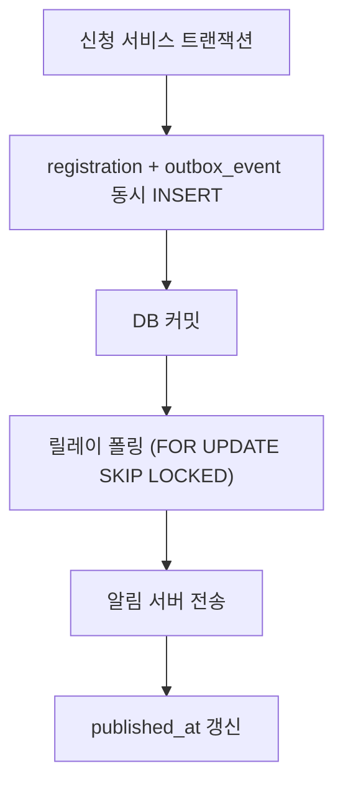

> DB에 데이터를 저장하고 외부로 이벤트를 보내는 두 동작은 하나의 트랜잭션으로 묶이지 않습니다. 행사 신청 알림이 가끔 사라지거나 두 번 가던 문제를 Transactional Outbox 패턴과 `SKIP LOCKED` 폴링 릴레이로 해결한 과정을 정리합니다.

> 본 글은 **Spring Boot 3.5.3, Java 21, Kotlin 2.1.21, PostgreSQL 17, Spring Data JPA(Hibernate 6.6)** 환경을 기준으로 작성했습니다.
{: .prompt-info }

## 배경

동아리 행사 신청 서비스는 신청이 확정되면 별도로 운영하는 알림 서버에 HTTP로 이벤트를 보내고, 알림 서버가 디스코드와 메일로 안내를 발송합니다. 처음에는 `@TransactionalEventListener(phase = AFTER_COMMIT)`로 커밋 직후 알림 서버를 호출했습니다. 도메인 이벤트 구조 자체는 [도메인 이벤트와 비동기 처리](/posts/ddd-domain-events-and-async-processing/) 글에서 정리한 방식 그대로였습니다.

그런데 운영하면서 두 종류의 사고가 났습니다. 배포로 애플리케이션이 재시작되는 순간 커밋은 끝났지만 알림 호출은 나가지 않아 신청자에게 안내가 누락되었습니다. 반대로 알림 서버가 응답은 늦게 줬지만 실제로는 처리한 경우, 타임아웃 후 재시도가 붙어 같은 알림이 두 번 갔습니다.

이것이 **이중 쓰기(dual write)** 문제입니다. DB 커밋과 외부 전송은 서로 다른 시스템이라 어느 한쪽만 성공하는 순간이 반드시 존재합니다. `AFTER_COMMIT` 리스너는 메모리에서만 실행되므로 JVM이 그 사이에 죽으면 이벤트는 흔적 없이 사라지고, 리스너 예외는 이미 끝난 트랜잭션에 영향을 주지 못해 실패를 되살릴 방법도 없습니다.

## Outbox 패턴의 동작 원리

해법은 외부 전송을 "DB에 기록하는 일"로 바꾸는 것입니다. 신청 저장과 같은 트랜잭션 안에서 `outbox_event` 테이블에 이벤트 행을 함께 INSERT합니다. 둘은 같은 DB 트랜잭션이므로 함께 커밋되거나 함께 롤백됩니다. 실제 전송은 별도 릴레이가 미전송 행을 읽어 처리합니다.



한 단계 더 들어가 보면, 릴레이가 여러 인스턴스에서 동시에 돌 때 같은 행을 중복으로 집지 않게 하는 장치가 PostgreSQL의 `FOR UPDATE SKIP LOCKED`입니다. 다른 트랜잭션이 이미 행 잠금을 쥔 행은 기다리지 않고 건너뛰어, 각 릴레이가 서로 겹치지 않는 묶음을 가져갑니다. 행 잠금과 MVCC의 관계는 [트랜잭션 격리 수준과 MVCC](/posts/transaction-isolation-level-mvcc/) 글에서 다뤘습니다.

이 구조가 보장하는 것은 **최소 한 번(at-least-once) 전달**입니다. 전송은 성공했는데 `published_at` 갱신 전에 죽으면 다음 폴링에서 같은 이벤트가 다시 나갑니다. 그래서 받는 쪽은 반드시 멱등해야 합니다.

## 구현 코드

```kotlin
// build.gradle.kts
dependencies {
    implementation("org.springframework.boot:spring-boot-starter-web")
    implementation("org.springframework.boot:spring-boot-starter-data-jpa")
    implementation("com.fasterxml.jackson.module:jackson-module-kotlin")
    runtimeOnly("org.postgresql:postgresql")
}
```

```sql
-- src/main/resources/db/outbox.sql
CREATE TABLE outbox_event (
    id             BIGSERIAL PRIMARY KEY,
    event_id       UUID        NOT NULL UNIQUE,
    aggregate_type VARCHAR(50) NOT NULL,
    aggregate_id   VARCHAR(50) NOT NULL,
    event_type     VARCHAR(100) NOT NULL,
    payload        JSONB       NOT NULL,
    created_at     TIMESTAMPTZ NOT NULL DEFAULT now(),
    published_at   TIMESTAMPTZ,
    attempts       INT         NOT NULL DEFAULT 0
);

-- 미전송 행만 담는 부분 인덱스로 폴링 비용을 일정하게 유지
CREATE INDEX idx_outbox_unpublished ON outbox_event (id) WHERE published_at IS NULL;
```

```yaml
# src/main/resources/application.yml
outbox:
  relay:
    fixed-delay: 2s
    batch-size: 50
```

```kotlin
// src/main/kotlin/com/example/club/outbox/OutboxWriter.kt
package com.example.club.outbox

import com.fasterxml.jackson.databind.ObjectMapper
import org.springframework.jdbc.core.simple.JdbcClient
import org.springframework.stereotype.Component
import org.springframework.transaction.annotation.Propagation
import org.springframework.transaction.annotation.Transactional
import java.util.UUID

@Component
class OutboxWriter(
    private val jdbcClient: JdbcClient,
    private val objectMapper: ObjectMapper,
) {
    // 호출자 트랜잭션이 없으면 예외: 비즈니스 저장과 반드시 함께 커밋되도록 강제
    @Transactional(propagation = Propagation.MANDATORY)
    fun append(aggregateType: String, aggregateId: String, eventType: String, payload: Any) {
        jdbcClient.sql(
            """
            INSERT INTO outbox_event (event_id, aggregate_type, aggregate_id, event_type, payload)
            VALUES (:eventId, :aggregateType, :aggregateId, :eventType, CAST(:payload AS jsonb))
            """.trimIndent()
        )
            .param("eventId", UUID.randomUUID())
            .param("aggregateType", aggregateType)
            .param("aggregateId", aggregateId)
            .param("eventType", eventType)
            .param("payload", objectMapper.writeValueAsString(payload))
            .update()
    }
}
```

```kotlin
// src/main/kotlin/com/example/club/registration/RegistrationService.kt
package com.example.club.registration

import com.example.club.outbox.OutboxWriter
import org.springframework.stereotype.Service
import org.springframework.transaction.annotation.Transactional

data class RegistrationConfirmed(val registrationId: Long, val eventId: Long, val memberId: Long)

@Service
class RegistrationService(
    private val registrationRepository: RegistrationRepository,
    private val outboxWriter: OutboxWriter,
) {
    @Transactional
    fun confirm(eventId: Long, memberId: Long): Long {
        val saved = registrationRepository.save(Registration(eventId = eventId, memberId = memberId))
        outboxWriter.append(
            aggregateType = "Registration",
            aggregateId = saved.id.toString(),
            eventType = "RegistrationConfirmed",
            payload = RegistrationConfirmed(saved.id!!, eventId, memberId),
        )
        return saved.id!!
    }
}
```

```kotlin
// src/main/kotlin/com/example/club/outbox/OutboxRelay.kt
package com.example.club.outbox

import org.slf4j.LoggerFactory
import org.springframework.beans.factory.annotation.Value
import org.springframework.jdbc.core.simple.JdbcClient
import org.springframework.scheduling.annotation.Scheduled
import org.springframework.stereotype.Component
import org.springframework.transaction.annotation.Transactional
import java.util.UUID

data class OutboxRow(val id: Long, val eventId: UUID, val eventType: String, val payload: String)

@Component
class OutboxRelay(
    private val jdbcClient: JdbcClient,
    private val notificationClient: NotificationClient,
    @Value("\${outbox.relay.batch-size}") private val batchSize: Int,
) {
    private val log = LoggerFactory.getLogger(javaClass)

    @Scheduled(fixedDelayString = "\${outbox.relay.fixed-delay}")
    @Transactional
    fun relay() {
        val rows = jdbcClient.sql(
            """
            SELECT id, event_id, event_type, payload::text AS payload
            FROM outbox_event
            WHERE published_at IS NULL AND attempts < 10
            ORDER BY id
            LIMIT :limit
            FOR UPDATE SKIP LOCKED
            """.trimIndent()
        )
            .param("limit", batchSize)
            .query(OutboxRow::class.java)
            .list()

        for (row in rows) {
            try {
                // Idempotency-Key 헤더로 event_id를 함께 보내 수신 측 중복 제거에 사용
                notificationClient.send(row.eventId, row.eventType, row.payload)
                jdbcClient.sql("UPDATE outbox_event SET published_at = now() WHERE id = :id")
                    .param("id", row.id).update()
            } catch (e: Exception) {
                log.warn("outbox 전송 실패 id={} type={}", row.id, row.eventType, e)
                jdbcClient.sql("UPDATE outbox_event SET attempts = attempts + 1 WHERE id = :id")
                    .param("id", row.id).update()
                break // 실패 이후 이벤트를 먼저 보내지 않도록 이번 배치는 중단
            }
        }
    }
}
```

스케줄러를 켜려면 설정 클래스에 `@EnableScheduling`을 붙입니다. 수신하는 알림 서버는 `processed_event(event_id UUID PRIMARY KEY)` 테이블에 `INSERT ... ON CONFLICT (event_id) DO NOTHING`을 먼저 실행하고, 영향받은 행이 0이면 이미 처리한 이벤트로 보고 건너뜁니다. 이 INSERT와 실제 발송 기록을 같은 트랜잭션에 묶어야 멱등성이 완성됩니다.

## 비교와 선택 기준

| 방식 | 유실 위험 | 운영 부담 | 적합한 규모 |
| :--- | :--- | :--- | :--- |
| `AFTER_COMMIT` + 직접 호출 | 재시작·장애 시 유실 | 매우 낮음 | 유실돼도 되는 캐시 무효화, 통계 |
| Outbox + 폴링 릴레이 | 매우 낮음 | 테이블·스케줄러 관리 | 단일 DB 기반 중소 규모 서비스 |
| Outbox + CDC(Debezium) | 매우 낮음 | Kafka Connect 운영 필요 | 이벤트량이 많고 브로커를 이미 운영할 때 |

CDC는 DB의 WAL을 읽어 `outbox_event` INSERT를 그대로 브로커로 흘려보내므로 폴링 지연과 DB 부하가 없습니다. Debezium은 Outbox Event Router 변환까지 제공합니다. 다만 논리 복제 슬롯, Kafka, Kafka Connect를 모두 운영해야 하므로 동아리 서비스 규모에서는 폴링 릴레이로 충분하다고 판단했습니다.

**언제 쓰지 말아야 하는가**도 분명합니다. 알림 하나쯤 빠져도 괜찮은 기능에 Outbox를 붙이면 테이블과 정리 배치만 늘어납니다. 이벤트를 받는 쪽이 멱등하게 만들 수 없는 외부 시스템이라면 Outbox만으로는 중복을 막지 못합니다. 실시간성이 수십 밀리초 단위로 중요한 흐름에도 폴링 주기만큼의 지연이 부담이 됩니다.

## 운영 함정 및 정리

> 위 릴레이는 HTTP 전송 동안 행 잠금과 DB 커넥션을 쥐고 있습니다. 알림 서버가 느려지면 트랜잭션이 길어지므로 전송 클라이언트에는 짧은 read 타임아웃을 반드시 걸어야 합니다. 또 인스턴스가 여러 대면 `SKIP LOCKED` 때문에 같은 신청에 대한 이벤트가 서로 다른 릴레이로 나뉘어 순서가 뒤집힐 수 있습니다. 순서가 중요하다면 릴레이를 한 인스턴스에서만 돌리거나, 수신 측에서 애그리거트별 버전을 비교해 오래된 이벤트를 버려야 합니다.
{: .prompt-warning }

전송이 끝난 행은 계속 쌓이므로 정리 배치가 필요합니다. 한 번에 지우면 긴 잠금과 WAL 폭증이 생기니 묶음 단위로 나눠 지웁니다.

```sql
-- 매일 새벽 실행: 7일 지난 전송 완료 행을 1,000건씩 삭제
DELETE FROM outbox_event
WHERE id IN (
    SELECT id FROM outbox_event
    WHERE published_at < now() - INTERVAL '7 days'
    ORDER BY id
    LIMIT 1000
);
```

- [ ] 비즈니스 저장과 Outbox INSERT가 같은 트랜잭션인지 `Propagation.MANDATORY` 등으로 강제했는가?
- [ ] 수신 측이 `event_id` 기준으로 멱등하게 처리하는가?
- [ ] 릴레이 전송 클라이언트에 짧은 타임아웃을 걸었는가?
- [ ] 순서 보장이 필요한 이벤트에 대해 단일 릴레이나 버전 비교를 적용했는가?
- [ ] `attempts` 한도를 넘긴 행을 알림으로 감지하고 정리 배치를 돌리는가?
