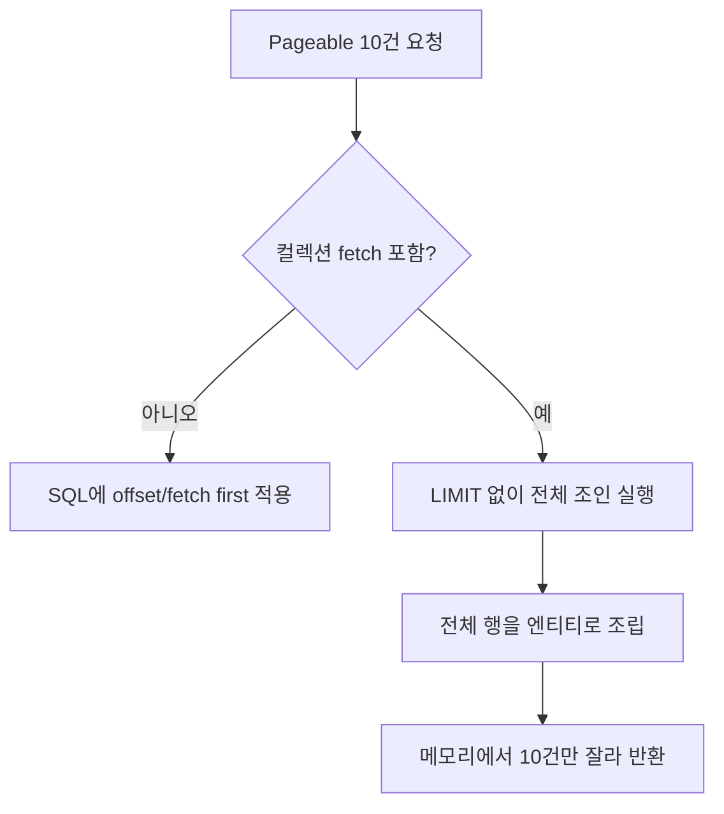

> 게시글과 댓글을 `join fetch`로 한 번에 가져오면서 `Pageable`을 붙였더니, 10건짜리 페이지를 만들기 위해 댓글 100만 행을 전부 읽고 있었습니다. Hibernate 6.4의 `HHH90003004` 경고가 실제로 무엇을 하는지 재현하고, 해결책별 쿼리 수·조회 행 수·메모리 할당량을 측정했습니다.

> 기준 환경: **Spring Boot 3.2.3, Hibernate ORM 6.4.4.Final, Kotlin 1.9.22, JDK 21, PostgreSQL 16.2**. 측정은 개인 PC(12코어, 32GB RAM, Windows + Docker Desktop/WSL2)에서 로컬로 재현했고, 시나리오마다 워밍업 3회 후 5회 측정한 중앙값입니다.
{: .prompt-info }

## 문제 상황

스터디에서 만들던 게시판 토이 프로젝트의 목록 API는 게시글 10개와 각 글의 댓글 수를 보여 줍니다. N+1을 피하려고 리포지토리에 컬렉션 fetch join을 쓰고 페이징을 붙였습니다.

```kotlin
// src/main/kotlin/lab/PostRepository.kt
@Query(
    value = "select p from Post p join fetch p.comments",
    countQuery = "select count(p) from Post p",
)
fun findPageWithComments(pageable: Pageable): Page<Post>
```

결과는 정상으로 보였지만 로그에 경고가 찍혔습니다.

```text
WARN --- [main] org.hibernate.orm.query : HHH90003004: firstResult/maxResults specified with collection fetch; applying in memory
```

`org.hibernate.SQL`을 DEBUG로 켜 보니 실제 SQL에는 `LIMIT`도 `OFFSET`도 없었습니다.

```sql
select p1_0.id,c1_0.post_id,c1_0.id,c1_0.content,p1_0.title
from post p1_0 join comment c1_0 on p1_0.id=c1_0.post_id
order by p1_0.id
```

## 원인 분석

컬렉션을 조인하면 결과 행은 게시글 단위가 아니라 **댓글 단위**로 늘어납니다. 게시글 10개를 원해 `LIMIT 10`을 붙이면 댓글 10행만 잘려 게시글 1개의 컬렉션이 일부만 채워진 엔티티가 만들어집니다. 그래서 Hibernate는 SQL 페이징을 포기하고, 전체 결과를 읽어 엔티티로 조립한 뒤 자바 리스트에서 `firstResult`~`maxResults` 구간만 잘라 돌려줍니다.

Hibernate 6.4에서는 `QuerySqmImpl`이 쿼리를 실행하기 전에 "제한(limit)이 있는가"와 "컬렉션 fetch가 있는가"를 함께 검사합니다. 컬렉션 fetch 여부에는 JPQL의 `join fetch`뿐 아니라 적용된 엔티티 그래프도 포함됩니다. 둘 다 참이면 경고를 남기고 limit 없이 실행하며, `hibernate.query.fail_on_pagination_over_collection_fetch=true`일 때는 경고 대신 예외를 던집니다.



`@EntityGraph(attributePaths = ["comments"])`로 바꿔도 같은 경고가 나왔습니다. 다른 점은 SQL이 `left join`으로 바뀐다는 것뿐이고, 조회 행 수와 할당량은 fetch join과 동일했습니다. 엔티티 그래프는 해결책이 아니라 같은 문제의 다른 표기입니다.

## 해결 방법

두 가지 대안을 비교했습니다.

1. **ID 선조회 2단계**: 게시글 ID만 SQL로 페이징한 뒤, 그 ID 10개로 `in` 절 fetch join을 실행합니다.
2. **배치 페치**: 부모만 페이징하고, 컬렉션은 지연 로딩하되 `default_batch_fetch_size`로 한 번에 묶어 가져옵니다.

```kotlin
// build.gradle.kts
plugins {
    id("org.springframework.boot") version "3.2.3"
    id("io.spring.dependency-management") version "1.1.4"
    kotlin("jvm") version "1.9.22"
    kotlin("plugin.spring") version "1.9.22"
    kotlin("plugin.jpa") version "1.9.22"
}

dependencies {
    implementation("org.springframework.boot:spring-boot-starter-data-jpa")
    implementation("org.jetbrains.kotlin:kotlin-reflect")
    runtimeOnly("org.postgresql:postgresql")
}
```

```yaml
# src/main/resources/application.yml
spring:
  jpa:
    open-in-view: false
    properties:
      hibernate:
        default_batch_fetch_size: 100
        # 개발·테스트 환경에서는 메모리 페이징을 예외로 막아 둡니다
        query.fail_on_pagination_over_collection_fetch: true
```

```kotlin
// src/main/kotlin/lab/PostRepository.kt
package lab

import org.springframework.data.domain.Page
import org.springframework.data.domain.Pageable
import org.springframework.data.jpa.repository.JpaRepository
import org.springframework.data.jpa.repository.Query

interface PostRepository : JpaRepository<Post, Long> {

    @Query(value = "select p.id from Post p", countQuery = "select count(p) from Post p")
    fun findIdPage(pageable: Pageable): Page<Long>

    @Query("select distinct p from Post p join fetch p.comments where p.id in :ids order by p.id")
    fun findAllWithCommentsByIdIn(ids: List<Long>): List<Post>

    @Query(value = "select p from Post p", countQuery = "select count(p) from Post p")
    fun findPagePlain(pageable: Pageable): Page<Post>
}
```

```kotlin
// src/main/kotlin/lab/PostQueryService.kt
package lab

import org.springframework.data.domain.PageImpl
import org.springframework.data.domain.PageRequest
import org.springframework.data.domain.Sort
import org.springframework.stereotype.Service
import org.springframework.transaction.annotation.Transactional

data class PostSummary(val id: Long, val title: String, val commentCount: Int)

@Service
@Transactional(readOnly = true)
class PostQueryService(private val postRepository: PostRepository) {

    private fun pageable(page: Int) = PageRequest.of(page, 10, Sort.by("id"))

    // ID 선조회 → in 절 fetch join
    fun idFirstPaging(page: Int): PageImpl<PostSummary> {
        val idPage = postRepository.findIdPage(pageable(page))
        val posts = postRepository.findAllWithCommentsByIdIn(idPage.content)
        return PageImpl(posts.map(::toSummary), idPage.pageable, idPage.totalElements)
    }

    // 부모만 페이징 → 컬렉션은 배치 페치
    fun batchFetchPaging(page: Int) =
        postRepository.findPagePlain(pageable(page)).map(::toSummary)

    private fun toSummary(p: Post) = PostSummary(p.id, p.title, p.comments.size)
}
```

배치 페치 쪽 SQL을 보면 PostgreSQL 방언에서는 `in (?, ?, ...)` 대신 배열 파라미터 하나를 쓰고 있었습니다. 페이지 크기가 달라져도 SQL 문자열이 바뀌지 않아 statement 캐시에 유리합니다.

```sql
select p1_0.id,p1_0.title from post p1_0 order by p1_0.id offset ? rows fetch first ? rows only
select c1_0.post_id,c1_0.id,c1_0.content from comment c1_0 where c1_0.post_id = any (?)
```

## 결과 확인

게시글 N건에 댓글을 10개씩(본문 100자) 넣고 첫 페이지 10건을 조회했습니다. 조회 행 수는 `pg_stat_statements`의 `rows` 합계, 할당량은 `ThreadMXBean`의 스레드 할당 바이트 차이로 쟀습니다. 조회 행 수에는 count 쿼리 결과 1행이 포함됩니다.

| 게시글 / 댓글 | 방식 | 쿼리 수 | DB 조회 행 | 중앙값 | 할당량 |
| :--- | :--- | ---: | ---: | ---: | ---: |
| 1천 / 1만 | fetch join + 페이징 | 2 | 10,001 | 39.4ms | 11.8MB |
| 10만 / 100만 | fetch join + 페이징 | 2 | 1,000,001 | 3,830.8ms | 1,174.6MB |
| 10만 / 100만 | @EntityGraph + 페이징 | 2 | 1,000,001 | 3,408.5ms | 1,174.6MB |
| 10만 / 100만 | ID 선조회 2단계 | 3 | 111 | 6.1ms | 0.2MB |
| 10만 / 100만 | 배치 페치(100) | 3 | 111 | 5.3ms | 0.1MB |

```json
{
  "type": "line",
  "data": {
    "labels": ["댓글 1만", "댓글 10만", "댓글 50만", "댓글 100만"],
    "datasets": [
      { "label": "fetch join + 페이징", "data": [39.4, 300.8, 1646.9, 3830.8], "borderColor": "#f7768e" },
      { "label": "@EntityGraph + 페이징", "data": [35.6, 298.3, 1618.2, 3408.5], "borderColor": "#e0af68" },
      { "label": "ID 선조회 2단계", "data": [4.3, 3.8, 5.3, 6.1], "borderColor": "#7aa2f7" },
      { "label": "배치 페치(100)", "data": [3.2, 3.1, 4.7, 5.3], "borderColor": "#9ece6a" }
    ]
  },
  "options": {
    "plugins": { "title": { "display": true, "text": "첫 페이지 10건 조회 중앙값 (ms, 로그 스케일)" } },
    "scales": { "y": { "type": "logarithmic", "title": { "display": true, "text": "ms" } } }
  }
}
```
{: .chart-js }

메모리 페이징은 응답 시간과 할당량이 데이터 크기에 정비례했고, 두 대안은 데이터가 100배 늘어도 조회 행 111건으로 고정됐습니다. 힙을 제한해 같은 조회를 다시 돌리면 차이가 더 분명합니다. 댓글 100만 건에서 `-Xmx512m`은 `java.lang.OutOfMemoryError: Java heap space`로 실패했고, `-Xmx1g`에서야 1.9초 만에 끝났습니다. 반면 두 대안은 `-Xmx256m`에서도 각각 12.3ms, 8.0ms로 응답했습니다. 실행 계획 쪽에서 왜 전체 조인이 느린지는 [PostgreSQL EXPLAIN ANALYZE로 실행 계획 읽는 방법](/posts/postgresql-explain-analyze-execution-plan/)에 정리한 순서대로 확인할 수 있습니다.

## 선택 기준과 정리

| 상황 | 권장 방식 | 이유 |
| :--- | :--- | :--- |
| 목록에서 컬렉션 전체가 필요 | 배치 페치 | 쿼리 3개 고정, 코드 변경 최소 |
| 컬렉션 조건으로 부모를 걸러야 함 | ID 선조회 후 fetch join | 필터는 ID 쿼리에서, 조립은 두 번째 쿼리에서 |
| 단건 상세 조회 | 컬렉션 fetch join | 페이징이 없으므로 경고 대상 아님 |
| 목록에 개수만 필요 | DTO 프로젝션 + `count` 서브쿼리 | 엔티티 조립 자체가 불필요 |

**컬렉션 fetch join을 쓰지 말아야 하는 경우**는 분명합니다. 페이징이 붙는 쿼리, 그리고 컬렉션을 두 개 이상 동시에 fetch하는 쿼리입니다. 후자는 `List` 두 개를 fetch하면 `MultipleBagFetchException`이 나고, `Set`으로 바꿔 예외를 피하면 카테시안 곱으로 행이 폭증합니다. 반대로 배치 페치도 만능은 아니라서, 컬렉션 일부만 조건으로 걸러 담아야 하는 화면이라면 차라리 DTO 조회가 낫습니다.

> 주의: `HHH90003004`는 WARN 한 줄이라 데이터가 적은 개발 환경에서는 응답이 빨라 놓치기 쉽습니다. 이번 재현에서도 댓글 1만 건일 때는 39ms라 문제가 없어 보였습니다. 운영 데이터가 쌓인 뒤 OOM으로 드러나므로, 개발·테스트 프로필에서 `fail_on_pagination_over_collection_fetch`를 켜 두고 CI에서 바로 실패시키는 편이 안전합니다.
{: .prompt-warning }

- [ ] 페이징 쿼리에 컬렉션 `join fetch`나 컬렉션 `@EntityGraph`가 붙어 있지 않은가?
- [ ] 로그에서 `HHH90003004` 경고를 검색해 보았는가?
- [ ] 테스트 프로필에 `hibernate.query.fail_on_pagination_over_collection_fetch=true`를 설정했는가?
- [ ] `default_batch_fetch_size` 또는 ID 선조회 방식으로 목록 쿼리 수가 고정되는지 확인했는가?
- [ ] `countQuery`를 별도로 지정해 count 쿼리에서 불필요한 조인을 제거했는가?
