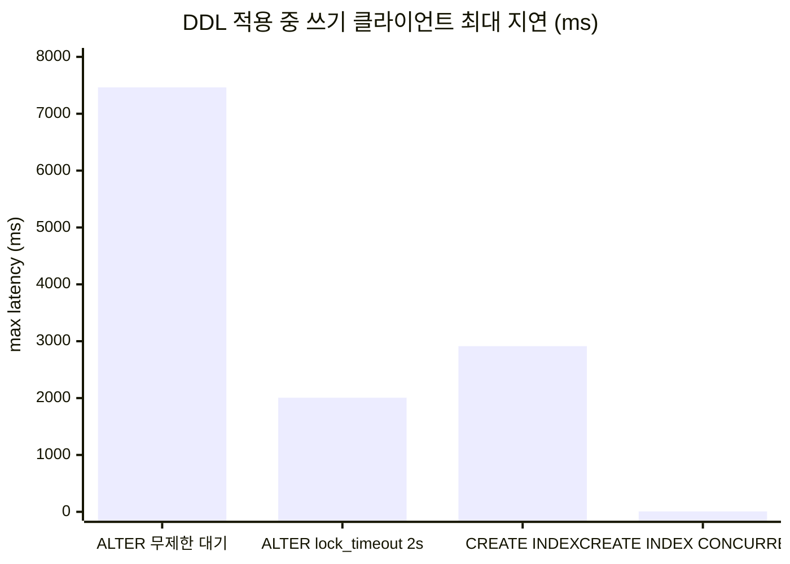
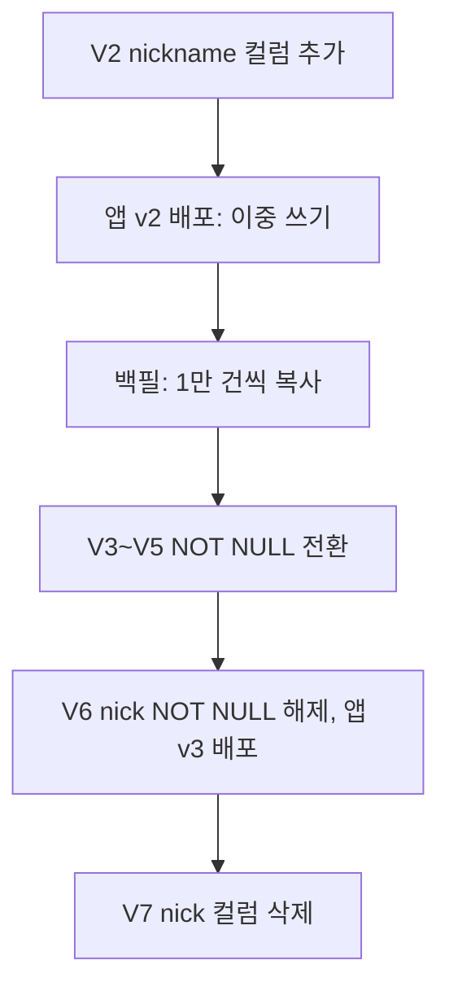

> 회사 서비스에서 `member.nick` 컬럼을 `nickname`으로 바꾸는 작업을 맡았습니다. 배포 중에는 구버전과 신버전 인스턴스가 함께 떠 있기 때문에, 단순 `RENAME COLUMN` 대신 Expand → 이중 쓰기 → 백필 → Contract 순서로 나눠 진행했습니다. 로컬에서 재현해 단계별 오류 수와 쓰기 지연을 측정한 결과를 정리합니다.

> 기준 환경: **Spring Boot 4.0.3, Flyway 11.14.1(Boot 4.0.3 BOM 관리 버전), Kotlin 2.2.21, JDK 21, PostgreSQL 18.1**. 개인 PC(12코어, 32GB RAM, Windows + Docker Desktop/WSL2)에서 구버전·신버전 앱을 흉내 내는 쓰기 클라이언트(버전당 2스레드, insert·update·select 반복)를 돌리며 측정했습니다.
{: .prompt-info }

## 문제 상황

가장 단순한 방법부터 확인했습니다. 구버전 앱이 `nick` 컬럼으로 쓰는 중에 아래 마이그레이션을 적용했습니다.

```sql
-- db/naive/V2__rename_nick_to_nickname.sql
alter table member rename column nick to nickname;
```

마이그레이션 자체는 70ms 만에 끝났습니다. 문제는 그다음 3초였습니다. 구버전 클라이언트의 작업 742건 중 724건이 실패했습니다.

```text
phase=before-rename            ops=  1116 errors=    0
phase=after-rename(v1 running) ops=    18 errors=  724
firstError=[V1_OLD_COLUMN] ERROR: column "nick" of relation "member" does not exist
```

롤링 배포에서는 신버전이 다 뜰 때까지 구버전이 트래픽을 받습니다. 스키마를 먼저 바꾸면 구버전이 깨지고, 앱을 먼저 바꾸면 신버전이 깨집니다. 어느 순서로 해도 한쪽은 실패하므로 **양쪽 버전이 모두 동작하는 중간 스키마**가 필요합니다.

## 원인 분석

이름 변경 외에 숨은 문제가 하나 더 있었습니다. `ALTER TABLE`은 대부분 `ACCESS EXCLUSIVE` 락을 잡습니다. 작업 자체는 메타데이터만 바꾸므로 수 밀리초면 끝나지만, **락을 얻기까지** 기다리는 동안 그 뒤에 들어온 모든 쿼리가 줄을 섭니다. 테이블을 읽는 트랜잭션 하나를 8초간 열어 둔 상태에서 컬럼 추가 마이그레이션을 돌려 봤습니다.

| 조건 | 마이그레이션 결과 | 클라이언트 최대 지연 |
| :--- | :--- | ---: |
| `lock_timeout` 없음 | 7,521ms 대기 후 성공 | 7,464.5ms |
| `set local lock_timeout = '2s'` | 2,057ms 후 실패, 재시도 61ms 성공 | 2,007.1ms |
| 기준(마이그레이션 없음) | - | 5.4ms |

`ADD COLUMN`처럼 가벼운 DDL도 앞선 긴 트랜잭션 하나 때문에 7초 넘게 쓰기를 막았습니다. `lock_timeout`을 걸면 Flyway가 `SQL State: 55P03`, `ERROR: canceling statement due to lock timeout`으로 실패하고, PostgreSQL은 DDL도 트랜잭션으로 롤백되므로 이력 테이블에 실패 기록이 남지 않아 그대로 재시도할 수 있었습니다. 누가 누구를 기다리는지는 [InnoDB 행 잠금과 넥스트 키 락 및 데드락 진단 방법](/posts/row-lock-gap-lock-deadlock-diagnosis/)에서 다룬 `pg_locks` 조회로 똑같이 확인할 수 있습니다.



인덱스도 같은 문제를 겪습니다. 200만 행 테이블에 일반 `CREATE INDEX`를 만들면 2,970ms 동안 쓰기가 막혀 그 구간 작업이 21건에 그쳤습니다. `CONCURRENTLY`로 바꾸자 비슷한 시간(2,949ms) 동안 1,000건을 처리했고 최대 지연은 7.7ms였습니다.

## 해결 방법

컬럼 이름 변경을 일곱 개의 마이그레이션과 세 번의 앱 배포로 나눴습니다.



```sql
-- db/expand/V2__expand_add_nickname.sql
set local lock_timeout = '3s';
alter table member add column nickname varchar(50);

-- db/expand/V3__nickname_check_not_valid.sql
set local lock_timeout = '3s';
alter table member add constraint member_nickname_not_null check (nickname is not null) not valid;

-- db/expand/V4__validate_nickname_check.sql
alter table member validate constraint member_nickname_not_null;

-- db/expand/V5__nickname_set_not_null.sql
set local lock_timeout = '3s';
alter table member alter column nickname set not null;
alter table member drop constraint member_nickname_not_null;

-- db/expand/V6__nick_drop_not_null.sql
set local lock_timeout = '3s';
alter table member alter column nick drop not null;

-- db/expand/V7__contract_drop_nick.sql
set local lock_timeout = '3s';
alter table member drop column nick;
```

`NOT NULL`을 바로 걸면 전체 테이블을 스캔하는 동안 `ACCESS EXCLUSIVE` 락을 쥡니다. 그래서 `NOT VALID` 체크 제약을 먼저 걸고, 쓰기를 막지 않는 `SHARE UPDATE EXCLUSIVE` 락으로 `VALIDATE`한 뒤 `SET NOT NULL`을 적용했습니다. PostgreSQL 12부터는 유효한 체크 제약이 있으면 `SET NOT NULL`이 스캔을 생략합니다. 실제로 V4 검증은 100만 행에 160ms, V5는 67ms에 끝났습니다. V6이 필요한 이유는 v3 앱이 `nick` 없이 insert하기 때문입니다. 이 단계를 빼면 구 컬럼의 `NOT NULL`이 신버전을 막습니다.

```kotlin
// build.gradle.kts
dependencies {
    implementation("org.springframework.boot:spring-boot-starter-jdbc")
    implementation("org.springframework.boot:spring-boot-starter-flyway")
    implementation("org.flywaydb:flyway-database-postgresql")
    runtimeOnly("org.postgresql:postgresql")
}
```

```yaml
# src/main/resources/application.yml
spring:
  flyway:
    postgresql:
      transactional-lock: false # CREATE INDEX CONCURRENTLY 사용 시 필수
```

```kotlin
// src/main/kotlin/lab/NicknameBackfill.kt
package lab

import org.springframework.jdbc.core.JdbcTemplate
import org.springframework.stereotype.Component

@Component
class NicknameBackfill(private val jdbc: JdbcTemplate) {

    fun run(batch: Long = 10_000) {
        val maxId = jdbc.queryForObject("select max(id) from member", Long::class.java) ?: return
        var from = 0L
        while (from < maxId) {
            // 배치마다 독립 커밋: 행 락을 오래 쥐지 않고, 실패해도 이어서 재실행 가능
            jdbc.update(
                "update member set nickname = nick where id > ? and id <= ? and nickname is distinct from nick",
                from, from + batch,
            )
            from += batch
            Thread.sleep(20) // 복제 지연과 autovacuum에 여유를 줌
        }
    }
}
```

## 결과 확인

100만 행에서 전체 흐름을 돌린 결과 모든 단계에서 오류가 0건이었습니다.

| 단계 | 처리 작업 | 오류 | p99 | 최대 지연 |
| :--- | ---: | ---: | ---: | ---: |
| v1만 동작 | 1,102 | 0 | 4.8ms | 8.9ms |
| v1+v2 공존(롤링 배포) | 2,045 | 0 | 6.2ms | 11.8ms |
| v2 + 백필 | 1,979 | 0 | 5.6ms | 30.6ms |
| v2 + 제약 전환(V3~V6) | 113 | 0 | 6.2ms | 11.4ms |
| v2+v3 공존 | 2,007 | 0 | 5.8ms | 10.3ms |
| v3 + Contract(V7) | 1,128 | 0 | 3.8ms | 8.6ms |

백필은 1만 건 배치로 1,000,127행을 5,699ms에 처리했고, 가장 느린 배치는 53ms였습니다. 백필 조건을 `nickname is null`이 아니라 `is distinct from nick`으로 둔 데는 이유가 있습니다. v1과 v2가 공존하는 동안 v2가 이중 쓰기한 행을 v1이 다시 수정하면 `nick`만 바뀌고 `nickname`은 옛 값으로 남습니다. 충돌이 잘 나도록 2,000행으로 줄여 다시 돌렸더니 이런 어긋난 행이 169건 나왔고, `is null` 조건이었다면 그대로 남았을 행들입니다.

## 선택 기준과 정리

| 변경 유형 | 권장 방식 |
| :--- | :--- |
| nullable 컬럼 추가, 인덱스 없는 테이블 추가 | 단일 마이그레이션 + `lock_timeout` |
| 컬럼 이름·타입 변경 | Expand-Contract (최소 2회 배포) |
| 대형 테이블 인덱스 | `CREATE INDEX CONCURRENTLY` 단독 파일 |
| 기존 컬럼 `NOT NULL` 추가 | `NOT VALID` 체크 → `VALIDATE` → `SET NOT NULL` |

**Expand-Contract를 쓰지 말아야 하는 경우**도 있습니다. 점검 시간을 공지할 수 있는 내부 시스템이나, 배포 시 인스턴스를 한 번에 교체하는 소규모 서비스라면 배포가 세 번으로 늘어나는 비용이 더 큽니다. 아직 아무도 읽지 않는 신규 컬럼처럼 구버전이 참조하지 않는 대상도 굳이 나눌 필요가 없습니다.

> 주의: Flyway 기본 설정(`postgresql.transactional.lock=true`)에서 `CREATE INDEX CONCURRENTLY`를 실행하자 마이그레이션이 끝나지 않았습니다. `pg_stat_activity`를 보니 Flyway의 락용 커넥션이 `idle in transaction` 상태로 advisory lock을 쥐고 있었고, CIC는 그 트랜잭션이 끝나기를 `virtualxid` 대기로 기다리고 있었습니다. 서로를 기다리므로 3분이 지나도 풀리지 않아 강제로 종료했습니다. `spring.flyway.postgresql.transactional-lock=false`로 바꾸자 정상 완료됐습니다. 또 CIC가 중간에 실패하면 `INVALID` 인덱스가 남으므로 재시도 전에 `pg_index.indisvalid`를 확인하고 지워야 합니다.
{: .prompt-warning }

- [ ] 모든 DDL 마이그레이션에 `set local lock_timeout`을 넣고 실패 시 재시도 절차를 정했는가?
- [ ] 구버전·신버전이 공존하는 동안 양쪽이 모두 동작하는 스키마인지 확인했는가?
- [ ] 백필 조건이 이중 쓰기 중 어긋난 행까지 잡도록 `is distinct from`으로 되어 있는가?
- [ ] 대형 테이블 인덱스는 `CONCURRENTLY` 단독 파일과 `transactional-lock: false`로 적용하는가?
- [ ] Contract 전에 구 컬럼을 읽거나 쓰는 인스턴스가 하나도 없는지 확인했는가?
