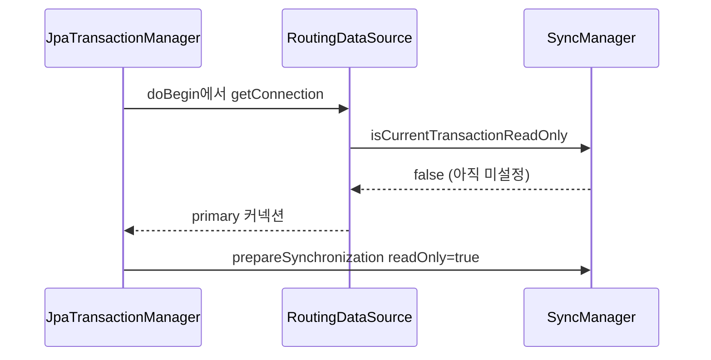
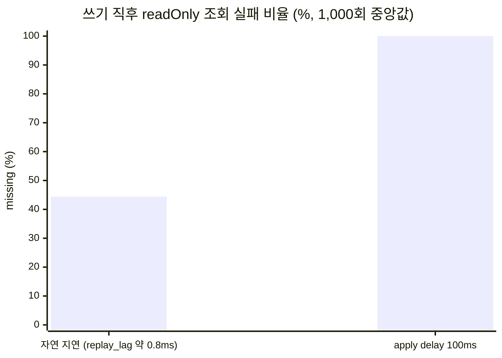

> 회사 서비스의 조회 트래픽을 읽기 복제본으로 나누려고 `@Transactional(readOnly = true)` 기반 라우팅을 붙였는데, 모니터링을 보니 복제본에 쿼리가 거의 가지 않았습니다. 라우팅이 왜 Primary로 새는지 로컬에서 재현하고, 고친 뒤에 생기는 복제 지연 문제와 readOnly가 Hibernate에서 실제로 바꾸는 것까지 측정했습니다.

> 기준 환경: **Spring Boot 4.0.3, Hibernate ORM 7.2.4.Final, Kotlin 2.2.21, JDK 21, PostgreSQL 18.1 Primary 1대 + 스트리밍 복제본 1대(`pg_basebackup -R`, 비동기)**. 개인 PC(12코어, 32GB RAM, Windows + Docker Desktop/WSL2)에서 Primary는 `172.19.0.2`, Replica는 `172.19.0.3` 컨테이너로 띄웠습니다.
{: .prompt-info }

## 문제 상황

흔히 보이는 라우팅 코드를 그대로 썼습니다. 현재 트랜잭션이 readOnly면 `replica` 키를 돌려주는 방식입니다.

```kotlin
// src/main/kotlin/lab/DataSourceConfig.kt
class ReplicationRoutingDataSource : AbstractRoutingDataSource() {
    override fun determineCurrentLookupKey(): Any {
        val readOnly = TransactionSynchronizationManager.isCurrentTransactionReadOnly()
        return if (readOnly) "replica" else "primary"
    }
}
```

어디에 붙었는지 확인하려고 트랜잭션 안에서 `select pg_is_in_recovery(), inet_server_addr()`를 실행했습니다. 복제본이라면 `pg_is_in_recovery()`가 `true`여야 합니다.

```text
readOnly tx  -> Where(txReadOnly=true,  inRecovery=false, serverAddr=172.19.0.2/32)
readWrite tx -> Where(txReadOnly=false, inRecovery=false, serverAddr=172.19.0.2/32)
```

트랜잭션 안에서는 분명 `readOnly=true`인데 연결된 곳은 Primary였습니다.

## 원인 분석

순서의 문제였습니다. `JpaTransactionManager.doBegin()`은 readOnly 트랜잭션을 시작할 때 `HibernateJpaDialect.beginTransaction()`에서 JDBC 커넥션을 꺼내 `setReadOnly(true)`를 적용합니다. 이 시점에 `determineCurrentLookupKey()`가 호출됩니다. 그런데 `TransactionSynchronizationManager`에 readOnly 플래그를 기록하는 `prepareSynchronization()`은 `doBegin()`이 끝난 **뒤에** 실행됩니다. 라우팅이 판단하는 순간에는 플래그가 아직 `false`입니다.



`LazyConnectionDataSourceProxy`로 감싸면 `getConnection()`은 실제 커넥션 대신 프록시를 돌려줍니다. `setReadOnly`, `setAutoCommit` 같은 호출은 기록만 해 두었다가, 첫 SQL을 실행할 때 진짜 커넥션을 얻고 기록한 설정을 적용합니다. 그때는 동기화 플래그가 이미 설정되어 있어 라우팅이 올바르게 동작합니다. Spring Framework 6.1.2부터는 `LazyConnectionDataSourceProxy#setReadOnlyDataSource`가 추가되어 라우팅 클래스 없이도 같은 효과를 낼 수 있습니다.

## 해결 방법

```kotlin
// build.gradle.kts
dependencies {
    implementation("org.springframework.boot:spring-boot-starter-data-jpa")
    implementation("org.jetbrains.kotlin:kotlin-reflect")
    runtimeOnly("org.postgresql:postgresql")
}
```

```yaml
# src/main/resources/application.yml
app:
  datasource:
    primary:
      jdbc-url: jdbc:postgresql://localhost:15444/lab
      username: lab
      password: ${DB_PASSWORD}
    replica:
      jdbc-url: jdbc:postgresql://localhost:15445/lab
      username: lab
      password: ${DB_PASSWORD}
```

```kotlin
// src/main/kotlin/lab/DataSourceConfig.kt
package lab

import com.zaxxer.hikari.HikariDataSource
import org.springframework.boot.context.properties.ConfigurationProperties
import org.springframework.context.annotation.Bean
import org.springframework.context.annotation.Configuration
import org.springframework.context.annotation.Primary
import org.springframework.jdbc.datasource.LazyConnectionDataSourceProxy
import javax.sql.DataSource

@Configuration
class DataSourceConfig {

    @Bean
    @ConfigurationProperties("app.datasource.primary")
    fun primaryDataSource() = HikariDataSource().apply { poolName = "primary" }

    @Bean
    @ConfigurationProperties("app.datasource.replica")
    fun replicaDataSource() = HikariDataSource().apply { poolName = "replica" }

    @Bean
    @Primary
    fun dataSource(primaryDataSource: DataSource, replicaDataSource: DataSource): DataSource {
        val routing = ReplicationRoutingDataSource().apply {
            setTargetDataSources(mapOf<Any, Any>("primary" to primaryDataSource, "replica" to replicaDataSource))
            setDefaultTargetDataSource(primaryDataSource)
            afterPropertiesSet()
        }
        // 실제 SQL 실행 시점까지 커넥션 획득을 미룹니다
        return LazyConnectionDataSourceProxy(routing)
        // Spring Framework 6.1.2+ 대안:
        // LazyConnectionDataSourceProxy(primaryDataSource).apply { setReadOnlyDataSource(replicaDataSource) }
    }
}
```

세 가지 구성을 같은 서비스 코드로 비교했습니다.

| 구성 | readOnly 트랜잭션 연결 대상 | readWrite 트랜잭션 연결 대상 |
| :--- | :--- | :--- |
| 라우팅만 사용 | Primary (`inRecovery=false`) | Primary |
| Lazy 프록시 + 라우팅 | Replica (`172.19.0.3`, `inRecovery=true`) | Primary (`172.19.0.2`) |
| Lazy 프록시 `setReadOnlyDataSource` | Replica (`172.19.0.3`, `inRecovery=true`) | Primary (`172.19.0.2`) |

## 결과 확인

라우팅을 고치자 새로운 문제가 보였습니다. 쓰기 트랜잭션으로 회원을 저장하고 커밋한 직후, readOnly 트랜잭션으로 같은 ID를 조회하는 흐름을 1,000번 반복했습니다. `pg_stat_replication`의 `replay_lag`는 0.8ms 수준이었는데도 세 번의 실행에서 각각 467건, 444건, 429건이 조회되지 않았습니다. 복제본에 `recovery_min_apply_delay = '100ms'`를 걸어 지연을 인위적으로 늘리자 1,000건 모두 조회되지 않았습니다.



readOnly가 Hibernate에서 바꾸는 것도 확인했습니다. 라우팅과 무관하게 세 구성 모두 같은 결과였습니다.

| 항목 | readOnly 트랜잭션 | readWrite 트랜잭션 |
| :--- | :--- | :--- |
| `session.hibernateFlushMode` | `MANUAL` | `AUTO` |
| `session.isDefaultReadOnly` / 엔티티 read-only | `true` / `true` | `false` / `false` |
| 엔티티 필드 변경 후 커밋 | UPDATE 0건, 값 유지 | UPDATE 1건, 값 변경 |
| 신규 엔티티 `save` | `cannot execute INSERT in a read-only transaction` | 정상 |

엔티티 10만 건 조회를 같은 Primary에서 비교하면 할당량은 readOnly 50.1MB, readWrite 55.1MB였습니다. read-only 엔티티는 dirty checking용 스냅샷을 만들지 않기 때문입니다. 반면 응답 시간 중앙값은 64.8ms와 64.3ms로 측정 오차 안이었습니다. readOnly의 실익은 속도보다 실수로 인한 쓰기 차단과 메모리 절감에 있었습니다.

## 선택 기준과 정리

| 상황 | 권장 방식 |
| :--- | :--- |
| 목록·통계처럼 수 초 지연을 허용하는 조회 | readOnly → Replica |
| 저장 직후 결과를 보여 주는 화면 | 쓰기와 같은 readWrite 트랜잭션에서 조회, 또는 Primary 강제 |
| 결제·재고처럼 최신 값이 필수인 조회 | 항상 Primary |
| 단일 DB 운영 | 라우팅 없이 readOnly만 사용 |

**라우팅을 쓰지 말아야 하는 경우**도 분명합니다. 복제본이 없거나 Primary 부하가 낮다면 복잡도만 늘어납니다. 사용자 흐름 대부분이 "쓰고 바로 읽기"라면, 이번 측정처럼 1ms 미만 지연에서도 절반 가까운 조회가 어긋나므로 이득보다 버그가 많아집니다. 커넥션 풀이 두 벌이 된다는 점도 고려해야 하는데, 풀 크기 산정 기준은 [HikariCP 커넥션 풀 크기 산정과 커넥션 대기 시간 분석](/posts/hikaricp-connection-pool-sizing/)에 정리해 두었습니다.

> 주의: 클래스 레벨에 `@Transactional(readOnly = true)`를 두고 메서드에 `@Transactional`을 덮어쓴 서비스가, 다시 내부에서 readOnly 메서드를 호출하면 전파 속성 `REQUIRED`에 따라 바깥 트랜잭션에 참여하므로 Replica로 가지 않습니다. 반대로 readOnly 트랜잭션 안에서 쓰기 메서드를 호출하면 이미 Replica 커넥션이 잡혀 있어 `cannot execute INSERT in a read-only transaction`으로 실패합니다. 라우팅은 가장 바깥 트랜잭션이 결정한다는 점을 기억해야 합니다.
{: .prompt-warning }

- [ ] 라우팅 데이터소스를 `LazyConnectionDataSourceProxy`로 감쌌는가?
- [ ] `pg_is_in_recovery()`나 `inet_server_addr()`로 실제 연결 대상을 테스트에서 검증하는가?
- [ ] 쓰기 직후 조회하는 화면을 찾아 Primary로 고정했는가?
- [ ] `pg_stat_replication.replay_lag`를 모니터링하고 허용 지연 기준을 정했는가?
- [ ] 바깥 트랜잭션의 readOnly 여부가 라우팅을 결정한다는 점을 팀 코드 리뷰 기준에 넣었는가?
