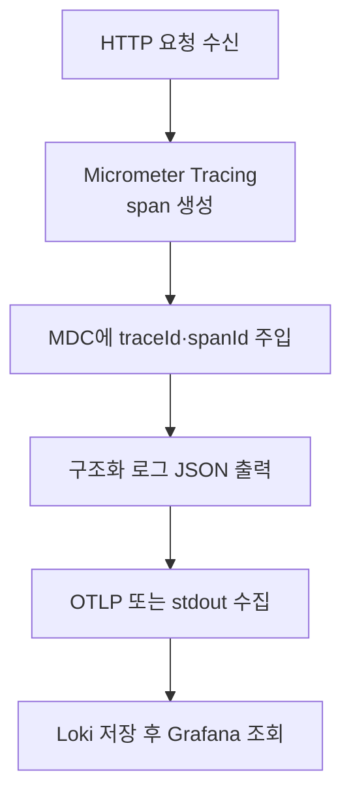

> 사람이 읽기 좋은 한 줄 로그를 기계가 검색하기 좋은 JSON 로그로 바꾸고, 모든 로그에 `traceId`·`spanId`를 실어 "이 에러 로그가 어떤 요청에서 나왔는가"를 한 번에 따라갈 수 있게 만드는 과정을 정리합니다.

> 기준 환경: Spring Boot 4.0.1, Kotlin 2.2, Java 21, Micrometer Tracing(OpenTelemetry 브리지), 홈랩 OpenTelemetry Collector(`otel.namju.kim`) + Loki 3.6 + Grafana
{: .prompt-info }

## 도입 배경

회사 서비스에서 장애 대응을 하다 보면 가장 시간이 오래 걸리는 일은 원인 분석이 아니라 "관련 로그를 모으는 일"입니다. 같은 요청이 API 서버, 내부 호출, 비동기 작업을 거치면서 남긴 로그가 시간순으로 뒤섞여 있으면, 결국 타임스탬프와 사용자 ID를 눈으로 대조하게 됩니다.

회사에서는 이미 OpenTelemetry 기반으로 트레이스와 로그를 묶어서 보고 있는데, 설정이 여러 팀의 공통 모듈에 흩어져 있어 한 번에 이해하기 어려웠습니다. 그래서 홈랩에서 처음부터 다시 재현해 보기로 했고, 그 첫 단계가 **로그를 구조화하고 트레이스 ID를 붙이는 일**입니다. 예전에 홈서버에 [Docker ELK 스택으로 컨테이너 로그를 모아 본 경험](/posts/docker-elk-centralized-log-management-kibana/)이 있지만, 그때는 로그 한 줄이 어떤 요청에 속하는지 알 방법이 없었습니다.



## 프로젝트 설정

Spring Boot 4.0부터는 Spring 팀이 직접 관리하는 `spring-boot-starter-opentelemetry`가 추가되었습니다. 이 스타터는 OpenTelemetry API, `micrometer-tracing-bridge-otel`, `micrometer-registry-otlp`를 함께 가져오므로, 트레이스가 켜지는 순간 MDC에 `traceId`와 `spanId`가 자동으로 채워집니다.

```kotlin
// build.gradle.kts
plugins {
    kotlin("jvm") version "2.2.21"
    kotlin("plugin.spring") version "2.2.21"
    id("org.springframework.boot") version "4.0.1"
    id("io.spring.dependency-management") version "1.1.7"
}

java {
    toolchain { languageVersion = JavaLanguageVersion.of(21) }
}

dependencies {
    implementation("org.springframework.boot:spring-boot-starter-webmvc")
    implementation("org.springframework.boot:spring-boot-starter-actuator")
    implementation("org.springframework.boot:spring-boot-starter-opentelemetry")
    // 로그를 OTLP로 내보낼 때만 필요 (Spring Boot가 appender를 설치하지 않음)
    implementation("io.opentelemetry.instrumentation:opentelemetry-logback-appender-1.0:2.23.0-alpha")
    implementation("org.jetbrains.kotlin:kotlin-reflect")
}
```

구조화 로깅은 Spring Boot 3.4부터 들어온 기능이고, 별도 의존성 없이 속성 하나로 켜집니다. 저는 콘솔은 사람이 보는 기본 패턴으로 두고, 파일과 수집 경로만 JSON으로 바꾸는 방식을 선호합니다.

```yaml
# src/main/resources/application.yml
spring:
  application:
    name: order-api
    version: 1.0.0

logging:
  structured:
    format:
      console: ecs          # 컨테이너 stdout 수집 시 ecs, 로컬 개발 시 주석 처리
    ecs:
      service:
        environment: homelab
  pattern:
    correlation: "[${spring.application.name:},%X{traceId:-},%X{spanId:-}] "
  include-application-name: false

management:
  tracing:
    sampling:
      probability: 1.0      # 홈랩 검증용. 운영에서는 낮춥니다
  opentelemetry:
    resource-attributes:
      deployment.environment: homelab
    logging:
      export:
        otlp:
          endpoint: https://otel.namju.kim/v1/logs
          headers:
            Authorization: "Bearer ${OTEL_AUTH_TOKEN}"
```

## 포맷 선택 기준

Spring Boot가 기본 제공하는 구조화 포맷은 세 가지입니다. 세 포맷 모두 MDC에 들어 있는 키-값을 JSON 필드로 그대로 추가하므로, `traceId`와 `spanId`는 어떤 포맷을 골라도 실립니다. 차이는 필드 이름 규약과 수집기 궁합입니다.

| 포맷 | 대표 필드 | 잘 맞는 수집 경로 | 선택 기준 |
| :--- | :--- | :--- | :--- |
| `ecs` | `@timestamp`, `log.level`, `service.name` | Filebeat·Elasticsearch, Loki | 기존 ELK가 있거나 서비스 메타데이터를 표준 필드로 두고 싶을 때 |
| `logstash` | `@timestamp`, `level`, `logger_name` | Logstash, Fluent Bit, Loki | 기존 Logstash 파이프라인·대시보드가 이 필드명에 맞춰져 있을 때 |
| `gelf` | `short_message`, `_level_name` | Graylog | Graylog를 쓰는 조직이 아니면 고를 이유가 적음 |
| OTLP appender | `trace_id`, `span_id`(로그 레코드 속성) | OTel Collector → Loki | 트레이스와 로그를 같은 파이프라인으로 보내고 싶을 때 |

저는 홈랩에 이미 ELK 실험 환경이 있고 Loki도 함께 쓰기 때문에 stdout은 `ecs`로 두고, 트레이스 연계가 필요한 경로는 OTLP appender를 병행합니다.

**언제 쓰지 말아야 하는가.** 로컬 개발 콘솔에서 JSON 로그는 오히려 독입니다. 사람이 읽어야 하는 환경에서는 기본 패턴 + `logging.pattern.correlation`만으로 충분합니다. 또한 로그 수집기가 없는 단일 서버라면 JSON으로 바꿔도 검색 이점이 없고 디스크만 더 씁니다. 그리고 stdout JSON과 OTLP 로그를 동시에 Loki로 보내면 같은 로그가 두 번 저장되므로, 수집 경로는 하나로 정해야 합니다.

## 동작 원리와 MDC 주입 시점

`traceId`가 로그에 찍히는 흐름을 한 단계 더 들어가 보면 다음과 같습니다.

1. `ServerHttpObservationFilter`가 요청을 받으면 `Observation`을 시작합니다.
2. `DefaultTracingObservationHandler`가 Observation 시작 시 OpenTelemetry span을 만들고 현재 스레드의 컨텍스트에 올립니다.
3. Micrometer Tracing의 `Slf4JEventListener` 계열 처리기가 span이 scope에 들어오는 이벤트를 받아 MDC에 `traceId`, `spanId`를 넣고, scope를 벗어날 때 제거합니다.
4. Logback 인코더(구조화 포맷터)는 로그 이벤트 생성 시점의 MDC 스냅샷을 JSON 필드로 씁니다.

즉 **MDC는 스레드 로컬**이고, span scope가 열린 스레드에서만 값이 존재합니다. 요청 단위 비즈니스 키는 MDC에 직접 넣기보다 SLF4J fluent API의 `addKeyValue`를 쓰는 편이 안전합니다. MDC는 `remove`를 잊으면 스레드 풀에서 다음 요청으로 값이 새어 나가기 때문입니다.

```kotlin
// src/main/kotlin/kim/namju/order/OrderService.kt
package kim.namju.order

import org.slf4j.LoggerFactory
import org.springframework.stereotype.Service

@Service
class OrderService {
    private val log = LoggerFactory.getLogger(javaClass)

    fun place(orderId: Long, userId: Long) {
        log.atInfo()
            .addKeyValue("orderId", orderId)
            .addKeyValue("userId", userId)
            .log("주문 접수")
    }
}
```

OTLP로 로그를 보내려면 appender를 직접 연결해야 합니다. Spring Boot는 `OpenTelemetry` 빈과 로그 exporter까지만 구성하고 Logback appender는 설치하지 않습니다.

```xml
<!-- src/main/resources/logback-spring.xml -->
<configuration>
    <include resource="org/springframework/boot/logging/logback/base.xml"/>
    <appender name="OTEL" class="io.opentelemetry.instrumentation.logback.appender.v1_0.OpenTelemetryAppender"/>
    <root level="INFO">
        <appender-ref ref="CONSOLE"/>
        <appender-ref ref="OTEL"/>
    </root>
</configuration>
```

```kotlin
// src/main/kotlin/kim/namju/order/config/OtelLogAppenderInstaller.kt
package kim.namju.order.config

import io.opentelemetry.api.OpenTelemetry
import io.opentelemetry.instrumentation.logback.appender.v1_0.OpenTelemetryAppender
import org.springframework.beans.factory.InitializingBean
import org.springframework.stereotype.Component

@Component
class OtelLogAppenderInstaller(
    private val openTelemetry: OpenTelemetry,
) : InitializingBean {
    override fun afterPropertiesSet() {
        OpenTelemetryAppender.install(openTelemetry)
    }
}
```

## 실행 결과

요청 한 건을 보내고 stdout을 확인하면 ECS 필드와 함께 MDC 값이 JSON에 실린 것을 볼 수 있습니다.

```bash
curl -s -X POST http://localhost:8080/orders -H 'Content-Type: application/json' -d '{"userId":7}'
docker logs order-api --tail 1 | jq '{msg: .message, traceId, spanId, orderId}'
```

```json
{
  "msg": "주문 접수",
  "traceId": "4bf92f3577b34da6a3ce929d0e0e4736",
  "spanId": "00f067aa0ba902b7",
  "orderId": 1042
}
```

OTLP 경로로 들어간 로그는 Loki에서 `trace_id`, `span_id`가 structured metadata로 저장됩니다. Grafana Explore에서 `{service_name="order-api"} | trace_id="4bf92f3577b34da6a3ce929d0e0e4736"`처럼 조회하면 한 요청의 로그만 깔끔하게 모입니다.

> 스타터의 기본 샘플링 확률은 `0.1`입니다. 샘플링되지 않은 요청도 MDC에는 `traceId`가 찍히지만 Tempo에는 해당 트레이스가 없습니다. "로그에 traceId는 있는데 트레이스가 안 보인다"는 대부분 이 경우이므로, 홈랩 검증 단계에서는 `1.0`으로 두고 확인하는 편이 덜 헷갈립니다.
{: .prompt-warning }

> `@Async`나 직접 만든 `ExecutorService`로 넘어간 작업은 새 스레드에서 실행되므로 MDC가 비어 있습니다. 비동기 경계에서 traceId가 사라지면 로깅 설정이 아니라 컨텍스트 전파 문제입니다.
{: .prompt-warning }

## 정리

구조화 로깅은 설정 한 줄이지만, 로그를 트레이스와 연결하려면 "어느 스레드에서 MDC가 채워지는가"를 이해해야 합니다. 적용 전에 아래 항목을 점검합니다.

- [ ] 수집 경로(stdout JSON 또는 OTLP appender)를 하나로 정했는가
- [ ] 포맷을 기존 수집기 필드 규약(ECS, Logstash)에 맞췄는가
- [ ] 비즈니스 키는 MDC 대신 `addKeyValue`로 남기는가
- [ ] 로컬 개발 콘솔은 사람이 읽는 패턴으로 유지했는가
- [ ] 샘플링 비율과 "traceId는 있으나 트레이스가 없는" 상황을 팀이 이해하고 있는가
