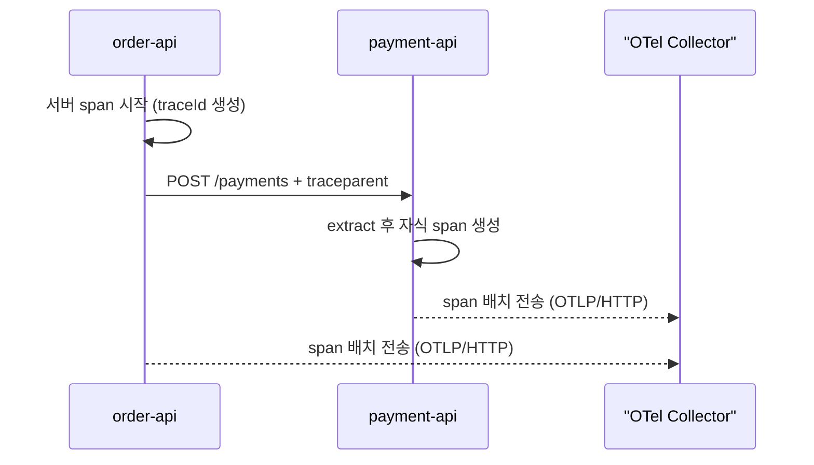

> 서비스 두 개 사이를 오가는 요청을 하나의 트레이스로 묶기 위해 Spring Boot 4 네이티브 방식과 OpenTelemetry Java Agent 중 무엇을 고를지, 그리고 `traceparent` 헤더가 어디서 끊기는지 정리합니다.

> 기준 환경: Spring Boot 4.0.1(`spring-boot-starter-opentelemetry`), Kotlin 2.2, Java 21, OpenTelemetry Java Agent 2.24.0, 홈랩 OTel Collector(`https://otel.namju.kim`, OTLP/HTTP) + Tempo
{: .prompt-info }

## 배경

회사 서비스에서는 OpenTelemetry Java Agent를 컨테이너 이미지에 넣어 쓰고 있습니다. 코드 한 줄 없이 트레이스가 나오는 것은 편하지만, 어떤 span이 왜 생기는지, 어디서 컨텍스트가 끊기는지를 설명하기 어려운 순간이 자주 있었습니다. 특히 비동기 작업으로 넘어간 뒤 트레이스가 두 개로 쪼개지는 문제는 원인을 짚기까지 시간이 꽤 걸렸습니다.

Spring Boot 4.0에서는 Spring 팀이 직접 관리하는 OpenTelemetry 스타터가 생겼습니다. 그래서 홈랩에 `order-api`, `payment-api` 두 서비스를 띄우고 Agent 방식과 네이티브 방식을 같은 조건에서 비교해 보았습니다. 로그에 `traceId`를 남기는 준비는 [Spring Boot 구조화 로깅과 traceId 상관관계 글](/posts/spring-boot-structured-logging-trace-id/)에서 정리했고, 이번에는 그 traceId가 서비스 경계를 넘어가는 과정을 다룹니다.

## 동작 원리

분산 추적의 핵심은 **컨텍스트 전파**입니다. 호출하는 쪽은 현재 span의 정보를 HTTP 헤더에 쓰고(inject), 받는 쪽은 헤더를 읽어 부모 span으로 삼습니다(extract). 표준은 W3C Trace Context의 `traceparent` 헤더입니다.

```text
traceparent: 00-4bf92f3577b34da6a3ce929d0e0e4736-00f067aa0ba902b7-01
             │  │                                │                └ trace-flags (01 = sampled)
             │  │                                └ parent span id (16 hex)
             │  └ trace id (32 hex)
             └ version
```



Spring Boot 네이티브 방식에서 inject를 담당하는 것은 자동 구성된 `RestClient.Builder`에 등록된 `ObservationRestClientCustomizer`입니다. 빌더로 만든 클라이언트가 요청을 보낼 때 Observation이 시작되고, `PropagatingSenderTracingObservationHandler`가 OpenTelemetry `TextMapPropagator`로 헤더를 씁니다. 그래서 `RestClient.create()`로 직접 만든 클라이언트에서는 헤더가 빠집니다. Agent 방식은 HTTP 클라이언트 라이브러리 자체를 바이트코드 계측하므로 이런 구분이 없습니다.

샘플링 결정은 trace-flags의 마지막 비트에 실립니다. 스타터는 `management.tracing.sampling.probability`(기본 `0.1`)로 루트에서 한 번 결정하고, 하위 서비스는 부모의 결정을 따르는 parent-based 방식입니다. 즉 하위 서비스의 샘플링 비율을 1.0으로 올려도 상위에서 버린 트레이스는 살아나지 않습니다.

## 비교와 선택 기준

| 기준 | Spring Boot 네이티브 (`spring-boot-starter-opentelemetry`) | OTel Java Agent 2.x |
| :--- | :--- | :--- |
| 적용 방식 | 의존성 + `application.yml` | `-javaagent` + 환경 변수 |
| 계측 범위 | Spring이 Observation을 지원하는 곳(MVC, RestClient, JDBC 일부 등) | JDBC, Redis, Kafka 등 라이브러리 전반 |
| 스레드 간 전파 | `TaskDecorator` 등 직접 연결 필요 | `ExecutorService` 계측으로 자동 |
| 커스텀 span·메트릭 | Observation API 하나로 span과 메트릭 동시 생성 | OTel API·어노테이션 |
| GraalVM 네이티브·AOT | 지원 | 사실상 어려움 |
| 버전 결합도 | Spring Boot BOM이 관리 | 라이브러리 버전이 Agent 지원 범위에 있어야 함 |

제 기준은 단순합니다. 코드를 직접 소유하고 Observation API로 비즈니스 구간을 표현하고 싶다면 네이티브 방식, 레거시 서비스가 많거나 코드 수정 없이 넓은 계측이 필요하면 Agent입니다. OpenTelemetry 프로젝트의 서드파티 Spring Boot 스타터도 있지만, 공식 문서에서도 Agent를 쓸 수 없을 때의 대안으로 안내하고 alpha 의존성을 끌어오기 때문에 홈랩 검증 대상에서는 제외했습니다.

**언제 쓰지 말아야 하는가.** 두 방식을 동시에 켜면 안 됩니다. Agent가 Spring MVC를 계측하고, 네이티브 스타터도 같은 요청에 Observation span을 만들어 서버 span이 중복됩니다. 또한 배치 작업처럼 외부 호출이 없는 단일 프로세스에서는 분산 추적보다 메트릭과 구조화 로그가 비용 대비 효과가 큽니다. 초당 요청이 많은데 Collector 용량을 확인하지 않은 상태라면 샘플링 비율부터 정해야 합니다.

## 진단과 적용

### 네이티브 방식 설정

Spring Boot 4.0에서 트레이스 export 속성은 `management.opentelemetry.tracing.export.otlp.*`로 정리되었습니다. `endpoint`에는 `/v1/traces`까지 포함한 전체 경로를 적어야 합니다.

```yaml
# order-api/src/main/resources/application.yml
spring:
  application:
    name: order-api
  threads:
    virtual:
      enabled: true

management:
  tracing:
    sampling:
      probability: 1.0
    propagation:
      produce: [W3C]
  opentelemetry:
    resource-attributes:
      deployment.environment: homelab
    tracing:
      export:
        otlp:
          endpoint: https://otel.namju.kim/v1/traces
          transport: http
          compression: gzip
          headers:
            Authorization: "Bearer ${OTEL_AUTH_TOKEN}"
```

```kotlin
// order-api/src/main/kotlin/kim/namju/order/config/TracingConfig.kt
package kim.namju.order.config

import org.springframework.context.annotation.Bean
import org.springframework.context.annotation.Configuration
import org.springframework.core.task.support.ContextPropagatingTaskDecorator
import org.springframework.web.client.RestClient

@Configuration
class TracingConfig {

    // 자동 구성 빌더를 주입받아야 traceparent가 붙습니다
    @Bean
    fun paymentClient(builder: RestClient.Builder): RestClient =
        builder.baseUrl("http://payment-api:8080").build()

    // 자동 구성 applicationTaskExecutor(@Async)에 적용되어 스레드 간 컨텍스트를 복사합니다
    @Bean
    fun contextPropagatingTaskDecorator() = ContextPropagatingTaskDecorator()
}
```

### Agent 방식 설정

Agent는 이미지에 jar를 넣고 환경 변수로 설정합니다. 2.x부터 기본 프로토콜이 `http/protobuf`이고, 기본 endpoint에 `/v1/traces` 같은 신호별 경로를 자동으로 붙입니다. 인증 헤더는 `.env`에서 주입하고 compose 파일에는 변수만 둡니다.

```yaml
# payment-api/docker-compose.yml
services:
  payment-api:
    image: payment-api:local
    environment:
      JAVA_TOOL_OPTIONS: "-javaagent:/otel/opentelemetry-javaagent.jar"
      OTEL_SERVICE_NAME: payment-api
      OTEL_RESOURCE_ATTRIBUTES: deployment.environment=homelab
      OTEL_EXPORTER_OTLP_ENDPOINT: https://otel.namju.kim
      OTEL_EXPORTER_OTLP_PROTOCOL: http/protobuf
      OTEL_EXPORTER_OTLP_HEADERS: ${OTEL_EXPORTER_OTLP_HEADERS} # .env: Authorization=Bearer%20<토큰>
      OTEL_TRACES_SAMPLER: parentbased_traceidratio
      OTEL_TRACES_SAMPLER_ARG: "1.0"
    volumes:
      - ./otel/opentelemetry-javaagent-2.24.0.jar:/otel/opentelemetry-javaagent.jar:ro
```

전파가 실제로 되는지는 하위 서비스에서 받은 헤더를 찍어 보는 것이 가장 빠릅니다.

```bash
# payment-api 로그에서 order-api가 보낸 traceId와 같은 값인지 확인
docker logs payment-api 2>&1 | grep -m1 "4bf92f3577b34da6a3ce929d0e0e4736"
# Tempo API로 트레이스 존재 확인 (홈랩 내부망)
curl -s http://tempo:3200/api/traces/4bf92f3577b34da6a3ce929d0e0e4736 | jq '.batches | length'
```

## 운영 함정 및 정리

가장 많이 겪은 문제는 비동기 경계에서 트레이스가 끊기는 것이었습니다. `spring.threads.virtual.enabled=true`를 켜면 자동 구성 executor가 가상 스레드 기반 `SimpleAsyncTaskExecutor`로 바뀌는데, 가상 스레드도 새 스레드이므로 `ThreadLocal` 컨텍스트는 자동으로 따라가지 않습니다. 자동 구성 executor는 `TaskDecorator` 빈을 적용하므로 위 설정으로 해결되지만, 직접 만든 `Executors.newVirtualThreadPerTaskExecutor()`는 Spring이 모르는 executor라 여전히 끊깁니다. 이 경우 `ContextSnapshotFactory`로 감싸거나 Spring이 관리하는 executor를 주입받아야 합니다. Kotlin 코루틴은 `observationRegistry.asContextElement()`를 코루틴 컨텍스트에 넣어야 합니다.

> Spring Boot 속성의 `endpoint`는 경로를 그대로 쓰고, Agent의 `OTEL_EXPORTER_OTLP_ENDPOINT`는 `/v1/traces`를 자동으로 붙입니다. 두 방식을 오가며 같은 값을 복사하면 `https://otel.namju.kim`에 경로가 빠지거나 `/v1/traces/v1/traces`가 되어 Collector가 404를 반환합니다.
{: .prompt-warning }

> 홈랩 Collector는 OTLP/HTTP(4318)만 Nginx Proxy Manager 뒤로 공개하고, gRPC(4317)는 내부 Docker 네트워크에서만 받습니다. Agent에 `grpc` 프로토콜을 설정하고 외부 도메인을 바라보게 하면 연결 자체가 되지 않습니다.
{: .prompt-warning }

적용 전 체크리스트입니다.

- [ ] 네이티브 스타터와 Agent 중 하나만 활성화했는가
- [ ] HTTP 클라이언트를 자동 구성 빌더(`RestClient.Builder`, `WebClient.Builder`)로 만들었는가
- [ ] `@Async`·가상 스레드 executor에 `ContextPropagatingTaskDecorator`가 적용되는가
- [ ] 루트 서비스의 샘플링 비율이 의도한 값이며 하위 서비스는 parent-based인가
- [ ] endpoint 경로 규칙(속성은 전체 경로, Agent는 기본 경로)을 구분했는가
