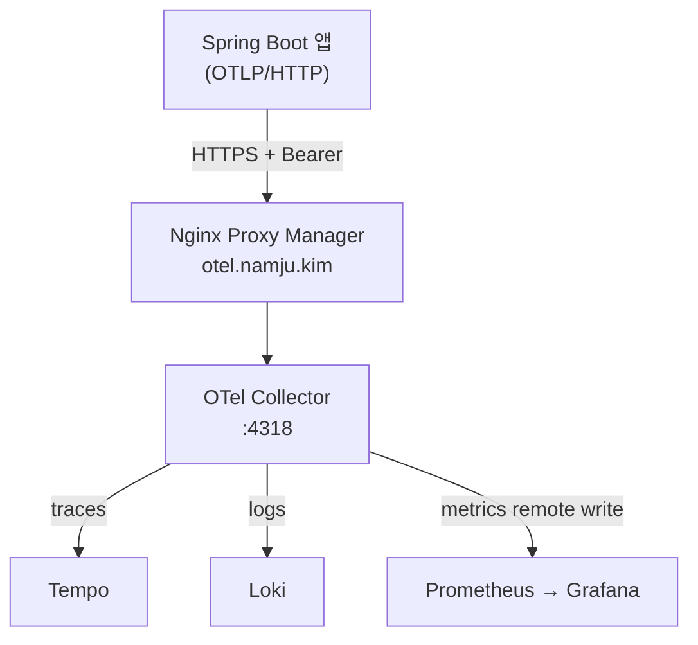

> 애플리케이션이 트레이스·메트릭·로그를 한 곳(`otel.namju.kim`)으로만 보내고, 저장소 선택과 샘플링은 Collector가 책임지도록 홈랩 관측성 파이프라인을 구성합니다.

> 기준 환경: OpenTelemetry Collector Contrib 0.144.0, Grafana Tempo 2.9.1, Grafana Loki 3.6.3, 기존 홈랩 Prometheus 2.54.1·Grafana 11.2, Nginx Proxy Manager(`*.namju.kim` 와일드카드 인증서)
{: .prompt-info }

## 도입 배경

회사 서비스는 애플리케이션이 백엔드에 직접 붙지 않고 반드시 Collector를 거치도록 되어 있습니다. 처음에는 한 단계가 늘어나는 것처럼 보였지만, 백엔드를 교체하거나 샘플링 정책을 바꿀 때 애플리케이션을 재배포하지 않아도 된다는 점이 운영에서 크게 체감되었습니다.

홈랩에서도 같은 구조를 만들었습니다. 이미 [Prometheus와 Node Exporter로 시스템 메트릭을 수집](/posts/prometheus-node-exporter-homelab-system-metrics/)하고 Grafana로 대시보드를 보고 있었기 때문에, 여기에 트레이스 저장소(Tempo)와 로그 저장소(Loki)를 붙이고 입구를 Collector 하나로 통일하는 것이 목표입니다.



## 파이프라인 설계와 선택 기준

Collector는 `receivers → processors → exporters`를 신호별 파이프라인으로 묶습니다. 내부적으로는 receiver가 받은 데이터를 `pdata` 구조로 변환하고, processor 체인을 순서대로 통과시킨 뒤, 같은 파이프라인의 exporter들에 팬아웃합니다. 각 exporter는 자체 전송 큐(`sending_queue`)와 재시도를 가지므로, Tempo가 잠시 내려가도 로그와 메트릭 전송은 영향을 받지 않습니다.

processor 순서는 의미가 있습니다. `memory_limiter`는 메모리가 한계에 닿으면 receiver에 거절을 돌려보내는 역할이라 **항상 맨 앞**에 둡니다. `tail_sampling`은 트레이스 전체를 모아서 판단해야 하므로 `batch`보다 앞에, `batch`는 전송 효율을 위해 **맨 뒤**에 둡니다.

| 결정 사항 | 선택지 | 홈랩 선택과 이유 |
| :--- | :--- | :--- |
| 외부 공개 프로토콜 | gRPC 4317 / HTTP 4318 | HTTP만 공개. NPM에서 HTTP/2 gRPC 프록시를 따로 다루지 않아도 됨 |
| 인증 | NPM Access List / Collector `bearertokenauth` | Collector에서 검증. 앱 SDK가 헤더만 붙이면 되고 토큰 교체가 쉬움 |
| 메트릭 적재 | `prometheusremotewrite` / Prometheus OTLP 수신 | remote write. 기존 2.54.1에서 플래그 하나로 가능 |
| 로그 적재 | Loki 네이티브 OTLP(`/otlp`) | 별도 exporter 없이 `otlphttp` 사용, trace_id가 structured metadata로 저장 |
| 샘플링 | 앱 head sampling / Collector tail sampling | 앱은 100% 전송, Collector에서 에러·지연 트레이스 우선 보관 |

**언제 쓰지 말아야 하는가.** 서비스 하나에 백엔드 하나라면 Collector 없이 SDK에서 바로 보내는 편이 단순합니다. 또한 tail sampling은 한 트레이스의 모든 span이 같은 Collector 인스턴스에 모여야 하므로, Collector를 여러 대로 수평 확장할 계획이라면 앞단에 trace ID 기반 로드밸런싱 계층이 따로 필요합니다. 홈랩처럼 단일 인스턴스일 때만 이 구성 그대로 쓰는 것이 맞습니다.

## Step 1. Collector 설정

`bearertokenauth` 확장은 contrib 배포판에 포함되어 있고, 서버 인증기로 쓰면 `Authorization: Bearer <토큰>` 헤더를 검증합니다. 토큰은 환경 변수로만 주입합니다.

```yaml
# ~/homelab-otel/collector/config.yaml
extensions:
  health_check:
    endpoint: 0.0.0.0:13133
  bearertokenauth/server:
    scheme: Bearer
    tokens:
      - ${env:OTEL_AUTH_TOKEN}

receivers:
  otlp/public:                 # NPM 뒤로 공개, 인증 필수
    protocols:
      http:
        endpoint: 0.0.0.0:4318
        auth:
          authenticator: bearertokenauth/server
  otlp/internal:               # 같은 Docker 네트워크 내부 전용
    protocols:
      grpc:
        endpoint: 0.0.0.0:4317

processors:
  memory_limiter:
    check_interval: 1s
    limit_percentage: 80
    spike_limit_percentage: 20
  tail_sampling:
    decision_wait: 10s
    num_traces: 20000
    policies:
      - name: keep-errors
        type: status_code
        status_code: { status_codes: [ERROR] }
      - name: keep-slow
        type: latency
        latency: { threshold_ms: 1000 }
      - name: baseline
        type: probabilistic
        probabilistic: { sampling_percentage: 20 }
  batch:
    send_batch_size: 1024
    timeout: 5s

exporters:
  otlp/tempo:
    endpoint: tempo:4317
    tls:
      insecure: true
  otlphttp/loki:
    endpoint: http://loki:3100/otlp
  prometheusremotewrite:
    endpoint: http://monitoring-prometheus:9090/api/v1/write
    tls:
      insecure: true

service:
  extensions: [health_check, bearertokenauth/server]
  pipelines:
    traces:
      receivers: [otlp/public, otlp/internal]
      processors: [memory_limiter, tail_sampling, batch]
      exporters: [otlp/tempo]
    metrics:
      receivers: [otlp/public, otlp/internal]
      processors: [memory_limiter, batch]
      exporters: [prometheusremotewrite]
    logs:
      receivers: [otlp/public, otlp/internal]
      processors: [memory_limiter, batch]
      exporters: [otlphttp/loki]
```

## Step 2. Tempo·Loki·Collector Compose 구성

Tempo는 최소 설정으로 로컬 디스크에 저장합니다. Tempo 2.7부터 receiver 기본 바인딩이 `localhost`로 바뀌었기 때문에 `0.0.0.0`을 명시해야 다른 컨테이너에서 접근할 수 있습니다.

```yaml
# ~/homelab-otel/tempo/tempo.yaml
server:
  http_listen_port: 3200

distributor:
  receivers:
    otlp:
      protocols:
        grpc:
          endpoint: 0.0.0.0:4317

storage:
  trace:
    backend: local
    wal:
      path: /var/tempo/wal
    local:
      path: /var/tempo/blocks

compactor:
  compaction:
    block_retention: 168h
```

```yaml
# ~/homelab-otel/docker-compose.yml
services:
  otel-collector:
    image: otel/opentelemetry-collector-contrib:0.144.0
    container_name: otel-collector
    restart: unless-stopped
    command: ["--config=/etc/otelcol-contrib/config.yaml"]
    environment:
      OTEL_AUTH_TOKEN: ${OTEL_AUTH_TOKEN}
    volumes:
      - ./collector/config.yaml:/etc/otelcol-contrib/config.yaml:ro
    networks: [npm-network, monitoring-net]
    depends_on: [tempo, loki]

  tempo:
    image: grafana/tempo:2.9.1
    container_name: monitoring-tempo
    restart: unless-stopped
    command: ["-config.file=/etc/tempo.yaml"]
    volumes:
      - ./tempo/tempo.yaml:/etc/tempo.yaml:ro
      - tempo_data:/var/tempo
    networks:
      monitoring-net:
        aliases: [tempo]

  loki:
    image: grafana/loki:3.6.3
    container_name: monitoring-loki
    restart: unless-stopped
    command: ["-config.file=/etc/loki/local-config.yaml"]
    volumes:
      - loki_data:/loki
    networks:
      monitoring-net:
        aliases: [loki]

volumes:
  tempo_data:
  loki_data:

networks:
  npm-network:
    external: true
  monitoring-net:
    name: homelab_monitoring_net
    external: true
```

기존 Prometheus에는 remote write 수신 플래그를 추가하고, Grafana에는 Tempo·Loki 데이터소스를 프로비저닝합니다. Tempo에서 트레이스를 보다가 같은 trace ID의 로그로 바로 넘어갈 수 있도록 상호 링크를 걸어 둡니다.

```yaml
# 기존 monitoring 스택의 prometheus.command에 추가
      - "--web.enable-remote-write-receiver"
```

```yaml
# grafana/provisioning/datasources/tracing.yml
apiVersion: 1
datasources:
  - name: Tempo
    uid: tempo
    type: tempo
    url: http://tempo:3200
    jsonData:
      tracesToLogsV2:
        datasourceUid: loki
        filterByTraceID: true
  - name: Loki
    uid: loki
    type: loki
    url: http://loki:3100
    jsonData:
      derivedFields:
        - name: TraceID
          matcherType: label
          matcherRegex: trace_id
          datasourceUid: tempo
          url: "$${__value.raw}"
```

## Step 3. NPM 프록시 호스트와 실행 결과

[Cloudflare DDNS와 Nginx Proxy Manager 와일드카드 SSL 글](/posts/cloudflare-ddns-nginx-proxy-manager-wildcard-ssl/)에서 만든 `npm-network`에 Collector를 붙였으므로, 프록시 호스트는 컨테이너 이름으로 지정합니다.

- **Domain Names**: `otel.namju.kim`
- **Forward**: `http` / `otel-collector` / `4318`
- **SSL**: `*.namju.kim` 와일드카드 인증서, Force SSL, HTTP/2 ON
- **Access List**: 사용하지 않음(인증은 Collector가 담당)

```bash
cd ~/homelab-otel && docker compose up -d
# 토큰 없이 호출하면 401
curl -s -o /dev/null -w "%{http_code}\n" -X POST https://otel.namju.kim/v1/traces \
  -H "Content-Type: application/json" -d '{"resourceSpans":[]}'
# 토큰을 붙이면 200
curl -s -o /dev/null -w "%{http_code}\n" -X POST https://otel.namju.kim/v1/traces \
  -H "Authorization: Bearer ${OTEL_AUTH_TOKEN}" \
  -H "Content-Type: application/json" -d '{"resourceSpans":[]}'
```

```text
401
200
```

> `prometheusremotewrite`의 `resource_to_telemetry_conversion`을 켜면 Java Agent가 붙이는 `process.command_args`, `host.name` 같은 리소스 속성이 전부 메트릭 레이블이 되어 시계열 수가 폭증합니다. 기본값(off)으로 두면 서비스 이름은 `job` 레이블로 들어가고, 나머지 리소스 속성은 `target_info`에서 조인해 조회할 수 있습니다.
{: .prompt-warning }

> tail sampling을 쓰면 애플리케이션의 head sampling은 `1.0`으로 올려야 합니다. 앱에서 이미 10%만 보내면 Collector가 에러 트레이스를 보존하려 해도 애초에 도착하지 않습니다. 대신 Collector 메모리가 `num_traces × 평균 span 수`만큼 필요하므로 `memory_limiter`와 함께 컨테이너 메모리 제한을 꼭 잡아 둡니다.
{: .prompt-warning }

## 정리

Collector를 입구로 두니 애플리케이션 설정은 엔드포인트와 토큰 두 가지로 줄었고, 저장소와 샘플링 정책은 홈랩 쪽에서만 바꾸면 되는 구조가 되었습니다. 운영 전 점검 항목입니다.

- [ ] 외부에는 OTLP/HTTP 4318만 노출하고 gRPC 4317은 내부망에 두었는가
- [ ] `bearertokenauth` 토큰을 환경 변수로만 주입하고 저장소에 커밋하지 않았는가
- [ ] processor 순서가 `memory_limiter → tail_sampling → batch`인가
- [ ] Prometheus에 `--web.enable-remote-write-receiver`를 추가하고 리소스 속성 레이블 변환을 꺼 두었는가
- [ ] Grafana에서 Tempo↔Loki 상호 링크가 trace ID로 동작하는가
