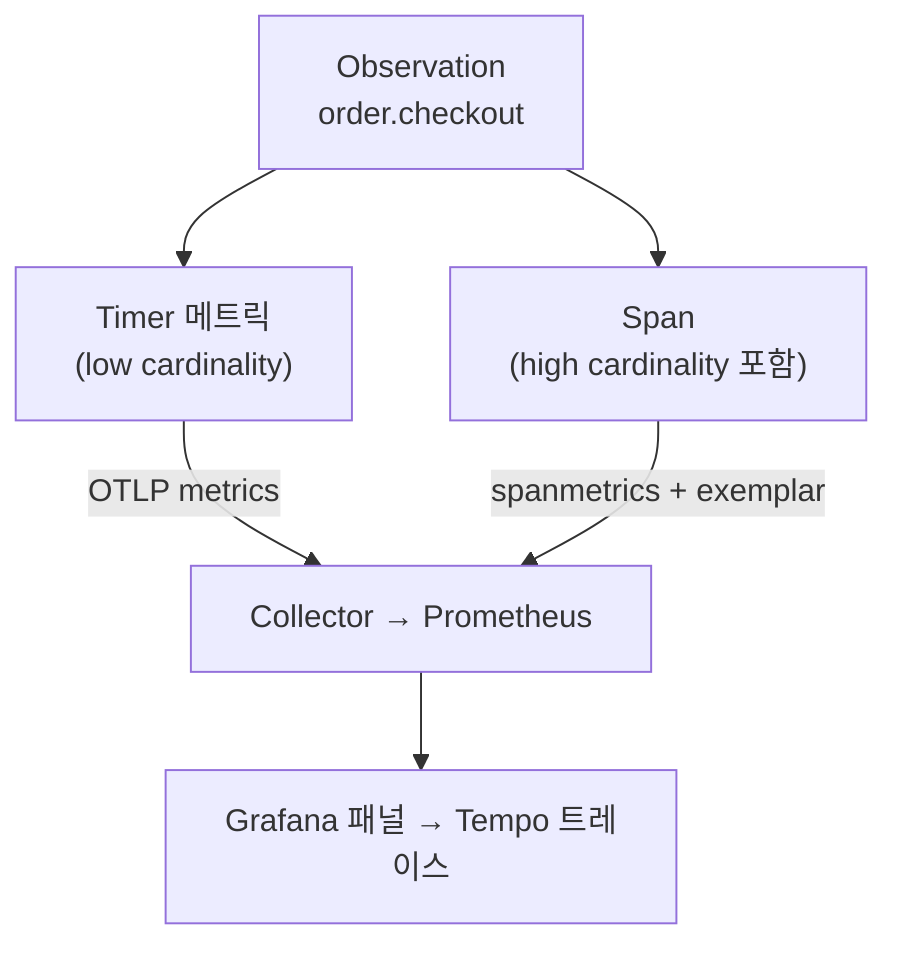

> HTTP 응답 시간 같은 기술 지표만으로는 "주문이 실제로 잘 되고 있는가"에 답할 수 없습니다. 주문 도메인의 비즈니스 메트릭을 Micrometer로 설계하고, 그래프의 튀는 점에서 바로 해당 트레이스로 이동하는 흐름까지 홈랩에서 구성합니다.

> 기준 환경: Spring Boot 4.0.2(Micrometer 1.16, `spring-boot-starter-opentelemetry`), Kotlin 2.2, Java 21, 홈랩 OTel Collector Contrib 0.144.0(`https://otel.namju.kim`), Prometheus 2.54.1, Tempo 2.9.1, Grafana 11.2
{: .prompt-info }

## 도입 배경

회사 서비스에서 장애 알림을 처음 받게 되는 경로를 돌아보면, 의외로 HTTP 5xx 비율보다 "결제 완료 건수가 평소보다 적다"는 비즈니스 지표가 먼저 이상을 알려 준 경우가 많았습니다. 외부 결제사가 200 응답과 함께 실패 코드를 내려주면 기술 지표는 정상으로 보이기 때문입니다.

그래서 홈랩의 `order-api`에 주문 도메인 메트릭을 직접 설계해 보았습니다. 메트릭은 앱에서 OTLP로 `otel.namju.kim`에 보내고, Collector가 Prometheus에 remote write로 적재하는 구조입니다. 이 파이프라인은 [OTel Collector 홈랩 파이프라인 글](/posts/otel-collector-pipeline-homelab/)에서 구성한 것을 그대로 사용합니다.



## 계측 도구 선택 기준

| 도구 | 질문 형태 | 주문 도메인 예시 | 주의점 |
| :--- | :--- | :--- | :--- |
| `Counter` | "몇 번 일어났나" | 환불 건수(`reason` 태그) | 감소하는 값에 쓰지 않음 |
| `Timer` / `Observation` | "얼마나 걸렸고 몇 번 실패했나" | 주문 확정 지연·실패율 | 히스토그램을 켜야 분위수 집계 가능 |
| `DistributionSummary` | "크기 분포가 어떤가" | 주문 금액 분포 | 금액 같은 연속값은 버킷 경계를 직접 정의 |
| `Gauge` | "지금 몇 개인가" | 결제 대기 중 주문 수 | 객체를 약한 참조로 잡으므로 필드로 유지 |

**언제 쓰지 말아야 하는가.** 주문 ID, 사용자 ID, 쿠폰 코드처럼 값의 종류가 계속 늘어나는 데이터는 메트릭 태그에 넣지 않습니다. 태그 조합마다 시계열이 하나씩 생기므로 Prometheus 메모리가 선형으로 늘어납니다. 이런 값은 로그나 span 속성으로 남기고, 메트릭은 "집계해서 의미 있는 질문"에만 씁니다. 또한 정확한 건수가 필요한 정산·회계 지표는 메트릭이 아니라 DB 집계로 확인해야 합니다. 메트릭은 전송 실패나 재시작 시 일부 유실을 허용하는 근사치입니다.

## 동작 원리와 구현

Spring의 `Observation`을 쓰면 하나의 계측 코드에서 메트릭과 span이 동시에 나옵니다. `DefaultMeterObservationHandler`는 Observation 종료 시 Timer(`order.checkout`)와 진행 중 작업용 LongTaskTimer(`order.checkout.active`)를 기록하고, `DefaultTracingObservationHandler`는 같은 이름의 span을 만듭니다. 이때 **low cardinality 키는 메트릭 태그와 span 속성 양쪽**에, **high cardinality 키는 span 속성에만** 들어갑니다. 카디널리티 제어를 API 수준에서 강제할 수 있다는 점이 이 방식을 선호하는 이유입니다.

```kotlin
// src/main/kotlin/kim/namju/order/metrics/OrderMetrics.kt
package kim.namju.order.metrics

import io.micrometer.core.instrument.Counter
import io.micrometer.core.instrument.DistributionSummary
import io.micrometer.core.instrument.Gauge
import io.micrometer.core.instrument.MeterRegistry
import io.micrometer.observation.Observation
import io.micrometer.observation.ObservationRegistry
import org.springframework.stereotype.Component
import java.util.concurrent.atomic.AtomicInteger
import java.util.function.Supplier

enum class PaymentMethod { CARD, TRANSFER, POINT }
enum class RefundReason { CUSTOMER_REQUEST, OUT_OF_STOCK, PAYMENT_ERROR }

@Component
class OrderMetrics(
    private val meterRegistry: MeterRegistry,
    private val observationRegistry: ObservationRegistry,
) {
    // Gauge는 약한 참조이므로 반드시 필드로 보관합니다
    private val pendingOrders = AtomicInteger(0)

    private val orderAmount = DistributionSummary.builder("order.amount")
        .description("주문 금액(원)")
        .serviceLevelObjectives(10_000.0, 30_000.0, 50_000.0, 100_000.0, 300_000.0)
        .register(meterRegistry)

    init {
        Gauge.builder("order.pending", pendingOrders) { it.get().toDouble() }
            .description("결제 대기 중 주문 수")
            .register(meterRegistry)
    }

    fun <T> checkout(orderId: Long, method: PaymentMethod, amount: Long, block: () -> T): T {
        pendingOrders.incrementAndGet()
        try {
            val result = Observation.createNotStarted("order.checkout", observationRegistry)
                .lowCardinalityKeyValue("payment.method", method.name)   // 메트릭 + span
                .highCardinalityKeyValue("order.id", orderId.toString()) // span 전용
                .observe(Supplier { block() })
            orderAmount.record(amount.toDouble())
            @Suppress("UNCHECKED_CAST")
            return result as T
        } finally {
            pendingOrders.decrementAndGet()
        }
    }

    fun refunded(reason: RefundReason) {
        Counter.builder("order.refund")
            .tag("reason", reason.name)
            .register(meterRegistry)
            .increment()
    }
}
```

enum으로 태그 값을 제한했더라도 다른 개발자가 문자열 태그를 추가할 수 있으므로, `MeterFilter`로 한 번 더 상한을 겁니다. Spring Boot는 `MeterFilter` 빈을 자동으로 레지스트리에 적용합니다.

```kotlin
// src/main/kotlin/kim/namju/order/metrics/MetricsGuardConfig.kt
package kim.namju.order.metrics

import io.micrometer.core.instrument.config.MeterFilter
import org.springframework.context.annotation.Bean
import org.springframework.context.annotation.Configuration

@Configuration
class MetricsGuardConfig {
    // order.* 메트릭의 payment.method 값이 10종을 넘으면 이후 시계열은 버립니다
    @Bean
    fun paymentMethodCardinalityGuard(): MeterFilter =
        MeterFilter.maximumAllowableTags("order.", "payment.method", 10, MeterFilter.deny())
}
```

```yaml
# src/main/resources/application.yml (메트릭 부분)
management:
  otlp:
    metrics:
      export:
        url: https://otel.namju.kim/v1/metrics
        step: 30s
        headers:
          Authorization: "Bearer ${OTEL_AUTH_TOKEN}"
  metrics:
    distribution:
      slo:
        order.checkout: 200ms,500ms,1s,3s
```

## Exemplar로 메트릭에서 트레이스로 이동하기

exemplar는 히스토그램 버킷에 "이 값을 만든 trace ID"를 샘플로 붙이는 기능입니다. 다만 제가 확인한 Micrometer 1.16의 OTLP 레지스트리 문서에는 exemplar 지원 내용이 없어서, 앱에서 보내는 Timer에는 exemplar가 실리지 않았습니다. 대신 Collector의 `spanmetrics` connector가 span으로부터 지연 히스토그램을 만들 때 exemplar를 붙이도록 구성했습니다. Observation이 만든 `order.checkout` span이 그대로 재료가 됩니다.

```yaml
# collector/config.yaml 추가분
connectors:
  spanmetrics:
    histogram:
      explicit:
        buckets: [50ms, 100ms, 200ms, 500ms, 1s, 3s]
    dimensions:
      - name: payment.method
    exemplars:
      enabled: true
    metrics_flush_interval: 15s

service:
  pipelines:
    traces/spanmetrics:           # tail sampling 이전의 전체 span으로 집계
      receivers: [otlp/public, otlp/internal]
      processors: [memory_limiter]
      exporters: [spanmetrics]
    metrics:
      receivers: [otlp/public, otlp/internal, spanmetrics]
      processors: [memory_limiter, batch]
      exporters: [prometheusremotewrite]
```

Prometheus는 exemplar 저장이 기능 플래그로 분리되어 있으므로 `--enable-feature=exemplar-storage`를 추가하고, Grafana의 Prometheus 데이터소스에 exemplar의 `trace_id`를 Tempo로 연결합니다.

```yaml
# grafana/provisioning/datasources/prometheus.yml (jsonData 추가분)
    jsonData:
      timeInterval: 15s
      httpMethod: POST
      exemplarTraceIdDestinations:
        - name: trace_id
          datasourceUid: tempo
```

## Grafana 패널과 알림

패널과 알림 규칙에는 아래 PromQL을 사용합니다. OTLP 메트릭이 remote write로 변환되면서 점(`.`)은 밑줄로, 단위와 타입 접미사가 붙습니다(`add_metric_suffixes` 기본값). 정확한 이름은 Prometheus의 메트릭 탐색기에서 먼저 확인하는 것이 안전합니다.

```promql
# 결제 수단별 주문 확정 실패율 (알림 규칙: 5분간 5% 초과)
sum by (payment_method) (rate(order_checkout_milliseconds_count{error!="none"}[5m]))
  / sum by (payment_method) (rate(order_checkout_milliseconds_count[5m]))

# 주문 확정 p95 지연 (패널에서 Exemplars 토글 ON)
histogram_quantile(0.95,
  sum by (le) (rate(traces_span_metrics_duration_milliseconds_bucket{span_name="order.checkout"}[5m])))

# 사유별 환불 추이
sum by (reason) (increase(order_refund_total[1h]))
```

알림은 [Grafana 홈서버 대시보드·알림 글](/posts/grafana-homelab-dashboard-alerting-setup/)에서 만든 Contact Point를 재사용하고, 실패율 규칙의 pending 기간을 5분으로 두어 일시적인 결제사 오류에는 울리지 않게 했습니다.

> `rate()` 범위는 OTLP 전송 주기(`step`)의 최소 4배 이상으로 잡습니다. `step`이 30초인데 `rate(...[1m])`을 쓰면 샘플이 두 개 이하라 그래프가 끊기거나 비어 보입니다.
{: .prompt-warning }

> `spanmetrics`는 tail sampling 이전의 전체 span으로 집계하므로 비율은 정확하지만, exemplar가 가리키는 트레이스가 tail sampling에서 버려졌을 수 있습니다. 에러·지연 트레이스는 보존 정책에 걸려 남기 때문에 실제로 클릭하는 튀는 점은 대부분 열리지만, 평범한 구간의 exemplar는 Tempo에서 "trace not found"가 날 수 있습니다.
{: .prompt-warning }

## 정리

비즈니스 메트릭은 무엇을 측정할지보다 **무엇을 태그로 넣지 않을지**를 먼저 정하는 작업이었습니다. 적용 전 체크리스트입니다.

- [ ] 메트릭 태그 값이 enum처럼 유한한 집합인가
- [ ] 주문 ID 등 고유값은 `highCardinalityKeyValue`로 span에만 남기는가
- [ ] `MeterFilter`로 태그 값 개수 상한을 강제했는가
- [ ] PromQL `rate()` 범위가 전송 주기의 4배 이상인가
- [ ] exemplar가 가리키는 트레이스가 샘플링 정책상 보존되는지 확인했는가
