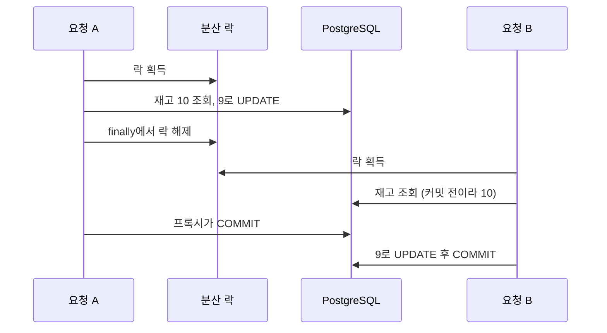

> 분산 락을 걸었는데도 재고가 초과 판매됐습니다. 원인은 락 구현이 아니라 락을 푸는 시점이 트랜잭션 커밋보다 앞선 데 있었습니다. 세 가지 락 구현을 같은 조건에서 재현하고, 초과 판매 건수와 처리량을 측정했습니다.

> 본 글은 **Spring Boot 3.5.5, Kotlin 2.2.10, Java 21, Redisson 3.51.0, Spring Data Redis 3.5.3(Lettuce 6.6.0), Redis 8.2.1, PostgreSQL 17.6** 환경을 기준으로 작성했습니다. 측정은 개인 PC(12코어, 32GB RAM, Windows + Docker Desktop/WSL2)에서 HikariCP 풀 크기 10으로 진행했습니다.
{: .prompt-info }

## 문제 상황

동아리에서 행사 티셔츠를 선착순 100장 판매하는 기능을 만들었습니다. 재고 차감은 `재고 조회 → 0보다 크면 1 감소 → 주문 저장` 순서입니다. 동시에 들어오는 요청을 막으려고 Redisson 락을 `@Transactional` 메서드 안에서 잡고 `finally`에서 풀었습니다. 그런데 부하 테스트에서 주문이 100건을 넘었습니다.

재고 100, 요청 200건, 스레드 100개로 각 방식을 3번씩 돌린 결과입니다. 초과 판매는 `주문 수 - 100`입니다.

| 방식 | 주문 수 (3회) | 초과 판매 |
| :--- | :--- | :--- |
| 락 없음 | 200 / 200 / 200 | 100 / 100 / 100 |
| Redisson, 트랜잭션 안에서 해제 | 102 / 112 / 118 | 2 / 12 / 18 |
| SETNX 스핀 락, 트랜잭션 안에서 해제 | 146 / 125 / 132 | 46 / 25 / 32 |
| `pg_advisory_lock`, 트랜잭션 안에서 해제 | 191 / 200 / 200 | 91 / 100 / 100 |
| Redisson, 트랜잭션 밖에서 해제 | 100 × 3 | 0 |
| SETNX 스핀 락, 트랜잭션 밖에서 해제 | 100 × 3 | 0 |
| `pg_advisory_xact_lock` | 100 × 3 | 0 |

락 구현과 관계없이 "트랜잭션 안에서 해제"한 경우는 모두 초과 판매가 났고, 해제 시점만 바꾼 경우는 모두 정확히 100건이었습니다. 참고로 Redis 키 하나만 바꾸는 갱신이었다면 [INCR·Lua 스크립트 측정 글](/posts/redis-data-structure-ranking-uv-lua/)처럼 락 없이 원자 명령으로 끝낼 수 있지만, 이번에는 DB 재고와 주문 행을 함께 바꿔야 해서 락이 필요했습니다.

## 원인 분석

`@Transactional`은 프록시가 메서드 호출을 감싸서 메서드가 **반환된 뒤에** 커밋합니다. 메서드 안의 `finally`에서 락을 풀면 아직 커밋되지 않은 상태로 락이 넘어갑니다.



PostgreSQL의 기본 격리 수준인 READ COMMITTED에서는 B가 A의 커밋 전 값을 읽습니다. [격리 수준과 MVCC 글](/posts/transaction-isolation-level-mvcc/)에서 재현했던 Lost Update가 락이 있는데도 그대로 일어난 셈입니다.

초과 판매 규모가 구현마다 달랐던 이유는 락이 다음 대기자에게 넘어가는 속도 차이로 보입니다. Redisson은 해제 시 Pub/Sub 채널로 대기자를 깨우고, 깨어난 대기자가 다시 Lua 스크립트로 락을 잡는 동안 대부분 커밋이 끝납니다. 스핀 락은 5ms 간격으로 재시도하므로 커밋 전 틈에 걸리는 경우가 더 많았습니다. `pg_advisory_lock`은 DB 안에서 대기자에게 즉시 넘어가서 거의 매번 커밋 전 값을 읽었습니다. 즉 락 핸드오프가 빠를수록 이 버그는 더 크게 드러납니다.

## 해결 방법

락은 트랜잭션보다 바깥에서 잡고, 트랜잭션 메서드가 반환(커밋)된 뒤에 풉니다. DB 락을 쓴다면 트랜잭션 종료 시 자동으로 풀리는 `pg_advisory_xact_lock`을 쓰면 경계가 저절로 맞습니다.

```kotlin
// build.gradle.kts
dependencies {
    implementation("org.springframework.boot:spring-boot-starter-data-redis")
    implementation("org.springframework.boot:spring-boot-starter-jdbc")
    implementation("org.redisson:redisson:3.51.0")
    runtimeOnly("org.postgresql:postgresql")
}
```

```kotlin
// src/main/kotlin/com/example/club/config/RedissonConfig.kt
package com.example.club.config

import org.redisson.Redisson
import org.redisson.api.RedissonClient
import org.redisson.config.Config
import org.springframework.boot.autoconfigure.data.redis.RedisProperties
import org.springframework.context.annotation.Bean
import org.springframework.context.annotation.Configuration

@Configuration
class RedissonConfig {
    @Bean(destroyMethod = "shutdown")
    fun redissonClient(props: RedisProperties): RedissonClient {
        val config = Config()
        config.useSingleServer().address = "redis://${props.host}:${props.port}"
        return Redisson.create(config)
    }
}
```

```kotlin
// src/main/kotlin/com/example/club/stock/StockService.kt
package com.example.club.stock

import org.redisson.api.RedissonClient
import org.springframework.jdbc.core.simple.JdbcClient
import org.springframework.stereotype.Component
import org.springframework.stereotype.Service
import org.springframework.transaction.annotation.Transactional
import java.util.concurrent.TimeUnit

@Service
class StockService(private val jdbc: JdbcClient) {

    @Transactional
    fun decrease(productId: Long): Boolean {
        val stock = jdbc.sql("select stock from product where id = :id")
            .param("id", productId).query(Int::class.java).single()
        if (stock <= 0) return false
        jdbc.sql("update product set stock = :stock where id = :id")
            .param("stock", stock - 1).param("id", productId).update()
        jdbc.sql("insert into orders(product_id) values (:id)").param("id", productId).update()
        return true
    }

    // DB 락: 트랜잭션 커밋/롤백 시 자동 해제되므로 경계가 어긋날 수 없음
    @Transactional
    fun decreaseWithAdvisoryLock(productId: Long): Boolean {
        jdbc.sql("select pg_advisory_xact_lock(:id)").param("id", productId).query().singleRow()
        return decrease(productId) // 같은 트랜잭션 안의 일반 메서드 호출
    }
}

@Component
class StockFacade(
    private val stockService: StockService,
    private val redisson: RedissonClient,
) {
    fun decrease(productId: Long): Boolean {
        val lock = redisson.getLock("lock:stock:$productId")
        check(lock.tryLock(10, TimeUnit.SECONDS)) { "lock timeout" }
        try {
            return stockService.decrease(productId) // 반환 시점에 이미 커밋 완료
        } finally {
            lock.unlock()
        }
    }
}
```

`StockFacade`에는 `@Transactional`을 붙이지 않는 것이 핵심입니다. 여기에 붙이면 다시 락 해제가 커밋보다 앞서게 됩니다.

## 락 구현별 처리량과 선택 기준

수정한 세 방식을 같은 부하(요청 2,000건, 스레드 50개, 같은 상품 1개)로 4번 돌려 첫 회를 워밍업으로 버리고 3회 중앙값을 냈습니다. 다른 작업이 함께 돌던 PC라 절대값보다 상대 비교로 봐 주시면 좋겠습니다.

| 방식 | 처리량 | p50 | p99 | 비고 |
| :--- | ---: | ---: | ---: | :--- |
| Redisson RLock | 256 req/s | 187ms | 1,114ms | 대기자 Pub/Sub 통지 |
| SETNX 스핀 락 (5ms 재시도) | 268 req/s | 4.2ms | 1,631ms | SET NX 시도 약 6만 회 |
| `pg_advisory_xact_lock` | 368 req/s | 28ms | 1,043ms | 대기 중에도 커넥션 점유 |

```json
{
  "type": "bar",
  "data": {
    "labels": ["Redisson", "SETNX 스핀", "PG advisory xact"],
    "datasets": [
      { "label": "p50 (ms)", "data": [187.31, 4.15, 28.06], "backgroundColor": "#7aa2f7" },
      { "label": "p99 (ms)", "data": [1114.26, 1631.27, 1043.14], "backgroundColor": "#f7768e" }
    ]
  },
  "options": {
    "plugins": { "title": { "display": true, "text": "핫 키 1개, 2,000 요청 기준 락 대기 포함 지연" } }
  }
}
```
{: .chart-js }

스핀 락은 p50이 가장 낮지만 p99가 가장 길었습니다. 막 락을 푼 스레드나 운 좋은 스레드가 계속 이기고, 일부 요청은 수 초씩 굶습니다. 2,000건을 처리하는 동안 SET NX 시도가 약 6만 회(요청당 30회)였으니 Redis에도 불필요한 부하를 줍니다. Redisson은 대기 순서가 비교적 고르게 돌아가 p50과 p99의 차이가 작았습니다. advisory lock은 Redis 왕복이 없어 처리량이 가장 높았지만, 대기하는 동안 DB 커넥션을 붙잡고 있어 같은 풀을 쓰는 다른 API가 영향을 받습니다. p50도 회차별로 27~135ms로 들쭉날쭉했습니다.

| 상황 | 추천 |
| :--- | :--- |
| 락 대상이 DB 한 곳의 데이터, 경합이 낮음 | `pg_advisory_xact_lock` 또는 `SELECT ... FOR UPDATE` |
| 여러 인스턴스, 대기 시간이 길 수 있음 | Redisson RLock (watchdog으로 리스 자동 연장) |
| 대기 없이 "이미 처리 중"이면 바로 실패 | `SET NX PX` 1회 시도 |
| 경합이 높은 핫 키에서 대기 | 스핀 락은 피함 |

**언제 쓰지 말아야 하는가**도 정리합니다. 재고 차감처럼 단일 행 갱신이라면 분산 락 없이 `update product set stock = stock - 1 where id = ? and stock > 0`의 영향 행 수로 판단하는 편이 더 단순하고 빠릅니다. Redis 단일 노드 락은 장애 조치(failover) 중 락이 사라질 수 있으므로, 락이 깨지면 데이터가 망가지는 곳에서는 DB 제약 조건이나 버전 컬럼을 최종 방어선으로 함께 둬야 합니다.

## 운영 함정 및 정리

> `redisson-spring-boot-starter`를 의존성에 넣으면 `RedisConnectionFactory`가 Redisson 구현으로 바뀝니다. 실험 중 `StringRedisTemplate`이 Lettuce가 아닌 `RedissonConnection`으로 동작하면서 `RedissonConnection.execute()`에서 `UnsupportedOperationException`이 났습니다. 기존 코드를 Lettuce로 유지하고 락만 Redisson으로 쓰려면 위처럼 `org.redisson:redisson` 코어만 넣고 `RedissonClient` 빈을 직접 등록하는 편이 안전합니다. 또 세션 단위 `pg_advisory_lock`은 커넥션 풀에서 해제를 빠뜨리면 그 커넥션이 반납된 뒤에도 락이 남습니다.
{: .prompt-warning }

- [ ] 락을 잡는 메서드와 `@Transactional` 메서드가 서로 다른 빈으로 분리되어 있는가?
- [ ] 락 해제가 커밋 이후에 일어나는지 동시성 테스트로 검증했는가?
- [ ] 락 대기 타임아웃과 실패 시 응답(재시도 안내 등)을 정했는가?
- [ ] DB 락 사용 시 대기 스레드 수가 커넥션 풀 크기를 압도하지 않는가?
- [ ] 락이 깨져도 데이터가 망가지지 않도록 DB 조건부 UPDATE나 제약 조건을 함께 두었는가?
