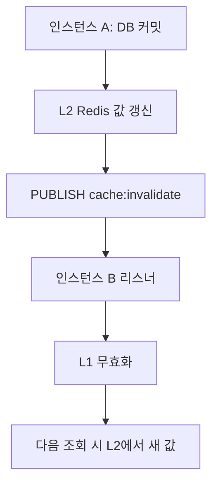

> Redis 캐시도 결국 네트워크 왕복이라 읽기가 아주 많은 데이터에는 로컬 캐시를 한 겹 더 두게 됩니다. 문제는 인스턴스가 여러 대일 때 로컬 캐시를 어떻게 함께 지우느냐입니다. Caffeine + Redis 2단계 캐시를 두 프로세스로 띄워 조회 지연, 무효화 전파 시간, Pub/Sub 메시지가 유실됐을 때 낡은 값이 보이는 시간을 측정했습니다.

> 본 글은 **Spring Boot 4.0.2, Kotlin 2.2.21, Java 21, Caffeine 3.2.3, Spring Data Redis 4.0.2(Lettuce 6.8.2), Redis 8.4.0, PostgreSQL 17.6** 환경을 기준으로 작성했습니다. 측정은 개인 PC(12코어, 32GB RAM, Windows + Docker Desktop/WSL2)에서 같은 jar를 두 프로세스로 띄워 진행했습니다.
{: .prompt-info }

## 배경

회사 서비스에는 거의 모든 요청이 읽는 설정성 데이터(기능 플래그, 노출 정책 등)가 있습니다. [캐시 스탬피드 방어 글](/posts/cache-stampede-penetration-avalanche-defense/)에서 Redis 캐시의 만료 문제는 정리했지만, 이 데이터는 요청당 여러 번 읽혀서 Redis 왕복 자체가 부담이었습니다. 그래서 인스턴스 메모리에 Caffeine(L1)을 두고, 그 뒤에 Redis(L2), 마지막에 DB를 두는 구조로 바꿨습니다.

1,000개 키(값 200바이트)를 계층별로 2만 번씩 조회한 지연입니다(워밍업 5,000회 제외, 3회 중앙값).

| 계층 | p50 | p99 |
| :--- | ---: | ---: |
| L1 (Caffeine) | 0.1µs 이하 | 0.3µs 이하 |
| L2 (Redis) | 553µs | 768µs |
| DB (PostgreSQL) | 1,608µs | 2,172µs |

```json
{
  "type": "bar",
  "data": {
    "labels": ["L1 Caffeine", "L2 Redis", "DB PostgreSQL"],
    "datasets": [
      { "label": "p50 (µs)", "data": [0.1, 552.9, 1608.4], "backgroundColor": "#7aa2f7" },
      { "label": "p99 (µs)", "data": [0.3, 768.2, 2171.8], "backgroundColor": "#f7768e" }
    ]
  },
  "options": {
    "scales": { "y": { "type": "logarithmic", "title": { "display": true, "text": "µs (로그 스케일)" } } },
    "plugins": { "title": { "display": true, "text": "캐시 계층별 조회 지연" } }
  }
}
```
{: .chart-js }

L1은 `System.nanoTime()` 해상도 아래로 내려가서 0.1µs 이하로만 표기했습니다. L2와 약 5,000배 차이입니다. DB 경로에는 L2 미스 확인과 L2 적재 왕복이 포함되어 있습니다.

## 무효화 흐름과 내부 동작

L1은 인스턴스마다 따로 있으므로, 한 인스턴스가 값을 바꾸면 다른 인스턴스의 L1을 지워야 합니다. Redis Pub/Sub으로 무효화 메시지를 뿌렸습니다.



`RedisMessageListenerContainer`는 구독 전용 커넥션을 하나 열어 두고, 메시지를 받으면 등록된 `MessageListener`를 호출합니다. Pub/Sub은 **fire-and-forget**입니다. Redis는 발행 시점에 연결된 구독자에게만 메시지를 밀어 넣고 저장하지 않습니다. 구독 커넥션이 끊긴 사이에 발행된 메시지는 재연결 후에도 다시 오지 않습니다.

그래서 값에 버전을 붙였습니다. 메시지에도 버전을 실어, 이미 더 새 버전의 무효화를 받았다면 L2에서 늦게 읽어 온 낡은 값을 L1에 올리지 않습니다. 메시지 유실에 대비해서는 L1 TTL을 짧게 두고(여기서는 10초), 1초마다 L1에 있는 키의 버전을 L2와 한 번에 비교하는 보조 경로를 넣었습니다.

## 구현 코드

```kotlin
// build.gradle.kts
dependencies {
    implementation("org.springframework.boot:spring-boot-starter-data-redis")
    implementation("org.springframework.boot:spring-boot-starter-jdbc")
    implementation("com.github.ben-manes.caffeine:caffeine")
    implementation("org.jetbrains.kotlin:kotlin-reflect")
    runtimeOnly("org.postgresql:postgresql")
}
```

```yaml
# src/main/resources/application.yml
spring:
  data:
    redis:
      host: localhost
      port: 6379
app:
  cache:
    l1-ttl: 10s
```

```kotlin
// src/main/kotlin/com/example/cache/TwoTierCache.kt
package com.example.cache

import com.github.benmanes.caffeine.cache.Cache
import com.github.benmanes.caffeine.cache.Caffeine
import org.springframework.beans.factory.annotation.Value
import org.springframework.context.annotation.Bean
import org.springframework.context.annotation.Configuration
import org.springframework.data.redis.connection.MessageListener
import org.springframework.data.redis.connection.RedisConnectionFactory
import org.springframework.data.redis.core.StringRedisTemplate
import org.springframework.data.redis.core.script.RedisScript
import org.springframework.data.redis.listener.ChannelTopic
import org.springframework.data.redis.listener.RedisMessageListenerContainer
import org.springframework.jdbc.core.simple.JdbcClient
import org.springframework.scheduling.annotation.Scheduled
import org.springframework.stereotype.Component
import org.springframework.transaction.support.TransactionTemplate
import java.time.Duration
import java.util.concurrent.ConcurrentHashMap

data class Versioned(val version: Long, val payload: String) {
    fun encode() = "$version|$payload"
    companion object {
        fun decode(raw: String) = raw.indexOf('|').let { Versioned(raw.substring(0, it).toLong(), raw.substring(it + 1)) }
    }
}

@Component
class TwoTierCache(
    private val redis: StringRedisTemplate,
    private val jdbc: JdbcClient,
    private val tx: TransactionTemplate,
    @Value("\${app.cache.l1-ttl:10s}") l1Ttl: Duration,
) {
    val l1: Cache<String, Versioned> = Caffeine.newBuilder()
        .maximumSize(10_000)
        .expireAfterWrite(l1Ttl) // 메시지 유실 시 stale 상한
        .build()
    private val latestSeen = ConcurrentHashMap<String, Long>()

    fun get(key: String): Versioned? {
        l1.getIfPresent(key)?.let { return it }
        val loaded = redis.opsForValue().get("l2:$key")?.let(Versioned::decode)
            ?: loadFromDb(key)?.also { redis.opsForValue().set("l2:$key", it.encode(), Duration.ofMinutes(10)) }
            ?: return null
        // 더 새 버전의 무효화를 이미 받았다면 낡은 값을 L1에 올리지 않음
        if (loaded.version >= (latestSeen[key] ?: Long.MIN_VALUE)) l1.put(key, loaded)
        return loaded
    }

    private fun loadFromDb(key: String): Versioned? =
        jdbc.sql("select version, payload from config_entry where k = :k").param("k", key)
            .query { rs, _ -> Versioned(rs.getLong(1), rs.getString(2)) }.optional().orElse(null)

    fun update(key: String, payload: String): Long {
        val version = tx.execute {
            jdbc.sql("update config_entry set version = version + 1, payload = :p where k = :k returning version")
                .param("p", payload).param("k", key).query(Long::class.java).single()
        }!!
        redis.opsForValue().set("l2:$key", Versioned(version, payload).encode(), Duration.ofMinutes(10))
        redis.convertAndSend(CHANNEL, "$key|$version")
        return version
    }

    fun onInvalidate(body: String) {
        val (key, version) = body.split('|').let { it[0] to it[1].toLong() }
        latestSeen.merge(key, version, ::maxOf)
        val cur = l1.getIfPresent(key)
        if (cur == null || cur.version < version) l1.invalidate(key)
    }

    companion object { const val CHANNEL = "cache:invalidate" }
}

@Component
class L1VersionSweeper(private val cache: TwoTierCache, private val redis: StringRedisTemplate) {
    private val versions = RedisScript.of(
        "local r = {} for i, k in ipairs(KEYS) do local v = redis.call('GET', k) " +
            "r[i] = v and string.match(v, '^(%d+)|') or '0' end return r",
        List::class.java,
    )

    // Pub/Sub 유실 보완: L1 키의 버전을 L2와 한 번에 비교 (@EnableScheduling 필요)
    @Scheduled(fixedDelay = 1000)
    fun sweep() {
        val keys = cache.l1.asMap().keys.toList().ifEmpty { return }
        val remote = redis.execute(versions, keys.map { "l2:$it" }) ?: return
        keys.zip(remote).forEach { (k, v) ->
            val local = cache.l1.getIfPresent(k)
            if (local != null && local.version < v.toString().toLong()) cache.l1.invalidate(k)
        }
    }
}

@Configuration
class PubSubConfig {
    @Bean
    fun listenerContainer(cf: RedisConnectionFactory, cache: TwoTierCache) = RedisMessageListenerContainer().apply {
        setConnectionFactory(cf)
        addMessageListener(MessageListener { m, _ -> cache.onInvalidate(String(m.body)) }, ChannelTopic(TwoTierCache.CHANNEL))
    }
}
```

## 전파 시간과 유실 측정

인스턴스 A가 키 하나를 20ms 간격으로 500번 갱신하고, 인스턴스 B는 같은 키를 쉬지 않고 읽으며 새 버전을 처음 본 시각을 기록했습니다. 두 프로세스가 같은 PC에 있어 벽시계(µs)를 그대로 비교했습니다.

| 지표 (500회, 2회 실행) | p50 | p99 | 최대 |
| :--- | ---: | ---: | ---: |
| 발행 → B 수신 | 1.0 / 1.6ms | 2.1 / 2.9ms | 6.3 / 9.8ms |
| A 커밋 → B가 새 값 조회 | 2.6 / 3.1ms | 4.2 / 5.8ms | 13.0 / 18.7ms |

정상 상황의 stale 구간은 수 밀리초였고, 500번 모두 B가 새 값을 봤습니다. 커밋 이후에 L2 갱신, 발행, 수신, L2 재조회가 순서대로 일어나므로 수신 시간보다 1~2ms 길게 나옵니다.

다음은 유실 실험입니다. 발행 직전에 `CLIENT KILL TYPE pubsub`으로 구독 커넥션을 강제로 끊고 별도 키를 갱신했습니다. Lettuce는 곧바로 재연결하고 재구독하지만, 그 사이에 발행된 메시지는 사라집니다.

| 조건 (5회) | 메시지 유실 | B가 낡은 값을 본 시간 |
| :--- | :--- | :--- |
| L1 TTL 10초만 | 5 / 5 | 254, 883, 4,004, 7,141, 7,753ms |
| L1 TTL 10초 + 1초 버전 비교 | 4 / 5 | 365, 450, 459, 464ms |

TTL만 있을 때는 낡은 값이 남은 TTL만큼, 최대 약 7.8초까지 보였습니다. 1초 주기 버전 비교를 넣자 유실된 4건 모두 0.5초 안에 정리됐습니다. 나머지 1건은 재연결이 발행보다 먼저 끝나 메시지를 정상 수신했습니다.

## 선택 기준과 운영 함정

| 데이터 성격 | 추천 |
| :--- | :--- |
| 읽기 매우 많음, 수 초 stale 허용 | L1 + L2 + Pub/Sub + 짧은 L1 TTL |
| 수백 ms stale 허용, 유실도 막고 싶음 | 위 구성 + 주기적 버전 비교 |
| 변경 즉시 모든 인스턴스 일치 필요 | L1 없이 L2만 사용 |
| 무효화 이력을 반드시 전달 | Redis Streams 등 저장되는 채널 |

**언제 쓰지 말아야 하는가**도 분명합니다. 잔액, 재고, 권한처럼 한 번이라도 낡은 값을 보면 안 되는 데이터에는 L1을 두지 않습니다. 쓰기가 잦은 데이터는 무효화 메시지만 늘고 L1 적중률이 낮아 이득이 없습니다. 인스턴스 메모리가 작은 환경에서 `maximumSize` 없이 L1을 키우면 GC 압박이 캐시 이득을 상쇄합니다.

> 무효화 메시지는 반드시 **DB 커밋과 L2 갱신이 끝난 뒤**에 발행해야 합니다. 커밋 전에 발행하면 다른 인스턴스가 L1을 지운 직후 L2나 DB에서 이전 값을 다시 읽어 L1에 올리고, 그 값은 L1 TTL 동안 그대로 남습니다. 또 Redis Cluster의 일반 Pub/Sub은 메시지를 모든 노드로 전파하므로 인스턴스 수와 메시지량이 많다면 Sharded Pub/Sub(`SPUBLISH`)도 함께 검토합니다.
{: .prompt-warning }

- [ ] L1에 올리는 데이터가 수 초의 stale을 허용하는가?
- [ ] L1 TTL이 메시지 유실 시 허용 가능한 stale 상한과 같거나 짧은가?
- [ ] 무효화 메시지를 커밋과 L2 갱신 이후에 발행하는가?
- [ ] 값에 버전을 두어 늦게 도착한 낡은 값이 L1에 올라가지 않게 했는가?
- [ ] 구독 커넥션 재연결 이벤트를 로그나 메트릭으로 확인할 수 있는가?
