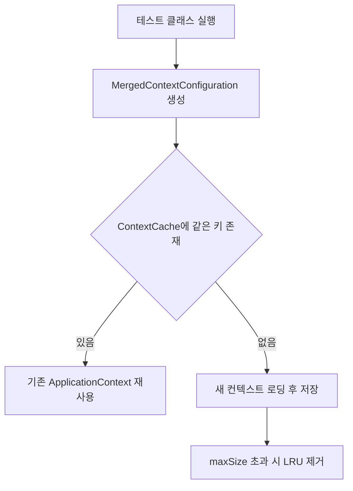

> 팀 프로젝트의 테스트가 늘어나면서 `./gradlew test` 한 번에 Spring 배너가 열 번 넘게 찍히는 문제를 겪었습니다. 테스트 슬라이스로 로딩 범위를 줄이고, TestContext 프레임워크의 컨텍스트 캐시 키를 이해해 불필요한 컨텍스트 재생성을 줄인 과정을 정리합니다.

> 본 문서는 Spring Boot 3.1.5(Spring Framework 6.0.13), Kotlin 1.9.10, JUnit 5.9.3, Gradle Kotlin DSL 환경을 기준으로 작성되었습니다.
{: .prompt-info }

## 도입 배경

학교 팀 프로젝트로 스터디룸 예약 서비스를 만들면서 처음에는 모든 테스트에 `@SpringBootTest`를 붙였습니다. 테스트가 60개를 넘기자 전체 실행 시간이 1분을 넘겼고, 로그에는 클래스마다 Hibernate 초기화가 반복되고 있었습니다.

원인은 두 가지였습니다. 컨트롤러 하나를 검증하는데도 JPA 설정까지 모두 띄우고 있었고, 클래스마다 다른 `@MockBean` 조합을 써서 이미 만든 컨텍스트를 재사용하지 못했습니다. 앞의 문제는 테스트 슬라이스로, 뒤의 문제는 캐시 키를 맞추는 방식으로 해결했습니다.

## 테스트 슬라이스 선택 기준

Spring Boot는 계층별로 필요한 자동 구성만 골라 올리는 슬라이스 어노테이션을 제공합니다. 제가 정리한 선택 기준은 다음과 같습니다.

| 어노테이션 | 로딩 범위 | 적합한 검증 대상 | 주의점 |
| :--- | :--- | :--- | :--- |
| `@SpringBootTest` | 전체 빈 + 모든 자동 구성 | 여러 계층이 엮인 시나리오, 트랜잭션 경계 | 가장 느리고 캐시 키가 쉽게 갈라짐 |
| `@WebMvcTest` | `@Controller`, `@ControllerAdvice`, `Filter`, `WebMvcConfigurer` 등 MVC 빈 | 요청 매핑, 검증 실패 응답, 직렬화 결과 | `@Service`는 올라오지 않아 `@MockBean` 필요 |
| `@DataJpaTest` | `@Entity`, Spring Data 리포지토리, `TestEntityManager` | 쿼리 메서드, 연관관계 매핑, 제약 조건 | 기본으로 내장 DB로 교체, 테스트마다 롤백 |
| `@JsonTest` | `ObjectMapper`, `@JsonComponent`, Jackson 모듈 | DTO 필드명, 날짜 포맷, null 처리 | 웹 계층 없이 직렬화만 검증 |
| 순수 단위 테스트 | 스프링 없음 | 도메인 계산 로직 | 가장 빠르며 가능하면 우선 선택 |

슬라이스가 만능은 아닙니다. 서비스 로직을 검증하려고 `@WebMvcTest`에 `@MockBean`을 다섯 개씩 붙이고 있다면 스프링 없는 단위 테스트가 맞습니다. 또한 `@DataJpaTest`는 기본으로 H2 같은 내장 DB로 바꿔 끼우기 때문에 PostgreSQL 전용 문법이나 `jsonb` 타입을 쓰는 쿼리는 통과하더라도 운영에서 실패할 수 있습니다. 이런 쿼리는 슬라이스 테스트만으로 검증했다고 판단하지 않아야 합니다.

## 프로젝트 설정과 슬라이스 테스트 코드

슬라이스 테스트는 `spring-boot-starter-test` 하나로 모두 사용할 수 있습니다. Kotlin 엔티티를 위해 `plugin.jpa`를 함께 적용했습니다. 엔티티 설계 기준은 [Kotlin JPA 엔티티 설계와 all-open, no-arg 플러그인 설정](/posts/kotlin-jpa-entity-design-allopen-noarg/)에 따로 정리했습니다.

```kotlin
// build.gradle.kts
plugins {
    id("org.springframework.boot") version "3.1.5"
    id("io.spring.dependency-management") version "1.1.3"
    kotlin("jvm") version "1.9.10"
    kotlin("plugin.spring") version "1.9.10"
    kotlin("plugin.jpa") version "1.9.10"
}

dependencies {
    implementation("org.springframework.boot:spring-boot-starter-web")
    implementation("org.springframework.boot:spring-boot-starter-data-jpa")
    implementation("com.fasterxml.jackson.module:jackson-module-kotlin")
    implementation("org.jetbrains.kotlin:kotlin-reflect")
    runtimeOnly("com.h2database:h2")
    testImplementation("org.springframework.boot:spring-boot-starter-test")
}

tasks.withType<Test> {
    useJUnitPlatform()
}
```

예제에서 사용하는 도메인은 최소한으로 구성했습니다.

```kotlin
// src/main/kotlin/com/example/studyroom/reservation/Reservation.kt
package com.example.studyroom.reservation

import jakarta.persistence.Entity
import jakarta.persistence.GeneratedValue
import jakarta.persistence.GenerationType
import jakarta.persistence.Id
import org.springframework.data.jpa.repository.JpaRepository
import org.springframework.stereotype.Service
import org.springframework.web.bind.annotation.GetMapping
import org.springframework.web.bind.annotation.PathVariable
import org.springframework.web.bind.annotation.RequestMapping
import org.springframework.web.bind.annotation.RestController

@Entity
class Reservation(
    val room: String,
    val headCount: Int,
    @Id @GeneratedValue(strategy = GenerationType.IDENTITY)
    val id: Long? = null,
)

interface ReservationRepository : JpaRepository<Reservation, Long> {
    fun findAllByRoom(room: String): List<Reservation>
}

data class ReservationResponse(val id: Long, val room: String, val headCount: Int)

@Service
class ReservationService(private val repository: ReservationRepository) {
    fun find(id: Long): ReservationResponse {
        val r = repository.findById(id).orElseThrow()
        return ReservationResponse(r.id!!, r.room, r.headCount)
    }
}

@RestController
@RequestMapping("/api/reservations")
class ReservationController(private val reservationService: ReservationService) {
    @GetMapping("/{id}")
    fun find(@PathVariable id: Long): ReservationResponse = reservationService.find(id)
}
```

세 가지 슬라이스 테스트는 다음과 같습니다. Spring Boot 3.1에 포함된 Mockito 5는 기본 mock maker가 inline이라 Kotlin의 final 클래스도 별도 설정 없이 `@MockBean`으로 대체할 수 있습니다.

```kotlin
// src/test/kotlin/com/example/studyroom/reservation/ReservationSliceTests.kt
package com.example.studyroom.reservation

import org.assertj.core.api.Assertions.assertThat
import org.junit.jupiter.api.Test
import org.mockito.BDDMockito.given
import org.springframework.beans.factory.annotation.Autowired
import org.springframework.boot.test.autoconfigure.json.JsonTest
import org.springframework.boot.test.autoconfigure.orm.jpa.DataJpaTest
import org.springframework.boot.test.autoconfigure.orm.jpa.TestEntityManager
import org.springframework.boot.test.autoconfigure.web.servlet.WebMvcTest
import org.springframework.boot.test.json.JacksonTester
import org.springframework.boot.test.mock.mockito.MockBean
import org.springframework.test.web.servlet.MockMvc
import org.springframework.test.web.servlet.get

@WebMvcTest(ReservationController::class)
class ReservationControllerTest(@Autowired val mockMvc: MockMvc) {

    @MockBean
    lateinit var reservationService: ReservationService

    @Test
    fun `예약 단건 조회 시 200과 본문을 반환한다`() {
        given(reservationService.find(1L)).willReturn(ReservationResponse(1L, "세미나실 A", 4))

        mockMvc.get("/api/reservations/1").andExpect {
            status { isOk() }
            jsonPath("$.room") { value("세미나실 A") }
        }
    }
}

@DataJpaTest
class ReservationRepositoryTest(
    @Autowired val reservationRepository: ReservationRepository,
    @Autowired val em: TestEntityManager,
) {
    @Test
    fun `방 이름으로 예약 목록을 조회한다`() {
        em.persist(Reservation(room = "세미나실 A", headCount = 4))
        em.flush()
        em.clear()

        assertThat(reservationRepository.findAllByRoom("세미나실 A")).hasSize(1)
    }
}

@JsonTest
class ReservationResponseJsonTest {

    @Autowired
    lateinit var json: JacksonTester<ReservationResponse>

    @Test
    fun `응답 DTO의 필드명을 고정한다`() {
        val content = json.write(ReservationResponse(1L, "세미나실 A", 4))

        assertThat(content).extractingJsonPathStringValue("$.room").isEqualTo("세미나실 A")
        assertThat(content).extractingJsonPathNumberValue("$.headCount").isEqualTo(4)
    }
}
```

## 컨텍스트 캐시가 동작하는 원리

슬라이스 어노테이션은 내부적으로 세 단계로 동작합니다. `@WebMvcTest`를 예로 들면 `@BootstrapWith(WebMvcTestContextBootstrapper::class)`가 테스트 부트스트랩을 바꾸고, `@TypeExcludeFilters(WebMvcTypeExcludeFilter::class)`가 컴포넌트 스캔 대상을 MVC 빈으로 제한합니다. 마지막으로 `@AutoConfigureWebMvc` 같은 메타 어노테이션이 `META-INF/spring/...AutoConfigureWebMvc.imports` 파일에 나열된 자동 구성만 `@ImportAutoConfiguration`으로 가져옵니다.

컨텍스트를 만들기 전에 TestContext 프레임워크는 테스트 클래스의 설정을 모아 `MergedContextConfiguration`을 만듭니다. 이 객체가 곧 캐시 키입니다. 설정 클래스, 활성 프로파일, `@TestPropertySource`와 `properties` 속성, 부모 컨텍스트, 컨텍스트 로더, 그리고 `ContextCustomizer` 집합이 `equals`/`hashCode`에 포함됩니다.



여기서 함정은 `ContextCustomizer`입니다. `@MockBean`과 `@SpyBean`은 `MockitoContextCustomizer`로 변환되고, 이 객체는 대체할 빈 정의 목록을 기준으로 동등성을 비교합니다. 즉 A 테스트가 `ReservationService`만 목으로 바꾸고 B 테스트가 `ReservationService`와 `SettlementService`를 바꾸면 두 클래스는 다른 키를 갖습니다. `@WebMvcTest(controllers = ...)`에 지정한 컨트롤러 목록도 `TypeExcludeFiltersContextCustomizer`를 통해 키에 들어가므로 컨트롤러마다 별도 컨텍스트가 생깁니다.

캐시는 `DefaultContextCache`에 static으로 보관되어 같은 JVM 안에서만 공유됩니다. 크기는 `spring.test.context.cache.maxSize`로 조절하며 기본값은 32입니다. `@DirtiesContext`를 붙이면 해당 컨텍스트를 닫고 캐시에서 제거하기 때문에 다음 테스트는 처음부터 다시 로딩합니다.

## 캐시를 깨뜨리는 패턴과 개선

먼저 현재 상태를 수치로 확인했습니다. 테스트 리소스에 아래 로그 설정을 추가하면 테스트가 끝날 때 캐시 통계가 출력됩니다.

```yaml
# src/test/resources/application.yml
logging:
  level:
    org.springframework.test.context.cache: debug
```

```text
Spring test ApplicationContext cache statistics: [DefaultContextCache@6d2a2560 size = 11, maxSize = 32, parentContextCount = 0, hitCount = 52, missCount = 11]
```

`missCount`가 곧 컨텍스트 생성 횟수입니다. 제 프로젝트는 11번이었고, 대부분 `@WebMvcTest` 클래스마다 목 조합과 컨트롤러 지정이 달라서 생긴 것이었습니다. 그래서 웹 슬라이스는 공통 부모 클래스 하나로 모았습니다.

```kotlin
// src/test/kotlin/com/example/studyroom/support/WebSliceTestSupport.kt
package com.example.studyroom.support

import com.example.studyroom.reservation.ReservationService
import org.springframework.beans.factory.annotation.Autowired
import org.springframework.boot.test.autoconfigure.web.servlet.WebMvcTest
import org.springframework.boot.test.mock.mockito.MockBean
import org.springframework.test.web.servlet.MockMvc

@WebMvcTest
abstract class WebSliceTestSupport {

    @Autowired
    lateinit var mockMvc: MockMvc

    // 모든 컨트롤러가 의존하는 서비스를 한곳에서 목으로 선언해 캐시 키를 통일합니다.
    @MockBean
    lateinit var reservationService: ReservationService
}
```

각 컨트롤러 테스트는 `class ReservationControllerTest : WebSliceTestSupport()`처럼 상속만 받습니다. `controllers` 속성을 비우면 모든 컨트롤러가 올라오므로, 컨트롤러가 의존하는 서비스는 부모 클래스에 빠짐없이 목으로 선언해야 합니다. `@DirtiesContext`는 모두 제거하고, 데이터 정리는 `@DataJpaTest`의 기본 롤백이나 `@Transactional`에 맡겼습니다. 그 결과 `missCount`가 11에서 4로 줄었고 전체 테스트 시간도 체감할 만큼 짧아졌습니다.

> 캐시된 컨텍스트는 JVM이 끝날 때까지 닫히지 않습니다. `maxSize`를 크게 잡으면 컨텍스트마다 커넥션 풀, `@Scheduled` 작업, 내장 서버 포트가 살아 있어 메모리 부족이나 의도치 않은 스케줄 실행이 생길 수 있습니다. 또한 Gradle의 `maxParallelForks`나 `forkEvery`로 JVM을 나누면 포크마다 캐시가 따로 생기므로 캐시 효과가 줄어듭니다.
{: .prompt-warning }

## 정리

슬라이스는 로딩 범위를 줄이고, 캐시 키 관리는 만든 컨텍스트를 재사용하게 합니다. 테스트를 추가할 때 확인하는 항목은 다음과 같습니다.

- [ ] 검증 대상이 도메인 계산이라면 스프링 없는 단위 테스트로 충분한지 먼저 확인했는가?
- [ ] `@WebMvcTest`의 `@MockBean` 조합을 공통 부모 클래스로 통일했는가?
- [ ] `@DirtiesContext` 대신 롤백이나 명시적 정리로 대체할 수 있는지 검토했는가?
- [ ] `org.springframework.test.context.cache` 디버그 로그로 `missCount`를 주기적으로 확인하는가?
- [ ] 내장 DB에서만 통과하는 쿼리를 슬라이스 테스트 통과만으로 안심하고 있지 않은가?
