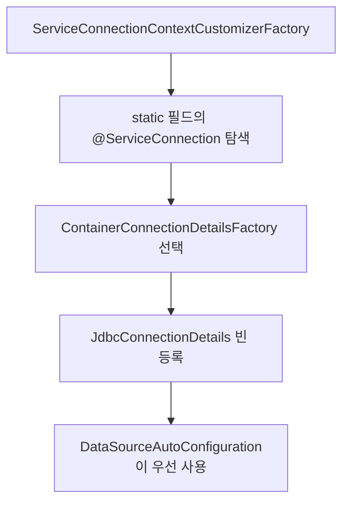

> H2의 PostgreSQL 호환 모드로는 잡히지 않는 쿼리 오류를 겪은 뒤, 통합 테스트를 실제 PostgreSQL·Redis 컨테이너 위에서 돌리도록 바꿨습니다. Spring Boot 3.1에 추가된 `@ServiceConnection`으로 연결 설정 코드를 없애고, 싱글턴 컨테이너와 개발용 `TestApplication`까지 구성한 과정을 정리합니다.

> 본 문서는 Spring Boot 3.1.5, Testcontainers 1.19.1, Kotlin 1.9.10, PostgreSQL 16, Redis 7, Docker Desktop 환경을 기준으로 작성되었습니다.
{: .prompt-info }

## 도입 배경

팀 프로젝트의 통합 테스트는 `jdbc:h2:mem:testdb;MODE=PostgreSQL`로 돌아가고 있었습니다. 그런데 `jsonb` 컬럼과 `->>` 연산자를 쓰는 네이티브 쿼리를 추가하자, 테스트용 스키마와 운영 스키마가 어긋나면서 로컬에서 검증한 쿼리가 배포 서버에서 다르게 동작하는 일이 생겼습니다. 테스트 DB와 운영 DB가 다르면 테스트가 통과해도 안심할 수 없다는 것을 그때 체감했습니다.

Testcontainers는 테스트 중에 Docker 컨테이너를 띄우고 종료 시 정리해 주는 라이브러리입니다. 다만 Spring Boot 3.0까지는 컨테이너가 받은 임의 포트를 `@DynamicPropertySource`로 `spring.datasource.url` 등에 직접 옮겨 적어야 했습니다. Spring Boot 3.1부터는 `@ServiceConnection` 하나로 이 연결을 자동 처리합니다.

| 방식 | 연결 설정 방법 | 장점 | 적합하지 않은 경우 |
| :--- | :--- | :--- | :--- |
| H2 호환 모드 | `application.yml` 고정 | 가장 빠르고 Docker 불필요 | DB 전용 문법·타입을 쓰는 쿼리 |
| `@DynamicPropertySource` | 프로퍼티 키를 직접 등록 | 모든 라이브러리에 적용 가능 | 키 오타·누락을 컴파일 시점에 못 잡음 |
| `@ServiceConnection` | `ConnectionDetails` 빈 자동 등록 | 설정 코드 없음, 타입 안전 | 지원 목록에 없는 컨테이너 |
| Docker Compose 지원 | `compose.yaml` 기반 | 로컬 개발 환경과 공유 | 테스트마다 격리된 DB가 필요할 때 |

반대로 Docker를 쓸 수 없는 CI 러너이거나, 순수 도메인 로직만 검증하는 테스트라면 컨테이너를 띄울 이유가 없습니다. 컨테이너 기동에는 수 초가 걸리므로 슬라이스 테스트와 단위 테스트를 먼저 두고, 실제 DB가 꼭 필요한 테스트에만 적용하는 것이 맞습니다.

## 프로젝트 설정

Spring Boot 3.1.5가 관리하는 Testcontainers 버전은 1.18.3입니다. 저는 당시 최신이던 1.19.1을 쓰기 위해 버전 프로퍼티를 덮어썼습니다.

```kotlin
// build.gradle.kts
plugins {
    id("org.springframework.boot") version "3.1.5"
    id("io.spring.dependency-management") version "1.1.3"
    kotlin("jvm") version "1.9.10"
    kotlin("plugin.spring") version "1.9.10"
    kotlin("plugin.jpa") version "1.9.10"
}

extra["testcontainers.version"] = "1.19.1"

dependencies {
    implementation("org.springframework.boot:spring-boot-starter-data-jpa")
    implementation("org.springframework.boot:spring-boot-starter-data-redis")
    implementation("org.springframework.boot:spring-boot-starter-web")
    implementation("org.jetbrains.kotlin:kotlin-reflect")
    runtimeOnly("org.postgresql:postgresql")

    testImplementation("org.springframework.boot:spring-boot-starter-test")
    testImplementation("org.springframework.boot:spring-boot-testcontainers")
    testImplementation("org.testcontainers:junit-jupiter")
    testImplementation("org.testcontainers:postgresql")
}

tasks.withType<Test> {
    useJUnitPlatform()
}
```

## Step 1. 싱글턴 컨테이너와 @ServiceConnection

공식 예제처럼 `@Testcontainers`와 `@Container`를 쓰면 테스트 클래스가 끝날 때마다 컨테이너가 내려가고, 다음 클래스에서 다시 올라옵니다. 통합 테스트 클래스가 많아지면 이 시간이 누적되므로, 저는 추상 부모 클래스의 `companion object`에서 한 번만 시작하는 싱글턴 컨테이너 패턴을 사용했습니다.

```kotlin
// src/test/kotlin/com/example/studyroom/support/IntegrationTestSupport.kt
package com.example.studyroom.support

import org.springframework.boot.test.context.SpringBootTest
import org.springframework.boot.testcontainers.service.connection.ServiceConnection
import org.testcontainers.containers.GenericContainer
import org.testcontainers.containers.PostgreSQLContainer
import org.testcontainers.utility.DockerImageName

@SpringBootTest
abstract class IntegrationTestSupport {

    companion object {
        @JvmStatic
        @ServiceConnection
        val postgres = PostgreSQLContainer("postgres:16-alpine")

        @JvmStatic
        @ServiceConnection(name = "redis")
        val redis: GenericContainer<*> = GenericContainer(DockerImageName.parse("redis:7-alpine"))
            .withExposedPorts(6379)

        init {
            postgres.start()
            redis.start()
        }
    }
}
```

```kotlin
// src/test/kotlin/com/example/studyroom/reservation/ReservationIntegrationTest.kt
package com.example.studyroom.reservation

import com.example.studyroom.support.IntegrationTestSupport
import org.assertj.core.api.Assertions.assertThat
import org.junit.jupiter.api.Test
import org.springframework.beans.factory.annotation.Autowired
import org.springframework.data.redis.core.StringRedisTemplate
import org.springframework.jdbc.core.JdbcTemplate

class ReservationIntegrationTest(
    @Autowired val jdbcTemplate: JdbcTemplate,
    @Autowired val redisTemplate: StringRedisTemplate,
) : IntegrationTestSupport() {

    @Test
    fun `실제 PostgreSQL과 Redis에 연결된다`() {
        val version = jdbcTemplate.queryForObject("select version()", String::class.java)
        redisTemplate.opsForValue().set("ping", "pong")

        assertThat(version).contains("PostgreSQL 16")
        assertThat(redisTemplate.opsForValue().get("ping")).isEqualTo("pong")
    }
}
```

Redis처럼 전용 모듈 없이 `GenericContainer`를 쓰는 경우에는 어떤 서비스인지 알 수 없으므로 `name = "redis"`를 지정해야 합니다. PostgreSQL은 `PostgreSQLContainer` 타입만으로 판별됩니다.

## 동작 원리와 @DynamicPropertySource 비교

`@ServiceConnection`은 프로퍼티를 덮어쓰는 방식이 아닙니다. Spring Boot 3.1은 `JdbcConnectionDetails`, `RedisConnectionDetails` 같은 `ConnectionDetails` 추상화를 도입했고, 자동 구성은 이 빈이 있으면 `spring.datasource.*` 프로퍼티보다 우선 사용합니다.



흐름을 한 단계 더 보면, `ServiceConnectionContextCustomizerFactory`가 테스트 클래스와 부모 클래스의 필드를 훑어 `@ServiceConnection`을 찾습니다. 이때 필드가 static이 아니면 `@ServiceConnection field 'postgres' must be static` 오류로 실패합니다. Kotlin에서는 `companion object`의 프로퍼티가 바깥 클래스의 static 필드로 컴파일되기 때문에 위 코드가 동작합니다. 찾은 컨테이너는 이름과 타입에 맞는 `ContainerConnectionDetailsFactory`를 거쳐 `ConnectionDetails` 빈이 되고, 실제 호스트와 포트는 컨테이너가 시작된 뒤 조회됩니다.

비교를 위해 같은 연결을 `@DynamicPropertySource`로 작성하면 다음과 같습니다.

```kotlin
// 비교용: Spring Boot 3.0 이전 방식
@JvmStatic
@DynamicPropertySource
fun registerProperties(registry: DynamicPropertyRegistry) {
    registry.add("spring.datasource.url", postgres::getJdbcUrl)
    registry.add("spring.datasource.username", postgres::getUsername)
    registry.add("spring.datasource.password", postgres::getPassword)
    registry.add("spring.data.redis.host", redis::getHost)
    registry.add("spring.data.redis.port") { redis.getMappedPort(6379) }
}
```

Spring Boot 3에서 Redis 프로퍼티 접두사가 `spring.redis`에서 `spring.data.redis`로 바뀐 것처럼, 키를 직접 쓰는 방식은 버전 변경에 취약합니다. `@ServiceConnection`은 이런 키를 몰라도 되므로 지원되는 서비스라면 우선 선택합니다. 컨테이너 필드 구성은 `ContextCustomizer`로 컨텍스트 캐시 키에도 포함됩니다. 그래서 통합 테스트가 모두 같은 부모 클래스를 상속하게 해야 컨텍스트가 하나로 재사용됩니다. 캐시 키의 동작은 [Spring 테스트 슬라이스와 ApplicationContext 캐싱 동작 정리](/posts/spring-test-slice-context-caching/)에서 자세히 다뤘습니다.

## Step 2. 개발용 TestApplication과 컨테이너 재사용

Spring Boot 3.1은 테스트 클래스패스의 `main` 함수로 애플리케이션을 띄우는 기능도 추가했습니다. 컨테이너를 빈으로 선언하면 로컬 개발 서버도 같은 DB 이미지로 실행할 수 있습니다.

```kotlin
// src/test/kotlin/com/example/studyroom/TestStudyRoomApplication.kt
package com.example.studyroom

import org.springframework.boot.fromApplication
import org.springframework.boot.test.context.TestConfiguration
import org.springframework.boot.testcontainers.service.connection.ServiceConnection
import org.springframework.boot.with
import org.springframework.context.annotation.Bean
import org.testcontainers.containers.GenericContainer
import org.testcontainers.containers.PostgreSQLContainer
import org.testcontainers.utility.DockerImageName

@TestConfiguration(proxyBeanMethods = false)
class LocalContainersConfig {

    @Bean
    @ServiceConnection
    fun postgres(): PostgreSQLContainer<*> =
        PostgreSQLContainer("postgres:16-alpine").withReuse(true)

    @Bean
    @ServiceConnection(name = "redis")
    fun redis(): GenericContainer<*> =
        GenericContainer(DockerImageName.parse("redis:7-alpine")).withExposedPorts(6379)
}

fun main(args: Array<String>) {
    fromApplication<StudyRoomApplication>().with(LocalContainersConfig::class).run(*args)
}
```

`./gradlew bootTestRun`으로 실행하면 컨테이너 빈이 먼저 시작되고 애플리케이션이 그 위에 연결됩니다. `withReuse(true)`가 실제로 동작하려면 사용자 홈의 `~/.testcontainers.properties`에 `testcontainers.reuse.enable=true`를 추가해야 합니다. 그러면 재실행할 때 기존 컨테이너를 찾아 연결하므로 기동 시간이 줄어듭니다.

> 재사용 컨테이너는 Ryuk가 정리하지 않으므로 `docker ps`로 확인해 직접 지워야 하고, 이전 실행의 데이터가 남아 테스트 격리가 깨질 수 있습니다. 저는 재사용을 로컬 개발 서버에만 쓰고 CI와 테스트 코드에는 켜지 않았습니다. 또한 싱글턴 패턴에 `@Container`를 함께 붙이면 클래스가 끝날 때 컨테이너가 중지되어 다음 테스트 클래스의 연결이 끊기므로 둘을 섞지 않아야 합니다.
{: .prompt-warning }

## 정리

실제 DB로 테스트하는 비용은 컨테이너 기동 몇 초로 줄었고, 연결 설정 코드는 어노테이션 하나로 사라졌습니다. 적용 전에 확인한 항목은 다음과 같습니다.

- [ ] DB 전용 문법이나 타입을 쓰는 쿼리가 있어 H2로는 검증이 부족한가?
- [ ] 컨테이너 필드를 `companion object`의 static 필드로 선언했는가?
- [ ] `GenericContainer`에는 `@ServiceConnection(name = ...)`을 지정했는가?
- [ ] 통합 테스트가 같은 부모 클래스를 상속해 컨텍스트 하나를 공유하는가?
- [ ] 컨테이너 재사용을 CI가 아닌 로컬 개발 환경에만 켰는가?
