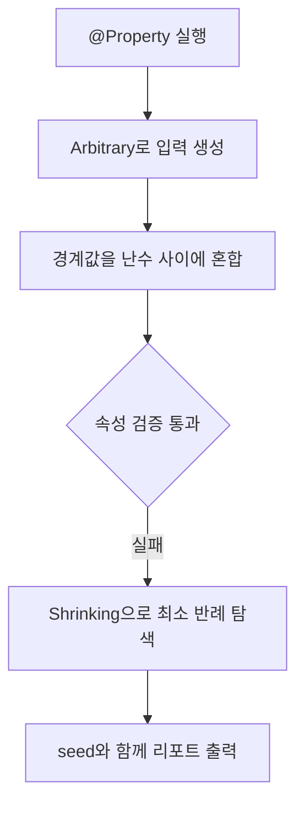

> 동아리 프로젝트의 회비 정산 로직은 예제 테스트를 모두 통과했지만, 실제 운영에서 1원 단위 금액이 사라지는 문제가 있었습니다. Jqwik으로 "어떤 입력이든 성립해야 하는 규칙"을 테스트로 옮기고, shrinking이 찾아 준 최소 반례로 버그를 고친 과정을 정리합니다.

> 본 문서는 Spring Boot 3.5.0, Kotlin 2.1.21, Jqwik 1.9.3(`jqwik-kotlin` 포함), JUnit 5.13.1, Gradle Kotlin DSL 환경을 기준으로 작성되었습니다.
{: .prompt-info }

## 도입 배경

동아리에서 스터디룸 예약과 모임 회비 정산 서비스를 운영하고 있습니다. 정산은 총액을 참석 인원으로 나누는 단순한 로직이라 `10,000원 / 4명 = 2,500원` 같은 예제 테스트 몇 개로 충분하다고 생각했습니다. 그런데 `10,000원 / 3명`처럼 나누어떨어지지 않는 금액에서 1원이 사라졌고, 총무가 장부를 맞추다가 이 문제를 발견했습니다.

예제 기반 테스트는 제가 떠올린 입력만 검증합니다. 속성 기반 테스트는 반대로 "분배 금액의 합은 항상 총액과 같다" 같은 규칙을 선언하고, 도구가 수백 개의 입력을 생성해 규칙을 깨는 반례를 찾습니다.

| 기준 | 예제 기반 (`@Test`, `@Example`) | 속성 기반 (`@Property`) |
| :--- | :--- | :--- |
| 입력 | 개발자가 직접 고른 값 | 생성기(`Arbitrary`)가 만든 값 |
| 검증 대상 | 특정 입력의 기대 출력 | 모든 입력에서 성립하는 불변식 |
| 강점 | 요구사항 문서화, 읽기 쉬움 | 경계값·조합 누락 발견 |
| 실패 시 | 입력 그대로 보고 | 최소 반례로 줄여서 보고 |

속성 기반 테스트를 쓰지 말아야 할 때도 분명합니다. 외부 API 호출이나 DB 저장이 섞인 테스트를 1,000번 반복하면 느리고 불안정해집니다. 불변식을 말로 정의하기 어려운 화면 문구나 단순 위임 메서드도 대상이 아닙니다. 저는 순수 함수로 분리할 수 있는 계산·판정 로직에만 적용했습니다.

## 프로젝트 설정

Jqwik은 JUnit Platform 위에서 동작하는 독립 테스트 엔진입니다. 예전에 [Fixture Monkey를 활용한 더미 데이터 생성](/posts/fixture-monkey/)에서 쓴 Fixture Monkey도 내부적으로 Jqwik의 `Arbitrary`를 사용하기 때문에 익숙한 API가 많았습니다. `jqwik-kotlin` 모듈은 Kotlin 전용 생성기 함수와 nullable 타입 지원을 추가합니다. Jqwik 1.9.3은 JUnit Platform 1.13.1에 맞춰 빌드되었기 때문에, Spring Boot 3.5.0이 관리하는 JUnit 5.12.2를 같은 버전대로 올려 플랫폼 버전을 일치시켰습니다.

```kotlin
// build.gradle.kts
plugins {
    id("org.springframework.boot") version "3.5.0"
    id("io.spring.dependency-management") version "1.1.7"
    kotlin("jvm") version "2.1.21"
    kotlin("plugin.spring") version "2.1.21"
}

extra["junit-jupiter.version"] = "5.13.1"

dependencies {
    testImplementation("org.springframework.boot:spring-boot-starter-test")
    testImplementation("net.jqwik:jqwik:1.9.3")
    testImplementation("net.jqwik:jqwik-kotlin:1.9.3")
    testRuntimeOnly("org.junit.platform:junit-platform-launcher")
}

kotlin {
    compilerOptions {
        freeCompilerArgs.addAll(
            "-Xjsr305=strict",
            "-Xnullability-annotations=@org.jspecify.annotations:strict",
            "-Xemit-jvm-type-annotations", // 타입 위치 어노테이션을 바이트코드에 남김
        )
        javaParameters = true // 실패 리포트에 실제 파라미터 이름 표시
    }
}

tasks.withType<Test> {
    useJUnitPlatform {
        includeEngines("jqwik", "junit-jupiter")
    }
}
```

`-Xemit-jvm-type-annotations`가 없으면 `List<@AlphaChars String>`처럼 타입 인자에 붙인 제약 어노테이션이 무시됩니다.

## Step 1. 정산 분배 규칙을 속성으로 옮기기

문제가 된 기존 코드는 몫만 계산해 인원수만큼 채우고 있었습니다.

```kotlin
// src/main/kotlin/com/example/club/settlement/SettlementCalculator.kt
package com.example.club.settlement

object SettlementCalculator {
    // 수정 전: fun split(total: Long, people: Int) = List(people) { total / people }

    fun split(total: Long, people: Int): List<Long> {
        require(total >= 0) { "총액은 0 이상이어야 합니다." }
        require(people > 0) { "인원은 1명 이상이어야 합니다." }
        val base = total / people
        val remainder = (total % people).toInt()
        // 나머지는 앞사람부터 1원씩 더 부담합니다.
        return List(people) { index -> if (index < remainder) base + 1 else base }
    }
}
```

속성은 세 가지로 정의했습니다. 합계 보존, 인원수 일치, 최대·최소 부담액 차이 1원 이하입니다.

```kotlin
// src/test/kotlin/com/example/club/settlement/SettlementPropertyTest.kt
package com.example.club.settlement

import net.jqwik.api.Arbitrary
import net.jqwik.api.ForAll
import net.jqwik.api.Property
import net.jqwik.api.Provide
import net.jqwik.api.statistics.Statistics
import net.jqwik.api.constraints.LongRange
import net.jqwik.kotlin.api.any
import org.assertj.core.api.Assertions.assertThat

class SettlementPropertyTest {

    @Property
    fun `분배 금액의 합은 총액과 같다`(
        @ForAll @LongRange(min = 0, max = 10_000_000) total: Long,
        @ForAll("peopleCounts") people: Int,
    ) {
        Statistics.collect(if (total % people == 0L) "나누어떨어짐" else "나머지 있음")

        val shares = SettlementCalculator.split(total, people)

        assertThat(shares).hasSize(people)
        assertThat(shares.sum()).isEqualTo(total)
        assertThat(shares.max() - shares.min()).isLessThanOrEqualTo(1L)
    }

    @Provide
    fun peopleCounts(): Arbitrary<Int> = Int.any(1..30)
}
```

수정 전 코드로 실행하면 Jqwik은 처음 발견한 큰 반례를 그대로 보고하지 않고, 같은 속성을 깨는 더 작은 입력을 찾아 줄여서 보여 줍니다.

```text
Shrunk Sample (5 steps)
-----------------------
  total: 1
  people: 2

Original Sample
---------------
  total: 783421
  people: 7
```

`783421원 / 7명`보다 `1원 / 2명`이 원인을 훨씬 빨리 드러냅니다. `Statistics.collect`로 남긴 분포를 보면 생성된 입력 중 나머지가 있는 경우가 대부분이었는데, 예제 테스트는 나누어떨어지는 값만 쓰고 있었다는 것도 확인할 수 있었습니다.

## Step 2. 생성기를 조합해 예약 경계 검증하기

예약 기능에서는 두 시간대의 겹침 판정이 핵심입니다. 시간은 오전 9시 기준 분 단위 정수로 표현했습니다.

```kotlin
// src/main/kotlin/com/example/club/reservation/TimeSlot.kt
package com.example.club.reservation

data class TimeSlot(val start: Int, val end: Int) {
    init {
        require(start < end) { "종료 시각은 시작 시각보다 뒤여야 합니다." }
    }

    // 수정 전: start <= other.end && other.start <= end
    fun overlaps(other: TimeSlot): Boolean = start < other.end && other.start < end
}
```

```kotlin
// src/test/kotlin/com/example/club/reservation/TimeSlotPropertyTest.kt
package com.example.club.reservation

import net.jqwik.api.Arbitrary
import net.jqwik.api.ForAll
import net.jqwik.api.Property
import net.jqwik.api.Provide
import net.jqwik.kotlin.api.any
import net.jqwik.kotlin.api.combine
import org.assertj.core.api.Assertions.assertThat

class TimeSlotPropertyTest {

    @Property
    fun `겹침 판정은 대칭이다`(@ForAll("slots") a: TimeSlot, @ForAll("slots") b: TimeSlot) {
        assertThat(a.overlaps(b)).isEqualTo(b.overlaps(a))
    }

    @Property
    fun `연달아 잡은 예약은 겹치지 않는다`(@ForAll("slots") first: TimeSlot, @ForAll("lengths") length: Int) {
        val next = TimeSlot(first.end, first.end + length)

        assertThat(first.overlaps(next)).isFalse()
    }

    @Provide
    fun slots(): Arbitrary<TimeSlot> =
        combine(Int.any(0..720), Int.any(10..180)) { start, length -> TimeSlot(start, start + length) }

    @Provide
    fun lengths(): Arbitrary<Int> = Int.any(10..180)
}
```

수정 전 코드는 두 번째 속성에서 바로 실패했습니다. 10시~11시 예약 뒤에 11시~12시 예약을 잡으면 충돌로 판정하고 있었던 것입니다. 동아리원들이 "연속 예약이 안 된다"고 했던 문의의 원인이 이 비교 연산자 하나였습니다.

## 동작 원리와 실패 재현

`@Property` 메서드 하나는 기본 1,000회 실행됩니다. 각 시도에서 Jqwik은 파라미터마다 `Arbitrary`를 찾아 값을 만들고, `0`, `1`, 범위의 최솟값·최댓값 같은 경계값(edge case)을 일반 난수 사이에 섞어 넣습니다.



Shrinking은 생성된 값이 어떤 단계를 거쳐 만들어졌는지 기억해 두었다가, 그 단계를 거꾸로 줄여 가며 여전히 실패하는 가장 작은 입력을 찾는 과정입니다. `combine`으로 만든 `TimeSlot`도 시작 시각과 길이를 각각 줄이기 때문에 조합 객체 단위로 최소 반례가 나옵니다. 기본 모드인 `ShrinkingMode.BOUNDED`는 10초가 지나면 그때까지 찾은 최선의 값을 보고합니다.

실패하면 리포트에 `seed`가 함께 출력됩니다. 기본 설정(`AfterFailureMode.SAMPLE_FIRST`)에서는 다음 실행 때 직전에 실패한 샘플부터 다시 시도하므로, 코드를 고친 뒤 같은 반례로 바로 확인할 수 있습니다. 다른 개발자 PC에서 재현하려면 `@Property(seed = "...")`에 리포트의 값을 넣으면 됩니다.

> 생성기에서 `filter`로 조건을 과하게 거르면 Jqwik이 유효한 값을 충분히 만들지 못해 `TooManyFilterMissesException`으로 실패합니다. 또한 Kotlin에서 `net.jqwik.api.constraints.IntRange`를 그대로 import하면 표준 라이브러리의 `kotlin.ranges.IntRange`와 이름이 겹쳐 혼란스럽기 때문에, 저는 정수 범위를 `Int.any(1..30)` 같은 `@Provide` 생성기로 표현했습니다.
{: .prompt-warning }

## 정리

속성 기반 테스트는 예제 테스트를 대체하기보다, 제가 떠올리지 못한 입력을 대신 찾아 주는 보완재였습니다. 이후 이 테스트는 정산 방식이 바뀔 때도 같은 규칙을 계속 검증하고 있습니다. 도입할 때 확인한 항목은 다음과 같습니다.

- [ ] 검증 대상을 외부 의존성 없는 순수 함수로 분리했는가?
- [ ] "합계 보존", "대칭성", "경계 비포함"처럼 입력과 무관한 규칙을 문장으로 정의했는가?
- [ ] `Statistics.collect`로 생성된 입력 분포가 의도대로인지 확인했는가?
- [ ] JUnit Jupiter와 Jqwik이 사용하는 JUnit Platform 버전을 일치시켰는가?
- [ ] 실패 리포트의 `seed`와 최소 반례를 회귀용 `@Example` 테스트로 남겼는가?
