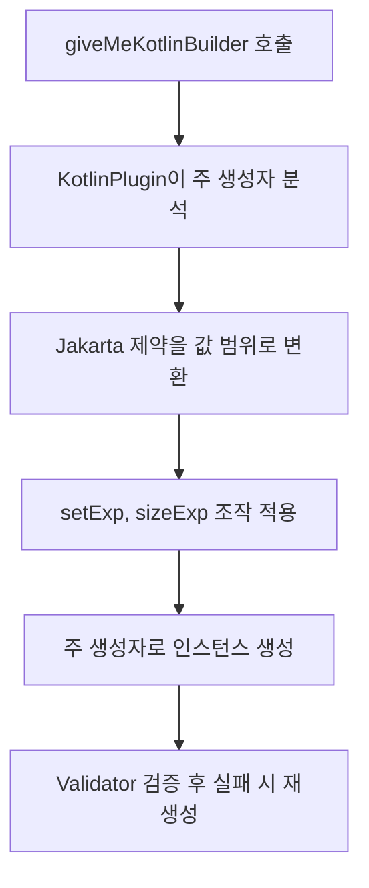

> [Fixture Monkey를 활용한 더미 데이터 생성](/posts/fixture-monkey/)에서는 검증 어노테이션을 반영한 무작위 객체를 만드는 데까지 다뤘습니다. 이번에는 동아리 예약 서비스에서 "필드 하나하나는 유효하지만 조합하면 도메인 규칙을 어기는" 데이터 문제를 Kotlin 빌더 API로 풀고, Jqwik 속성 테스트와 결합한 과정을 정리합니다.

> 본 문서는 Fixture Monkey 1.1.12, Jqwik 1.9.3, Kotlin 2.1.21, Spring Boot 3.5.0, JUnit 5.13.1 환경을 기준으로 작성되었습니다.
{: .prompt-info }

## 도입 배경

동아리 스터디룸 예약 API에 Fixture Monkey를 붙이자 요청 DTO는 쉽게 만들 수 있었습니다. 문제는 도메인 규칙이었습니다. `headCount`는 1~10, `participantIds`는 1~10개라는 각각의 제약은 지켜졌지만, "참석 인원과 참가자 수는 같아야 한다"는 필드 간 규칙은 대부분의 샘플이 어겼습니다. 결국 테스트마다 객체를 `copy()`로 고치는 코드가 늘었고, 무작위 데이터를 쓰는 의미가 흐려졌습니다.

그래서 도구별 역할을 다시 정리했습니다.

| 방법 | 적합한 상황 | 한계 |
| :--- | :--- | :--- |
| `giveMeOne<T>()` | 값과 무관하게 "아무 유효 객체"가 필요한 테스트 | 필드 간 규칙 보장 불가 |
| `giveMeKotlinBuilder` + `setExp`/`sizeExp` | 특정 필드를 고정해 시나리오를 드러낼 때 | 고정 값이 많아지면 수동 생성과 차이 없음 |
| `thenApply` | 생성된 값에 맞춰 다른 필드를 맞출 때 | 내부적으로 한 번 더 샘플링해 느림 |
| Jqwik `combine` + Fixture Monkey | 핵심 필드는 경계값·축소, 나머지는 자동 채움 | 설정이 가장 복잡함 |
| 직접 작성한 팩토리 함수 | 필드가 3~4개인 값 객체 | 필드 추가 시 테스트 전체 수정 |

Fixture Monkey를 쓰지 말아야 할 경우도 있습니다. 필드가 몇 개 없는 값 객체는 생성자를 직접 호출하는 쪽이 읽기 쉽습니다. 응답 스냅샷처럼 항상 같은 데이터가 필요한 테스트나, 검증 실패 메시지 자체를 확인하는 테스트에도 무작위 데이터는 방해가 됩니다.

## 프로젝트 설정

이전 글처럼 `java-test-fixtures` 플러그인으로 픽스처를 분리하고, Jqwik과 Kotlin 모듈을 함께 추가했습니다. `fixture-monkey-starter-kotlin`에는 Jakarta Validation 플러그인이 이미 포함되어 있습니다.

```kotlin
// build.gradle.kts
plugins {
    id("org.springframework.boot") version "3.5.0"
    id("io.spring.dependency-management") version "1.1.7"
    kotlin("jvm") version "2.1.21"
    kotlin("plugin.spring") version "2.1.21"
    id("java-test-fixtures")
}

extra["junit-jupiter.version"] = "5.13.1"

dependencies {
    implementation("org.springframework.boot:spring-boot-starter-validation")

    testFixturesApi("com.navercorp.fixturemonkey:fixture-monkey-starter-kotlin:1.1.12")
    testImplementation("org.springframework.boot:spring-boot-starter-test")
    testImplementation("net.jqwik:jqwik:1.9.3")
    testImplementation("net.jqwik:jqwik-kotlin:1.9.3")
    testRuntimeOnly("org.junit.platform:junit-platform-launcher")
}

kotlin {
    compilerOptions {
        freeCompilerArgs.addAll("-Xjsr305=strict", "-Xemit-jvm-type-annotations")
        javaParameters = true
    }
}

tasks.withType<Test> {
    useJUnitPlatform()
}
```

요청 DTO와 정책은 다음과 같습니다.

```kotlin
// src/main/kotlin/com/example/club/reservation/ReservationRequest.kt
package com.example.club.reservation

import jakarta.validation.Valid
import jakarta.validation.constraints.Email
import jakarta.validation.constraints.Max
import jakarta.validation.constraints.Min
import jakarta.validation.constraints.NotBlank
import jakarta.validation.constraints.Pattern
import jakarta.validation.constraints.Size

data class ReservationRequest(
    @field:NotBlank @field:Size(max = 20) val roomName: String,
    @field:Min(1) @field:Max(10) val headCount: Int,
    @field:Min(30) @field:Max(240) val durationMinutes: Int,
    @field:NotBlank @field:Email val contactEmail: String,
    @field:Valid val host: Host,
    @field:Size(min = 1, max = 10) val participantIds: List<Long>,
)

data class Host(
    @field:NotBlank @field:Size(max = 10) val name: String,
    @field:Pattern(regexp = "^\\d{9}$") val studentId: String,
)

object ReservationPolicy {
    const val ROOM_CAPACITY = 10

    fun violations(request: ReservationRequest): List<String> = buildList {
        // 수정 전: request.headCount >= ROOM_CAPACITY
        if (request.headCount > ROOM_CAPACITY) add("정원을 초과했습니다.")
        if (request.participantIds.size != request.headCount) add("참가자 수와 인원이 다릅니다.")
        if (request.durationMinutes % 30 != 0) add("30분 단위로만 예약할 수 있습니다.")
    }
}
```

```kotlin
// src/testFixtures/kotlin/com/example/club/fixture/ClubFixtures.kt
package com.example.club.fixture

import com.navercorp.fixturemonkey.FixtureMonkey
import com.navercorp.fixturemonkey.jakarta.validation.plugin.JakartaValidationPlugin
import com.navercorp.fixturemonkey.kotlin.KotlinPlugin

object ClubFixtures {
    val fixtureMonkey: FixtureMonkey = FixtureMonkey.builder()
        .plugin(KotlinPlugin())
        .plugin(JakartaValidationPlugin())
        .defaultNotNull(true)
        .build()
}
```

## Step 1. Kotlin 빌더로 시나리오 고정하기

`giveMeKotlinBuilder`는 Kotlin 프로퍼티 참조를 받는 `setExp`, `sizeExp`, `setPostCondition`을 제공합니다. 문자열 경로(`"host.name"`) 대신 `Host::name` 같은 참조를 쓰므로 필드명을 바꾸면 컴파일 단계에서 바로 드러납니다.

```kotlin
// src/test/kotlin/com/example/club/reservation/ReservationFixtureTest.kt
package com.example.club.reservation

import com.example.club.fixture.ClubFixtures.fixtureMonkey
import com.navercorp.fixturemonkey.kotlin.giveMeKotlinBuilder
import com.navercorp.fixturemonkey.kotlin.into
import org.assertj.core.api.Assertions.assertThat
import org.junit.jupiter.api.Test

class ReservationFixtureTest {

    @Test
    fun `필드를 고정하면 나머지는 제약 안에서 채워진다`() {
        val request = fixtureMonkey.giveMeKotlinBuilder<ReservationRequest>()
            .setExp(ReservationRequest::headCount, 4)
            .sizeExp(ReservationRequest::participantIds, 4)
            .setExp(ReservationRequest::host into Host::name, "김남주")
            .setPostCondition<Int>(ReservationRequest::durationMinutes) { it % 30 == 0 }
            .sample()

        assertThat(request.host.name).isEqualTo("김남주")
        assertThat(ReservationPolicy.violations(request)).isEmpty()
    }

    @Test
    fun `생성된 인원 수에 맞춰 참가자 목록 크기를 맞춘다`() {
        val request = fixtureMonkey.giveMeKotlinBuilder<ReservationRequest>()
            .setPostCondition<Int>(ReservationRequest::durationMinutes) { it % 30 == 0 }
            .thenApply { sampled, builder -> builder.size("participantIds", sampled.headCount) }
            .sample()

        assertThat(request.participantIds).hasSize(request.headCount)
    }
}
```

`setPostCondition`은 조건을 만족할 때까지 다시 생성하는 필터입니다. `durationMinutes`는 30~240 범위에서 30의 배수가 8개뿐이라 재시도가 잦습니다. 가능하면 `setExp`로 값을 직접 지정하는 편이 빠릅니다.

## Step 2. Jqwik 속성 테스트와 결합하기

처음에는 `@Provide` 메서드에서 `giveMeKotlinBuilder<T>().build()`를 그대로 반환했습니다. `build()`가 Jqwik의 `Arbitrary<T>`를 돌려주기 때문입니다. 그런데 실패했을 때 반례가 전혀 줄어들지 않았습니다. 이유는 다음 섹션에서 설명하고, 해결한 코드부터 보겠습니다. 핵심 필드는 Jqwik `combine`으로 만들고, 나머지는 Fixture Monkey가 채우게 했습니다. Jqwik 설정과 shrinking 개념은 [Jqwik 속성 기반 테스트로 예약·정산 도메인의 경계값 검증하기](/posts/jqwik-property-based-testing/)에 정리했습니다.

```kotlin
// src/test/kotlin/com/example/club/reservation/ReservationPolicyPropertyTest.kt
package com.example.club.reservation

import com.example.club.fixture.ClubFixtures.fixtureMonkey
import com.navercorp.fixturemonkey.kotlin.giveMeKotlinBuilder
import net.jqwik.api.Arbitrary
import net.jqwik.api.ForAll
import net.jqwik.api.Property
import net.jqwik.api.Provide
import net.jqwik.kotlin.api.any
import net.jqwik.kotlin.api.combine
import org.assertj.core.api.Assertions.assertThat

class ReservationPolicyPropertyTest {

    @Property(tries = 200)
    fun `규칙을 지킨 예약 요청은 정책 위반이 없다`(@ForAll("validRequests") request: ReservationRequest) {
        assertThat(ReservationPolicy.violations(request)).isEmpty()
    }

    @Provide
    fun validRequests(): Arbitrary<ReservationRequest> =
        combine(Int.any(1..10), Int.any(1..8)) { headCount, slots ->
            fixtureMonkey.giveMeKotlinBuilder<ReservationRequest>()
                .setExp(ReservationRequest::headCount, headCount)
                .sizeExp(ReservationRequest::participantIds, headCount)
                .setExp(ReservationRequest::durationMinutes, slots * 30)
                .sample()
        }
}
```

이 테스트는 처음 실행에서 바로 실패했습니다. Jqwik이 `Int.any(1..10)`의 경계값인 10을 난수 사이에 섞어 넣었고, 축소된 반례는 `headCount: 10`이었습니다. 정책 코드가 `headCount >= ROOM_CAPACITY`로 작성되어 정원을 꽉 채운 예약을 거절하고 있었습니다. 무작위 값만 쓰던 기존 Fixture Monkey 테스트에서는 10이 나올 확률이 낮아 놓쳤던 경계였습니다.

## 동작 원리

Fixture Monkey는 객체를 바로 만들지 않고, 타입을 분석해 프로퍼티 트리를 만든 뒤 각 노드에 생성 규칙을 붙입니다.



`KotlinPlugin`은 `PrimaryConstructorArbitraryIntrospector`를 우선 사용해 data class의 주 생성자 파라미터를 프로퍼티로 인식합니다. `JakartaValidationPlugin`은 `JakartaValidationConstraintGenerator`로 `@Size`, `@Min`, `@Pattern`, `@Email` 같은 어노테이션을 생성 범위로 바꾸고, `JakartaArbitraryValidator`로 완성된 객체를 한 번 더 검증합니다. 검증이나 `setPostCondition`에 실패하면 `generateMaxTries` 횟수까지 다시 생성합니다.

반례가 줄어들지 않았던 이유는 `build()`의 구현에 있습니다. 1.1.12 기준 `DefaultArbitraryBuilder.build()`는 `Arbitraries.ofSuppliers { ... }`로 감싼 `Arbitrary`를 반환합니다. Jqwik 입장에서는 "값을 공급하는 함수" 하나일 뿐이라 내부 필드를 어떻게 줄여야 할지 알 수 없습니다. 반면 `combine`으로 만든 `headCount`와 `slots`는 Jqwik이 생성 과정을 추적하므로 경계값 삽입과 축소가 모두 동작합니다.

> Fixture Monkey 1.1.x는 Jqwik 1.7.3에 의존하므로, Jqwik 1.9.3을 함께 선언하면 Gradle이 더 높은 버전으로 맞춥니다. `./gradlew dependencyInsight --dependency net.jqwik:jqwik-api --configuration testRuntimeClasspath`로 실제 해석 버전을 확인해 두는 것이 좋습니다. 또한 `combine` 안의 Fixture Monkey 필드는 축소 단계마다 새로 무작위 생성되므로, 실패 원인이 고정하지 않은 필드에 있다면 반례가 흔들릴 수 있습니다. 이때는 `FixtureMonkey.builder().seed(...)`로 시드를 고정해 재현합니다.
{: .prompt-warning }

## 정리

Fixture Monkey는 "나머지 필드를 유효하게 채우는 일"에, Jqwik은 "중요한 필드의 경계를 탐색하고 반례를 줄이는 일"에 맡기니 두 도구의 장점이 겹치지 않고 맞물렸습니다. 적용 전에 확인한 항목은 다음과 같습니다.

- [ ] 필드 간 도메인 규칙이 있는 객체를 `giveMeOne`만으로 만들고 있지 않은가?
- [ ] 문자열 경로 대신 `setExp`, `sizeExp`, `into`로 프로퍼티 참조를 사용했는가?
- [ ] `setPostCondition`의 통과 확률이 낮다면 `setExp`로 값을 직접 지정했는가?
- [ ] 축소가 필요한 핵심 필드는 Jqwik `combine`으로 생성하고 있는가?
- [ ] Jqwik 해석 버전과 실패 재현용 시드를 확인했는가?
