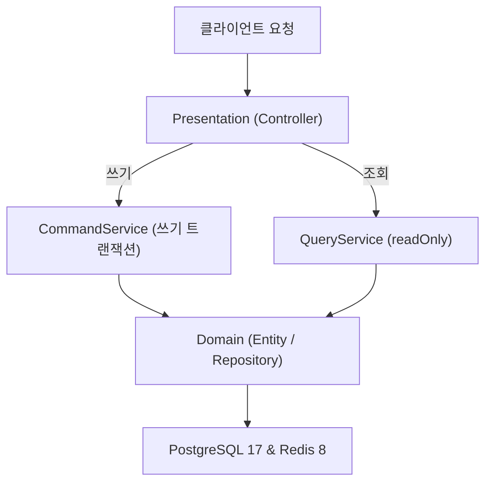

> 원티드 프리온보딩 백엔드 챌린지 요구사항을 정리하고, Spring Boot 3.5 기반 3계층 CQRS 패키지 구조, `BaseTimeEntity` Auditing, 프로필·런타임 기본 설정을 설계한 기록입니다.

> 본 글은 **Java 21 / Kotlin 1.9.25 / Spring Boot 3.5.16 / PostgreSQL 17 / Redis 8 / Spring AI 1.1.8** 기준입니다.
{: .prompt-info }

## 요구사항 분석 및 도메인 범위

사전 과제의 게시판 CRUD와 인증·권한·조회수·알림·이미지 업로드 요구사항에 AI 말투 분석 기능을 더해 6개 도메인으로 범위를 정리했습니다.

| 도메인 | 핵심 기능 | 설계 포인트 |
| :--- | :--- | :--- |
| **회원 / 인증** | 회원가입, 로그인, 토큰 재발급 | 형식 검증, JWT(OAuth2 Resource Server), 작성자·관리자 권한 분리 |
| **게시글 / 댓글 / 태그** | CRUD, 태그, 검색·정렬 | 제목 200자·본문 1000자, Soft Delete, 10일 수정 제한·9일 차 경고 |
| **이미지 업로드** | 다중 이미지 첨부 | 15MB 제한, 형식 검증, 외부 스토리지 인터페이스 추상화 |
| **조회수** | 상세 조회 시 집계 | Redis 기반 중복 조회 방지 및 DB 쓰기 부하 완화 |
| **실시간 알림** | 댓글·좋아요·마감 경고 | 도메인 이벤트 비동기 처리로 결합도 최소화 |
| **AI 말투 분석** | 게시글·초안 톤 분석 | Spring AI(Google GenAI) 연동 및 외부 호출 격리 |

테스트는 Kotest, MockK, Fixture Monkey, ArchUnit으로 구성하고, OpenAPI(Swagger) 문서에 API별 `SecurityRequirement`와 마지막 Git 커밋 정보를 노출했습니다.

## 3계층 CQRS 패키지 구조와 설계 트레이드오프

패키지는 도메인 중심으로 최상위를 나누고, 내부에 `presentation`, `application`, `domain` 3계층을 두었습니다. 외부 AI 클라이언트가 개입하는 `writing/tone` 모듈만 `infrastructure` 패키지를 추가했습니다.

```text
org.project.portfolio
├── article          # presentation / application(Command·Query·scheduler) / domain(event·validator)
├── auth / user / notification
├── writing/tone     # presentation / application / domain / infrastructure
├── common           # aop / domain / presentation / storage / utils
└── config           # Security, JWT, JPA Auditing, Redis, Async, Swagger
```

서비스 계층은 **액터 분리(도메인별 단일 Service)**와 **CQRS 라이트**의 트레이드오프를 비교했습니다.

| 구분 | 단일 Service (액터 분리) | CQRS 라이트 (채택) | 풀 CQRS (DB 분리) |
| :--- | :--- | :--- | :--- |
| **트랜잭션** | 읽기·쓰기 혼재 | `CommandService` / `QueryService` 분리 | 쓰기·읽기 저장소 분리 |
| **JPA 최적화** | 쓰기 트랜잭션 조회 위험 | 클래스 단위 `readOnly = true` 강제 | 별도 조회 모델 사용 |
| **복잡도** | 낮음 | 중간 (클래스 수 소폭 증가) | 높음 (동기화·최종 일관성) |

물리 DB를 나누는 풀 CQRS는 현재 규모에 과도하지만, 게시글·댓글은 조회와 변경의 성격이 뚜렷합니다. 같은 DB를 공유하되 서비스만 `ArticleCommandService`와 `ArticleQueryService`로 분리하는 CQRS 라이트를 선택했습니다.



`QueryService`에 `@Transactional(readOnly = true)`를 적용하면 Hibernate가 변경 감지용 스냅샷을 생략해 리소스를 아낄 수 있고, 추후 Read Replica 라우팅 전환도 수월합니다. 반면 단순 도메인까지 기계적으로 분리하면 파일만 불어나므로 핵심 도메인 위주로 적용했습니다.

## BaseTimeEntity Auditing 설계와 상속 전략

생성·수정 시각을 일관되게 기록하기 위해 공용 상위 클래스 `BaseTimeEntity`를 두었습니다. 타임존 의존성을 없애려 `Instant`를 택했고, `build.gradle.kts`의 `allOpen`에 `@MappedSuperclass`를 등록해 Hibernate 프록시 생성을 보장했습니다.

```kotlin
// src/main/kotlin/org/project/portfolio/common/domain/BaseTimeEntity.kt
package org.project.portfolio.common.domain

import jakarta.persistence.Column
import jakarta.persistence.EntityListeners
import jakarta.persistence.MappedSuperclass
import org.springframework.data.annotation.CreatedDate
import org.springframework.data.annotation.LastModifiedDate
import org.springframework.data.jpa.domain.support.AuditingEntityListener
import java.time.Instant

@MappedSuperclass
@EntityListeners(AuditingEntityListener::class)
abstract class BaseTimeEntity(
    @CreatedDate
    @Column(nullable = false, updatable = false)
    var createdAt: Instant = Instant.now(),
    @LastModifiedDate
    @Column(nullable = false)
    var updatedAt: Instant = Instant.now(),
)
```

`@EnableJpaAuditing`은 메인 클래스가 아닌 `JpaAuditingConfiguration`으로 분리해 `@WebMvcTest` 같은 슬라이스 테스트에서 JPA 메타모델 빈 부재로 실패하는 문제를 방지했습니다.

```kotlin
// src/main/kotlin/org/project/portfolio/config/JpaAuditingConfiguration.kt
package org.project.portfolio.config

import org.springframework.context.annotation.Configuration
import org.springframework.data.jpa.repository.config.EnableJpaAuditing

@Configuration
@EnableJpaAuditing
class JpaAuditingConfiguration
```

도메인 이벤트 발행을 위해 `AbstractAggregateRoot` 상속도 검토했으나 배제했습니다. `@DomainEvents`는 `JpaRepository.save()`를 명시적으로 호출할 때만 트리거되므로, 더티 체킹만으로 수정하는 트랜잭션에서 이벤트가 조용히 유실되는 함정이 있습니다. 또한 단일 상속 제약으로 `BaseTimeEntity`와 공존할 수 없어, `CommandService`에서 `ApplicationEventPublisher`로 명시적으로 발행하는 방식을 택했습니다.

## 환경별 프로필 전략과 런타임 기본 설정

빠른 개발 피드백과 운영 안정성을 함께 챙기기 위해 프로필별 데이터소스와 런타임 설정을 분리했습니다.

- **Local / Test**: H2 인메모리 DB에 `MODE=PostgreSQL`을 부여해 빠르게 검증합니다. 단, H2가 실제 PostgreSQL의 인덱스·락 동작을 완전히 재현하지는 못하므로 통합 확인용 `docker-compose.yml`에 `postgres:17-alpine`과 `redis:8-alpine`을 함께 구성했습니다.
- **Prod**: PostgreSQL 17과 Redis 8을 환경 변수로 연결하고, Actuator를 `8081` 포트로 분리해 프로브·ECS JSON 로깅을 활성화했으며 Swagger는 기본 비활성화했습니다.

```yaml
# src/main/resources/application.yml
spring:
  application:
    name: portfolio
  profiles:
    default: local
  threads:
    virtual:
      enabled: true
  lifecycle:
    timeout-per-shutdown-phase: 30s
  jpa:
    open-in-view: false
    properties:
      hibernate:
        default_batch_fetch_size: 100
  data:
    redis:
      host: localhost
      port: 6379
      database: 2
server:
  shutdown: graceful
```

1. **Virtual Threads (`enabled: true`)**: 이미지 업로드나 Gemini API 호출 같은 블로킹 I/O 구간에서 플랫폼 스레드 고갈을 막습니다. Java 21에서는 `synchronized` 내부 I/O 시 캐리어 스레드 피닝이 발생할 수 있어 `ReentrantLock` 사용을 원칙으로 합니다.
2. **Graceful Shutdown (`graceful`, `30s`)**: 배포 시 `SIGTERM`을 받으면 신규 요청을 차단하고 진행 중인 트랜잭션을 최대 30초간 안전하게 마무리합니다.
3. **OSIV 비활성화 (`open-in-view: false`)**: 응답 직렬화까지 DB 커넥션을 점유해 HikariCP가 고갈되는 현상을 막고, `default_batch_fetch_size: 100`으로 N+1을 완화했습니다. 트랜잭션 밖 지연 로딩 시 `LazyInitializationException`이 발생하므로 `QueryService` 내부에서 DTO 변환까지 완료합니다.

## 마치며

요구사항을 도메인 경계와 운영 제약으로 정리한 뒤 3계층 CQRS 라이트, `BaseTimeEntity`와 명시적 이벤트 발행, Virtual Threads·Graceful Shutdown·OSIV 비활성화로 기본 골격을 세웠습니다. 전체 소스와 템플릿은 아래 저장소에서 확인할 수 있습니다.




