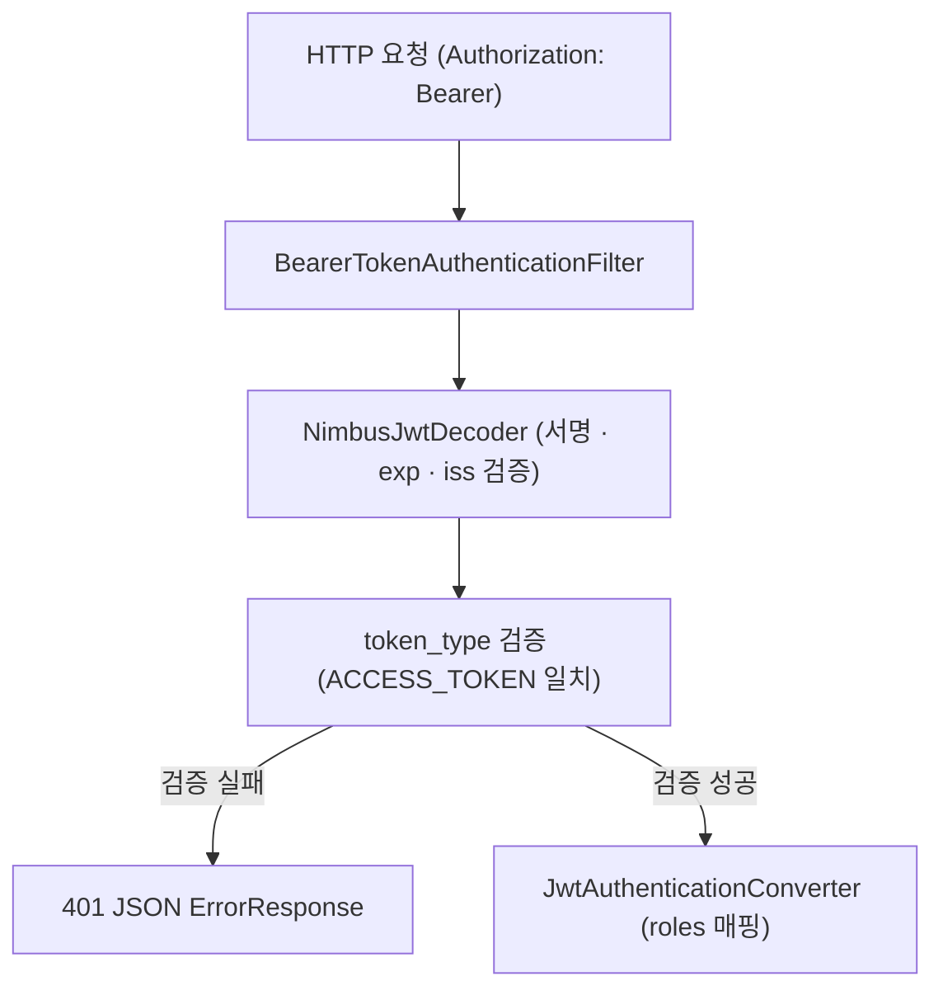

> 수동 `OncePerRequestFilter`와 `jjwt` 조합 대신 Spring Security OAuth2 Resource Server로 Stateless JWT 인증을 구성한 과정을 정리합니다.

> 기준 환경: **Spring Boot 3.5 / Kotlin 1.9 / Java 21 / `spring-boot-starter-oauth2-resource-server`**
{: .prompt-info }

## 수동 JWT 필터 대신 OAuth2 Resource Server를 선택한 이유

`jjwt`와 `OncePerRequestFilter`를 직접 조합하면 토큰 검증 실패 시 예외 처리에서 실수가 잦습니다. 필터에서 예외를 잡은 뒤 그대로 `return`하면 401 대신 빈 200 응답이 내려가거나, `AuthenticationEntryPoint` 위임이 어긋나 에러 포맷이 깨집니다.

`spring-boot-starter-oauth2-resource-server`는 `BearerTokenAuthenticationFilter`와 `NimbusJwtDecoder`로 토큰 추출, 서명·만료 검증, 예외 위임을 표준 파이프라인으로 처리합니다.

| 항목 | 수동 필터 + `jjwt` | `OAuth2 Resource Server` |
| :--- | :--- | :--- |
| 토큰 추출 | 헤더 직접 파싱 | `BearerTokenResolver` 제공 |
| 클레임 검증 | 파서 수동 조합 | `JwtValidators` 표준 체인 |
| 예외 위임 | try-catch 실수 위험 | `AuthenticationEntryPoint` 자동 위임 |
| 컨텍스트 | `Authentication` 직접 생성 | `JwtAuthenticationToken` 자동 구성 |

커스텀 쿠키 전달이나 매 요청 DB 권한 조회가 필요하다면 커스터마이징 비용이 늘어나지만, 표준 Bearer 헤더 기반 Stateless API라면 공식 모듈이 훨씬 안전합니다.

```kotlin
// build.gradle.kts
dependencies {
    implementation("org.springframework.boot:spring-boot-starter-security")
    implementation("org.springframework.boot:spring-boot-starter-oauth2-resource-server")
    implementation("org.springframework.boot:spring-boot-starter-validation")
}
```

## 기동 시점 Fail-Fast 검증과 토큰 발급 구조

HS256은 최소 32바이트 시크릿 키가 필요합니다. 짧은 키로 서버가 기동되면 첫 로그인 시점에야 런타임 예외가 터지므로, `JwtProperties`에 `@Validated`와 `@field:Size(min = 32)`를 선언해 기동 시점에 Fail-Fast 검증하도록 구성했습니다. Kotlin `data class`는 `@field:` 타깃을 명시해야 Bean Validation이 동작합니다.

```kotlin
// src/main/kotlin/org/project/portfolio/auth/JwtProperties.kt
@Validated
@ConfigurationProperties(prefix = "jwt")
data class JwtProperties(
    @field:NotBlank(message = "JWT secret은 비어있을 수 없습니다")
    @field:Size(min = 32, message = "HS256 서명을 위해 JWT secret은 최소 32자 이상이어야 합니다")
    val secret: String,
    @field:NotBlank(message = "JWT issuer는 비어있을 수 없습니다")
    val issuer: String,
    @field:Positive(message = "accessExpiry는 양수여야 합니다")
    val accessExpiry: Long = 3600,
    @field:Positive(message = "refreshExpiry는 양수여야 합니다")
    val refreshExpiry: Long = 604800,
)
```

`JwtProvider`는 `JwtEncoder`로 Access·Refresh 토큰을 발급합니다. 두 토큰 모두 `token_type` 클레임을 명시하고, `roles` 클레임은 Access Token에만 담습니다.

```kotlin
// src/main/kotlin/org/project/portfolio/auth/JwtProvider.kt
@Component
class JwtProvider(
    private val jwtProperties: JwtProperties,
    private val jwtEncoder: JwtEncoder,
    @Qualifier("refreshJwtDecoder")
    private val refreshJwtDecoder: JwtDecoder,
) {
    fun createAccessToken(
        email: String,
        roles: Set<UserRole>,
        jit: String = UUID.randomUUID().toString(),
        issuedAt: Instant = Instant.now(),
        duration: Long = jwtProperties.accessExpiry,
    ): String {
        val claims = defaultClaims(email, jit, issuedAt, duration, TokenType.ACCESS_TOKEN)
            .claim("roles", roles.map { it.authority })
            .build()
        return encode(claims)
    }

    fun createRefreshToken(
        email: String,
        jit: String,
        issuedAt: Instant = Instant.now(),
        duration: Long = jwtProperties.refreshExpiry,
    ): String {
        val claims = defaultClaims(email, jit, issuedAt, duration, TokenType.REFRESH_TOKEN).build()
        return encode(claims)
    }

    fun decodeRefreshToken(token: String): RefreshToken {
        return try {
            val jwt = refreshJwtDecoder.decode(token)
            RefreshToken(email = jwt.subject, jit = jwt.id)
        } catch (e: JwtException) {
            throw UnauthorizedException("Invalid token")
        }
    }

    private fun defaultClaims(
        subject: String,
        jit: String,
        issuedAt: Instant,
        duration: Long,
        tokenType: TokenType,
    ): JwtClaimsSet.Builder = JwtClaimsSet.builder()
        .id(jit)
        .issuer(jwtProperties.issuer)
        .subject(subject)
        .issuedAt(issuedAt)
        .notBefore(issuedAt)
        .expiresAt(issuedAt.plusSeconds(duration))
        .claim("token_type", tokenType.name)

    private fun encode(claims: JwtClaimsSet): String {
        val header = JwsHeader.with(MacAlgorithm.HS256).type("JWT").build()
        return jwtEncoder.encode(JwtEncoderParameters.from(header, claims)).tokenValue
    }

    enum class TokenType { ACCESS_TOKEN, REFRESH_TOKEN }
}
```

## JwtConfig에서 Encoder·Decoder 분리와 토큰 혼용 차단

Access·Refresh 토큰이 같은 키를 공유하면 Refresh Token으로 보호된 API를 호출하는 혼용 공격에 노출됩니다. `JwtConfig`에서 `NimbusJwtEncoder`와 용도별 `NimbusJwtDecoder`를 분리하고, `@Primary` `jwtDecoder`는 `ACCESS_TOKEN`, `@Qualifier("refreshJwtDecoder")`는 `REFRESH_TOKEN`만 허용하도록 `DelegatingOAuth2TokenValidator`에 커스텀 `token_type` 검증기를 합성했습니다.



```kotlin
// src/main/kotlin/org/project/portfolio/config/JwtConfig.kt
@Configuration
@EnableConfigurationProperties(JwtProperties::class)
class JwtConfig(
    private val jwtProperties: JwtProperties,
) {
    private val secretKey: SecretKey = SecretKeySpec(
        jwtProperties.secret.toByteArray(Charsets.UTF_8),
        "HmacSHA256",
    )

    @Bean
    fun jwtEncoder(): JwtEncoder = NimbusJwtEncoder(ImmutableSecret<SecurityContext>(secretKey))

    @Bean
    @Primary
    fun jwtDecoder(): JwtDecoder = buildDecoder(JwtProvider.TokenType.ACCESS_TOKEN)

    @Bean
    @Qualifier("refreshJwtDecoder")
    fun refreshJwtDecoder(): JwtDecoder = buildDecoder(JwtProvider.TokenType.REFRESH_TOKEN)

    @Bean
    fun jwtAuthenticationConverter(): JwtAuthenticationConverter {
        val authoritiesConverter = JwtGrantedAuthoritiesConverter().apply {
            setAuthoritiesClaimName("roles")
            setAuthorityPrefix("")
        }
        return JwtAuthenticationConverter().apply {
            setJwtGrantedAuthoritiesConverter(authoritiesConverter)
            setPrincipalClaimName("sub")
        }
    }

    private fun buildDecoder(expectedType: JwtProvider.TokenType): JwtDecoder {
        val decoder = NimbusJwtDecoder.withSecretKey(secretKey)
            .macAlgorithm(MacAlgorithm.HS256)
            .build()

        val defaultValidator = JwtValidators.createDefaultWithIssuer(jwtProperties.issuer)
        val tokenTypeValidator = OAuth2TokenValidator<Jwt> { jwt ->
            if (jwt.getClaimAsString("token_type") == expectedType.name) {
                OAuth2TokenValidatorResult.success()
            } else {
                OAuth2TokenValidatorResult.failure(
                    OAuth2Error("invalid_token", "Expected ${expectedType.name} token", null),
                )
            }
        }
        decoder.setJwtValidator(DelegatingOAuth2TokenValidator(defaultValidator, tokenTypeValidator))
        return decoder
    }
}
```

기본 `JwtGrantedAuthoritiesConverter`는 `scope` 클레임에 `SCOPE_` 접두사를 붙입니다. `roles` 클레임에 `ROLE_USER`, `ROLE_ADMIN`을 담으므로 `setAuthoritiesClaimName("roles")`와 `setAuthorityPrefix("")`를 지정하고, `setPrincipalClaimName("sub")`로 `authentication.name`을 이메일에 맞췄습니다.

## 기본 거부 SecurityConfig와 traceId 포함 JSON 에러 응답

URL 접근 제어는 **기본 거부(Default Deny)** 원칙으로 공개 엔드포인트만 허용하고 나머지는 `anyRequest().authenticated()`로 막았습니다.

```kotlin
// src/main/kotlin/org/project/portfolio/config/SecurityConfig.kt
@Configuration
@EnableMethodSecurity
class SecurityConfig(
    private val jwtAuthenticationConverter: JwtAuthenticationConverter,
    private val objectMapper: ObjectMapper,
) {
    @Bean
    fun securityFilterChain(http: HttpSecurity): SecurityFilterChain {
        return http
            .csrf { it.disable() }
            .headers { headers -> headers.frameOptions { it.sameOrigin() } }
            .sessionManagement { it.sessionCreationPolicy(SessionCreationPolicy.STATELESS) }
            .authorizeHttpRequests { auth ->
                auth
                    .requestMatchers(HttpMethod.OPTIONS, "/**").permitAll()
                    .requestMatchers(
                        "/api/v1/auth/login",
                        "/api/v1/auth/register",
                        "/api/v1/auth/register/email",
                        "/api/v1/auth/refresh",
                        "/api/v1/auth/logout",
                    ).permitAll()
                    .requestMatchers(
                        HttpMethod.GET,
                        "/api/v1/articles",
                        "/api/v1/articles/*",
                        "/api/v1/articles/*/comments",
                        "/api/v1/users/*",
                    ).permitAll()
                    .requestMatchers("/swagger-ui/**", "/swagger-ui.html", "/v3/api-docs/**", "/actuator/health")
                    .permitAll()
                    .anyRequest().authenticated()
            }
            .oauth2ResourceServer { oauth2 ->
                oauth2.jwt { it.jwtAuthenticationConverter(jwtAuthenticationConverter) }
                oauth2.authenticationEntryPoint(jsonAuthenticationEntryPoint())
                oauth2.accessDeniedHandler(jsonAccessDeniedHandler())
            }
            .exceptionHandling { exceptions ->
                exceptions.authenticationEntryPoint(jsonAuthenticationEntryPoint())
                exceptions.accessDeniedHandler(jsonAccessDeniedHandler())
            }
            .addFilterBefore(LoggingFilter(), UsernamePasswordAuthenticationFilter::class.java)
            .build()
    }

    private fun jsonAuthenticationEntryPoint(): AuthenticationEntryPoint =
        AuthenticationEntryPoint { _, response, _ ->
            response.status = HttpServletResponse.SC_UNAUTHORIZED
            response.contentType = MediaType.APPLICATION_JSON_VALUE
            objectMapper.writeValue(
                response.outputStream,
                ErrorResponse(code = "UNAUTHORIZED", message = "인증이 필요합니다."),
            )
        }

    private fun jsonAccessDeniedHandler(): AccessDeniedHandler =
        AccessDeniedHandler { _, response, _ ->
            response.status = HttpServletResponse.SC_FORBIDDEN
            response.contentType = MediaType.APPLICATION_JSON_VALUE
            objectMapper.writeValue(
                response.outputStream,
                ErrorResponse(code = "FORBIDDEN", message = "접근 권한이 없습니다."),
            )
        }
}
```

`ErrorResponse`는 SLF4J `MDC`에서 `LoggingFilter.TRACE_ID`를 자동 조회해 `traceId`와 `timestamp`를 채웁니다.

```kotlin
// src/main/kotlin/org/project/portfolio/common/presentation/response/ErrorResponse.kt
data class ErrorResponse(
    val code: String,
    val message: String?,
    val properties: Map<String, Any?> = mapOf(),
    val traceId: String? = MDC.get(LoggingFilter.TRACE_ID),
    val timestamp: Instant = Instant.now(),
)
```

`oauth2ResourceServer`와 `exceptionHandling` 양쪽에 핸들러를 둔 이유는 예외 주체가 다르기 때문입니다. 잘못된 토큰은 `BearerTokenAuthenticationFilter`가, 미인증 접근은 `ExceptionTranslationFilter`가 처리합니다. `@PreAuthorize` 실패로 던져진 `AccessDeniedException`은 `@RestControllerAdvice`가 가로챌 수 있어 `GlobalExceptionHandler`에서도 403 `ErrorResponse`로 통일했습니다.

```kotlin
// src/main/kotlin/org/project/portfolio/common/presentation/GlobalExceptionHandler.kt (일부)
@RestControllerAdvice
class GlobalExceptionHandler {
    @ExceptionHandler(UnauthorizedException::class)
    private fun handleUnauthorizedException(e: UnauthorizedException): ResponseEntity<ErrorResponse> =
        ResponseEntity.status(HttpStatus.UNAUTHORIZED)
            .body(ErrorResponse(code = e.code, message = e.message, properties = e.properties))

    @ExceptionHandler(AccessDeniedException::class)
    private fun handleAccessDeniedException(): ResponseEntity<ErrorResponse> =
        ResponseEntity.status(HttpStatus.FORBIDDEN)
            .body(ErrorResponse(code = "FORBIDDEN", message = "접근 권한이 없습니다."))
}
```

## @AuthenticationPrincipal과 @PreAuthorize 활용 및 운영 주의점

인증을 통과하면 `Principal`이 `Jwt` 객체가 되어 컨트롤러에서 `@AuthenticationPrincipal jwt: Jwt`로 `jwt.subject`를 바로 참조할 수 있습니다. `@EnableMethodSecurity`와 `@PreAuthorize`를 조합해 관리자 또는 작성자 본인만 수정·삭제하도록 선언적으로 제어합니다.

```kotlin
// UserController.kt & ArticleController.kt (일부)
@GetMapping("/user")
@PreAuthorize("isAuthenticated()")
fun getUserInfo(@AuthenticationPrincipal jwt: Jwt): ResponseEntity<UserResponse> =
    ResponseEntity.ok(UserResponse.from(userQueryService.getUser(email = jwt.subject)))

@PatchMapping("/{articleId}", consumes = ["multipart/form-data"])
@PreAuthorize("isAuthenticated() and (hasRole('ROLE_ADMIN') or @articleValidator.isEditable(#articleId, authentication.name))")
fun updateArticle(
    @AuthenticationPrincipal jwt: Jwt,
    @PathVariable articleId: Long,
    @Valid @ModelAttribute articleUpdateForm: ArticleUpdateForm,
): ResponseEntity<ArticleResponse> =
    ResponseEntity.ok(articleCommandService.updateArticle(articleId, articleUpdateForm))
```

> **운영 시 주의사항**
> 1. **`LoggingFilter` 순서와 401 `traceId`**: `BearerTokenAuthenticationFilter`가 `LoggingFilter`보다 먼저 401을 반환하면 `MDC`가 비어 `traceId`가 `null`이 될 수 있습니다. 최상위 `FilterRegistrationBean`으로 앞당기는 편이 안전합니다.
> 2. **`setAuthorityPrefix("")` 누락**: 접두사를 비우지 않으면 `ROLE_ADMIN`이 `SCOPE_ROLE_ADMIN`으로 매핑되어 `hasRole('ROLE_ADMIN')`이 항상 403을 반환합니다. 200/401/403과 Refresh Token 혼용 차단 테스트를 함께 유지해야 합니다.
{: .prompt-warning }


