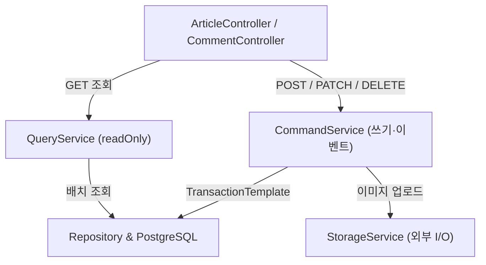

> Kotlin과 Spring Data JPA 게시판 백엔드에서 게시글·댓글 서비스를 CQRS로 분리하고, `@ElementCollection` Set 설계와 배치 조회로 N+1을 제거하며, `Clock` 빈 주입으로 10일 수정 제한을 검증한 과정을 정리합니다.

> 본 문서는 **Kotlin 1.9.25 · Spring Boot 3.5 · Java 21 · Spring Data JPA(Hibernate 6)** 기준으로 작성되었습니다.
{: .prompt-info }

게시판 도메인은 조회 성능(N+1)과 트랜잭션 경계에서 문제가 먼저 드러납니다. 여기서는 조회·명령 서비스 분리와 JPA 내부 동작에 맞춘 쿼리·시간 검증 설계를 정리합니다.

## 서비스 계층 CQRS 분리와 트랜잭션 경계 설계

조회와 상태 변경은 트랜잭션 특성이 달라 `ArticleQueryService`·`ArticleCommandService`, `CommentQueryService`·`CommentCommandService`로 분리했습니다.



읽기·쓰기 DB의 물리적 분리나 이벤트 소싱은 동기화 부담이 크므로, 단일 DB 환경에서는 서비스 계층의 경량 CQRS만 적용했습니다.

| 구분 | QueryService | CommandService |
| :--- | :--- | :--- |
| 트랜잭션 | 클래스 레벨 `@Transactional(readOnly = true)` | 쓰기 `@Transactional` / `TransactionTemplate` |
| Hibernate 동작 | 스냅샷 생략·플러시 모드 `MANUAL` | 변경 감지(Dirty Checking) 활성화 |
| 주요 의존성 | `Repository`, `StringRedisTemplate` | `Repository`, `StorageService`, `Clock` |

특히 `ArticleCommandService`는 외부 이미지 업로드를 트랜잭션 바깥에서 먼저 실행하고, DB 저장 구간만 `TransactionTemplate`으로 좁혀 커넥션 점유 시간을 최소화했습니다.

```kotlin
// src/main/kotlin/org/project/portfolio/article/application/ArticleCommandService.kt
@Service
class ArticleCommandService(
    private val articleRepository: ArticleRepository,
    private val userRepository: UserRepository,
    private val storageService: StorageService,
    private val eventPublisher: ApplicationEventPublisher,
    private val transactionTemplate: TransactionTemplate,
    private val clock: Clock,
) {
    fun createArticle(
        email: String,
        articleForm: ArticleForm,
    ): ArticleResponse {
        val uploadedImages = articleForm.images.map { storageService.uploadFile(it) }

        return checkNotNull(
            transactionTemplate.execute {
                val user: User = userRepository.findByEmail(email)
                    ?: throw NotFoundException(User::class.java, mapOf("email" to email))

                val article: Article = articleRepository.save(
                    Article.create(
                        title = articleForm.title,
                        content = articleForm.content,
                        authorId = user.id,
                        images = uploadedImages,
                        tags = articleForm.tags,
                    ),
                )

                ArticleResponse.from(
                    article = article,
                    author = UserSummaryResponse.from(user),
                )
            },
        )
    }
}
```

## @ElementCollection 태그 설계와 키워드 검색 JPQL

`Article` 엔티티에서 순서가 중요한 이미지는 `@OrderColumn(name = "image_order")`와 `List<String>`으로, 중복이 없고 순서가 무관한 태그는 `MutableSet<String>`으로 매핑했습니다.

```kotlin
// src/main/kotlin/org/project/portfolio/article/domain/Article.kt
@Entity
@SoftDelete(columnName = "is_deleted")
class Article(
    @Id
    @GeneratedValue(strategy = GenerationType.IDENTITY)
    var id: Long = 0L,
    @Column(length = 400)
    var title: String,
    @Column(columnDefinition = "TEXT")
    var content: String,
    @ElementCollection
    @CollectionTable(name = "article_images")
    @OrderColumn(name = "image_order")
    var images: List<String> = mutableListOf(),
    @ElementCollection
    @CollectionTable(name = "article_tags")
    var tags: MutableSet<String> = mutableSetOf(),
    var authorId: Long,
    var viewCount: Long = 0,
) : BaseTimeEntity() {
    fun update(
        title: String?,
        content: String?,
        images: List<String>? = null,
        tags: List<String>? = null,
    ) {
        title?.let { this.title = it }
        content?.let { this.content = it }
        images?.let { this.images = it }
        tags?.let {
            this.tags.clear()
            this.tags.addAll(it.map { tag -> tag.trim() }.filter { tag -> tag.isNotEmpty() })
        }
    }
}
```

`@OrderColumn` 없는 `@ElementCollection` `List`는 Hibernate 내부에서 `PersistentBag`으로 동작해 원소 하나만 바꿔도 `article_tags` 행을 전체 `DELETE` 후 `RE-INSERT`합니다. 반면 `MutableSet`(`PersistentSet`)은 기존 컬렉션 참조를 유지한 채 `clear()`·`addAll()`을 호출하면 스냅샷 비교를 통해 변경된 차분만 개별 `DELETE`/`INSERT`로 반영합니다.

제목·내용 키워드 검색은 `ArticleRepository`에 단일 JPQL(`searchByKeyword`)로 작성했습니다.

```kotlin
// src/main/kotlin/org/project/portfolio/article/domain/ArticleRepository.kt
@Query(
    """
    SELECT a FROM Article a
    WHERE :keyword IS NULL OR :keyword = ''
       OR a.title LIKE CONCAT('%', :keyword, '%')
       OR a.content LIKE CONCAT('%', :keyword, '%')
    """,
)
fun searchByKeyword(
    @Param("keyword") keyword: String? = null,
    pageable: Pageable,
): Page<Article>
```

서비스에서 `keyword?.trim()?.takeIf { it.isNotEmpty() }`로 공백 입력을 정규화합니다. 다만 `%keyword%` 조건은 B-Tree 인덱스를 타지 못해 대용량 환경에서는 `pg_trgm` GIN 인덱스나 전문 검색 엔진으로 전환해야 합니다.

## 배치 페치와 ID 기반 배치 조회로 N+1 제거하기

`Article`과 `Comment`는 애그리게이트 경계를 유지하기 위해 `User`를 연관관계 대신 `authorId: Long`으로 참조합니다. 동시에 목록 응답 DTO가 지연 로딩 컬렉션(`images`, `tags`)에 접근하므로 두 경로의 N+1을 각각 해결했습니다.

1. **컬렉션 N+1**: `application.yml`에 `open-in-view: false`와 `default_batch_fetch_size: 100`을 설정해 지연 로딩 시 최대 100건씩 `IN` 쿼리로 일괄 조회합니다.
2. **작성자 N+1**: `authorId`를 `distinct()`로 모아 `userRepository.findAllById(authorIds).associateBy { it.id }`로 단일 `IN` 쿼리 조회 후 메모리에서 매핑합니다.

```yaml
# src/main/resources/application.yml
spring:
  jpa:
    open-in-view: false
    properties:
      hibernate:
        default_batch_fetch_size: 100
```

```kotlin
// src/main/kotlin/org/project/portfolio/article/application/ArticleQueryService.kt
@Service
@Transactional(readOnly = true)
class ArticleQueryService(
    private val articleRepository: ArticleRepository,
    private val stringRedisTemplate: StringRedisTemplate,
    private val commentRepository: CommentRepository,
    private val userRepository: UserRepository,
) {
    fun getArticles(
        keyword: String?,
        pageable: Pageable,
    ): Page<ArticleSummaryResponse> {
        val articles = articleRepository.searchByKeyword(
            keyword = keyword?.trim()?.takeIf { it.isNotEmpty() },
            pageable = pageable,
        )
        val authorIds = articles.content.map { it.authorId }.distinct()
        val authorsById = userRepository.findAllById(authorIds).associateBy { it.id }

        return articles.map { article ->
            ArticleSummaryResponse.from(
                article = article,
                author = UserSummaryResponse.from(authorsById[article.authorId]),
            )
        }
    }

    fun getArticle(id: Long): ArticleResponse {
        val article = articleRepository.findByIdOrNull(id)
            ?: throw NotFoundException(Article::class.java, mapOf("articleId" to id))

        val comments = commentRepository.findByArticleId(id)
        val userIds = (comments.map { it.authorId } + article.authorId).distinct()
        val usersById = userRepository.findAllById(userIds).associateBy { it.id }

        return ArticleResponse.from(
            article = article,
            author = UserSummaryResponse.from(usersById[article.authorId]),
            comments = comments.map { comment ->
                CommentResponse.from(
                    comment = comment,
                    author = UserSummaryResponse.from(usersById[comment.authorId]),
                )
            },
        )
    }
}
```

상세 조회(`getArticle`)도 게시글·댓글 작성자 ID를 합쳐 `users` 조회를 1회로 줄였습니다. `open-in-view: false` 환경에서는 지연 로딩 예외를 막기 위해 서비스 트랜잭션 안에서 DTO 변환을 끝내야 합니다.

## 댓글 페이징 조회 API와 PagedModel 응답 구조

댓글이 많은 게시글에서 페이로드 비대화를 막기 위해 댓글 전용 페이징 API(`GET /api/v1/articles/{articleId}/comments`)를 분리했습니다.

```kotlin
// src/main/kotlin/org/project/portfolio/article/presentation/CommentController.kt
@GetMapping
@Operation(summary = "게시글 댓글 페이징 조회 API")
fun getComments(
    @PathVariable articleId: Long,
    @PageableDefault(page = 0, size = 20, sort = ["createdAt"], direction = Sort.Direction.ASC)
    @ParameterObject pageable: Pageable,
): ResponseEntity<PagedModel<CommentResponse>> {
    return ResponseEntity.ok(
        PagedModel(
            commentQueryService.getComments(
                articleId = articleId,
                pageable = pageable,
            ),
        ),
    )
}
```

```kotlin
// src/main/kotlin/org/project/portfolio/article/application/CommentQueryService.kt
@Service
@Transactional(readOnly = true)
class CommentQueryService(
    private val articleRepository: ArticleRepository,
    private val commentRepository: CommentRepository,
    private val userRepository: UserRepository,
) {
    fun getComments(
        articleId: Long,
        pageable: Pageable,
    ): Page<CommentResponse> {
        if (!articleRepository.existsById(articleId)) {
            throw NotFoundException(Article::class.java, mapOf("articleId" to articleId))
        }

        val comments = commentRepository.findByArticleId(articleId, pageable)
        val authorIds = comments.content.map { it.authorId }.distinct()
        val authorsById = userRepository.findAllById(authorIds).associateBy { it.id }

        return comments.map { comment ->
            CommentResponse.from(
                comment = comment,
                author = UserSummaryResponse.from(authorsById[comment.authorId]),
            )
        }
    }
}
```

`CommentQueryService`는 `existsById`로 없는 게시글 요청을 404로 차단한 뒤 `findByArticleId`와 `findAllById`로 N+1 없이 페이징 결과를 만듭니다. 컨트롤러는 `PageImpl` 직접 직렬화 경고를 피하기 위해 `PagedModel`로 감싸 반환합니다.

## Clock 빈 주입과 도메인 메서드 기반 10일 수정 제한

"작성 후 10일 미만인 게시글만 수정 가능"이라는 시간 규칙을 `Instant.now()` 직접 호출로 구현하면 테스트가 시스템 시계에 종속됩니다. `ClockConfig`에 `Clock.systemUTC()` 빈을 등록하고, 판단 로직은 `Article.isEditableAt(now)` 도메인 메서드로 캡슐화했습니다.

```kotlin
// src/main/kotlin/org/project/portfolio/config/ClockConfig.kt
@Configuration
class ClockConfig {
    @Bean
    fun clock(): Clock = Clock.systemUTC()
}
```

```kotlin
// src/main/kotlin/org/project/portfolio/article/domain/Article.kt (일부)
companion object {
    const val EDITABLE_DAYS: Long = 10L
}

fun isEditableAt(now: Instant): Boolean {
    return createdAt.until(now, ChronoUnit.DAYS) < EDITABLE_DAYS
}
```

```kotlin
// src/main/kotlin/org/project/portfolio/article/domain/validator/ArticleValidator.kt
@Component
class ArticleValidator(
    private val articleRepository: ArticleRepository,
    private val userRepository: UserRepository,
    private val clock: Clock = Clock.systemUTC(),
) {
    fun isEditable(
        articleId: Long,
        email: String,
    ): Boolean {
        val article = articleRepository.findByIdOrNull(articleId)
            ?: throw NotFoundException(Article::class.java, mapOf("articleId" to articleId))

        val user: User = userRepository.findByEmail(email)
            ?: throw NotFoundException(User::class.java, mapOf("email" to email))

        if (article.authorId != user.id) {
            return false
        }

        return article.isEditableAt(Instant.now(clock))
    }
}
```

`ArticleController.updateArticle`에 `@PreAuthorize("isAuthenticated() and (hasRole('ROLE_ADMIN') or @articleValidator.isEditable(#articleId, authentication.name))")`를 선언해 수정 불가 요청을 이미지 업로드 전에 403으로 차단합니다. 단위 테스트에서는 `Clock.fixed(...)`를 주입해 10일 경계값을 결정적으로 검증할 수 있습니다.

> 운영 환경에서는 `Clock.systemUTC()`와 DB 타임존(`UTC`)을 일치시켜야 타임존 차이로 인한 경계 판정 오류를 막을 수 있습니다.
{: .prompt-warning }
