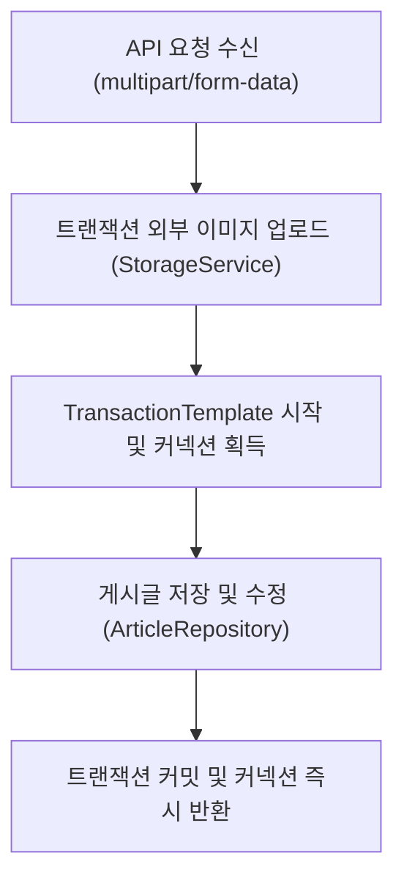

> Spring 6 `@HttpExchange`와 `RestClient`로 ImgBB 이미지 업로드를 추상화하고, `TransactionTemplate`으로 외부 HTTP I/O를 트랜잭션 밖으로 분리해 DB 커넥션 고갈을 방지한 구현을 정리합니다.

> 본 문서는 Spring Boot 3.5 / Kotlin 1.9 / Java 21 환경을 기준으로 작성되었습니다.
{: .prompt-info }

## StorageService 추상화와 프로파일 분리

게시글 작성·수정 API(`POST /api/v1/articles`, `PATCH /api/v1/articles/{articleId}`)에 이미지 첨부 기능을 넣을 때 로컬 디스크 저장은 스케일 아웃 시 동기화 문제가 생기고, 외부 스토리지 클라이언트를 서비스에 직접 결합하면 교체와 테스트가 모두 번거로워집니다. 이를 피하기 위해 `StorageService` 인터페이스로 업로드 계약을 추상화하고 프로파일별로 구현체를 분리했습니다.

```kotlin
// common/storage/StorageService.kt
package org.project.portfolio.common.storage

import org.springframework.web.multipart.MultipartFile

interface StorageService {
    fun uploadFile(file: MultipartFile): String
}
```

`prod`·`local` 프로파일에서는 `ImgBB` 구현체가, `test` 환경에서는 외부 네트워크 호출 없이 고정 URL을 반환하는 `MockStorage`가 주입됩니다.

```kotlin
// src/test/kotlin/org/project/portfolio/config/MockStorage.kt
package org.project.portfolio.config

import org.project.portfolio.common.storage.StorageService
import org.springframework.stereotype.Component
import org.springframework.web.multipart.MultipartFile

@Component
class MockStorage : StorageService {
    override fun uploadFile(file: MultipartFile): String {
        return "https://mock-storage.com/${file.originalFilename}"
    }
}
```

추후 AWS S3나 Cloudflare R2로 스토리지를 교체하더라도 도메인 계층 코드는 수정할 필요가 없고, 통합 테스트 역시 외부 API 키나 네트워크 상태에 의존하지 않아 안정적으로 동작합니다.

## Spring 6 HttpExchange와 RestClient로 ImgBB 클라이언트 구성

Spring MVC 프로젝트에서 외부 HTTP API를 호출하는 대표 방식은 다음과 같습니다.

| 방식 | 추가 의존성 | 특징 |
| :--- | :--- | :--- |
| `RestClient` + `@HttpExchange` | 불필요 (`starter-web` 내장) | 동기식 선언형 인터페이스, MVC와 자연스럽게 통합 |
| `WebClient` + `@HttpExchange` | `starter-webflux` 필요 | 비동기 논블로킹, 순수 MVC 앱에는 과한 의존성 |
| OpenFeign | `spring-cloud-openfeign` 필요 | 선언형이나 Spring Cloud 버전 관리 부담 발생 |

서블릿 기반 앱에 WebFlux나 Spring Cloud를 추가하지 않고도 선언형 클라이언트를 쓸 수 있어 `RestClient`와 `@HttpExchange` 조합을 선택했습니다.

```kotlin
// common/storage/ImgBB.kt
package org.project.portfolio.common.storage

import com.fasterxml.jackson.databind.JsonNode
import org.springframework.beans.factory.annotation.Value
import org.springframework.context.annotation.Profile
import org.springframework.http.MediaType
import org.springframework.http.client.SimpleClientHttpRequestFactory
import org.springframework.stereotype.Component
import org.springframework.web.bind.annotation.RequestParam
import org.springframework.web.bind.annotation.RequestPart
import org.springframework.web.client.RestClient
import org.springframework.web.client.support.RestClientAdapter
import org.springframework.web.multipart.MultipartFile
import org.springframework.web.service.annotation.HttpExchange
import org.springframework.web.service.annotation.PostExchange
import org.springframework.web.service.invoker.HttpServiceProxyFactory
import java.time.Duration

@Component
@Profile("prod", "local")
class ImgBB(
    @Value("\${storage.imgbb.api-key}")
    private val apiKey: String,
) : StorageService {
    private val requestFactory = SimpleClientHttpRequestFactory().apply {
        setConnectTimeout(Duration.ofSeconds(3))
        setReadTimeout(Duration.ofSeconds(10))
    }

    private val factory = HttpServiceProxyFactory.builder()
        .exchangeAdapter(
            RestClientAdapter.create(
                RestClient.builder()
                    .requestFactory(requestFactory)
                    .build(),
            ),
        )
        .build()

    private val imgbbClient = factory.createClient(ImgBBClient::class.java)

    override fun uploadFile(file: MultipartFile): String {
        return imgbbClient
            .uploadImage(
                key = apiKey,
                name = file.originalFilename,
                image = file,
            )["data"]["url"]
            .asText()
    }

    @HttpExchange(url = "https://api.imgbb.com/1")
    interface ImgBBClient {
        @PostExchange("/upload", contentType = MediaType.MULTIPART_FORM_DATA_VALUE)
        fun uploadImage(
            @RequestParam key: String,
            @RequestParam name: String? = null,
            @RequestParam expiration: Int? = null,
            @RequestPart image: MultipartFile,
        ): JsonNode
    }
}
```

내부적으로 `HttpServiceProxyFactory.createClient()`가 `ImgBBClient` 프록시를 생성하고, `@RequestParam`과 `@RequestPart`를 해석해 `RestClientAdapter`를 거쳐 `multipart/form-data` 요청으로 전송합니다.

여기서 핵심은 `SimpleClientHttpRequestFactory`에 Connect(3초)·Read(10초) 타임아웃을 명시한 점입니다. 기본 `HttpURLConnection`은 타임아웃 미지정 시 무한 대기하므로, 외부 API가 지연되면 워커 스레드가 해제되지 않아 서버 전체가 멈출 수 있습니다. API 키와 파일 크기 제한은 `application.yml`에서 관리합니다.

```yaml
# src/main/resources/application.yml
spring:
  servlet:
    multipart:
      max-file-size: 15MB
      max-request-size: 15MB

storage:
  imgbb:
    api-key: ${IMGBB_API_KEY:your-api-key}
```

## 외부 I/O의 트랜잭션 분리와 TransactionTemplate 패턴

`@Transactional` 메서드 안에서 `storageService.uploadFile()`을 호출하면 트랜잭션 시작 시점에 HikariCP DB 커넥션을 점유한 채 외부 HTTP 응답을 기다리게 됩니다. 기본 풀 크기가 10개일 때 업로드가 2~10초 지연되면 동시 요청 10건만으로 커넥션 풀이 고갈되어 일반 조회 API까지 `SQLTransientConnectionException`으로 연쇄 실패합니다.

이를 막기 위해 외부 업로드를 트랜잭션 밖으로 빼고 DB 쓰기 구간만 짧게 감쌌습니다.



같은 클래스 내부의 `@Transactional` 메서드 호출은 Spring AOP 프록시를 우회해 트랜잭션이 적용되지 않으며, 단순히 구간을 나누려고 별도 빈을 쪼개면 코드 흐름이 분산됩니다. `TransactionTemplate`을 주입받아 사용하면 한 메서드 안에서 DB 작업 구간만 명확히 제어할 수 있습니다.

```kotlin
// article/application/ArticleCommandService.kt
@Service
class ArticleCommandService(
    private val articleRepository: ArticleRepository,
    private val userRepository: UserRepository,
    private val storageService: StorageService,
    private val transactionTemplate: TransactionTemplate,
) {
    fun createArticle(
        email: String,
        articleForm: ArticleForm,
    ): ArticleResponse {
        val uploadedImages = articleForm.images.map { storageService.uploadFile(it) }

        return checkNotNull(
            transactionTemplate.execute {
                val user: User = userRepository.findByEmail(email)
                    ?: throw NotFoundException(User::class.java, mapOf("email" to email))

                val article: Article = articleRepository.save(
                    Article.create(
                        title = articleForm.title,
                        content = articleForm.content,
                        authorId = user.id,
                        images = uploadedImages,
                        tags = articleForm.tags,
                    ),
                )

                ArticleResponse.from(
                    article = article,
                    author = UserSummaryResponse.from(user),
                )
            },
        )
    }

    fun updateArticle(
        articleId: Long,
        articleUpdateForm: ArticleUpdateForm,
    ): ArticleResponse {
        val uploadedImages = articleUpdateForm.images?.map { storageService.uploadFile(it) }

        return checkNotNull(
            transactionTemplate.execute {
                val article: Article = articleRepository.findByIdOrNull(articleId)
                    ?: throw NotFoundException(Article::class.java, mapOf("articleId" to articleId))

                article.update(
                    title = articleUpdateForm.title,
                    content = articleUpdateForm.content,
                    images = uploadedImages,
                    tags = articleUpdateForm.tags,
                )

                ArticleResponse.from(
                    article = article,
                    author = UserSummaryResponse.from(
                        userRepository.findByIdOrNull(article.authorId),
                    ),
                )
            },
        )
    }
}
```

컨트롤러는 `consumes = ["multipart/form-data"]`와 `@ModelAttribute`로 텍스트와 파일 목록을 함께 바인딩합니다.

```kotlin
// article/presentation/ArticleController.kt (발췌)
@PostMapping(consumes = ["multipart/form-data"])
@PreAuthorize("isAuthenticated()")
fun createArticle(
    @AuthenticationPrincipal jwt: Jwt,
    @Valid @ModelAttribute articleForm: ArticleForm,
): ResponseEntity<ArticleResponse> {
    return articleCommandService.createArticle(
        email = jwt.subject,
        articleForm = articleForm,
    ).let {
        ResponseEntity
            .created(URI.create("/api/v1/articles/${it.id}"))
            .body(it)
    }
}
```

## 운영 환경의 주의사항과 대응 전략

> 외부 스토리지 업로드와 DB 트랜잭션은 원자적으로 묶이지 않으므로 부분 실패 시나리오를 반드시 고려해야 합니다.
{: .prompt-warning }

가장 먼저 고려할 문제는 **고아 파일(Orphan File)**입니다. 이미지 업로드는 성공했지만 뒤이은 `transactionTemplate.execute` 블록에서 `NotFoundException`이나 제약 조건 위반으로 롤백되면 DB에서 참조하지 않는 파일이 스토리지에 남습니다. 운영 환경에서는 다음 전략을 함께 검토해야 합니다.

- **보상 삭제 및 배치 정리**: DB 저장 실패 시 업로드된 파일 삭제를 시도하거나 실패 URL을 별도 테이블에 기록해 두고 스케줄러로 주기 정리합니다.
- **Pre-signed URL 전환**: 트래픽이 커지면 백엔드가 파일을 중계하는 대신 클라이언트가 S3 등에 직접 업로드하고 URL만 전달하도록 전환하는 편이 메모리와 대역폭 면에서 유리합니다.
- **순차 업로드 지연과 OSIV 비활성화**: `images.map { ... }`은 여러 장을 순차 전송하므로 DTO에서 최대 이미지 개수를 제한하고, `spring.jpa.open-in-view: false`를 유지해 직렬화 구간까지 DB 커넥션이 점유되지 않게 해야 합니다.

## 정리

외부 이미지 업로드 연동 시 `StorageService`로 프로파일별 구현을 분리하고, Spring 6 `@HttpExchange`·`RestClient`에 Connect/Read 타임아웃을 명시해 장애 전파를 막아야 합니다. 여기에 `TransactionTemplate`으로 외부 HTTP I/O와 DB 쓰기 트랜잭션을 분리하면 HikariCP 커넥션 풀을 안정적으로 보호할 수 있습니다.


