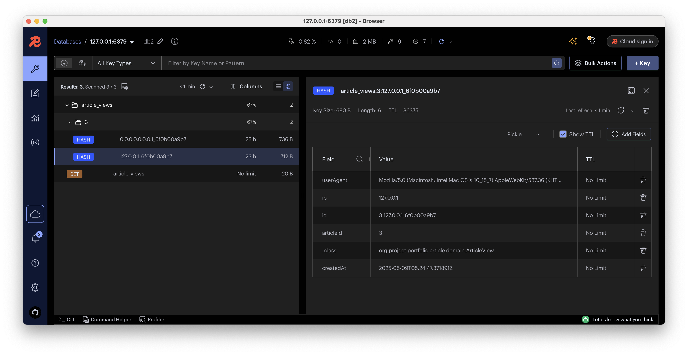
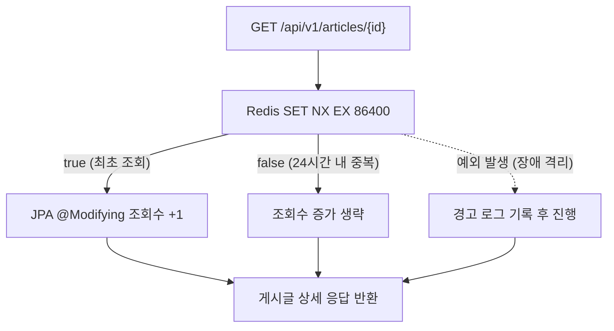

> 동일 사용자의 새로고침으로 인한 게시글 조회수 중복 증가를 막기 위해 IP와 User-Agent 해시 조합 키에 Redis `SETNX` 원자 연산과 JPA `@Modifying` 쿼리를 적용했습니다. TOCTOU 동시성 제어, 영속성 컨텍스트 정합성, Redis 장애 격리, 프록시 환경 IP 처리까지 정리합니다.

> 이 글은 Kotlin 1.9, Java 21, Spring Boot 3.5, Spring Data Redis, Spring Data JPA 환경을 기준으로 작성되었습니다.
{: .prompt-info }

## 조회수 중복 방지 전략과 식별 키 설계

게시글 조회수 중복 방지 방식은 구현 복잡도와 인프라 비용 면에서 뚜렷한 트레이드오프가 있습니다.

| 방식 | 저장 위치 | 장점 | 한계 |
| :--- | :--- | :--- | :--- |
| Cookie / LocalStorage | 클라이언트 | 서버 부담 없음 | 쿠키 삭제·`curl`로 쉽게 우회 |
| RDBMS 조회 로그 | DB | 영구 보관·집계 가능 | 매 조회 `INSERT` 부하, 배치 삭제 필요 |
| Redis TTL 키 (`SETNX`) | 인메모리 캐시 | 빠른 응답, TTL 만료, 원자적 체크 | 별도 인프라 및 장애 격리 필요 |

DB 쓰기 부하를 피하면서 24시간 뒤 자동 만료되는 **Redis TTL 방식**을 선택했습니다. 클라이언트는 공용 Wi-Fi(NAT) 환경의 동일 IP 공유를 고려해 **IP + User-Agent 조합**으로 식별합니다.

```kotlin
// article/domain/ArticleView.kt
package org.project.portfolio.article.domain

import java.security.MessageDigest

data class ArticleView(
    val id: String,
    val articleId: Long,
    val ip: String,
    val userAgent: String,
) {
    companion object {
        fun createKey(
            articleId: Long,
            ip: String,
            userAgent: String,
        ): String {
            val newIp: String = ip.replace(':', '.')
            val hashUserAgent: String = MessageDigest.getInstance("SHA-256")
                .digest(userAgent.toByteArray())
                .joinToString("") { "%02x".format(it) }
                .take(10)
            return "$articleId:${newIp}_$hashUserAgent"
        }
    }
}
```

`ArticleView.createKey`는 IPv6 주소의 콜론(`:`)을 점(`.`)으로 치환해 Redis 네임스페이스 구분자와 충돌하지 않게 하고, 긴 `User-Agent` 문자열은 SHA-256 해시 앞 10자리로 압축해 키 메모리를 절약합니다.

## 단순 조회 후 저장의 동시성 문제와 Redis SETNX

초기에는 `@RedisHash`와 `CrudRepository`로 `findByIdOrNull` 후 `save`하는 방식을 쓰기 쉽지만, 두 가지 한계가 있습니다.

1. **TOCTOU(Time-of-Check to Time-of-Use) Race Condition**: 동시 요청이 들어오면 두 스레드가 모두 `null`을 확인한 뒤 각각 조회수를 올려 중복 증가가 발생합니다.
2. **메모리·왕복 오버헤드**: `@RedisHash`는 `HASH` 외에 만료 시간(`TTL`)이 없는 보조 `SET` 인덱스를 함께 생성합니다.



이를 해결하기 위해 일반 캐시는 `RedisConfig`의 JSON 직렬화 `RedisTemplate`에 맡기고, 조회 플래그는 Spring Boot 자동 구성 `StringRedisTemplate`의 `setIfAbsent`로 전환했습니다.

`stringRedisTemplate.opsForValue().setIfAbsent(viewKey, "1", Duration.ofHours(24))`는 Redis 단일 원자 명령어(`SET key "1" NX EX 86400`)로 실행됩니다. Redis의 단일 스레드 이벤트 루프 특성상 동시 요청 중 단 하나만 `true`를 반환받아 TOCTOU 문제를 원천 차단합니다.



## JPA Modifying 쿼리와 영속성 컨텍스트 정합성

DB 조회수 반영은 변경 감지(`article.viewCount++`) 대신 JPQL 벌크 업데이트로 구현했습니다.

```kotlin
// article/domain/ArticleRepository.kt
@Repository
interface ArticleRepository : JpaRepository<Article, Long> {
    @Modifying(clearAutomatically = true, flushAutomatically = true)
    @Query(
        """
        update Article a
        set a.viewCount = a.viewCount + 1
        where a.id = :id""",
    )
    fun increaseViewCount(id: Long): Int
}
```

변경 감지는 동시 요청 시 갱신 손실(Lost Update)을 일으키고, `BaseTimeEntity`의 `@LastModifiedDate`가 동작해 단순 조회만으로 `updatedAt`이 오염됩니다. 반면 JPQL `UPDATE`는 DB 레코드 락으로 원자적 가산을 수행하며 JPA Auditing을 우회합니다.

`@Modifying`의 `flushAutomatically = true`는 벌크 쿼리 실행 전 쓰기 지연 SQL을 반영하고, `clearAutomatically = true`는 쿼리 직후 1차 캐시(L1)를 비워 이후 조회 시 이전 `viewCount`가 캐시에서 반환되는 정합성 문제를 방지합니다.

## Redis 장애 격리와 트랜잭션 경계 설계

조회수 증가는 상세 조회에 딸린 부가 기능입니다. Redis 장애로 게시글 본문 조회까지 `500` 에러로 실패하지 않도록 `ArticleQueryService`에서 `try-catch`로 장애를 격리했습니다.

```kotlin
// article/application/ArticleQueryService.kt
@Service
@Transactional(readOnly = true)
class ArticleQueryService(
    private val articleRepository: ArticleRepository,
    private val stringRedisTemplate: StringRedisTemplate,
) {
    @Transactional
    fun increaseArticleViewCount(
        articleId: Long,
        ip: String,
        userAgent: String,
    ) {
        if (!articleRepository.existsById(articleId)) {
            throw NotFoundException(Article::class.java, mapOf("articleId" to articleId))
        }

        try {
            val viewKey = "$ARTICLE_VIEW_KEY_PREFIX${ArticleView.createKey(articleId, ip, userAgent)}"
            val isFirstView = stringRedisTemplate.opsForValue()
                .setIfAbsent(viewKey, "1", VIEW_TTL) == true

            if (isFirstView) {
                articleRepository.increaseViewCount(articleId)
                logger.info {
                    mapOf("articleId" to articleId, "ip" to ip, "userAgent" to userAgent)
                }
            }
        } catch (e: Exception) {
            logger.warn(e) { "조회수 증가 처리 실패 (Redis 장애 격리): articleId=$articleId" }
        }
    }

    companion object {
        private const val ARTICLE_VIEW_KEY_PREFIX = "article_views:"
        private val VIEW_TTL: Duration = Duration.ofHours(24)
        private val logger: KLogger = KotlinLogging.logger {}
    }
}
```

`existsById` 검증은 `try` 바깥에 두어 존재하지 않는 게시글에 대한 `404` 응답을 유지하고, Redis 예외만 경고 로그로 기록합니다.

```kotlin
// article/presentation/ArticleController.kt
@GetMapping("/{articleId}")
@Operation(summary = "게시글 상세 조회 API")
fun getArticle(
    @PathVariable @Parameter(description = "게시글 ID") articleId: Long,
    request: HttpServletRequest,
): ResponseEntity<ArticleResponse> {
    articleQueryService.increaseArticleViewCount(
        articleId = articleId,
        ip = request.remoteAddr,
        userAgent = request.getHeader("User-Agent") ?: "Unknown User-Agent",
    )
    return ResponseEntity.ok(
        articleQueryService.getArticle(articleId),
    )
}
```

컨트롤러에서 두 메서드를 별도로 호출하면 AOP 프록시 자기 호출 문제를 피하면서 쓰기(`@Transactional`)와 읽기(`readOnly = true`) 트랜잭션 경계를 깔끔하게 분리할 수 있습니다.

## 프록시 환경 운영 주의사항 및 정리

Nginx나 AWS ALB 같은 리버스 프록시 환경에서는 별도 설정이 없으면 `request.remoteAddr`가 프록시 내부 IP를 반환해 모든 사용자가 동일 IP로 묶입니다. 운영 설정(`application-prod.yml`)에 아래 옵션을 추가하면 Spring의 `ForwardedHeaderFilter`가 `X-Forwarded-For` 헤더를 해석해 실제 클라이언트 IP를 복원합니다.

```yaml
# src/main/resources/application-prod.yml
server:
  forward-headers-strategy: framework
```

> **보안 주의사항**: `forward-headers-strategy: framework`는 외부에서 조작한 `X-Forwarded-For` 헤더를 덮어쓰는 신뢰된 프록시 뒤에서만 사용해야 합니다. 또한 정산처럼 엄격한 무결성이 필요한 도메인이라면 IP + User-Agent 방식 외에 로그인 계정 기반 집계를 함께 검토해야 합니다.
{: .prompt-warning }

조회수 중복 방지는 Redis 원자 연산(`SET NX EX`), JPA `@Modifying` 정합성 관리, 장애 격리, 프록시 IP 복원을 함께 챙겨야 운영 환경에서 안정적으로 동작합니다. 전체 코드는 아래 저장소에서 확인할 수 있습니다.


