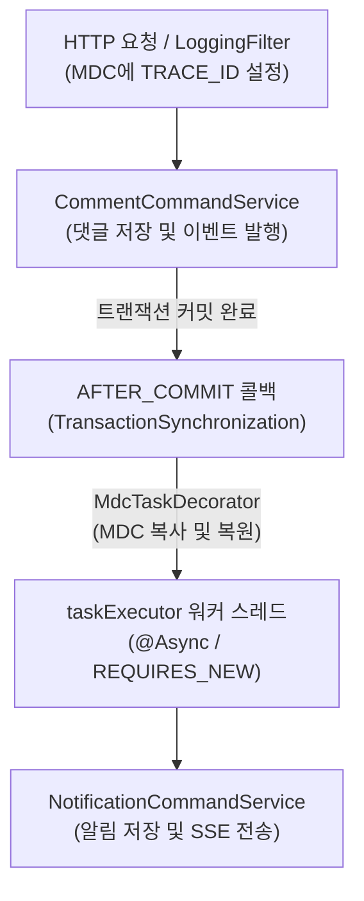

> 게시글·댓글 도메인에서 알림 도메인 직접 의존을 끊고, Spring Event와 `@Async`로 비동기 알림을 안전하게 처리하는 설계를 정리합니다. 비동기 스레드 전환 시 유실되는 MDC(`TRACE_ID`)를 `MdcTaskDecorator`로 전파하고 예외를 기록하는 방법까지 다룹니다.

> 본 문서는 Spring Boot 3.5 / Kotlin 1.9 / Java 21 환경을 기준으로 작성되었습니다.
{: .prompt-info }

## 도메인 결합을 끊는 이벤트 발행 설계

댓글 작성이나 9일차 마감 시점에 `CommentCommandService`가 `NotificationCommandService`를 직접 호출하면 `article`이 `notification`에 강하게 결합되고, 알림 저장·SSE 전송 지연이나 예외가 댓글 트랜잭션에 전파됩니다.

이를 끊기 위해 `ApplicationEventPublisher`로 도메인 이벤트를 발행하고 `notification` 리스너가 구독하도록 의존을 역전했습니다. 이벤트에는 엔티티 대신 필요한 필드만 복사한 불변 스냅샷 `data class`를 전달해, 비동기 스레드에서 발생하는 `LazyInitializationException`과 상태 오염을 차단합니다.

```kotlin
// article/domain/event/CommentCreateEvent.kt
package org.project.portfolio.article.domain.event

data class CommentCreateEvent(
    val articleId: Long,
    val articleTitle: String,
    val articleAuthorId: Long,
    val commentId: Long,
    val commentAuthorId: Long,
    val commentAuthorName: String,
    val content: String,
)
```

```kotlin
// article/domain/event/ArticleEditDeadlineApproachingEvent.kt
package org.project.portfolio.article.domain.event

data class ArticleEditDeadlineApproachingEvent(
    val articleId: Long,
    val articleTitle: String,
    val authorId: Long,
)
```

`CommentCommandService`는 댓글 저장 후 게시글 작성자와 댓글 작성자가 다를 때만(`article.authorId != user.id`) `CommentCreateEvent`를 발행해 본인 댓글 알림을 제외합니다.

```kotlin
// article/application/CommentCommandService.kt
@Service
@Transactional
class CommentCommandService(
    private val articleRepository: ArticleRepository,
    private val commentRepository: CommentRepository,
    private val userRepository: UserRepository,
    private val eventPublisher: ApplicationEventPublisher,
) {
    fun createComment(
        email: String,
        articleId: Long,
        content: String,
    ): CommentResponse {
        val article = articleRepository.findByIdOrNull(articleId)
            ?: throw NotFoundException(Article::class.java, mapOf("articleId" to articleId))

        val user: User = userRepository.findByEmail(email)
            ?: throw NotFoundException(User::class.java, mapOf("email" to email))

        val comment = commentRepository.save(
            Comment.create(
                content = content,
                authorId = user.id,
                articleId = articleId,
            ),
        )

        if (article.authorId != user.id) {
            eventPublisher.publishEvent(
                CommentCreateEvent(
                    articleId = article.id,
                    articleTitle = article.title,
                    articleAuthorId = article.authorId,
                    commentId = comment.id,
                    commentAuthorId = user.id,
                    commentAuthorName = user.name,
                    content = comment.content,
                ),
            )
        }

        return CommentResponse.from(
            comment = comment,
            author = UserSummaryResponse.from(user),
        )
    }
}
```

## TransactionalEventListener와 Async 조합의 동작 원리

일반 `@EventListener`는 발행 즉시 실행되므로 원본 트랜잭션이 롤백되어도 이미 발송된 유령 알림을 되돌릴 수 없습니다. 이를 막기 위해 리스너에 `@TransactionalEventListener(phase = AFTER_COMMIT)`, `@Async("taskExecutor")`, `@Transactional(propagation = REQUIRES_NEW)`를 함께 선언했습니다.



내부 실행 순서는 세 단계로 나뉩니다.

1. **`@TransactionalEventListener(phase = AFTER_COMMIT)`**: `TransactionSynchronizationManager`에 `afterCommit()` 콜백을 등록해 원본 트랜잭션 커밋 후에만 리스너를 실행합니다.
2. **`@Async("taskExecutor")`**: `AsyncExecutionInterceptor`가 `taskExecutor` 풀로 작업을 위임해 HTTP 스레드 응답 지연을 막습니다.
3. **`@Transactional(propagation = REQUIRES_NEW)`**: 커밋이 끝난 트랜잭션 대신 새 트랜잭션을 열어 알림 DB 쓰기를 안전하게 커밋합니다.

```kotlin
// notification/application/ArticleNotificationEventListener.kt
@Component
class ArticleNotificationEventListener(
    private val notificationCommandService: NotificationCommandService,
) {
    @Async("taskExecutor")
    @TransactionalEventListener(phase = TransactionPhase.AFTER_COMMIT)
    @Transactional(propagation = Propagation.REQUIRES_NEW)
    fun handleCommentCreated(event: CommentCreateEvent) {
        notificationCommandService.sendNotification(
            notificationRequestDto = NotificationRequestDto(
                title = "새 댓글 알림",
                content = "'${event.articleTitle}' 게시글에 ${event.commentAuthorName}님이 댓글을 남겼습니다.",
                receiver = event.articleAuthorId,
                sender = "system",
            ),
            sender = "system",
        )
    }

    @Async("taskExecutor")
    @TransactionalEventListener(phase = TransactionPhase.AFTER_COMMIT, fallbackExecution = true)
    @Transactional(propagation = Propagation.REQUIRES_NEW)
    fun handleArticleEditDeadlineApproaching(event: ArticleEditDeadlineApproachingEvent) {
        notificationCommandService.sendNotification(
            notificationRequestDto = NotificationRequestDto(
                title = "게시글 수정 마감 알림",
                content = "게시글 '${event.articleTitle}'은(는) 내일까지 수정 가능합니다.",
                receiver = event.authorId,
                sender = "system",
            ),
            sender = "system",
        )
    }
}
```

마감 알림 리스너에는 `fallbackExecution = true`를 추가해 활성 트랜잭션이 없는 호출 경로에서도 이벤트가 무시되지 않도록 방어했습니다.

## 비동기 스레드 MDC 전파와 예외 처리

`LoggingFilter`는 매 HTTP 요청마다 `TRACE_ID`와 `requestId`를 SLF4J `MDC`에 기록하고 `finally`에서 `MDC.clear()`로 정리합니다.

```kotlin
// config/LoggingFilter.kt
class LoggingFilter : OncePerRequestFilter() {
    override fun doFilterInternal(
        request: HttpServletRequest,
        response: HttpServletResponse,
        filterChain: FilterChain,
    ) {
        val traceId = UUID.randomUUID().toString()
        val requestId = request.getHeader(REQUEST_ID) ?: "unknown"
        val query: String? = request.queryString?.takeIf { it.isNotEmpty() }

        try {
            MDC.put(TRACE_ID, traceId)
            MDC.put(REQUEST_ID, requestId)
            MDC.put("uri", request.requestURI)
            MDC.put("method", request.method)
            if (query != null) {
                MDC.put("query", query)
            }
            response.setHeader(TRACE_ID, traceId)
            filterChain.doFilter(request, response)
        } finally {
            MDC.clear()
        }
    }

    companion object {
        const val TRACE_ID = "TRACE_ID"
        const val REQUEST_ID = "requestId"
    }
}
```

하지만 `MDC`는 `ThreadLocal` 기반이라 `@Async` 워커 스레드로 실행이 넘어가면 `TRACE_ID`가 증발합니다. `AsyncConfig`에서 `MdcTaskDecorator`와 `AsyncUncaughtExceptionHandler`를 함께 등록해 추적성과 예외 관측성을 확보했습니다.

```kotlin
// config/AsyncConfig.kt
@Configuration
@EnableAsync
class AsyncConfig : AsyncConfigurer {
    @Bean(name = ["taskExecutor"])
    override fun getAsyncExecutor(): Executor {
        return ThreadPoolTaskExecutor().apply {
            corePoolSize = 4
            maxPoolSize = 16
            queueCapacity = 100
            setThreadNamePrefix("async-")
            setTaskDecorator(MdcTaskDecorator())
            setWaitForTasksToCompleteOnShutdown(true)
            setAwaitTerminationSeconds(30)
            initialize()
        }
    }

    override fun getAsyncUncaughtExceptionHandler(): AsyncUncaughtExceptionHandler {
        return AsyncUncaughtExceptionHandler { ex, method, params ->
            logger.error(ex) {
                "Uncaught async error in ${method.declaringClass.simpleName}.${method.name}(${params.joinToString()})"
            }
        }
    }

    class MdcTaskDecorator : TaskDecorator {
        override fun decorate(runnable: Runnable): Runnable {
            val contextMap = MDC.getCopyOfContextMap()
            return Runnable {
                try {
                    if (contextMap != null) {
                        MDC.setContextMap(contextMap)
                    } else {
                        MDC.clear()
                    }
                    runnable.run()
                } finally {
                    MDC.clear()
                }
            }
        }
    }

    companion object {
        private val logger = KotlinLogging.logger {}
    }
}
```

`MdcTaskDecorator`는 부모 스레드에서 `MDC.getCopyOfContextMap()`으로 스냅샷을 복사해 워커 스레드에 복원합니다. 스레드 풀 재사용 시 `finally { MDC.clear() }`가 빠지면 이전 요청의 `TRACE_ID`가 다음 작업 로그에 오염됩니다. `Unit` 반환 `@Async` 메서드의 예외는 호출자에게 전파되지 않으므로 `AsyncUncaughtExceptionHandler`로 클래스·메서드·파라미터를 에러 로그에 남기고, `waitForTasksToCompleteOnShutdown`으로 종료 시 최대 30초간 잔여 작업을 마무리합니다.

## 스케줄러 기반 9일차 마감 알림과 타임존 설정

작성 9일차 게시글의 수정 마감 알림은 매시 정각 동작하는 스케줄러와 `ArticleCommandService`의 조회·발행 로직으로 분리했습니다.

```kotlin
// article/application/scheduler/ArticleDeleteNotificationScheduler.kt
@Component
class ArticleDeleteNotificationScheduler(
    private val articleCommandService: ArticleCommandService,
) {
    @Scheduled(cron = "0 0 * * * *", zone = "Asia/Seoul")
    fun sendArticleUpdateNotification() {
        logger.info { "게시글 수정가능 알림 전송 스케줄러 시작" }
        articleCommandService.sendArticleUpdateNotification()
        logger.info { "게시글 수정가능 알림 전송 스케줄러 종료" }
    }

    companion object {
        private val logger: KLogger = KotlinLogging.logger {}
    }
}
```

```kotlin
// article/application/ArticleCommandService.kt (발췌)
@Transactional(readOnly = true)
fun sendArticleUpdateNotification(
    start: Instant = Instant.now(clock).minusSeconds(9 * 24 * 60 * 60 + 1 * 60 * 60),
    end: Instant = Instant.now(clock).minusSeconds(9 * 24 * 60 * 60),
) {
    val articles: List<Article> = articleRepository.findByCreatedAtBetween(start, end)
    logger.debug { "9일차 수정 마감 알림 대상 게시글 수: ${articles.size}" }
    articles.forEach { article ->
        eventPublisher.publishEvent(
            ArticleEditDeadlineApproachingEvent(
                articleId = article.id,
                articleTitle = article.title,
                authorId = article.authorId,
            ),
        )
    }
}
```

컨테이너 기본 타임존은 대개 UTC이므로 `@Scheduled`에 `zone = "Asia/Seoul"`을 명시해 한국 시각 기준으로 실행되도록 고정했습니다. `Clock` 빈을 주입받으면 테스트에서 고정 시계로 경계 조건을 검증하기도 수월합니다.

## 인메모리 이벤트의 한계와 운영 시 주의사항

Spring 이벤트는 별도 브로커 없이 결합을 풀어주지만, JVM 메모리 기반이라는 명확한 한계가 있습니다.

| 구분 | Spring Event + `@Async` | Transactional Outbox + 브로커 |
| :--- | :--- | :--- |
| 인프라 복잡도 | 낮음 (별도 브로커 불필요) | 높음 (Outbox 테이블, 릴레이, 브로커) |
| 전달 보장 | 최대 1회 (JVM 장애 시 유실 가능) | 최소 1회 (DB 트랜잭션과 원자적 기록) |
| 적합한 용도 | 부가 알림, 로그·통계 집계 | 결제, 정산, 주문 상태 동기화 |

일시적 유실이 허용되는 알림에는 인메모리 이벤트가 실용적이지만, 결제·정산처럼 유실이 치명적인 도메인이라면 DB에 이벤트를 함께 저장해 릴레이로 발행하는 **Transactional Outbox 패턴**으로 확장해야 합니다.

> 운영 환경 주의사항
> 1. **프록시 자기 호출**: 같은 클래스 내부에서 `@Async` 메서드를 호출하면 AOP 프록시를 타지 않아 동기 실행됩니다.
> 2. **큐 포화**: `queueCapacity = 100`과 `maxPoolSize = 16` 소진 시 `TaskRejectedException`이 발생하므로 트래픽에 맞는 거부 정책을 검토해야 합니다.
> 3. **멀티 인스턴스 중복 발행**: 수평 확장 시 `@Scheduled`가 동시 실행되므로 ShedLock 같은 분산 락이 필요합니다.
{: .prompt-warning }
