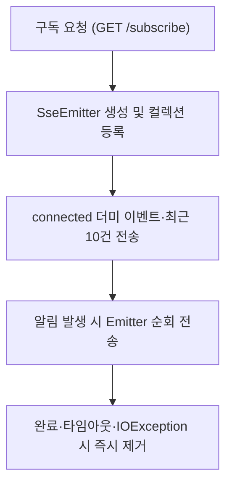

> Spring MVC의 `SseEmitter`로 단방향 실시간 알림을 구현하면서 적용한 다중 탭 동시성 제어, DTO 직렬화, 장기 연결의 OSIV 커넥션 관리 전략을 정리합니다.

> 본 글은 Spring Boot 3.5 / Kotlin 1.9 / Java 21 환경을 기준으로 작성되었습니다.
{: .prompt-info }

## 실시간 알림에 WebSocket 대신 SSE를 선택한 이유

서버에서 클라이언트로 이벤트를 전달하는 방식은 Polling, WebSocket, SSE(Server-Sent Events)로 나뉩니다.

| 구분 | Polling | WebSocket | SSE (`SseEmitter`) |
| :--- | :--- | :--- | :--- |
| 방향 | 요청 기반 단방향 | 양방향 전이중 | 서버 → 클라이언트 단방향 |
| 프로토콜 | HTTP | 별도 (`ws://`) | 표준 HTTP (`text/event-stream`) |
| 재연결 | 직접 구현 | 직접 구현 | 브라우저 `EventSource` 지원 |
| 구현 비용 | 낮음 (요청 누적) | 높음 (세션 관리) | 낮음 (Spring MVC 내장) |

댓글이나 공지 알림은 서버에서 클라이언트로만 보내는 단방향 푸시입니다. Polling은 빈 요청이 쌓이고, WebSocket은 별도 프로토콜과 세션 관리가 필요해 단순 알림에 과합니다. SSE는 기존 HTTP 인프라와 브라우저 자동 재연결을 그대로 활용할 수 있습니다.

다만 브라우저 표준 `EventSource`는 `Authorization` 헤더를 지원하지 않아 JWT 인증 시 `event-source-polyfill`이나 쿠키 인증이 필요합니다. 채팅처럼 양방향 통신이 필요하다면 WebSocket을 선택해야 합니다.

## SseEmitter 생명주기와 다중 탭 연결 관리

한 사용자가 여러 브라우저 탭이나 기기에서 동시에 구독할 수 있으므로, `ConcurrentHashMap<String, CopyOnWriteArrayList<SseEmitter>>`로 이메일별 다중 연결을 관리했습니다.



`CopyOnWriteArrayList`를 쓴 이유는 순회 중 삭제 안전성 때문입니다. 알림을 순회 전송하다 끊어진 연결에서 `IOException`이 발생해 `removeEmitter()`를 호출해도 스냅샷 기반 순회 덕분에 `ConcurrentModificationException`이 발생하지 않습니다.

```kotlin
// notification/application/NotificationSseService.kt
package org.project.portfolio.notification.application

import com.fasterxml.jackson.databind.ObjectMapper
import io.github.oshai.kotlinlogging.KotlinLogging
import org.project.portfolio.notification.presentation.response.NotificationResponse
import org.springframework.data.domain.PageRequest
import org.springframework.stereotype.Service
import org.springframework.web.servlet.mvc.method.annotation.SseEmitter
import java.io.IOException
import java.util.concurrent.ConcurrentHashMap
import java.util.concurrent.CopyOnWriteArrayList

@Service
class NotificationSseService(
    private val notificationQueryService: NotificationQueryService,
    private val objectMapper: ObjectMapper,
) {
    /** 현재 연결된 모든 SSE 클라이언트 (이메일별 다중 연결 지원) */
    private val emitters = ConcurrentHashMap<String, CopyOnWriteArrayList<SseEmitter>>()

    /** 알림 구독 */
    fun subscribe(email: String): SseEmitter {
        val emitter = SseEmitter(SSE_TIMEOUT_MS)
        val userEmitters = emitters.computeIfAbsent(email) { CopyOnWriteArrayList() }
        userEmitters.add(emitter)

        val cleanup = { removeEmitter(email, emitter) }
        emitter.onCompletion(cleanup)
        emitter.onTimeout(cleanup)
        emitter.onError { cleanup() }

        sendEvent(email, emitter, "system", "connected")

        // 최근 10개의 알림을 초기 전송
        notificationQueryService.getNotifications(email, PageRequest.of(0, 10)).forEach {
            sendEvent(email, emitter, "notification", objectMapper.writeValueAsString(it))
        }

        return emitter
    }

    /** 특정 사용자에게 실시간 SSE 알림 전송 */
    fun sendToUser(
        email: String,
        notification: NotificationResponse,
    ) {
        val userEmitters = emitters[email] ?: return
        val payload = objectMapper.writeValueAsString(notification)
        userEmitters.forEach { emitter ->
            sendEvent(email, emitter, "notification", payload)
        }
    }

    private fun sendEvent(
        email: String,
        emitter: SseEmitter,
        eventName: String,
        data: Any,
    ) {
        try {
            emitter.send(SseEmitter.event().name(eventName).data(data))
        } catch (e: IOException) {
            logger.debug(e) { "SSE 전송 실패로 연결 제거: email=$email" }
            removeEmitter(email, emitter)
        }
    }

    private fun removeEmitter(
        email: String,
        emitter: SseEmitter,
    ) {
        emitters.computeIfPresent(email) { _, list ->
            list.remove(emitter)
            if (list.isEmpty()) null else list
        }
    }

    companion object {
        private const val SSE_TIMEOUT_MS = 60L * 60L * 1000L // 1시간
        private val logger = KotlinLogging.logger {}
    }
}
```

`onCompletion`, `onTimeout`, `onError`와 `IOException` 예외 경로를 모두 `removeEmitter()`로 통합하고, `computeIfPresent`로 리스트가 비면 키까지 제거해 메모리 누수를 막았습니다. 구독 직후 `"connected"` 더미 이벤트를 보내는 이유는 첫 데이터 없이 타임아웃될 때 발생하는 `503 Service Unavailable`을 예방하기 위함입니다. 컨트롤러에서는 `produces = [MediaType.TEXT_EVENT_STREAM_VALUE]`를 지정합니다.

```kotlin
// notification/presentation/NotificationController.kt
@GetMapping(path = ["/subscribe"], produces = [MediaType.TEXT_EVENT_STREAM_VALUE])
@PreAuthorize("isAuthenticated()")
fun notificationSubscribe(
    @AuthenticationPrincipal jwt: Jwt,
): SseEmitter {
    return notificationSseService.subscribe(jwt.subject)
}
```

## 엔티티 직접 직렬화 방지와 NotificationResponse 설계

`Notification` 엔티티는 `@ManyToOne`으로 `User`를 참조합니다.

```kotlin
// notification/domain/Notification.kt
@Entity
@SoftDelete(columnName = "is_deleted")
class Notification(
    @Id @GeneratedValue(strategy = GenerationType.IDENTITY)
    val id: Long = 0,
    val title: String,
    val content: String,
    @ManyToOne
    val receiver: User,
    val sender: String,
) : BaseTimeEntity()
```

엔티티를 그대로 `ObjectMapper`로 직렬화하면 `User`의 해시된 `password`, `phone`, `roles` 같은 민감 정보가 SSE 페이로드로 유출됩니다. 또한 트랜잭션 외부에서 지연 로딩 필드에 접근해 `LazyInitializationException`이 터질 위험도 있습니다.

따라서 조회(`NotificationQueryService`)와 발송(`NotificationCommandService`) 모두 `@Transactional` 경계 안에서 `NotificationResponse` DTO로 평탄화한 뒤 전송 계층으로 넘깁니다.

```kotlin
// notification/presentation/response/NotificationResponse.kt
data class NotificationResponse(
    val id: Long,
    val title: String,
    val content: String,
    val receiverId: Long,
    val sender: String,
    val createdAt: Instant,
) {
    companion object {
        fun from(notification: Notification): NotificationResponse {
            return NotificationResponse(
                id = notification.id,
                title = notification.title,
                content = notification.content,
                receiverId = notification.receiver.id,
                sender = notification.sender,
                createdAt = notification.createdAt,
            )
        }
    }
}
```

```kotlin
// notification/application/NotificationCommandService.kt
@Service
@Transactional
class NotificationCommandService(
    private val notificationRepository: NotificationRepository,
    private val userRepository: UserRepository,
    private val notificationSseService: NotificationSseService,
) {
    fun sendNotification(
        notificationRequestDto: NotificationRequestDto,
        sender: String,
    ) {
        val receiverId = notificationRequestDto.receiver
        if (receiverId == null) {
            userRepository.findAll().forEach { user ->
                val saved = saveNotification(notificationRequestDto, receiver = user, sender = sender)
                notificationSseService.sendToUser(user.email, NotificationResponse.from(saved))
            }
        } else {
            userRepository.findByIdOrNull(receiverId)?.let { user ->
                val saved = saveNotification(notificationRequestDto, receiver = user, sender = sender)
                notificationSseService.sendToUser(user.email, NotificationResponse.from(saved))
            }
        }
    }
}
```

## 장기 SSE 연결에서 OSIV 비활성화와 Virtual Threads 설정

Spring Boot의 `spring.jpa.open-in-view`(OSIV) 기본값은 `true`입니다. 이 상태에서는 `OpenEntityManagerInViewInterceptor`가 HTTP 응답이 끝날 때까지 영속성 컨텍스트와 DB 커넥션을 반환하지 않습니다. 1시간짜리 SSE 연결이 초기 알림 10건을 조회한 뒤 커넥션을 붙잡고 있으면, 동시 구독자 수가 HikariCP 기본 풀 크기(10)에 도달하는 순간 전체 API가 `SQLTransientConnectionException`으로 마비됩니다.

> SSE처럼 응답 스트림을 장시간 유지하는 엔드포인트가 있다면 `spring.jpa.open-in-view: false` 설정은 필수입니다.
{: .prompt-warning }

```yaml
# src/main/resources/application.yml
spring:
  threads:
    virtual:
      enabled: true

  lifecycle:
    timeout-per-shutdown-phase: 30s

  jpa:
    open-in-view: false
    properties:
      hibernate:
        default_batch_fetch_size: 100

server:
  shutdown: graceful
```

- **OSIV 비활성화 (`open-in-view: false`)**: `getNotifications()` 트랜잭션 종료 즉시 커넥션을 풀에 반환해, 이후 1시간 동안 SSE가 유지되어도 DB 커넥션을 점유하지 않습니다.
- **Java 21 Virtual Threads (`virtual.enabled: true`)**: 초기 조회나 대량 알림 전송 I/O 구간에서 가상 스레드가 경량 스케줄링되어 플랫폼 스레드 고갈을 방지합니다.
- **Graceful Shutdown (`shutdown: graceful`, `30s`)**: 배포 시 `SIGTERM`을 받으면 신규 요청을 차단하고 진행 중인 요청을 마무리합니다. 1시간짜리 SSE 연결은 유예 시간 후 정리되며, 클라이언트는 `EventSource` 재연결로 새 인스턴스에 재구독합니다.

## 운영 환경 고려사항과 다중 인스턴스 확장

Nginx 같은 리버스 프록시 앞단에서는 `proxy_buffering off;` 또는 `X-Accel-Buffering: no` 헤더로 버퍼링을 꺼야 이벤트가 즉시 전달됩니다. 또한 `proxy_read_timeout` 기본값(60초)을 늘리거나 주기적인 heartbeat를 보내야 연결이 중간에 끊기지 않습니다.

현재 `emitters` 맵은 단일 JVM 메모리에만 존재하므로, 서버를 2대 이상으로 수평 확장하면 다른 인스턴스에 연결된 사용자의 알림이 유실됩니다. 다중 인스턴스 환경에서는 **Redis Pub/Sub**으로 `NotificationResponse`를 브로드캐스트하고, 각 인스턴스가 자신의 로컬 `emitters`에 해당 사용자가 있을 때만 푸시하는 구조로 확장해야 합니다.
