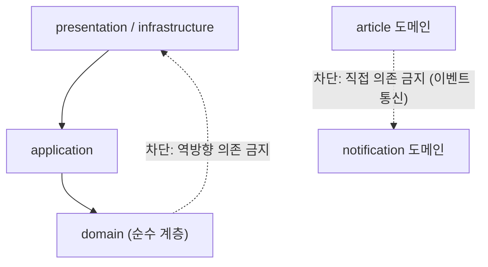

> Kotest, Fixture Monkey, ArchUnit으로 API 통합 테스트와 토큰 단위 테스트, 3계층 의존성 검증을 구축한 과정을 정리합니다. Kotlin MockMvc DSL에서 검증이 누락되어 항상 통과하는 거짓 양성(False-Positive) 문제의 원인과 교정 방법도 함께 다룹니다.

> 본 문서는 Java 21, Kotlin 1.9.25, Spring Boot 3.5.16, Kotest 5.9.1, Fixture Monkey 1.2.4, ArchUnit 1.4.1 기준입니다.
{: .prompt-info }

## Kotest 전역 설정과 @DirtiesContext 제거

API 통합 테스트는 엔드포인트마다 성공(200, 201, 204)과 예외(400, 401, 403, 404) 시나리오가 계층적으로 나뉩니다. JUnit 5 `@Nested` 대신 `describe`/`it` 구조로 가독성을 높일 수 있는 Kotest `DescribeSpec`을 선택했고, `AbstractProjectConfig`로 `SpringExtension`을 전역 등록해 클래스별 중복 선언을 없앴습니다.

```kotlin
// src/test/kotlin/org/project/portfolio/config/KotestProjectConfig.kt
package org.project.portfolio.config

import io.kotest.core.config.AbstractProjectConfig
import io.kotest.extensions.spring.SpringExtension

class KotestProjectConfig : AbstractProjectConfig() {
    override fun extensions() = listOf(SpringExtension)
}
```

이어서 통합 테스트의 `@DirtiesContext`를 모두 제거했습니다.

- **컨텍스트 캐싱 무력화**: 클래스마다 `ApplicationContext`와 Hibernate가 재기동되어 빌드 시간이 급증합니다.
- **H2 공유 DB 충돌**: `jdbc:h2:mem:testdb;MODE=PostgreSQL;DB_CLOSE_DELAY=-1`과 `ddl-auto: create-drop` 조합에서는 컨텍스트 종료마다 테이블이 드롭·재생성되어 공유 DB 상태가 꼬입니다.

`@Transactional` 롤백으로 단일 컨텍스트를 재사용하되, `REQUIRES_NEW`나 비동기 리스너가 커밋하는 데이터만 별도로 정리합니다.

## java-test-fixtures와 Fixture Monkey로 테스트 데이터 관리

Gradle `java-test-fixtures` 플러그인(`src/testFixtures/kotlin`)으로 테스트 데이터 팩토리를 분리하고, [Fixture Monkey](/posts/fixture-monkey/)에 `KotlinPlugin`과 `JakartaValidationPlugin`을 조합해 Bean Validation 제약을 만족하는 요청 DTO를 자동 생성했습니다.



```kotlin
// src/testFixtures/kotlin/ArticleFixture.kt
import com.navercorp.fixturemonkey.FixtureMonkey
import com.navercorp.fixturemonkey.api.plugin.SimpleValueJqwikPlugin
import com.navercorp.fixturemonkey.jakarta.validation.plugin.JakartaValidationPlugin
import com.navercorp.fixturemonkey.kotlin.KotlinPlugin
import com.navercorp.fixturemonkey.kotlin.giveMeBuilder
import org.project.portfolio.article.domain.Article
import org.project.portfolio.article.presentation.request.ArticleForm
import java.time.Instant

object ArticleFixture {
    private val fixtureMonkey: FixtureMonkey = FixtureMonkey.builder()
        .plugin(KotlinPlugin())
        .plugin(SimpleValueJqwikPlugin())
        .plugin(JakartaValidationPlugin())
        .build()

    fun getRandomArticle(authorId: Long): ArticleForm {
        return fixtureMonkey.giveMeBuilder<ArticleForm>()
            .set("images", null)
            .set("authorId", authorId)
            .sample()
    }

    fun createArticle(
        articleForm: ArticleForm? = getRandomArticle(1)[0],
        authorId: Long = 1L,
        articleId: Long = 1L,
        createdAt: Instant = Instant.now(),
    ): Article {
        return Article(
            id = articleId,
            title = articleForm?.title ?: "제목입니다",
            content = articleForm?.content ?: "내용입니다",
            images = listOf(),
            authorId = authorId,
        ).apply {
            this.createdAt = createdAt
        }
    }
}
```

주의할 점은 **검색 키워드나 정렬 기준처럼 검증 핵심 조건에 해당하는 필드까지 랜덤에 맡기면 간헐적 실패(Flaky Test)가 발생한다**는 점입니다. 핵심 조건은 명시적 상수로 고정하고 나머지 부가 필드만 픽스처에 맡기는 것이 안전합니다.

## Kotlin MockMvc DSL의 거짓 양성 함정과 검증 교정

통합 테스트에서 겪은 가장 치명적인 버그는 **API가 404나 500을 반환해도 테스트가 통과하는 거짓 양성(False-Positive)**이었습니다.

```kotlin
// 잘못된 패턴: 검증이 등록되지 않아 항상 통과함
mockMvc.get("/api/v1/articles") {
    contentType = MediaType.APPLICATION_JSON
}.andExpect {
    status().isOk // Java 정적 메서드 -> ResultMatcher만 생성되고 버려짐
}
```

원인은 Kotlin MockMvc DSL의 내부 구조에 있습니다. `ResultActionsDsl.andExpect`는 `MockMvcResultMatchersDsl` 람다를 실행하며, DSL 함수인 `status { isOk() }`가 생성한 `ResultMatcher`를 내부 `matchers` 리스트에 등록한 뒤 검증합니다. 반면 Java 정적 메서드 `MockMvcResultMatchers.status().isOk`는 `ResultMatcher` 객체만 반환하고 버려지므로 리스트가 비어 있는 채 무조건 성공합니다.

| 호출 방식 | 검증 등록 여부 | 특징 |
| :--- | :--- | :--- |
| `mockMvc.get { }.andExpect { status().isOk }` | 미등록 (거짓 양성) | 매처가 버려져 항상 통과 |
| `mockMvc.get { }.andExpectAll { status { isOk() } }` | 정상 등록 (Kotlin DSL) | 모든 매처를 실행해 실패 항목 일괄 보고 |
| `mockMvc.perform(...).andExpectAll(status().isCreated)` | 정상 등록 (Java API) | 가변 인자로 매처를 직접 전달 |

> Kotlin MockMvc DSL 내부에서는 Java 정적 메서드(`status()`, `jsonPath()`)를 혼용하지 말고 중괄호 DSL(`status { isOk() }`)만 사용해야 합니다.
{: .prompt-warning }

`.andExpectAll`로 교정하면 모든 검증 실패를 한 번에 확인할 수 있습니다. 멀티파트 요청처럼 `mockMvc.perform`을 쓰는 구간은 Java API이므로 `andExpectAll(status().isCreated, ...)`로 가변 인자를 전달합니다.

```kotlin
// src/test/kotlin/org/project/portfolio/article/ArticlesApiTest.kt (핵심 발췌)
@Transactional
@DisplayName("Articles API 통합 테스트")
@SpringBootTest(webEnvironment = SpringBootTest.WebEnvironment.RANDOM_PORT)
@AutoConfigureMockMvc
class ArticlesApiTest(
    private val mockMvc: MockMvc,
    private val authService: AuthService,
    private val articleService: ArticleCommandService,
) : DescribeSpec({
    val userRegisterForm = UsersFixture.getRandomRegisterRequest()
    val author = authService.register(userRegisterForm)
    val authorToken = authService.login(userRegisterForm.email, userRegisterForm.password)

    describe("GET /api/v1/articles - 게시글 조회 API") {
        it("200 OK - 키워드 검색이 실제로 필터링된다") {
            val uniqueKeyword = "UNIQUE_SEARCH_KEYWORD_999"
            articleService.createArticle(
                email = author.email,
                articleForm = ArticleForm(
                    title = "제목 $uniqueKeyword",
                    content = "검색 테스트 본문",
                    tags = listOf("kotlin", "spring"),
                ),
            )

            mockMvc.get("/api/v1/articles") {
                param("keyword", uniqueKeyword)
                contentType = MediaType.APPLICATION_JSON
            }.andExpectAll {
                status { isOk() }
                jsonPath("$.content.length()") { value(1) }
                jsonPath("$.content[0].title") { value("제목 $uniqueKeyword") }
                jsonPath("$.content[0].tags[0]") { value("kotlin") }
            }
        }
    }

    describe("POST /api/v1/articles - 게시글 작성 API") {
        it("201 Created - 이미지 및 태그 포함") {
            val file = MockMultipartFile(
                "images", "image.jpg", "image/jpeg", "fake-image-content".toByteArray(),
            )

            mockMvc.perform(
                multipart("/api/v1/articles")
                    .file(file)
                    .param("title", "테스트 제목")
                    .param("content", "테스트 내용")
                    .param("tags", "spring", "kotlin")
                    .withJwt(authorToken)
                    .contentType(MediaType.MULTIPART_FORM_DATA),
            ).andExpectAll(
                status().isCreated,
                jsonPath("$.title").value("테스트 제목"),
                jsonPath("$.tags[0]").value("spring"),
                jsonPath("$.tags[1]").value("kotlin"),
            )
        }
    }
})
```

알림 API 통합 테스트에서는 `receiver` 엔티티가 그대로 직렬화되어 민감 정보가 노출되지 않는지 `doesNotExist()`로 확인하고, 관리자 발송 API의 권한 분리(202 Accepted vs 403 Forbidden)도 검증했습니다.

```kotlin
// src/test/kotlin/org/project/portfolio/notification/NotificationsApiTest.kt (핵심 발췌)
mockMvc.get("/api/v1/notifications") {
    withJwt(userToken)
}.andExpectAll {
    status { isOk() }
    content { contentType(MediaType.APPLICATION_JSON) }
    jsonPath("$.content[0].title") { value("테스트 알림") }
    jsonPath("$.content[0].receiverId") { value(user.id) }
    jsonPath("$.content[0].receiver") { doesNotExist() }
}
```

## JwtProviderTest로 토큰 혼용 차단 단위 테스트 작성

JWT 발급·검증 경계 조건은 Spring 컨테이너 없이 `JwtConfig`와 `JwtProvider`를 직접 조립해 단위 테스트로 분리했습니다. 특히 **Access Token과 Refresh Token의 혼용 차단**을 핵심으로 검증합니다. 토큰 타입 클레임 검증이 빠지면 Refresh Token으로 보호된 API에 접근하거나 Access Token으로 재발급을 시도하는 취약점이 열리기 때문입니다.

```kotlin
// src/test/kotlin/org/project/portfolio/auth/JwtProviderTest.kt (핵심 발췌)
class JwtProviderTest :
    DescribeSpec({
        val jwtProperties = JwtProperties(
            secret = "test-secret-key-at-least-32-bytes-long-for-hs256",
            issuer = "test-issuer",
            accessExpiry = 3600,
            refreshExpiry = 604800,
        )
        val jwtConfig = JwtConfig(jwtProperties)
        val accessDecoder = jwtConfig.jwtDecoder()
        val refreshDecoder = jwtConfig.refreshJwtDecoder()
        val authConverter = jwtConfig.jwtAuthenticationConverter()
        val jwtProvider = JwtProvider(
            jwtProperties = jwtProperties,
            jwtEncoder = jwtConfig.jwtEncoder(),
            refreshJwtDecoder = refreshDecoder,
        )

        describe("Spring OAuth2 Resource Server JWT") {
            it("Access Token을 발급하고 검증 및 권한 변환할 수 있다") {
                val token = jwtProvider.createAccessToken("user@test.com", setOf(UserRole.USER, UserRole.ADMIN))
                val jwt = accessDecoder.decode(token)
                val auth = authConverter.convert(jwt)!!

                jwt.subject shouldBe "user@test.com"
                auth.authorities.map { it.authority } shouldContainExactlyInAnyOrder listOf("ROLE_USER", "ROLE_ADMIN")
            }

            it("Refresh Token을 Access Token 디코더로 검증하면 실패한다") {
                val refreshToken = jwtProvider.createRefreshToken("user@test.com", "refresh-jit-123")
                shouldThrow<JwtValidationException> { accessDecoder.decode(refreshToken) }
            }

            it("Access Token을 Refresh Token으로 복호화하면 UnauthorizedException이 발생한다") {
                val accessToken = jwtProvider.createAccessToken("user@test.com", setOf(UserRole.USER))
                shouldThrow<UnauthorizedException> { jwtProvider.decodeRefreshToken(accessToken) }
            }

            it("만료된 Access Token은 검증에 실패한다") {
                val expiredToken = jwtProvider.createAccessToken(
                    email = "user@test.com",
                    roles = setOf(UserRole.USER),
                    issuedAt = Instant.now().minusSeconds(7200),
                    duration = 60,
                )
                shouldThrow<JwtValidationException> { accessDecoder.decode(expiredToken) }
            }
        }
    })
```

`issuedAt`과 `duration`을 주입할 수 있게 설계해 `Thread.sleep` 없이도 만료 시나리오를 빠르게 검증합니다.

## ArchUnit으로 3계층 의존성 규칙을 빌드 타임에 강제

도메인 순수성이나 이벤트 기반 통신 원칙은 코드 리뷰만으로는 점차 무너지기 쉽습니다. ArchUnit을 테스트 스위트에 넣으면 컴파일된 바이트코드를 분석해 의존성 위반을 빌드 단계에서 즉시 차단할 수 있습니다.



```kotlin
// src/test/kotlin/org/project/portfolio/ArchitectureTest.kt
package org.project.portfolio

import com.tngtech.archunit.core.importer.ClassFileImporter
import com.tngtech.archunit.core.importer.ImportOption
import com.tngtech.archunit.lang.syntax.ArchRuleDefinition.noClasses
import io.kotest.core.spec.style.DescribeSpec

class ArchitectureTest :
    DescribeSpec({
        val classes = ClassFileImporter()
            .withImportOption(ImportOption.DoNotIncludeTests())
            .importPackages("org.project.portfolio")

        describe("3계층 아키텍처 의존성 규칙") {
            it("domain 패키지는 application, presentation, infrastructure 패키지에 의존할 수 없다") {
                noClasses()
                    .that().resideInAPackage("..domain..")
                    .should().dependOnClassesThat().resideInAnyPackage(
                        "..application..",
                        "..presentation..",
                        "..infrastructure..",
                    )
                    .allowEmptyShould(true)
                    .check(classes)
            }

            it("article 도메인은 notification 도메인에 직접 의존하지 않는다 (이벤트로만 통신)") {
                noClasses()
                    .that().resideInAPackage("org.project.portfolio.article..")
                    .should().dependOnClassesThat().resideInAPackage("org.project.portfolio.notification..")
                    .check(classes)
            }
        }
    })
```

`ImportOption.DoNotIncludeTests()`로 프로덕션 클래스만 검사하고, `.allowEmptyShould(true)`로 빈 서브 패키지의 오탐 실패를 막았습니다. 통합·단위·아키텍처 테스트를 계층화해 기능 회귀와 설계 훼손을 CI 단계에서 함께 차단합니다.


