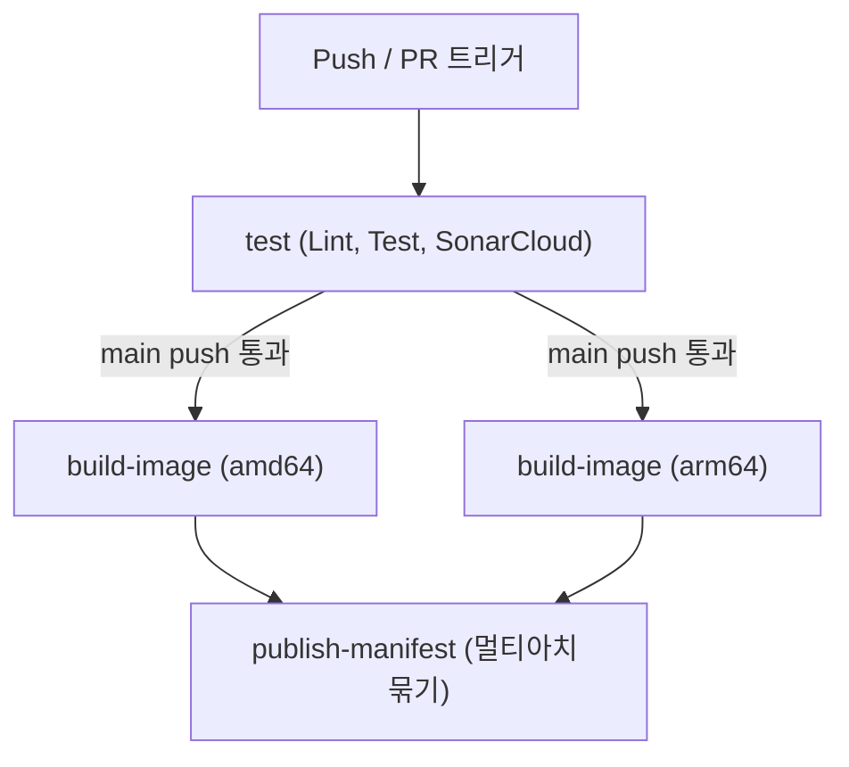

> 단일 GitHub Actions 워크플로우에서 Lint, Redis 통합 테스트, SonarCloud 분석, 그리고 `amd64`/`arm64` 네이티브 Buildpacks 멀티아치 이미지 배포까지 연결한 CI/CD 파이프라인 설계를 정리합니다.

> 기준 환경: Spring Boot 3.5, Kotlin 1.9, Java 21(Temurin), GitHub Actions(`ubuntu-24.04` / `ubuntu-24.04-arm`)
{: .prompt-info }

## 단일 워크플로우 통합과 배포 게이트 설계

CI와 CD를 별도 워크플로우로 나누면 `main` 푸시 시 테스트가 중복 실행되거나, 테스트가 깨진 커밋의 이미지가 먼저 배포될 위험이 있습니다. 이를 막기 위해 전체 파이프라인을 `.github/workflows/ci-cd.yaml` 하나로 통합하고 `needs: test` 배포 게이트를 세웠습니다.

모든 브랜치 푸시와 PR에서는 `test` 잡만 실행되며, `main` 푸시에서 `test`를 통과한 경우에만 멀티아치 빌드와 매니페스트 발행으로 넘어갑니다.



연속 푸시 시 이전 실행을 자동 취소하도록 `concurrency`를 설정하고, `permissions`는 테스트 리포트와 PR 코멘트에 필요한 최소 권한만 부여했습니다.


```yaml
# .github/workflows/ci-cd.yaml (트리거 및 동시성 제어)
name: CI/CD Pipeline

on:
  push:
    branches:
      - '**'
  pull_request:
    branches:
      - main

concurrency:
  group: ${{ github.workflow }}-${{ github.ref }}
  cancel-in-progress: true

permissions:
  contents: read
  issues: read
  checks: write
  pull-requests: write
```


## Lint, 통합 테스트와 SonarCloud 연동

`test` 잡에서는 `services`로 `redis:8-alpine` 컨테이너와 헬스체크를 함께 띄워 테스트 환경을 격리합니다. `ktlintCheck`로 코드 스타일을 검사한 뒤 `test jacocoTestReport`로 테스트와 커버리지 XML을 생성하고, `outputs`에 추출한 `VERSION`과 `SHORT_SHA`를 후속 배포 잡으로 전달합니다.


```yaml
# .github/workflows/ci-cd.yaml (test 잡)
jobs:
  test:
    name: Lint, Test & SonarCloud
    runs-on: ubuntu-24.04
    outputs:
      version: ${{ steps.project-version.outputs.version }}
      short_sha: ${{ steps.project-version.outputs.short_sha }}

    services:
      redis:
        image: redis:8-alpine
        ports:
          - 6379:6379
        options: >-
          --health-cmd "redis-cli ping"
          --health-interval 10s
          --health-timeout 5s
          --health-retries 5

    steps:
      - uses: actions/checkout@v7
        with:
          fetch-depth: 0

      - uses: gradle/actions/wrapper-validation@v6

      - name: Set up JDK 21
        uses: actions/setup-java@v6
        with:
          java-version: '21'
          distribution: 'temurin'

      - name: Setup Gradle
        uses: gradle/actions/setup-gradle@v6

      - name: Extract project version and short SHA
        id: project-version
        run: |
          VERSION=$(./gradlew properties -q | grep '^version:' | awk '{print $2}')
          echo "version=${VERSION}" >> "$GITHUB_OUTPUT"
          echo "short_sha=${GITHUB_SHA::7}" >> "$GITHUB_OUTPUT"

      - name: Check Lint
        run: ./gradlew ktlintCheck

      - name: Run Tests & JaCoCo Report
        run: ./gradlew -Dspring.profiles.active=test test jacocoTestReport

      - name: Publish Test Results
        uses: EnricoMi/publish-unit-test-result-action@v2
        if: ${{ always() }}
        with:
          files: build/test-results/**/*.xml

      - name: Report to SonarCloud
        run: |
          if [ -n "$SONAR_TOKEN" ]; then
            ./gradlew sonar
          else
            echo "SONAR_TOKEN is not set; skipping SonarCloud analysis."
          fi
        env:
          GITHUB_TOKEN: ${{ secrets.GITHUB_TOKEN }}
          SONAR_TOKEN: ${{ secrets.SONAR_TOKEN }}
```


테스트가 실패해도 실패 원인을 GitHub Checks에서 바로 볼 수 있도록 리포트 발행에 `if: ${{ always() }}`를 지정했고, `SONAR_TOKEN`이 없는 포크 PR에서는 SonarCloud 단계를 안전하게 건너뜁니다. Gradle에서는 JaCoCo XML 출력과 SonarCloud 분석 경로를 함께 맞춥니다.

```kotlin
// build.gradle.kts (JaCoCo 및 SonarCloud 설정)
tasks.withType<JacocoReport> {
    reports {
        xml.required.set(true)
        html.required.set(true)
    }
}

sonar {
    properties {
        property("sonar.projectKey", "cmsong111_Wanted-PreOnBoarding-Backend-Challenge")
        property("sonar.organization", "cmsong111")
        property("sonar.host.url", "https://sonarcloud.io")
        property("sonar.language", "kotlin")
        property("sonar.sources", "src/main/kotlin")
        property("sonar.tests", "src/test/kotlin")
        property("sonar.java.binaries", "build/classes/kotlin/main")
        property("sonar.java.test.binaries", "build/classes/kotlin/test")
        property("sonar.junit.reportPaths", "build/test-results/test")
        property("sonar.coverage.jacoco.xmlReportPaths", "build/reports/jacoco/test/jacocoTestReport.xml")
        property(
            "sonar.exclusions",
            "**/presentation/request/**, **/presentation/response/**, **/config/**",
        )
    }
}
```

## 네이티브 러너 기반 Buildpacks 멀티아치 빌드

`Dockerfile` 대신 Spring Boot `bootBuildImage`(Cloud Native Buildpacks)를 사용하면 JVM 메모리 계산과 베이스 이미지 보안 패치를 자동으로 챙길 수 있습니다. 다만 기본 생성 시각이 `1980-01-01`로 고정되므로, 운영 시 빌드 시점을 바로 확인하도록 `createdDate = "now"`를 설정했습니다.

```kotlin
// build.gradle.kts (BootBuildImage 설정)
import org.springframework.boot.gradle.tasks.bundling.BootBuildImage

tasks.withType<BootBuildImage>().configureEach {
    createdDate = "now"
}
```

멀티아치(`amd64`, `arm64`) 빌드는 QEMU 에뮬레이션 대신 GitHub Actions 네이티브 러너(`ubuntu-24.04`, `ubuntu-24.04-arm`) 병렬 매트릭스를 선택했습니다.

| 구분 | QEMU 에뮬레이션 | 네이티브 매트릭스 + `imagetools create` |
| :--- | :--- | :--- |
| 빌드 속도 | ARM64 구간에서 수 배 느림 | 양쪽 아키텍처 네이티브 병렬 실행 |
| Buildpacks 안정성 | JVM·Pack 구동 중 타임아웃 위험 | 호스트 아키텍처 빌더 직접 사용 |
| 워크플로우 구조 | 단일 잡 | 빌드 매트릭스 + 매니페스트 결합 |

`build-image` 잡은 각 아키텍처 이미지를 고정 중간 태그(`build-amd64`, `build-arm64`)로 덮어쓰며 푸시합니다. 커밋마다 임시 태그를 만들지 않아 Docker Hub 태그 오염을 막을 수 있으며, 마지막 `publish-manifest` 잡이 `docker buildx imagetools create`로 두 이미지를 하나의 OCI Image Index로 묶어 `latest`, `VERSION`, `SHORT_SHA` 3개 태그로 발행합니다.


```yaml
# .github/workflows/ci-cd.yaml (멀티아치 빌드 및 매니페스트 발행)
  build-image:
    name: Build & Push Image (${{ matrix.arch }})
    needs: test
    if: github.event_name == 'push' && github.ref == 'refs/heads/main'
    runs-on: ${{ matrix.runner }}
    strategy:
      fail-fast: false
      matrix:
        include:
          - arch: amd64
            runner: ubuntu-24.04
          - arch: arm64
            runner: ubuntu-24.04-arm

    steps:
      - uses: actions/checkout@v7
        with:
          fetch-depth: 0

      - uses: gradle/actions/wrapper-validation@v6

      - name: Set up JDK 21
        uses: actions/setup-java@v6
        with:
          java-version: '21'
          distribution: 'temurin'

      - name: Setup Gradle
        uses: gradle/actions/setup-gradle@v6

      - name: Login to Docker Hub
        uses: docker/login-action@v4
        with:
          username: ${{ vars.DOCKERHUB_USERNAME }}
          password: ${{ secrets.DOCKERHUB_TOKEN }}

      - name: Build & Push Boot Image (${{ matrix.arch }})
        env:
          IMAGE_TAG: cmsong111/portfolio-server:build-${{ matrix.arch }}
        run: |
          ./gradlew bootBuildImage --imageName="$IMAGE_TAG"
          docker push "$IMAGE_TAG"

  publish-manifest:
    name: Publish Multi-Arch Manifest
    needs: [test, build-image]
    if: github.event_name == 'push' && github.ref == 'refs/heads/main'
    runs-on: ubuntu-24.04

    steps:
      - name: Login to Docker Hub
        uses: docker/login-action@v4
        with:
          username: ${{ vars.DOCKERHUB_USERNAME }}
          password: ${{ secrets.DOCKERHUB_TOKEN }}

      - name: Create & Push Multi-Arch Manifest
        env:
          VERSION: ${{ needs.test.outputs.version }}
          SHORT_SHA: ${{ needs.test.outputs.short_sha }}
        run: |
          docker buildx imagetools create \
            -t "cmsong111/portfolio-server:latest" \
            -t "cmsong111/portfolio-server:${VERSION}" \
            -t "cmsong111/portfolio-server:${SHORT_SHA}" \
            "cmsong111/portfolio-server:build-amd64" \
            "cmsong111/portfolio-server:build-arm64"
```


## 운영 중 겪은 트러블슈팅과 주의사항

### SonarCloud Shallow Clone과 Automatic Analysis 충돌

`actions/checkout` 기본값(`fetch-depth: 1`)에서는 Git 커밋 이력이 잘려 SonarCloud의 blame 정보와 New Code 계산이 누락됩니다. 체크아웃에 `fetch-depth: 0`을 명시해 전체 이력을 내려받도록 수정했습니다.

또한 SonarCloud 프로젝트의 `Automatic Analysis`가 켜진 상태에서 `./gradlew sonar`를 실행하면 다음 오류로 분석이 거부됩니다.

```text
ERROR: You are running CI analysis while Automatic Analysis is enabled.
Please consider disabling one or the other.
```

> `Automatic Analysis`는 JaCoCo 커버리지 XML을 수집하지 못합니다. 테스트 커버리지까지 품질 게이트에 반영하려면 SonarCloud `Administration > Analysis Method`에서 반드시 `Automatic Analysis`를 OFF로 전환해야 합니다.
{: .prompt-warning }

### 시크릿 분리와 서버 자동 배포 연계

자격 증명은 노출 범위에 따라 Variables와 Secrets로 분리해 등록합니다.

| 위치 | 키 이름 | 용도 |
| :--- | :--- | :--- |
| Variables | `DOCKERHUB_USERNAME` | Docker Hub 계정 ID |
| Secrets | `DOCKERHUB_TOKEN` | Docker Hub Access Token |
| Secrets | `SONAR_TOKEN` | SonarCloud 분석 토큰 |

개발 서버에서 Watchtower 등으로 `latest` 태그를 폴링할 때도 `publish-manifest`가 완료된 시점에만 새 다이제스트가 노출되므로, x86_64와 ARM64 서버 모두 동일 태그로 자신의 아키텍처에 맞는 이미지를 안전하게 교체할 수 있습니다.

## 마치며

테스트·정적 분석·네이티브 멀티아치 빌드를 단일 워크플로우로 통합해 중복 실행을 없애고, 고정 중간 태그와 `imagetools create`로 레지스트리를 깔끔하게 유지할 수 있었습니다. 전체 코드는 아래 저장소에서 확인할 수 있습니다.


