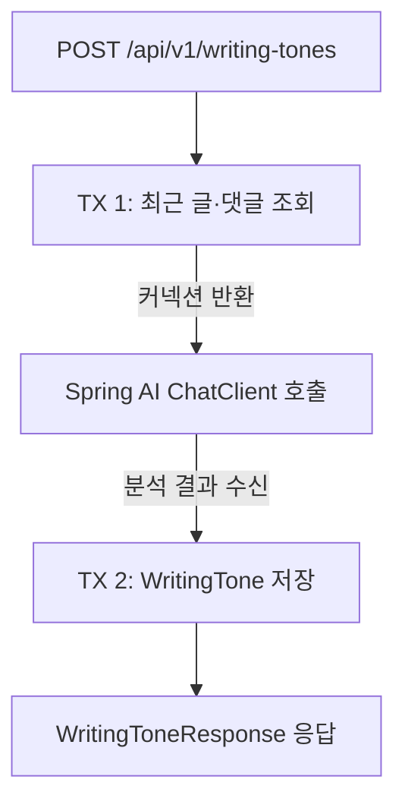

> Spring AI `ChatClient`와 외부 마크다운 프롬프트로 사용자의 말투를 분석·변환하는 기능을 구현하고, `TransactionTemplate`으로 LLM 호출을 DB 트랜잭션 밖으로 분리한 구조를 정리합니다.

> Spring Boot 3.5.16, Kotlin 1.9.25, Java 21, Spring AI 1.1.8(`spring-ai-starter-model-google-genai`) 기준입니다.
{: .prompt-info }

## 도입 배경과 Spring AI 연동 설정

사용자의 최근 게시글과 댓글을 분석해 말투 프로필을 저장하고, 새 글을 해당 말투로 변환해 주는 기능을 설계했습니다. 핵심 목표는 세 가지입니다. 프로바이더 교체 시 코드 수정이 없을 것, 프롬프트를 코드와 분리할 것, 그리고 긴 LLM 호출이 DB 커넥션을 점유하지 않을 것입니다.

먼저 `build.gradle.kts`에 Spring AI BOM과 Google GenAI 스타터를 추가합니다.

```kotlin
// build.gradle.kts
extra["springAiVersion"] = "1.1.8"

dependencies {
    implementation("org.springframework.ai:spring-ai-starter-model-google-genai")
}

dependencyManagement {
    imports {
        mavenBom("org.springframework.ai:spring-ai-bom:${property("springAiVersion")}")
    }
}
```

`application.yml`에서는 `spring.config.import: optional:file:.env[.properties]`로 루트 `.env`를 자동 로드합니다. `optional:` 덕분에 `.env`가 없는 CI나 컨테이너 환경에서도 환경 변수로 자연스럽게 폴백됩니다. 기본 모델은 `gemini-3.8-flash`로 지정하고, API 키 기본값(`dummy-api-key`)을 두어 테스트 컨텍스트 기동 실패를 막았습니다.

```yaml
# src/main/resources/application.yml
spring:
  config:
    import: optional:file:.env[.properties]
  jpa:
    open-in-view: false
  ai:
    google:
      genai:
        api-key: ${GEMINI_API_KEY:dummy-api-key}
        chat:
          options:
            model: ${GEMINI_MODEL:gemini-3.8-flash}
            temperature: 0.7
```

## 벤더 종속을 제거한 ChatClient 설계와 프롬프트 외부화

인프라 계층에서 `GoogleGenAiChatModel`이나 `GoogleGenAiChatOptions` 같은 벤더 전용 클래스를 직접 참조하면 모델 공급자를 바꿀 때 코드 수정이 불가피합니다. 이를 피하기 위해 도메인 계층에는 순수 포트(`WritingToneAnalyzer`, `WritingToneGenerator`)와 `WritingToneDraft`만 두고, 인프라 계층에서도 공통 `ChatClient.Builder`와 `ChatOptions`만 사용했습니다.

| 구분 | 프로바이더 전용 클래스 직접 사용 | `ChatClient.Builder` + 공통 `ChatOptions` |
| :--- | :--- | :--- |
| 프로바이더 교체 | 어댑터 코드 및 import 수정 필요 | 의존성 스타터와 `application.yml`만 교체 |
| 옵션 제어 범위 | 벤더 특화 파라미터 세부 제어 가능 | `temperature`, `topP`, `maxTokens` 등 공통 옵션 |

벤더 고유 기능이 꼭 필요하지 않다면 공통 추상화를 유지하는 편이 유지보수에 유리합니다. 도메인 모델 역시 웹 DTO나 Spring AI에 의존하지 않도록 `WritingToneDraft`로 분리했습니다.

```kotlin
// writing/tone/domain/WritingToneDraft.kt
data class WritingToneDraft(
    val title: String,
    val content: String,
)

// writing/tone/domain/WritingToneAnalyzer.kt
interface WritingToneAnalyzer {
    fun analyze(text: List<String>): String
}

// writing/tone/domain/WritingToneGenerator.kt
interface WritingToneGenerator {
    fun generate(
        draft: WritingToneDraft,
        toneDescription: String,
        tokenLimit: Int = 2000,
    ): WritingToneDraft
}
```

시스템 프롬프트는 `src/main/resources/prompts/writing-tone-analyze.md`와 `writing-tone-generate.md`로 외부화했습니다. 프롬프트를 마크다운 리소스로 빼면 Kotlin 코드 가독성을 해치지 않고, Git Diff에서 프롬프트 튜닝과 로직 수정이 깔끔하게 분리됩니다.

```kotlin
// writing/tone/infrastructure/SpringAiWritingToneAnalyzer.kt
@Component
class SpringAiWritingToneAnalyzer(
    chatClientBuilder: ChatClient.Builder,
    @Value("classpath:prompts/writing-tone-analyze.md")
    systemPromptResource: Resource,
) : WritingToneAnalyzer {
    private val chatClient: ChatClient = chatClientBuilder
        .defaultSystem(systemPromptResource)
        .defaultOptions(
            ChatOptions.builder()
                .temperature(0.7)
                .topP(0.9)
                .build(),
        )
        .build()

    override fun analyze(text: List<String>): String {
        return chatClient.prompt()
            .user(
                """
                다음은 한 사용자가 작성한 글입니다. 이 사용자의 말투와 글쓰기 스타일의 특징을 분석해주세요:

                ${text.joinToString(separator = "\n")}
                """.trimIndent(),
            )
            .call()
            .content()
            ?: throw IllegalStateException("Failed to analyze writing tone")
    }
}
```

## BeanOutputConverter 기반 구조화 JSON 출력

글 변환 API는 결과의 `title`과 본문을 명확히 분리해 반환해야 합니다. `ChatClient`의 `.entity(Class<T>)`를 호출하면 내부적으로 `BeanOutputConverter`가 동작해 Jackson 어노테이션으로 JSON Schema를 생성하고, 이를 프롬프트 포맷 지침에 자동 주입한 뒤 응답 JSON을 지정한 타입으로 역직렬화합니다.

```kotlin
// writing/tone/presentation/request/ArticleWritingForm.kt
@Schema(description = "글 스타일 변환 폼")
data class ArticleWritingForm(
    @field:NotBlank(message = "제목을 입력해주세요")
    @field:Size(max = 255, message = "제목은 255자 이하로 입력해주세요")
    @field:JsonProperty(required = true, value = "title")
    @field:JsonPropertyDescription("변환된 게시글 제목 (255자 이내)")
    val title: String,
    @field:NotBlank(message = "내용을 입력해주세요")
    @field:Size(max = 2000, message = "내용은 2000자 이하로 입력해주세요")
    @field:JsonProperty(required = true, value = "description")
    @field:JsonPropertyDescription("변환된 게시글 본문 내용 (2000자 이내)")
    val content: String,
)
```

`content` 필드의 JSON 키를 `description`으로 매핑하고 `@JsonPropertyDescription`에 길이 제약을 명시해 `prompts/writing-tone-generate.md` 지침과 일치시켰습니다. `SpringAiWritingToneGenerator`는 파싱 결과를 즉시 `WritingToneDraft`로 변환해 도메인 경계를 지킵니다.

```kotlin
// writing/tone/infrastructure/SpringAiWritingToneGenerator.kt
@Component
class SpringAiWritingToneGenerator(
    chatClientBuilder: ChatClient.Builder,
    @Value("classpath:prompts/writing-tone-generate.md")
    systemPromptResource: Resource,
) : WritingToneGenerator {
    private val chatClient: ChatClient = chatClientBuilder
        .defaultSystem(systemPromptResource)
        .build()

    override fun generate(
        draft: WritingToneDraft,
        toneDescription: String,
        tokenLimit: Int,
    ): WritingToneDraft {
        val result = chatClient.prompt()
            .user(
                """
                다음은 사용자가 작성한 글입니다. 이 글을 아래 말투 스타일로 변환해주세요:

                --- style description
                $toneDescription
                --- title
                ${draft.title}
                --- content
                ${draft.content}
                ---
                """.trimIndent(),
            )
            .options(
                ChatOptions.builder()
                    .temperature(0.9)
                    .topP(0.95)
                    .maxTokens(tokenLimit)
                    .build(),
            )
            .call()
            .entity(ArticleWritingForm::class.java)
            ?: throw IllegalStateException("Failed to parse generated writing tone response")

        return WritingToneDraft(title = result.title, content = result.content)
    }
}
```

## TransactionTemplate으로 LLM 호출을 DB 트랜잭션 밖으로 분리하기

`analyzeWritingTone()` 메서드 전체에 `@Transactional`을 걸면 DB 커넥션을 점유한 채 외부 LLM 응답을 수 초 이상 대기하게 됩니다. 동시 요청이 몰리면 HikariCP 커넥션 풀이 고갈되어 일반 API까지 장애가 전파됩니다.

이를 방지하기 위해 `TransactionTemplate`으로 DB 조회·저장 구간만 짧게 감싸고 LLM 호출을 트랜잭션 밖으로 분리했습니다.



```kotlin
// writing/tone/application/WritingToneCommandService.kt
@Service
class WritingToneCommandService(
    private val userRepository: UserRepository,
    private val articleRepository: ArticleRepository,
    private val commentRepository: CommentRepository,
    private val writingToneAnalyzer: WritingToneAnalyzer,
    private val writingToneGenerator: WritingToneGenerator,
    private val writingToneRepository: WritingToneRepository,
    private val transactionTemplate: TransactionTemplate,
) {
    fun analyzeWritingTone(email: String): WritingToneResponse {
        val (userId, texts) = checkNotNull(
            transactionTemplate.execute {
                val user = userRepository.findByEmail(email)
                    ?: throw NotFoundException(User::class.java, mapOf("email" to email))
                val recentPage = PageRequest.of(0, 10, Sort.by(Sort.Direction.DESC, "createdAt"))
                val articles = articleRepository.findByAuthorId(user.id, recentPage).content
                val comments = commentRepository.findByAuthorId(user.id, recentPage).content
                val collected = articles.map { it.title } +
                    articles.map { it.content } +
                    comments.map { it.content }
                if (collected.isEmpty()) {
                    throw BadRequestException("말투를 분석할 게시글 또는 댓글이 존재하지 않습니다.")
                }
                user.id to collected
            },
        )

        val analyzedText = writingToneAnalyzer.analyze(texts)

        return checkNotNull(
            transactionTemplate.execute {
                val saved = writingToneRepository.save(
                    WritingTone(userId = userId, description = analyzedText),
                )
                WritingToneResponse.from(saved)
            },
        )
    }

    fun generateWithWritingTone(
        email: String,
        articleWritingForm: ArticleWritingForm,
    ): ArticleWritingForm {
        val toneDescription = checkNotNull(
            transactionTemplate.execute {
                val user = userRepository.findByEmail(email)
                    ?: throw NotFoundException(User::class.java, mapOf("email" to email))
                writingToneRepository.findByUserId(
                    userId = user.id,
                    pageable = PageRequest.of(0, 1, Sort.by(Sort.Direction.DESC, "createdAt")),
                ).content.firstOrNull()?.description
                    ?: throw NotFoundException(WritingTone::class.java, mapOf("userId" to user.id))
            },
        )

        val generated = writingToneGenerator.generate(
            draft = WritingToneDraft(articleWritingForm.title, articleWritingForm.content),
            toneDescription = toneDescription,
            tokenLimit = 1000,
        )
        return ArticleWritingForm(title = generated.title, content = generated.content)
    }
}
```

이력 조회 전용 `WritingToneQueryService`는 `@Transactional(readOnly = true)`로 분리했고, `WritingToneController`는 `/api/v1/writing-tones` 아래 분석(`POST`), 이력 조회(`GET`), 변환(`POST /generate`) 엔드포인트를 제공합니다.

## 실무 적용 시 주의사항과 정리

- **`maxTokens`로 인한 JSON 잘림**: `tokenLimit = 1000`처럼 출력 토큰을 제한할 때 응답이 중간에 잘리면 `BeanOutputConverter` 역직렬화가 실패합니다. 프롬프트의 글자 수 지침과 `maxTokens` 사이에 여유를 두어야 합니다.
- **OSIV 비활성화(`open-in-view: false`) 주의**: 트랜잭션 밖으로 JPA 엔티티를 넘겨 지연 로딩 필드에 접근하면 예외가 발생합니다. 첫 번째 트랜잭션 안에서 필요한 `user.id`와 문자열만 추출해 반환해야 안전합니다.
- **입력 컨텍스트 상한 제어**: `PageRequest.of(0, 10, ...)`처럼 최근 글·댓글 개수를 제한해 토큰 비용과 지연 시간 폭증을 방지했습니다.

> 외부 LLM 호출을 트랜잭션 밖으로 격리하고 도메인 포트로 벤더 의존성을 차단해 두면, 모델 교체와 트래픽 증가 모두에 유연하게 대응할 수 있습니다.
{: .prompt-tip }


