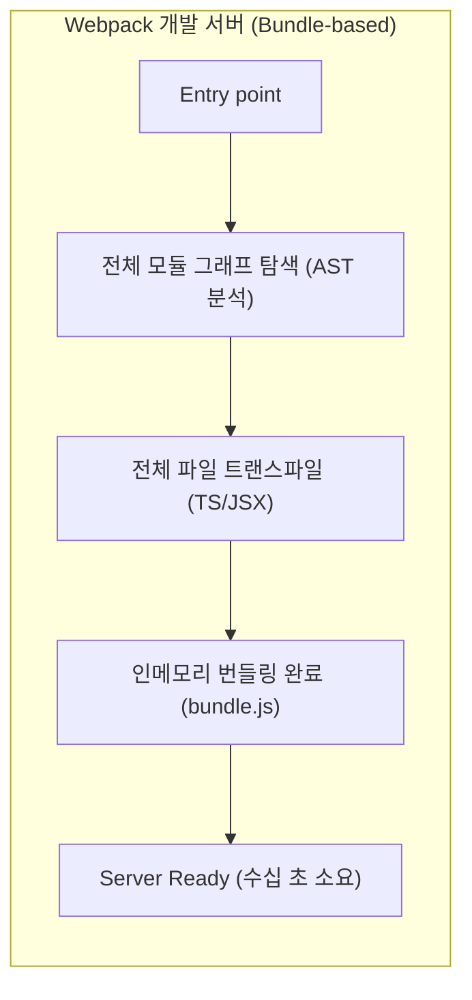
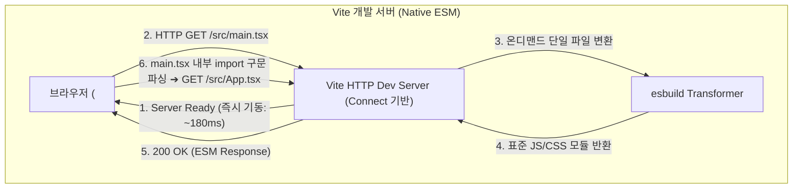

> 모던 프론트엔드 프로젝트의 규모가 커질수록 로컬 개발 서버 기동 시간과 핫 모듈 교체(HMR) 지연은 개발 생산성에 직접적인 영향을 미칩니다. 본 글에서는 전통적인 번들러(Webpack) 기반 개발 서버가 지닌 구조적 병목 원인을 짚어보고, 최신 브라우저의 Native ESM(ECMAScript Modules) 지원과 온디맨드(On-demand) 컴파일을 활용하여 밀리초 단위 기동을 달성한 Vite의 코어 아키텍처를 분석합니다.

---

## 1. Webpack 번들 기반 개발 서버의 구조적 한계

수년간 프론트엔드 생태계를 주도해 온 Webpack은 모든 소스 코드와 `node_modules` 의존성을 진입점(Entry Point)부터 하나로 묶어주는 강력한 번들러입니다. 하지만 로컬 개발 서버 환경에서는 이러한 '선제적 전체 번들링(Bundling-first)' 방식이 심각한 성능 저하를 초래합니다.

### 1.1 콜드 스타트(Cold Start) 병목 메커니즘

Webpack 기반 개발 서버(`webpack-dev-server`)가 준비 완료(`Server Ready`) 상태가 되려면 다음과 같은 단계를 거쳐야 합니다:

1. 애플리케이션 진입점(`src/index.tsx`)을 파싱합니다.
2. `import`, `require`로 연결된 모든 내부 모듈과 외부 라이브러리를 순회하며 거대한 **모듈 의존성 그래프(Module Dependency Graph)**를 메모리에 구축합니다.
3. Babel, TS Loader 등을 통해 모든 TypeScript/JSX 파일을 컴파일합니다.
4. 모든 모듈을 하나 이상의 번들 청크(`bundle.js`, `vendor.js`)로 합치고, 이를 가상 파일 시스템(In-memory FS)에 기록합니다.

이 과정은 **프로젝트의 전체 소스 코드 크기($N$)에 비례하여 작업량이 선형적으로 증가($O(N)$)**하는 특성을 갖습니다. 수백, 수천 개의 컴포넌트와 무거운 라이브러리가 포함된 대규모 프로젝트에서는 개발 서버를 켜는 데만 20초~1분 이상 소요되기도 합니다.



### 1.2 서버 기동 시간 벤치마크 비교

실제 1,480개의 소스 파일과 주요 서드파티 라이브러리가 포함된 프로젝트에서 Webpack 5와 Vite 6의 개발 서버 기동(Cold Start) 시간을 측정한 결과입니다.


_Webpack 5 번들 기반 서버(14.24s)와 Vite 6 Native ESM 서버(184ms) 기동 시간 비교_

Webpack은 개발 서버를 띄우기 위해 1,480개 모듈 전체를 인메모리에서 결합하느라 약 14.2초가 소요되었지만, Vite는 불과 184밀리초 만에 개발 서버를 준비 상태로 전환했습니다.

---

## 2. Vite Native ESM 아키텍처의 패러다임 전환

Vite는 개발 환경에서 **"번들링을 사전에 수행하지 않는다(No-bundling in Dev)"**는 대담한 설계를 채택했습니다. 이 혁신이 가능해진 배경은 최신 웹 브라우저 대부분이 **Native ECMAScript Modules(ESM)** 규격을 기본 지원하기 시작했기 때문입니다.

HTML에 다음과 같이 `<script type="module">`을 선언하면, 브라우저 자체가 모듈 로더 역할을 수행하여 코드 내의 `import` 문을 파싱하고 필요한 모듈을 개별 HTTP 요청으로 서버에 질의합니다.

```html
<!-- index.html -->
<!DOCTYPE html>
<html lang="ko">
  <head>
    <meta charset="UTF-8" />
    <meta name="viewport" content="width=device-width, initial-scale=1.0" />
    <title>Vite App</title>
  </head>
  <body>
    <div id="root"></div>
    <script type="module" src="/src/main.tsx"></script>
  </body>
</html>
```

### 2.1 Native ESM 기반 온디맨드(On-demand) 서빙

Vite 개발 서버는 전체 애플리케이션 코드를 미리 번들링하지 않고, HTTP 요청이 들어올 때 비로소 해당 파일 하나만 변환(Transform)하여 응답합니다.



1. **서버 즉시 기동**: 전체 애플리케이션 코드를 빌드하지 않고, 라우트 핸들러와 미들웨어만 등록한 뒤 즉시 포트(`http://localhost:5173`)를 개방합니다.
2. **브라우저의 요청 기반 컴파일**: 사용자가 브라우저에서 페이지를 열면 `GET /src/main.tsx` 요청이 서버로 전송됩니다.
3. **단일 파일 변환**: Vite 서버는 내부의 Connect 미들웨어를 통해 해당 `main.tsx` 파일만을 Go 언어 기반 컴파일러인 esbuild로 초고속 트랜스파일하여 표준 ESM JavaScript 코드로 변환해 브라우저에 전달합니다.
4. **점진적 의존성 로딩**: 브라우저는 반환받은 코드 안의 `import App from './App'` 구문을 해석하고, 다시 `GET /src/App.tsx`를 요청합니다.

이러한 온디맨드 처리 방식 덕분에 프로젝트에 모듈이 1만 개가 넘더라도, 초기 화면에서 사용되지 않는 페이지나 컴포넌트는 전혀 컴파일되지 않으므로 기동 속도에 아무런 영향을 주지 않습니다.

---

## 3. 네트워크 레벨 동작 분석과 HTTP 캐시 활용

실제 Vite 개발 서버가 기동된 후 브라우저가 첫 페이지를 로드할 때 발생하는 네트워크 통신 흐름을 디버그 모드로 확인해 보겠습니다.


_Vite Dev Server 콘솔에서 관찰되는 개별 ESM 모듈 요청 및 HTTP 304 응답_

### 3.1 브라우저 HTTP 요청 헤더와 조건부 요청(304 Not Modified)

Vite는 개발 중 불필요한 재컴파일과 네트워크 전송 오버헤드를 줄이기 위해 브라우저의 HTTP 캐시 헤더를 정교하게 활용합니다.

- **소스 코드(Source Code)**:
  - 파일 내용의 해시값을 기반으로 `ETag`를 생성하여 브라우저에 내려줍니다.
  - 브라우저가 새로고침 시 `If-None-Match` 헤더와 함께 요청하면, 파일이 수정되지 않았을 경우 서버는 변환을 건너뛰고 즉시 `304 Not Modified`를 응답합니다.
- **서드파티 의존성(Dependencies)**:
  - `react`, `lodash` 같은 외부 라이브러리는 빌드 시 내용이 변하지 않으므로 `Cache-Control: max-age=31536000, immutable` 헤더를 지정하여 브라우저 디스크 캐시를 강제합니다.

### 3.2 핫 모듈 교체(HMR)의 시간 복잡도 개선

Webpack에서는 단 하나의 파일이 수정되더라도 번들러가 의존성 체인을 재계산하여 번들 청크를 다시 패키징해야 했습니다. 프로젝트가 거대해질수록 코드 수정 후 브라우저에 반영되기까지 체감 지연 시간이 길어집니다.

반면 Vite는 모듈 그래프를 브라우저의 ESM 모듈 단위로 일대일 매핑해 둡니다. 특정 파일(예: `Header.tsx`)이 수정되면, WebSocket을 통해 해당 모듈의 경로만 브라우저로 전송합니다:

```typescript
// Vite 내부 HMR WebSocket 메시지 규격 예시
{
  type: 'update',
  updates: [
    {
      type: 'js-update',
      path: '/src/components/Header.tsx',
      acceptedPath: '/src/components/Header.tsx',
      timestamp: 1722654000123
    }
  ]
}
```

브라우저는 갱신된 타임스탬프 쿼리 스트링(`Header.tsx?t=1722654000123`)을 붙여 해당 단일 파일만 다시 요청하므로, 프로젝트 전체 규모와 상관없이 **HMR 갱신 속도는 항상 일정한 상수 시간($O(1)$)**을 보장합니다.

---

## 4. Webpack과 Vite 코어 아키텍처 비교 요약

두 도구의 개발 서버 처리 방식을 표로 비교하면 다음과 같습니다.

| 비교 항목 | Webpack Dev Server | Vite Dev Server |
| :--- | :--- | :--- |
| **서버 기동 원리** | 전체 모듈 그래프 분석 후 인메모리 사전 번들링 | 서버 즉시 개방, 브라우저 요청 시 온디맨드 컴파일 |
| **모듈 시스템** | CommonJS 및 자체 번들 런타임 클로저 래핑 | 브라우저 Native ESM (`<script type="module">`) |
| **트랜스파일러** | Babel / ts-loader (Node.js 기반) | esbuild (Go 언어 기반, 10~100배 고속) |
| **콜드 스타트 복잡도** | $O(N)$ (전체 모듈 수에 비례하여 지연) | $O(1)$ (서버 즉시 대기, 화면 렌더링에 필요한 모듈만 요청) |
| **HMR 갱신 속도** | 모듈 재번들링 오버헤드로 규모에 따라 지연 | 변경된 파일만 독립 요청하여 상수 시간($O(1)$) 유지 |
| **프로덕션 빌드** | Webpack 자체 번들러 | Rollup (Vite 5~7) ➔ **Rolldown Rust 코어 (Vite 8)** |

---

## 5. 마치며

Vite가 기존 번들러의 한계를 극복할 수 있었던 핵심은 브라우저의 표준 기술인 Native ESM을 신뢰하고, 무거운 선행 번들링 과정을 걷어낸 아키텍처적 전환에 있습니다.

나아가 프론트엔드 빌드 생태계는 **Vite 7의 Rollup 기반 안정성**을 거쳐 **Vite 8에서 Rust 기반 초고속 번들러인 Rolldown으로 개발과 빌드가 단일 통합**되는 거대한 진화를 이루어내고 있습니다.

하지만 현실의 프론트엔드 생태계에는 여전히 CommonJS 형식으로 배포된 수많은 npm 패키지들이 존재하며, 수백 개의 내부 파일로 쪼개진 라이브러리가 초래하는 HTTP 요청 폭포(Waterfall) 현상이라는 또 다른 과제가 남아 있습니다. 다음 포스트에서는 이러한 한계를 해결하기 위해 Vite가 도입한 **esbuild 의존성 사전 번들링(Pre-bundling)과 캐시 제어 메커니즘**, 그리고 향후 Rolldown 통합으로 이어지는 흐름을 살펴보겠습니다.


