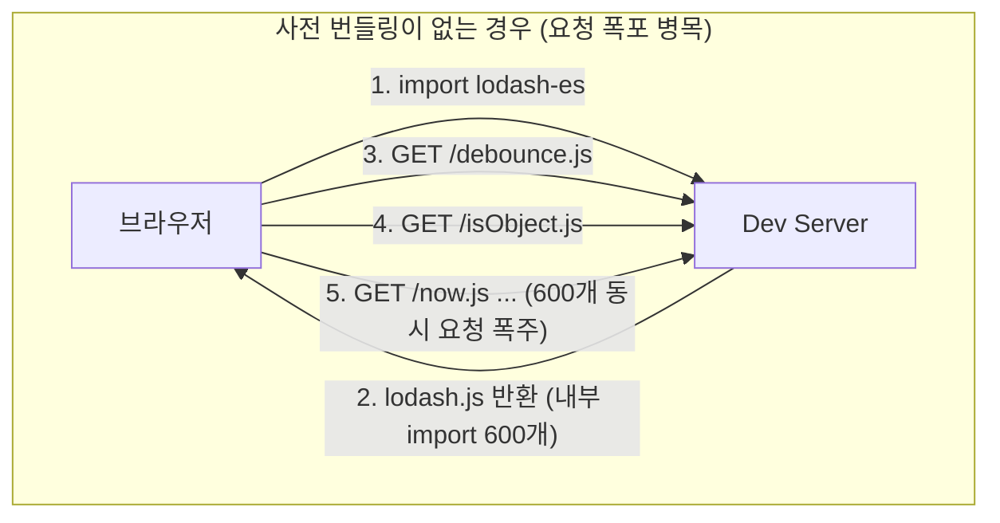
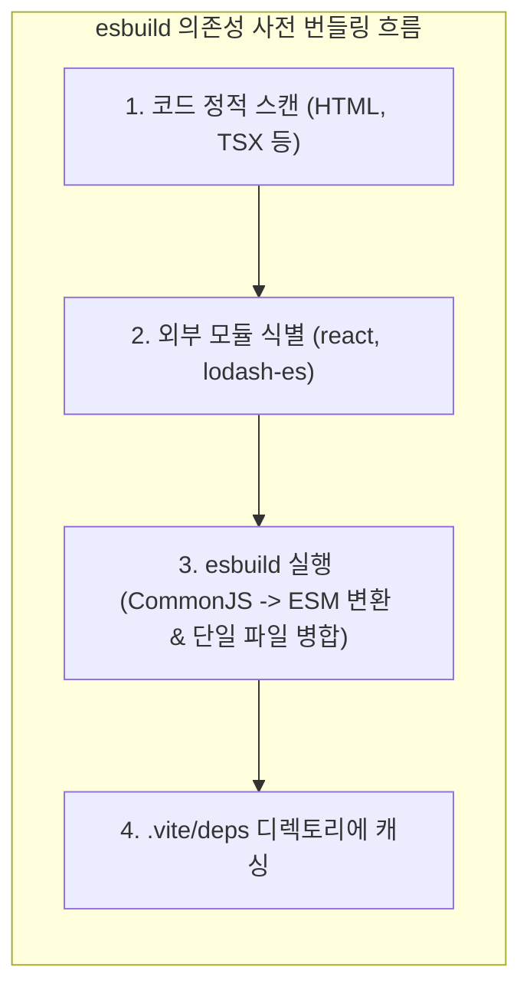

> 브라우저의 Native ESM 지원만으로는 CommonJS 규격의 레거시 npm 패키지와 수백 개의 파일로 쪼개진 모듈 요청 폭포(Waterfall) 현상을 완전히 해결할 수 없습니다. 본 글에서는 Vite가 Go 기반의 초고속 번들러 esbuild를 활용하여 의존성을 사전에 번들링(Pre-bundling)하는 구조적 원리를 분석하고, `node_modules/.vite/deps` 디스크 캐시 및 브라우저 HTTP 캐시 제어 전략을 정리합니다.

---

## 1. 배경: Native ESM 환경에서 마주하는 두 가지 현실적 과제

앞선 글에서 살펴본 것처럼 Native ESM은 애플리케이션 코드를 온디맨드로 서빙하는 데 이상적입니다. 하지만 실무 프로젝트에서 외부 서드파티 라이브러리(`node_modules`)를 다룰 때는 다음과 같은 두 가지 심각한 장벽에 부딪히게 됩니다.

### 1.1 CommonJS 및 UMD 모듈 호환성 부재

npm에 배포된 수많은 패키지(예: `react`, `react-dom`)는 여전히 CommonJS(CJS) 또는 UMD 형식으로 작성되어 있습니다. CJS 모듈은 브라우저 환경에서 직접 실행할 수 없으며, 브라우저의 Native ESM은 `require`나 `module.exports` 문법을 이해하지 못합니다. 브라우저가 이를 정상적으로 임포트하려면 CJS 모듈을 표준 ESM 문법으로 변환해 주는 브릿지가 반드시 필요합니다.

### 1.2 네트워크 요청 폭포(Network Waterfall) 현상

트리쉐이킹을 위해 모든 함수가 개별 파일로 분리된 라이브러리가 대표적입니다. 예를 들어 `lodash-es`는 내부적으로 600개가 넘는 세부 모듈 파일로 구성되어 있습니다. 브라우저가 `import { debounce } from 'lodash-es'` 구문을 만났을 때 아무런 사전 처리 없이 Native ESM으로 순차 요청하게 되면, 수백 개의 HTTP 요청이 동시에 쏟아지며 네트워크 병목이 발생하고 페이지 로딩이 수 초간 멈추게 됩니다.



---

## 2. esbuild를 활용한 의존성 사전 번들링(Pre-bundling)

Vite는 개발 서버를 기동하기 직전, Go 언어로 작성된 초고속 번들러 **esbuild**를 실행하여 외부 의존성만을 타깃으로 사전 번들링(Pre-bundling)을 수행합니다.



### 2.1 사전 번들링의 핵심 역할

1. **모듈 포맷 변환 (CommonJS -> ESM)**:
   - CJS 모듈의 `module.exports`를 정적으로 분석하여 브라우저가 인식할 수 있는 Named Export 구문으로 래핑합니다.
2. **모듈 평탄화(Flattening)**:
   - 수백 개의 내부 파일로 쪼개진 `lodash-es`를 단 하나(또는 소수)의 ESM 청크 파일(`lodash-es.js`)로 압축 결합하여 브라우저의 HTTP 요청 수를 1개로 줄입니다.
3. **esbuild의 압도적인 속도**:
   - esbuild는 Go 언어로 작성되어 병렬 처리에 최적화되어 있으며, 메모리 재사용률이 높습니다. 일반적인 JavaScript 기반 번들러 대비 10배에서 100배 빠른 속도로 동작하므로, 수십 개의 의존성을 변환하는 데 20~50밀리초 내외밖에 걸리지 않습니다.

---

## 3. 캐시 저장소 분석: `node_modules/.vite/deps`

사전 번들링된 의존성 결과물은 로컬 디스크의 `node_modules/.vite/deps` 경로에 안전하게 보관됩니다.

실제 프로젝트 디렉토리를 열어 캐시 구조와 메타데이터 파일을 확인해 보겠습니다.


_node_modules/.vite/deps 디렉토리 트리 및 _metadata.json 캐시 해시 정보_

### 3.1 `_metadata.json`의 구조와 역할

캐시 디렉토리 내부의 `_metadata.json` 파일은 사전 번들링의 신선도(Freshness)를 판별하는 기준점입니다:

```json
// node_modules/.vite/deps/_metadata.json
{
  "hash": "7a9f24b8",
  "configHash": "1f8e3c4d",
  "lockfileHash": "9b12d34e",
  "browserHash": "8c5a21ef",
  "optimized": {
    "react": {
      "src": "../../react/index.js",
      "file": "react.js",
      "fileHash": "4a71c89e"
    },
    "react-dom/client": {
      "src": "../../react-dom/client.js",
      "file": "react-dom_client.js",
      "fileHash": "9b52f10c"
    },
    "lodash-es": {
      "src": "../../lodash-es/lodash.js",
      "file": "lodash-es.js",
      "fileHash": "3c84e12d"
    }
  }
}
```

- **`lockfileHash`**: `pnpm-lock.yaml`, `package-lock.json`, `yarn.lock` 등의 락파일 해시값입니다. 패키지를 새로 설치하거나 버전을 업그레이드하면 이 값이 변경됩니다.
- **`configHash`**: `vite.config.ts` 내의 `optimizeDeps` 관련 설정 변경 여부를 감지합니다.
- **`browserHash`**: 브라우저 요청 시 쿼리 스트링(`?v=8c5a21ef`)으로 전달되어, 캐시가 유효한 동안 브라우저가 서버에 요청조차 보내지 않고 브라우저 캐시에서 즉각 꺼내 쓰도록 유도합니다.

---

## 4. 캐시 무효화(Cache Invalidation)와 강제 재번들링

개발 서버를 구동할 때마다 의존성을 다시 번들링한다면 불필요한 지연이 발생합니다. 따라서 Vite는 캐시를 재활용하되, 다음 세 가지 조건 중 하나라도 충족되면 자동으로 사전 번들링을 다시 수행합니다:

1. 패키지 매니저 락파일(`package-lock.json`, `pnpm-lock.yaml`, `yarn.lock`)의 내용이 변경된 경우
2. `package.json`의 `dependencies` 목록이 변경된 경우
3. `vite.config.ts` 내의 `optimizeDeps` 필드 설정이 변경된 경우

### 4.1 `--force` 옵션을 통한 수동 캐시 갱신

npm 패키지를 `npm link` 등으로 로컬 심볼릭 링크하여 테스트하거나 캐시 파일이 꼬였을 때는 `--force` 플래그를 전달하여 캐시를 즉시 파기하고 재생성할 수 있습니다.

```bash
# bash
# .vite 디렉토리를 지우고 강제로 사전 번들링 수행
pnpm vite --force --debug deps
```


_vite --force 실행 시 이전 캐시를 제거하고 esbuild를 통해 의존성을 17.8ms 만에 재번들링하는 콘솔 화면_

로그에서 확인할 수 있듯이, Vite는 기존 캐시를 정리한 뒤 4개의 주요 패키지를 esbuild를 통해 단 17.82ms 만에 ESM 규격으로 새롭게 번들링하여 디스크와 메모리에 적재합니다.

---

## 5. 실무 설정: `optimizeDeps` 세부 제어

대부분의 프로젝트에서는 Vite의 자동 의존성 탐색 기능이 훌륭하게 작동하지만, 동적 import나 복잡한 모노레포 구조에서는 명시적인 설정이 필요할 때가 있습니다.

### 5.1 `vite.config.ts` 설정 예제

다음은 의존성 사전 번들링을 미세 조정할 수 있는 설정 파일 예시입니다:

```typescript
// vite.config.ts
import { defineConfig } from 'vite';
import react from '@vitejs/plugin-react';

export default defineConfig({
  plugins: [react()],
  optimizeDeps: {
    // 1. 소스 코드에서 동적 임포트(dynamic import)되어 자동 스캔에서 누락될 수 있는 패키지 강제 포함
    include: [
      'lodash-es',
      'dayjs',
      'dayjs/plugin/utc',
      'dayjs/plugin/timezone'
    ],

    // 2. 이미 완벽한 ESM 형태로 제공되며, 로컬 심볼릭 링크로 자주 수정되는 내부 패키지는 번들링에서 제외
    exclude: [
      '@my-org/shared-utils'
    ],

    // 3. esbuild 빌드 옵션 커스텀 조정 (JSX 팩토리나 타깃 설정)
    esbuildOptions: {
      target: 'es2022',
      define: {
        global: 'globalThis'
      }
    }
  }
});
```

### 5.2 주요 옵션 사용 가이드

- **`include`**:
  - Vite는 기본적으로 정적 `import` 구문만을 크롤링하여 사전 번들링 대상을 찾습니다.
  - 만약 `const module = await import('heavy-library')`와 같이 런타임에 동적으로 로드되는 패키지가 있다면, 최초 호출 시점에 지연이나 에러가 발생할 수 있습니다. 이를 방지하기 위해 `include` 배열에 명시해 두면 서버 기동 시점에 미리 번들링됩니다.
- **`exclude`**:
  - 이미 순수 Native ESM으로만 구성되어 있고 단일 파일로 잘 배포된 모던 라이브러리는 굳이 사전 번들링을 거치지 않아도 됩니다.
  - 특히 모노레포 환경에서 자주 수정되는 워크스페이스 내부 패키지는 `exclude`에 추가해야 코드 수정 시 매번 사전 번들링이 재실행되는 것을 막을 수 있습니다.

---

## 6. 브라우저 캐싱 전략과의 결합

Vite는 이렇게 생성된 사전 번들링 파일들을 브라우저에 서빙할 때 매우 공격적인 캐시 정책을 적용합니다:

```http
HTTP/1.1 200 OK
Content-Type: application/javascript
Cache-Control: max-age=31536000, immutable
ETag: W/"8c5a21ef"
```

- **`immutable`**: 브라우저에게 "이 파일은 절대 변경되지 않으니 새로고침 시에도 서버에 유효성 검증 요청을 보내지 말라"고 지시합니다.
- **버전 쿼리 스트링(`?v=xxx`)**: 만약 의존성이 갱신되어 `browserHash`가 달라지면 브라우저는 새로운 URL로 인식하여 최신 번들 파일을 다시 다운로드합니다.

결과적으로 개발자는 최초 1회 방문 이후에는 외부 라이브러리 로딩에 따른 네트워크 지연을 사실상 0밀리초(Zero latency)에 가깝게 누릴 수 있습니다.

---

## 7. 차세대 Vite의 진화: esbuild 이중 번들러에서 Vite 8 Rolldown 단일 통합으로

esbuild를 활용한 사전 번들링은 개발 서버의 속도를 획기적으로 개선했지만, 아키텍처적으로 한 가지 근본적인 과제를 남겼습니다. 바로 **"개발 환경(esbuild)과 프로덕션 빌드(Rollup)의 번들러 불일치(Dual-Bundler Divergence)"** 문제입니다.

- **Vite 5~7 (이중 번들러 체제)**:
  - 개발 환경에서는 Go 기반의 esbuild가 CommonJS 변환 및 사전 번들링을 수행하고, 프로덕션 빌드에서는 JavaScript 기반의 Rollup이 전체 번들링을 수행합니다.
  - 두 도구의 AST 파서와 CommonJS 상호운용성(Interop) 처리 규칙이 미묘하게 달라, "개발 서버에서는 정상 동작하던 라이브러리가 프로덕션 빌드 배포 후에만 CJS export 참조 에러를 내뿜는" 고질적인 트러블슈팅 포인트가 존재했습니다.
- **Vite 8 (Rolldown 기반 단일 Rust 코어 통합)**:
  - 차세대 **Vite 8**에서는 Rust 기반 초고속 번들러인 **Rolldown(VoidZero 주도, Oxc 코어)**이 esbuild의 사전 번들링 영역까지 전면 대체합니다.
  - 개발 서버의 사전 번들링과 프로덕션 빌드가 **단일 Rolldown 엔진으로 통일**됨으로써, 이중 번들러 불일치가 완전히 해소되고 개발과 프로덕션이 100% 동일한 모듈 변환 결과를 보장받게 됩니다.

---

## 8. 마치며

Vite의 의존성 사전 번들링은 순수 Native ESM 아키텍처의 한계를 현실적인 웹 생태계에 맞추어 보완한 영리한 하이브리드 솔루션입니다. Vite 7까지의 esbuild 고속 연산과 디스크/브라우저 이중 캐시 체계를 이해하는 것은, 향후 Vite 8 Rolldown 단일 번들러 시대로의 전환을 준비하는 데 있어서도 가장 핵심적인 밑거름이 됩니다.

이어지는 다음 글에서는 Vite 프로젝트의 환경 분리 핵심 축인 **환경 변수 주입 방식과 `import.meta.env` 모드별 제어 전략**을 다루겠습니다.


