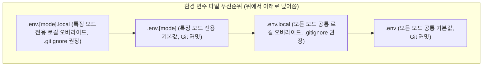

> 모던 웹 프론트엔드 애플리케이션을 개발하고 배포할 때, 백엔드 API 엔드포인트나 기능 토글 플래그는 개발(Development), 스테이징(Staging), 프로덕션(Production) 환경에 따라 정교하게 분리되어야 합니다. 본 글에서는 Node.js의 `process.env` 대신 ECMAScript 표준인 `import.meta.env`를 채택한 Vite의 환경 변수 주입 원리와 `.env` 파일 우선순위 규칙, 그리고 TypeScript 환경에서 타입 안전성을 확보하는 실무 전략을 살펴봅니다.

---

## 1. `process.env`와 `import.meta.env`의 차이점

전통적인 Webpack 기반 프로젝트(CRA 등)에서는 Node.js 전역 객체인 `process.env`를 통해 환경 변수에 접근했습니다. 하지만 브라우저 런타임에는 본래 `process`라는 전역 객체가 존재하지 않습니다. 과거에는 번들러가 거대한 폴리필(Polyfill) 코드를 주입하여 이를 흉내 내곤 했습니다.

Vite는 모던 웹 표준을 지향하므로, ECMAScript 모듈 표준 메타데이터 객체인 **`import.meta.env`**를 공식 인터페이스로 사용합니다.

```typescript
// src/services/apiClient.ts
// 브라우저 런타임에서 환경 변수 참조
const API_BASE_URL = import.meta.env.VITE_API_BASE_URL;
const IS_DEBUG_MODE = import.meta.env.DEV;
```

### 1.1 정적 문자열 치환(Static Replacement) 메커니즘

Vite는 빌드 시점에 브라우저 런타임 객체를 동적으로 조회하는 것이 아니라, esbuild와 Rollup의 코드 변환 파이프라인을 거치며 **소스 코드 상의 `import.meta.env.VITE_XXX` 문자열을 실제 값 리터럴로 직접 치환**합니다.

```javascript
// 빌드 전 소스 코드
if (import.meta.env.DEV) {
  console.log("Endpoint:", import.meta.env.VITE_API_BASE_URL);
}

// 빌드 후 번들 코드 (Production 모드)
if (false) {
  console.log("Endpoint:", "https://api.namju.kim");
}
```

이러한 정적 치환 덕분에 Rollup의 데드 코드 제거(DCE, Dead Code Elimination) 및 트리쉐이킹(Tree-shaking) 엔진이 `if (false)` 블록 전체를 프로덕션 최종 번들에서 흔적도 없이 삭제할 수 있습니다.

### 1.2 `VITE_` 접두사를 통한 보안 가드

클라이언트 번들에 주입되는 모든 변수는 브라우저의 소스 코드나 네트워크 탭을 통해 누구나 열람할 수 있습니다. 데이터베이스 비밀번호나 결제 비밀키(Secret Key)가 실수로 클라이언트 코드에 섞여 배포되는 대형 보안 사고를 방지하기 위해, Vite는 **`VITE_` 접두사가 붙은 환경 변수만을 클라이언트에 노출**하도록 엄격하게 필터링합니다.

---

## 2. 모드(Mode) 개념과 `.env` 파일 평가 우선순위

Vite는 실행 명령어에 따라 기본 모드(Mode)를 자동으로 결정합니다:
- `vite` 실행 시 ➔ `development` 모드
- `vite build` 실행 시 ➔ `production` 모드

하지만 실무 환경에서는 사내 테스트 서버나 QA 검증을 위한 **`staging` 모드**가 반드시 필요합니다. 이때 `--mode` 플래그를 사용해 원하는 모드를 명시적으로 지정할 수 있습니다.

```bash
# bash
# package.json 스크립트 예시
pnpm vite build --mode staging
pnpm vite build --mode production
```

### 2.1 환경 파일 로딩 우선순위 (Dotenv Resolution)

Vite는 프로젝트 루트에 위치한 여러 `.env` 파일들을 특정 순서에 따라 순차적으로 읽어 들이며, **먼저 읽힌 파일의 값이 나중에 읽힌 파일의 값을 덮어씁니다(Override)**.



예를 들어 `--mode staging`으로 빌드할 경우 다음과 같은 순서로 평가됩니다:
1. `.env.staging.local` (최우선)
2. `.env.staging`
3. `.env.local`
4. `.env` (최하위 기본값)

### 2.2 모드별 빌드 실행 결과 검증

실제 스테이징 모드와 프로덕션 모드로 빌드를 각각 수행했을 때 주입되는 환경 변수와 번들링 결과를 확인해 보겠습니다.


_pnpm build --mode staging과 --mode production 실행 시 환경별 변수 주입 콘솔 화면_

로그에서 확인할 수 있듯이, `staging` 모드에서는 `https://api-staging.namju.kim`이 주입되고, `production` 모드에서는 `https://api.namju.kim`과 함께 Terser의 콘솔 제거 최적화가 적용되어 번들 크기가 줄어든 것을 확인할 수 있습니다.

---

## 3. `vite.config.ts`에서 환경 변수 안전하게 읽기

개발자 분들이 자주 겪는 실수 중 하나는 `vite.config.ts` 파일 내부에서 `import.meta.env`나 `process.env.VITE_API_BASE_URL`을 직접 읽으려고 시도하는 것입니다.

설정 파일이 실행되는 시점은 Vite가 `.env` 파일들을 파싱하기 이전 단계이므로, `process.env`에는 시스템 전역 변수만 들어있고 `.env`에 적힌 변수들은 비어 있습니다.

이 문제를 해결하기 위해 Vite는 설정 함수에 `mode`를 인자로 넘겨주고, 환경 변수를 명시적으로 로드할 수 있는 **`loadEnv`** 유틸리티를 제공합니다.

```typescript
// vite.config.ts
import { defineConfig, loadEnv } from 'vite';
import react from '@vitejs/plugin-react';

export default defineConfig(({ mode }) => {
  // 1. 현재 작업 디렉토리(process.cwd()) 기준으로 해당 mode에 맞는 .env 파일들을 파싱합니다.
  // 세 번째 인자로 ''를 전달하면 VITE_ 접두사뿐 아니라 모든 환경 변수를 읽어옵니다.
  const env = loadEnv(mode, process.cwd(), '');

  console.log(`[vite.config] Current Mode: ${mode}`);
  console.log(`[vite.config] Target API: ${env.VITE_API_BASE_URL}`);

  return {
    plugins: [react()],
    server: {
      port: 3000,
      // 백엔드 API 프록시 설정에 환경 변수 반영
      proxy: {
        '/api': {
          target: env.VITE_API_BASE_URL || 'http://localhost:8080',
          changeOrigin: true,
          rewrite: (path) => path.replace(/^\/api/, '')
        }
      }
    },
    define: {
      // 런타임에 추가로 주입할 글로벌 상수 정의 (선택사항)
      __BUILD_TIMESTAMP__: JSON.stringify(new Date().toISOString())
    }
  };
});
```

---

## 4. TypeScript 환경에서의 타입 안전성 확보

기본적으로 `import.meta.env`는 `any`에 가까운 유연한 객체로 취급되므로, 오타가 발생해도 IDE가 경고를 표시하지 못합니다.

`src/vite-env.d.ts` 파일에서 Vite의 `ImportMetaEnv` 인터페이스를 **선언 병합(Declaration Merging)** 기법으로 확장하면 완벽한 자동완성과 정적 타입 검사를 지원받을 수 있습니다.

```typescript
// src/vite-env.d.ts
/// <reference types="vite/client" />

interface ImportMetaEnv {
  /** 백엔드 REST API 베이스 엔드포인트 */
  readonly VITE_API_BASE_URL: string;
  /** 로컬 개발용 Mock 서비스 워커 활성화 여부 */
  readonly VITE_ENABLE_MOCK: string;
  /** Sentry 에러 트래킹 DSN 키 */
  readonly VITE_SENTRY_DSN?: string;
  /** 앱 서비스 버전 */
  readonly VITE_APP_VERSION: string;
}

interface ImportMeta {
  readonly env: ImportMetaEnv;
}
```

이제 코드 에디터에서 `import.meta.env.`을 입력하는 즉시 프로젝트에서 정의한 변수 목록이 툴팁으로 표시되며, 정의되지 않은 환경 변수에 접근할 경우 `tsc` 컴파일 단계에서 에러를 조기에 차단할 수 있습니다.

---

## 5. 런타임 번들 결과 검증

실제 빌드 산출물(`dist/assets/*.js`)을 정적으로 검사하여 환경 변수가 안전하게 치환되었는지 확인해 보겠습니다.


_번들 산출물 내부의 정적 문자열 치환 확인 및 preview 서버 런타임 확인 로그_

터미널에서 `grep`으로 확인한 결과, 런타임 변수 참조 구문이 완전히 사라지고 빌드 타임에 확정된 실제 URL 문자열(`https://api-staging.namju.kim`)로 완전하게 인라인 치환된 것을 확인할 수 있습니다.

---

## 6. 실무 적용 시 주의사항

1. **민감한 키값(Secrets) 절대 금지**: `VITE_` 접두사가 붙은 값은 클라이언트 소스 코드에 평문으로 남습니다. AWS Access Key, DB 암호 등은 절대 `.env` 파일에 `VITE_`로 선언해서는 안 되며, 백엔드 서버를 거치도록 설계해야 합니다.
2. **구조 분해 할당(Destructuring) 지양**:
   ```typescript
   // ❌ 비권장: 정적 치환 파서가 감지하지 못할 수 있음
   const { VITE_API_BASE_URL } = import.meta.env;

   // ⭕ 권장: 전체 식별자를 명시하여 안전하게 치환되도록 작성
   const apiUrl = import.meta.env.VITE_API_BASE_URL;
   ```
   Vite의 정적 치환 엔진은 AST 수준에서 `import.meta.env.VITE_XXX` 형태의 정적 멤버 접근 패턴을 탐색하므로, 구조 분해 할당을 사용하면 값이 제대로 치환되지 않고 undefined로 남을 수 있습니다.

---

## 7. 마치며

Vite의 `import.meta.env`와 모드 시스템은 브라우저 표준을 준수하면서도 유연한 빌드 타임 정적 치환을 제공합니다. 개발, 스테이징, 프로덕션 환경별로 `.env` 파일을 체계적으로 구성하고 TypeScript 인터페이스를 병합해 두면, 환경 변수로 인한 런타임 오류를 원천 차단할 수 있습니다.

다음 글에서는 프로젝트 구조가 복잡해질 때 깊어지는 상대 경로 지옥을 해결하는 **TypeScript 경로 별칭 설정과 `vite-tsconfig-paths` 연동 전략**을 알아보겠습니다.


