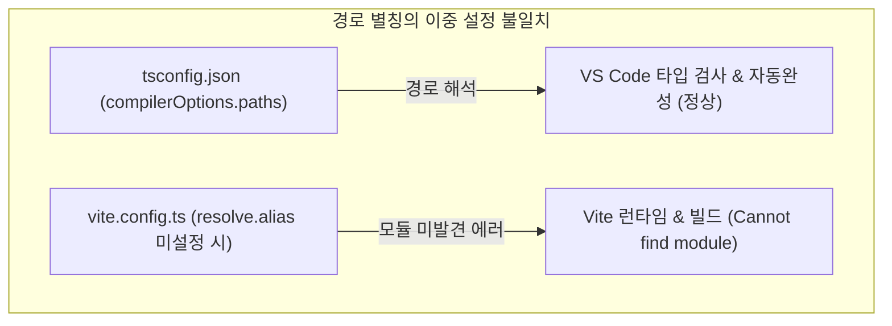

> 프로젝트의 디렉토리 깊이가 깊어질수록 `../../../../components/Button`과 같은 상대 경로 참조는 파일 이동 시 쉽게 깨지며 가독성을 저하시킵니다. 본 글에서는 TypeScript 컴파일러와 Vite 번들러 간의 경로 해석 불일치 문제를 분석하고, `vite-tsconfig-paths` 플러그인을 도입하여 `tsconfig.json`을 단일 진실 공급원(Single Source of Truth)으로 삼아 경로 별칭(Path Aliases)을 우아하게 동기화하는 방법을 정리합니다.

---

## 1. 상대 경로 지옥(Relative Path Hell)과 문제점

계층형 아키텍처나 기능 단위 폴더 구조(Feature-based structure)를 채택한 프로젝트에서는 하위 컴포넌트에서 공통 서비스나 유틸리티를 호출할 때 상위 디렉토리로 거슬러 올라가는 상대 경로를 작성하게 됩니다.

```typescript
// ❌ 가독성이 떨어지고 폴더 이동 시 쉽게 깨지는 상대 경로
import { UserCard } from '../../../../components/UserCard';
import { fetchUserProfile } from '../../../../services/userService';
import { formatDate } from '../../../../utils/formatDate';
```

이러한 방식은 다음과 같은 문제점을 유발합니다:
- **리팩토링 취약성**: 파일의 위치를 다른 폴더로 한 단계만 이동해도 상위 참조(`../`)의 깊이가 달라져 모든 import 경로를 일일이 수정해야 합니다.
- **인지 부하 증가**: 해당 모듈이 프로젝트 루트 기준 어디에 위치해 있는지 한눈에 파악하기 어렵습니다.

이를 `@components/UserCard` 또는 `@/services/userService`와 같은 **경로 별칭(Path Aliases)**으로 대체하면 경로가 직관적이고 견고해집니다.

---

## 2. 이중 설정의 딜레마: `tsconfig.json`과 `vite.config.ts`

경로 별칭을 프로젝트에 도입할 때 많은 개발자들이 겪는 문제는 **TypeScript 컴파일러(IDE)**와 **Vite 번들러(Rollup)**가 서로 다른 설정 파일을 바라본다는 점입니다.



1. **`tsconfig.json`만 설정한 경우**:
   - VS Code나 WebStorm 등의 IDE는 별칭 경로를 정상 인식하여 자동완성과 빨간 줄 없는 타입 체크를 제공합니다.
   - 하지만 브라우저를 띄우거나 `pnpm build`를 돌리면 Vite가 해당 경로를 해석하지 못해 `[plugin:vite:import-analysis] Failed to resolve import "@/components/Button"` 에러가 발생하며 기동에 실패합니다.
2. **`vite.config.ts`만 설정한 경우**:
   - Vite 런타임과 빌드는 성공하지만, 에디터 상에서 모듈을 찾을 수 없다는 TypeScript 에러(`TS2307: Cannot find module`)가 발생하고 자동 임포트 기능이 동작하지 않습니다.

---

## 3. 접근법 1: Vite 내장 `resolve.alias` 수동 매핑

첫 번째 해결책은 `vite.config.ts`의 `resolve.alias` 필드에 별칭을 직접 정의하고, `tsconfig.json`에도 동일한 내용을 수동으로 중복 작성하는 것입니다.

Node.js의 최신 ESM 환경에서는 `__dirname` 변수가 기본 제공되지 않으므로, `fileURLToPath`와 `path.resolve`를 조합하여 절대 경로를 생성해야 합니다.

```typescript
// vite.config.ts
import { defineConfig } from 'vite';
import react from '@vitejs/plugin-react';
import { fileURLToPath, URL } from 'node:url';

export default defineConfig({
  plugins: [react()],
  resolve: {
    alias: {
      '@': fileURLToPath(new URL('./src', import.meta.url)),
      '@components': fileURLToPath(new URL('./src/components', import.meta.url)),
      '@services': fileURLToPath(new URL('./src/services', import.meta.url)),
      '@utils': fileURLToPath(new URL('./src/utils', import.meta.url))
    }
  }
});
```

동시에 `tsconfig.json`에도 동일한 매핑을 정의해야 합니다:

```json
// tsconfig.json
{
  "compilerOptions": {
    "baseUrl": ".",
    "paths": {
      "@/*": ["src/*"],
      "@components/*": ["src/components/*"],
      "@services/*": ["src/services/*"],
      "@utils/*": ["src/utils/*"]
    }
  }
}
```

이 방식은 외부 플러그인 의존성이 없다는 장점이 있지만, **별칭이 추가되거나 경로가 바뀔 때마다 두 개의 설정 파일을 항상 동기화해야 하는 유지보수 부담**이 남습니다.

---

## 4. 접근법 2: `vite-tsconfig-paths`를 통한 단일 진실 공급원 구성

가장 이상적인 해결책은 타입 정의의 기준점인 `tsconfig.json`의 `paths` 설정을 단일 진실 공급원(Single Source of Truth)으로 삼고, Vite가 이를 자동으로 읽어 들이도록 만드는 것입니다.

**`vite-tsconfig-paths`** 플러그인은 Rollup의 `resolveId` 훅 단계에서 `tsconfig.json`을 직접 파싱하여 경로 별칭을 자동으로 매핑해 줍니다.

### 4.1 플러그인 설치

```bash
# bash
pnpm add -D vite-tsconfig-paths
```

### 4.2 설정 구성

이제 `vite.config.ts`에는 복잡한 경로 계산 코드 대신 플러그인을 단 한 줄 추가하기만 하면 됩니다:

```typescript
// vite.config.ts
import { defineConfig } from 'vite';
import react from '@vitejs/plugin-react';
import tsconfigPaths from 'vite-tsconfig-paths';

export default defineConfig({
  plugins: [
    react(),
    // tsconfig.json의 baseUrl 및 paths를 Vite의 alias로 자동 변환 주입
    tsconfigPaths()
  ]
});
```

프로젝트 루트의 `tsconfig.json` 설정:

```json
// tsconfig.json
{
  "compilerOptions": {
    "target": "ES2022",
    "lib": ["DOM", "DOM.Iterable", "ES2022"],
    "module": "ESNext",
    "moduleResolution": "bundler",
    "baseUrl": ".",
    "paths": {
      "@/*": ["src/*"],
      "@components/*": ["src/components/*"],
      "@services/*": ["src/services/*"],
      "@utils/*": ["src/utils/*"]
    },
    "strict": true,
    "skipLibCheck": true
  },
  "include": ["src"]
}
```

### 4.3 빌드 실행 및 별칭 해석 검증

설정이 적용된 후 `pnpm build`를 실행하여 Rollup 번들링 파이프라인에서 별칭이 정상 해석되는지 확인합니다.


_vite-tsconfig-paths가 tsconfig 경로를 자동 로드하여 368ms 만에 프로덕션 빌드를 완료한 콘솔 화면_

로그에서 볼 수 있듯이, 플러그인이 `tsconfig.json`에 정의된 4개의 경로 패턴을 감지하여 번들러 파이프라인에 주입했으며, 모듈 누락 에러 없이 깨끗하게 번들이 생성되었습니다.

---

## 5. CI/CD 파이프라인에서의 타입 체크 검증: `tsc --noEmit`

Vite의 개발 서버 및 프로덕션 빌드 트랜스파일러인 esbuild는 고속 컴파일을 위해 **타입 체킹을 완전히 건너뛰고 오직 타입 구문만 제거(Type Stripping)**합니다.

따라서 잘못된 경로 별칭이나 존재하지 않는 함수를 호출하더라도 문법적 오류가 아니라면 `vite build`는 성공해 버릴 수 있습니다. 이를 방지하기 위해 배포 스크립트에 반드시 `tsc --noEmit`을 포함해야 합니다.

```json
// package.json
{
  "scripts": {
    "dev": "vite",
    "typecheck": "tsc --noEmit",
    "build": "tsc --noEmit && vite build"
  }
}
```

실제 터미널에서 타입 체크를 수행하여 별칭 경로가 완벽히 통과하는지 검증합니다.


_pnpm exec tsc --noEmit 실행 시 모든 별칭 경로가 정상 해석되어 0 errors로 통과된 콘솔 로그_

TypeScript의 `--explainFiles` 옵션으로 추적해 보면 `@components/UserCard`, `@services/userService` 등의 별칭이 실제 파일 시스템의 경로로 매끄럽게 연결되어 컴파일되었음을 확인할 수 있습니다.

---

## 6. 모노레포(Monorepo) 환경에서의 주의사항

여러 패키지가 공존하는 pnpm 워크스페이스나 Nx, Turborepo 모노레포 환경에서는 각 패키지마다 별도의 `tsconfig.json`이 존재할 수 있습니다.

이때는 `vite-tsconfig-paths`의 `projects` 옵션을 통해 대상 tsconfig 파일의 경로를 명시적으로 지정해 주어야 상위/하위 프로젝트의 경로 해석이 꼬이지 않습니다:

```typescript
// vite.config.ts (모노레포 환경)
import { defineConfig } from 'vite';
import tsconfigPaths from 'vite-tsconfig-paths';

export default defineConfig({
  plugins: [
    tsconfigPaths({
      projects: ['./tsconfig.json', '../../packages/*/tsconfig.json']
    })
  ]
});
```

---

## 7. 마치며

경로 별칭은 대규모 프론트엔드 프로젝트의 코드 가독성과 유지보수성을 지탱하는 기본 뼈대입니다. `tsconfig.json`과 `vite.config.ts`를 개별 관리하며 발생하는 설정 불일치를 `vite-tsconfig-paths` 플러그인으로 일원화하고, `tsc --noEmit` 검증을 CI 파이프라인에 결합하면 안전하고 확장성 있는 개발 환경을 구축할 수 있습니다.

다음 글에서는 단일 설정 파일이 비대해지는 문제를 방지하기 위해 **개발·스테이징·프로덕션 환경을 위한 `vite.config.ts` 모듈화 및 `mergeConfig` 분리 전략**을 살펴보겠습니다.


