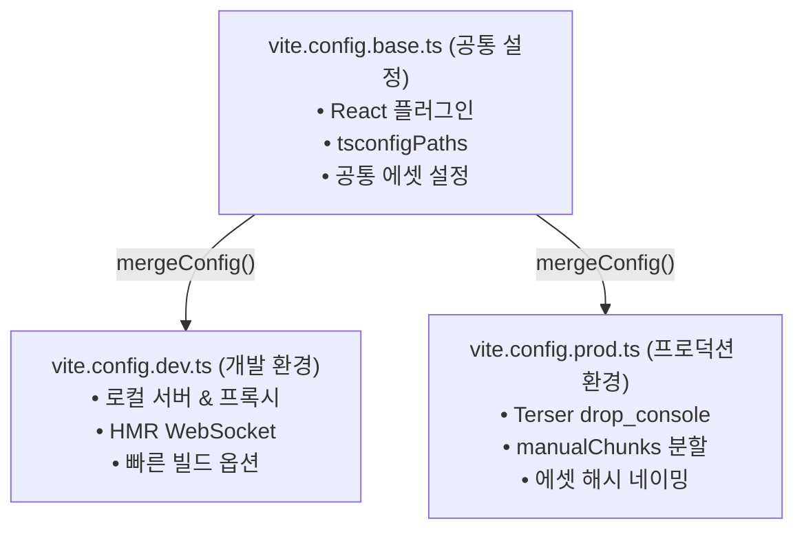

> 프로젝트가 고도화될수록 `vite.config.ts` 파일에는 로컬 프록시, HMR 소켓, 소스맵 제어, Rollup 청크 분할, Terser 콘솔 제거 등 서로 상충되는 요구사항이 하나의 파일에 누적됩니다. 본 글에서는 수많은 `if (mode === '...')` 분기로 비대해진 단일 설정 파일의 안티 패턴을 개선하고, Vite 내장 `mergeConfig` API를 활용하여 공통(Base), 개발(Dev), 프로덕션(Prod) 환경으로 설정을 분리하는 모듈화 전략을 정리합니다.

---

## 1. 단일 `vite.config.ts`의 안티 패턴과 한계

초기 프로젝트에서는 단일 `vite.config.ts` 파일만으로도 충분합니다. 하지만 서비스가 성장하면서 다음과 같은 요구사항이 추가됩니다:

- **개발 환경(Dev)**: 빠른 빌드를 위한 인라인 소스맵, 백엔드 API 로컬 프록시(Proxy), Mock 미들웨어 활성화
- **스테이징 환경(Staging)**: 프로덕션과 동일한 청크 분할 구조이지만 디버깅을 위한 히든(Hidden) 소스맵 보존
- **프로덕션 환경(Prod)**: 보안 및 성능을 위한 `console.log` 및 `debugger` 제거(Terser), 벤더(Vendor) 청크 분리, Gzip 사전 압축

이를 단일 파일에서 처리하려고 하면 삼항 연산자와 조건문이 복잡하게 얽히게 됩니다:

```typescript
// ❌ 단일 파일 내 조건문 누적으로 가독성이 저하된 설정 예시
export default defineConfig(({ command, mode }) => {
  const isDev = command === 'serve';
  const isProd = mode === 'production';

  return {
    server: isDev ? { proxy: { ... } } : undefined,
    build: {
      sourcemap: isDev ? 'inline' : isProd ? false : 'hidden',
      minify: isProd ? 'terser' : 'esbuild',
      terserOptions: isProd ? { compress: { drop_console: true } } : undefined
    }
  };
});
```

이러한 구조는 파일 길이가 수백 줄에 달하게 되며, 특정 환경의 옵션을 수정할 때 다른 환경에 예기치 않은 부작용(Side Effect)을 초래하기 쉽습니다.

---

## 2. 3단계 설정 모듈화 아키텍처

이를 해결하기 위해 설정을 역할에 따라 3개의 독립된 모듈로 분리합니다.



1. **`vite.config.base.ts`**: 모든 환경에서 변함없이 공유되는 프레임워크 플러그인, 경로 별칭, 정적 에셋 규칙을 선언합니다.
2. **`vite.config.dev.ts`**: 로컬 개발 서버 구동에 필요한 포트, 프록시, HMR 관련 옵션만 집중적으로 관리합니다.
3. **`vite.config.prod.ts`**: 배포 산출물의 크기 최적화, 코드 분할(Code Splitting), 난독화 옵션을 관리합니다.

---

## 3. `mergeConfig`의 동작 원리와 객체 병합 안전성

자바스크립트의 표준 `Object.assign`이나 전개 연산자(`...`)는 얕은 복사(Shallow Copy)만 수행하므로, `plugins` 배열이나 중첩된 `build.rollupOptions` 객체를 병합할 때 기존 설정을 덮어써 버리는 치명적인 결함이 발생합니다.

Vite가 공식 제공하는 **`mergeConfig`** 함수는 설정 객체의 깊은 병합(Deep Merge)을 지능적으로 수행합니다:

- **배열(`plugins`) 병합**: 기존 베이스 플러그인 목록 뒤에 환경 전용 플러그인을 자동으로 이어 붙입니다(Concat).
- **중첩 객체(`server`, `build`) 병합**: 하위 속성을 재귀적으로 탐색하여 누락 없이 안전하게 병합합니다.

---

## 4. 모듈별 완성형 코드 구현

### 4.1 공통 설정: `vite.config.base.ts`

```typescript
// vite.config.base.ts
import { defineConfig } from 'vite';
import react from '@vitejs/plugin-react';
import tsconfigPaths from 'vite-tsconfig-paths';

export default defineConfig({
  plugins: [
    react(),
    tsconfigPaths()
  ],
  resolve: {
    extensions: ['.mjs', '.js', '.ts', '.jsx', '.tsx', '.json']
  }
});
```

### 4.2 개발 환경 전용: `vite.config.dev.ts`

```typescript
// vite.config.dev.ts
import { defineConfig, mergeConfig } from 'vite';
import baseConfig from './vite.config.base';

export default mergeConfig(
  baseConfig,
  defineConfig({
    server: {
      port: 3000,
      host: true,
      open: false,
      proxy: {
        '/api': {
          target: 'http://localhost:8080',
          changeOrigin: true,
          rewrite: (path) => path.replace(/^\/api/, '')
        }
      }
    },
    build: {
      sourcemap: 'inline'
    }
  })
);
```

### 4.3 프로덕션 전용: `vite.config.prod.ts`

```typescript
// vite.config.prod.ts
import { defineConfig, mergeConfig } from 'vite';
import baseConfig from './vite.config.base';

export default mergeConfig(
  baseConfig,
  defineConfig({
    build: {
      outDir: 'dist',
      sourcemap: false,
      minify: 'terser',
      terserOptions: {
        compress: {
          drop_console: true,
          drop_debugger: true
        }
      },
      rollupOptions: {
        output: {
          // 브라우저 장기 캐싱을 위한 서드파티 벤더 청크 분할
          manualChunks: {
            'vendor-react': ['react', 'react-dom'],
            'vendor-ui': ['lucide-react', 'clsx', 'tailwind-merge']
          },
          chunkFileNames: 'assets/js/[name]-[hash].js',
          entryFileNames: 'assets/js/[name]-[hash].js',
          assetFileNames: 'assets/[ext]/[name]-[hash].[ext]'
        }
      }
    }
  })
);
```

---

## 5. `package.json` 스크립트 연결과 실행 검증

분리된 설정 파일들은 Vite CLI의 **`--config`** 플래그를 통해 각 스크립트에 명시적으로 바인딩합니다.

```json
// package.json
{
  "scripts": {
    "dev": "vite --config vite.config.dev.ts",
    "build:staging": "tsc --noEmit && vite build --config vite.config.prod.ts --mode staging",
    "build:prod": "tsc --noEmit && vite build --config vite.config.prod.ts --mode production",
    "preview": "vite preview"
  }
}
```

### 5.1 개발 서버 실행 결과

`pnpm run dev`를 실행하면 베이스 설정과 개발 전용 설정이 결합되어 로컬 프록시가 활성화된 개발 서버가 구동됩니다.


_pnpm dev 실행 시 mergeConfig를 통해 백엔드 프록시 라우트가 정상 바인딩된 콘솔 로그_

### 5.2 프로덕션 빌드 결과

`pnpm run build:prod`를 실행하면 Terser 압축 및 지정한 `manualChunks` 규칙에 따라 청크가 분할 생성됩니다.


_pnpm build:prod 실행 시 vendor-react, vendor-ui 청크가 독립 분리된 콘솔 화면_

결과에서 확인할 수 있듯이, React 코어 패키지(`vendor-react`)와 UI 유틸리티(`vendor-ui`)가 별도의 독립 파일로 분리되어, 애플리케이션 코드가 수정되어 재배포되더라도 사용자의 브라우저 캐시에서 벤더 라이브러리를 그대로 재사용할 수 있게 최적화되었습니다.

---

## 6. 마치며

설정 파일을 성격에 따라 `base`, `dev`, `prod`로 나누고 `mergeConfig`로 결합하는 방식은 프로젝트가 대규모 엔터프라이즈 레벨로 확장될 때 유지보수성을 극대화하는 검증된 설계 패턴입니다.

환경별 설정 파일의 책임을 단일화함으로써 복잡한 분기 오류를 예방하고, 개발 팀원 누구라도 손쉽게 특정 환경의 빌드 옵션을 안전하게 조정할 수 있습니다.

지금까지 Vite 시리즈 Module 1을 통해 **Native ESM 코어 아키텍처, esbuild 사전 번들링 및 캐시 메커니즘, 환경 변수 주입, TypeScript 경로 별칭, 그리고 설정 모듈화 전략**까지 Vite의 핵심 기반을 모두 살펴보았습니다.


