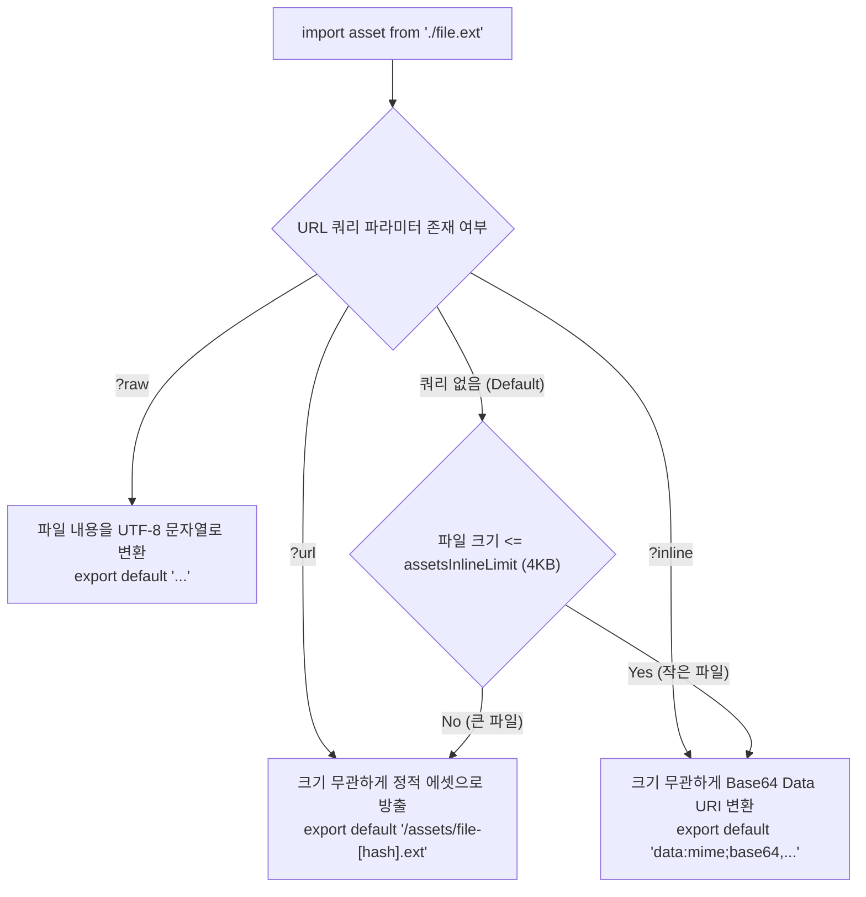

> 프론트엔드 프로젝트에서 이미지, 셰이더, 웹 워커, 문서 파일 등 다양한 정적 리소스를 다룰 때 번들러의 에셋 처리 방식은 애플리케이션의 초기 로딩 성능과 네트워크 요청 수에 직접적인 영향을 미칩니다. 본 글에서는 Vite의 정적 에셋 처리 원리를 분석하고, `?raw`, `?url`, `?inline` 등의 특수 쿼리 접미사를 활용해 리소스를 목적에 맞게 세밀하게 제어하는 실무 전략을 소개합니다.

---

## 1. 배경: 번들러의 정적 에셋 처리와 마주하는 고민

웹팩(Webpack) 중심의 환경에서는 정적 에셋을 불러올 때 `file-loader`, `url-loader`, `raw-loader`와 같은 별도의 로더를 체이닝하거나 Webpack 5의 `asset/resource`, `asset/inline`, `asset/source` 모듈 타입을 복잡하게 설정해야 했습니다.

반면 Vite는 최신 브라우저의 네이티브 ES 모듈(ESM) 메커니즘을 기반으로 정적 파일을 일급 객체(First-class Citizen)로 다룹니다. 기본적으로 자바스크립트 코드 내에서 정적 에셋을 `import`하면 해당 파일이 정적 자산 디렉토리에 배치되고 해석된 퍼블릭 URL 문자열이 반환됩니다.

하지만 실무에서는 기본 URL 반환 외에도 다양한 요구사항이 발생합니다.

- Three.js나 WebGL을 사용할 때 GLSL 셰이더 파일(`.frag`, `.vert`)을 컴파일 없이 **순수 문자열(Raw String)**로 즉시 읽어와야 하는 경우
- 작은 UI 아이콘이나 배지를 별도 HTTP 요청 없이 번들 내부에 **Base64 Data URI**로 강제 인라인화해야 하는 경우
- 특정 파일(WASM, PDF, 대용량 이미지)이 Vite의 기본 인라인 임계치(4KB)보다 작더라도 브라우저 캐싱을 위해 **반드시 외부 파일 URL**로 유지해야 하는 경우
- 백그라운드 연산을 위해 웹 워커(`.worker.ts`)를 전용 번들 청크나 인라인 Blob으로 인스턴스화해야 하는 경우

Vite는 이러한 시나리오를 해결하기 위해 경로 뒤에 붙이는 **명시적 쿼리 파라미터(Explicit URL Queries)** 메커니즘을 제공합니다.

---

## 2. Vite의 기본 정적 에셋 처리 파이프라인

Vite 내부에는 에셋 처리를 전담하는 핵심 플러그인(`vite:asset`)이 내장되어 있습니다. 모듈 그래프에서 특정 import 문을 만났을 때, Vite는 확장자와 쿼리 파라미터에 따라 분기 처리를 수행합니다.



기본 동작에서 Vite는 `build.assetsInlineLimit` (기본값: 4,096바이트, 4KB) 옵션을 참조합니다. 파일 크기가 4KB 미만인 정적 자산은 base64 인라인 데이터 URL로 자동 변환되어 추가적인 HTTP 라운드트립을 방지하고, 4KB 이상인 파일은 해시가 포함된 독립 에셋으로 `dist/assets/`에 복사됩니다.

---

## 3. 특수 쿼리 파라미터 상세 분석

Vite가 공식 지원하는 핵심 쿼리 접미사의 동작 원리와 실무 사용처를 살펴보겠습니다.

### 3.1 `?raw` : 원본 파일 내용을 텍스트 문자열로 주입

`?raw` 접미사를 지정하면 Vite는 해당 파일을 자바스크립트 모듈로 파싱하거나 URL로 치환하지 않고, 파일의 원시 바이트를 UTF-8 문자열로 변환하여 기본 내보내기(`export default`) 코드를 생성합니다.

```typescript
// src/graphics/renderPipeline.ts
import waterVertexShader from './shaders/water.vert?raw';
import waterFragmentShader from './shaders/water.frag?raw';

export function createWaterProgram(gl: WebGL2RenderingContext): WebGLProgram {
  const vs = compileShader(gl, gl.VERTEX_SHADER, waterVertexShader);
  const fs = compileShader(gl, gl.FRAGMENT_SHADER, waterFragmentShader);
  return linkProgram(gl, vs, fs);
}
```

빌드 타임에 문자열 리터럴로 번들 JS 파일 내에 그대로 포함되므로, 런타임에 별도의 `fetch('/shaders/water.frag')`를 호출할 필요가 없어 비동기 네트워크 지연과 에러 처리를 완전히 제거할 수 있습니다.

### 3.2 `?url` : 파일 크기에 관계없이 정적 URL 경로 강제 추출

Vite는 4KB 이하의 파일을 기본적으로 base64 문자열로 인라인화합니다. 하지만 Base64 인코딩은 원본 바이너리 대비 데이터 용량이 약 33% 증가하며, 브라우저의 HTTP 개별 캐싱 혜택을 누릴 수 없습니다.

`?url`을 사용하면 파일 크기가 100바이트에 불과하더라도 인라인화를 건너뛰고 독립 파일로 방출한 뒤 고유 URL을 반환하도록 강제할 수 있습니다.

```typescript
// src/services/pdfDownloader.ts
import templateThumbnailUrl from '../assets/tiny-preview.png?url';

export function getThumbnailLink(): string {
  // 4KB 이하 파일이지만 base64가 아닌 독립 HTTP URL 반환
  return templateThumbnailUrl; 
}
```

### 3.3 `?inline` : 무조건 Base64 Data URI로 번들링

반대로 파일 크기가 4KB를 초과하더라도, 첫 화면 렌더링(First Meaningful Paint)에 핵심적인 브랜드 로고나 모달 백드롭 SVG처럼 반드시 깜빡임 없이 즉시 표시되어야 하는 자산이 있을 수 있습니다.

`?inline`을 붙이면 `assetsInlineLimit` 제한을 무시하고 즉시 base64 데이터 URI로 변환됩니다.

```typescript
// src/components/CriticalBrandLogo.tsx
import brandLogoDataUri from '../assets/brand-logo.svg?inline';

export function BrandLogo() {
  return ;
}
```

### 3.4 `?worker` 및 `?worker&inline` : 웹 워커 간편 인스턴스화

Vite는 백그라운드 스레드 워커를 import할 때도 쿼리 파라미터를 활용합니다.

```typescript
// src/services/computeBridge.ts
// 별도 청크로 방출되는 워커 생성자
import ComputeWorker from '../workers/heavyComputation.worker?worker';

const worker = new ComputeWorker();
worker.postMessage({ data: [1, 2, 3] });
```

만약 워커 파일 자체도 외부 요청 없이 단일 번들 파일 안에 넣고 싶다면 `?worker&inline`을 사용하여 워커 코드를 `Blob` URL 형태로 감싸 번들링할 수 있습니다.

---

## 4. 실무 설정 및 TypeScript 타입 선언

실무 프로젝트에서 커스텀 확장자나 쿼리 접미사를 사용할 때 TypeScript 컴파일러 에러(`Cannot find module...`)가 발생하지 않도록 ambient module을 선언하고 Vite 설정을 구성해야 합니다.

### 4.1 Vite 빌드 설정 구성

`vite.config.ts`에서 기본 인라인 한계를 조정하거나 특정 확장자를 에셋으로 명시 등록합니다.

```typescript
// vite.config.ts
import { defineConfig } from 'vite';

export default defineConfig({
  build: {
    // 기본 4KB에서 8KB로 인라인 임계치 상향 조정
    assetsInlineLimit: 8192,
    rollupOptions: {
      output: {
        // 에셋 출력 네이밍 규칙 일관화
        assetFileNames: 'assets/[name]-[hash][extname]',
        chunkFileNames: 'assets/[name]-[hash].js',
        entryFileNames: 'assets/[name]-[hash].js'
      }
    }
  },
  // 기본 에셋 목록 외의 사용자 확장자 추가
  assetsInclude: ['**/*.gltf', '**/*.glb', '**/*.hdr']
});
```

### 4.2 TypeScript 타입 선언 확장

특수 쿼리가 붙은 경로에 대해 TS 컴파일러가 반환 타입을 정확히 인식할 수 있도록 `src/vite-env.d.ts`에 모듈 시그니처를 등록합니다.

```typescript
// src/vite-env.d.ts
/// <reference types="vite/client" />

// ?raw 쿼리가 붙은 모든 파일은 string 타입을 반환
declare module '*?raw' {
  const content: string;
  export default content;
}

// ?url 쿼리가 붙은 파일은 경로 string 반환
declare module '*?url' {
  const src: string;
  export default src;
}

// ?inline 쿼리가 붙은 파일은 data:uri string 반환
declare module '*?inline' {
  const dataUri: string;
  export default dataUri;
}
```

---

## 5. 실행 및 결과 검증

작성한 에셋 쿼리 파라미터가 프로덕션 빌드와 개발 서버에서 기대한 대로 동작하는지 검증합니다.

### 5.1 프로덕션 빌드 터미널 결과

`pnpm vite build` 명령어를 실행하여 에셋 방출 결과와 번들 상태를 점검합니다.


출력 로그에서 확인할 수 있듯이:
- `?raw`로 불러온 `water.frag`와 `?inline`으로 불러온 `small-badge.svg`는 `dist/assets/`에 개별 파일로 생성되지 않고 번들 JS 내부에 인라인화되었습니다.
- 반면 `?url`로 명시한 `banner.png`와 표준 에셋들은 고유 해시가 부여된 독립 파일로 안전하게 추출되었습니다.

### 5.2 개발 서버 모듈 응답 검증 (curl)

Vite 개발 서버(`http://localhost:5173`) 구동 중 curl 명령어로 쿼리 파라미터 요청을 전달하여 ESM 변환 결과를 확인해 보았습니다.


- `shader.frag?raw` 요청 시 원본 GLSL 소스 문자열이 즉시 반환됩니다.
- `logo.svg?url` 요청 시 `export default "/src/assets/logo.svg"` 모듈이 반환되어 브라우저가 정적 경로로 접근할 수 있게 합니다.
- `badge.svg?inline` 요청 시 Base64 Data URI 문자열을 내보내는 모듈 코드가 동적으로 생성되어 내려옵니다.

---

## 6. 정리

Vite의 정적 에셋 로딩 전략과 명시적 URL 쿼리는 복잡한 웹팩 플러그인 설정 없이도 리소스의 전달 형태를 코드 레벨에서 직관적으로 결정할 수 있게 해줍니다.

- **`?raw`**: 셰이더, SVG 아이콘 직접 조작, SQL, 마크다운 등 텍스트 원본이 필요한 경우에 적극 활용합니다.
- **`?inline`**: 초기 로딩 깜빡임을 방지해야 하는 4KB 초과 중요 UI 자산에 제한적으로 사용합니다.
- **`?url`**: 4KB 미만의 작은 파일이지만 독립적인 브라우저 HTTP 캐싱이 필요한 경우 명시합니다.

에셋의 성격에 맞춰 적절한 쿼리를 부여하면, 불필요한 HTTP 왕복 시간을 줄이면서도 번들 크기 팽창을 방지하는 균형 잡힌 빌드 파이프라인을 구축할 수 있습니다.
