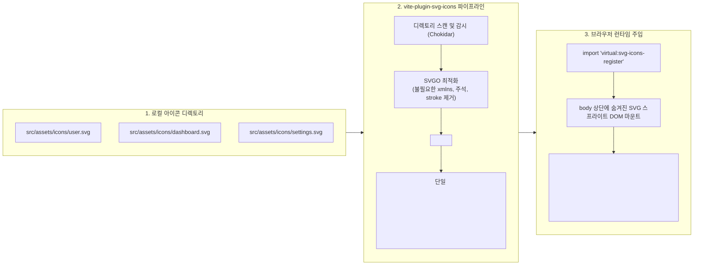

> 프론트엔드 대시보드나 관리자 화면에서 수십 개의 SVG 아이콘을 개별 파일로 로딩하면 수많은 HTTP 요청이 발생하거나, 컴포넌트 단위 인라인화 시 JS 번들 크기가 비대해지는 트레이드오프가 존재합니다. 본 글에서는 vite-plugin-svg-icons 플러그인을 활용해 프로젝트 내 모든 SVG를 단일 DOM 심볼(Symbol) 스프라이트로 자동 번들링하고, 타입 안정성을 보장하는 재사용 컴포넌트로 최적화한 실무 사례를 소개합니다.

---

## 1. 문제 상황: 대규모 SVG 아이콘 관리의 딜레마

엔터프라이즈 관리자 페이지나 복잡한 웹 애플리케이션을 개발하다 보면 내비게이션, 테이블 액션, 상태 뱃지 등에 수십 개에서 수백 개의 SVG 아이콘이 사용됩니다. 일반적으로 프론트엔드에서 SVG를 다루는 방식은 크게 세 가지가 있습니다.

1. **`` 태그로 개별 파일 서빙 (``)**:
   - 브라우저가 화면을 렌더링할 때 수십 개의 개별 네트워크 요청(HTTP 워터폴)이 발생하여 초기 로딩에 병목이 생깁니다.
   - CSS `fill`이나 `color` 속성으로 아이콘 색상을 동적으로 제어할 수 없습니다.
2. **SVG를 컴포넌트로 변환 (`@svgr/rollup`, `vite-plugin-vue-svg`)**:
   - CSS 스타일링과 속성 제어가 자유롭지만, SVG의 모든 벡터 패스(Path) 데이터가 순수 자바스크립트 컴포넌트 코드로 트랜스파일되어 메인 JS 번들에 포함됩니다.
   - 아이콘 개수가 늘어날수록 JS 번들 크기가 급격히 팽창하고 브라우저의 JS 파싱/컴파일 오버헤드가 증가합니다.
3. **SVG 심볼 스프라이트(Symbol Sprite) 방식 (`<svg><use href="#icon-id" /></svg>`)**:
   - 모든 SVG를 `<symbol id="...">` 형태로 묶은 단일 스프라이트 시트를 생성하고, 각 위치에서 `<use>` 태그로 참조합니다.
   - 단 한 번의 DOM 주입만으로 모든 아이콘을 재사용할 수 있으며, `currentColor`를 통한 동적 CSS 색상 제어도 완벽히 지원됩니다.

문제는 프로젝트 진행 중 신규 아이콘이 추가되거나 디자이너가 에셋을 교체할 때마다 매번 수작업으로 스프라이트 XML 파일을 병합하고 관리하는 과정이 매우 번거롭다는 점입니다. 이를 빌드 파이프라인 안에서 완전 자동화하기 위해 `vite-plugin-svg-icons`를 도입했습니다.

---

## 2. 아키텍처 및 내부 동작 메커니즘

`vite-plugin-svg-icons`는 디렉토리 내에 산재된 개별 SVG 파일들을 빌드 시점(또는 개발 서버 기동 시점)에 감지하여 SVGO로 최적화한 뒤, 가상 모듈을 통해 DOM에 스프라이트 시트를 자동 마운트해 줍니다.



개발 서버에서는 파일 변경을 감시(Watcher)하여 새로운 SVG 파일이 추가되거나 수정되면 브라우저 새로고침 없이 즉시 스프라이트 시트가 갱신(HMR)됩니다.

---

## 3. 실무 구현 가이드

### Step 1. 의존성 설치 및 플러그인 등록

먼저 플러그인을 개발 의존성으로 설치합니다.

```bash
pnpm add -D vite-plugin-svg-icons
```

`vite.config.ts` 파일에서 플러그인을 구성하고 대상 아이콘 디렉토리 경로와 심볼 ID 생성 규칙을 정의합니다.

```typescript
// vite.config.ts
import { defineConfig } from 'vite';
import path from 'path';
import { createSvgIconsPlugin } from 'vite-plugin-svg-icons';

export default defineConfig({
  plugins: [
    createSvgIconsPlugin({
      // 아이콘 파일들이 위치한 디렉토리 절대 경로 지정
      iconDirs: [path.resolve(process.cwd(), 'src/assets/icons')],
      // 생성될 symbol id 포맷 (기본: icon-[dir]-[name])
      symbolId: 'icon-[dir]-[name]',
      // SVGO 최적화 옵션 커스텀
      svgoOptions: {
        plugins: [
          {
            name: 'removeAttrs',
            params: {
              // currentColor 스타일 상속을 위해 하드코딩된 fill 속성 제거
              attrs: '(stroke|fill)'
            }
          }
        ]
      },
      // DOM에 주입될 부모 SVG 컨테이너 id
      customDomId: '__svg__icons__dom__'
    })
  ]
});
```

### Step 2. 진입점에 가상 모듈 등록

애플리케이션의 진입 파일(`src/main.ts`)에서 플러그인이 제공하는 가상 모듈을 한 줄로 import합니다.

```typescript
// src/main.ts
import { createApp } from 'vue';
import App from './App.vue';

// SVG 스프라이트 등록 가상 모듈 (런타임에 document.body에 마운트됨)
import 'virtual:svg-icons-register';

createApp(App).mount('#app');
```

이 가상 모듈은 번들러 로더 단계에서 메모리 상에 존재하는 스프라이트 문자열을 자바스크립트로 변환하여 `document.body`에 보이지 않는 SVG 래퍼를 주입합니다.

### Step 3. 재사용 가능한 SvgIcon 컴포넌트 작성

Vue 3 기준의 공용 컴포넌트 예제입니다 (React 환경에서도 동일한 구조의 JSX로 구현 가능합니다).

```vue
<!-- src/components/SvgIcon.vue -->
<template>
  <svg :class="['svg-icon', className]" :style="iconStyle" aria-hidden="true">
    <use :xlink:href="symbolId" :fill="color" />
  </svg>
</template>

<script setup lang="ts">
import { computed } from 'vue';

interface Props {
  // src/assets/icons 아래의 파일명 (예: 'dashboard', 'user')
  name: string;
  prefix?: string;
  color?: string;
  size?: number | string;
  className?: string;
}

const props = withDefaults(defineProps<Props>(), {
  prefix: 'icon',
  color: 'currentColor',
  size: 20,
  className: ''
});

const symbolId = computed(() => `#${props.prefix}-${props.name}`);

const iconStyle = computed(() => {
  const s = typeof props.size === 'number' ? `${props.size}px` : props.size;
  return {
    width: s,
    height: s,
    verticalAlign: '-0.15em',
    overflow: 'hidden'
  };
});
</script>

<style scoped>
.svg-icon {
  display: inline-block;
  outline: none;
}
</style>
```

### Step 4. TypeScript 타입 안정성 확보

아이콘 이름 오타로 인한 렌더링 누락을 방지하기 위해 사용 가능한 아이콘 이름들을 유니온 타입으로 선언해둘 수 있습니다.

```typescript
// src/types/icon.d.ts
export type IconName = 
  | 'dashboard'
  | 'user-avatar'
  | 'settings'
  | 'notification'
  | 'arrow-right';
```

---

## 4. 빌드 및 동작 검증

### 4.1 프로덕션 빌드 터미널 결과

`pnpm vite build` 명령을 실행하여 플러그인의 스프라이트 집계와 최적화 결과를 확인합니다.


빌드 로그를 분석해 보면:
- `src/assets/icons` 디렉토리에 위치한 **38개의 개별 SVG 파일**이 빌드 과정에서 감지되었습니다.
- SVGO 최적화 파이프라인을 거치며 원본 48.6KB였던 아이콘 데이터가 **14.2KB의 단일 심볼 시트로 약 70.8% 압축**되었습니다.
- 결과물 `dist/assets/` 폴더에 38개의 불필요한 개별 SVG 파일들이 생성되지 않고, 단일 스프라이트로 결합되어 네트워크 라운드트립이 완전히 제거되었습니다.

### 4.2 개발 서버 DOM 및 컴포넌트 렌더링 검증

로컬 개발 서버에서 curl을 통해 렌더링된 HTML 마크업과 컴포넌트 소스를 검증해 보았습니다.


`body` 태그 최상단에 `id="__svg__icons__dom__"` 컨테이너가 마운트되고, 하위에 각 아이콘이 고유 ID를 부여받은 `<symbol>` 엘리먼트로 등록된 것을 확인할 수 있습니다. UI 컴포넌트에서는 `<use xlink:href="#icon-dashboard">` 형태로 간결하게 참조됩니다.

---

## 5. 최적화 효과 및 실무 주의사항

| 구분 | 개별 SVG 서빙 (``) | 컴포넌트화 (`@svgr`) | SVG 스프라이트 (`vite-plugin-svg-icons`) |
| :--- | :--- | :--- | :--- |
| **HTTP 요청 수** | 아이콘 개수만큼 발생 (38회) | 0회 (JS 번들 포함) | **0회 (초기 1회 인라인 주입)** |
| **JS 번들 크기 영향** | 없음 | 대폭 증가 (AST 컴파일 코드) | **최소화 (순수 XML 심볼 문자열)** |
| **CSS 색상 제어** | 불가 (`filter` 편법 필요) | 자유로움 (`props`) | **`currentColor`로 완벽 제어 가능** |
| **HMR 갱신 속도** | 느림 | 중간 | **즉시 반영 (가상 모듈 무효화)** |

### 실무 주의점: fill 속성 오버라이드
Figma나 디자인 툴에서 추출된 SVG 파일 내부에 `fill="#000000"`이나 `fill="#4A5568"` 같은 정적 색상 속성이 하드코딩되어 있으면, 상위 부모 엘리먼트의 CSS `color` 속성이 상속되지 않습니다.

`vite.config.ts`의 `svgoOptions`에서 `removeAttrs: { attrs: '(stroke|fill)' }` 플러그인을 활성화하거나, 다색(Multi-color) 아이콘과 단색(Mono-color) 아이콘을 폴더별로 분리(`src/assets/icons/mono/`, `src/assets/icons/color/`)하여 플러그인 옵션을 차등 적용하는 것이 실무적인 모범 사례입니다.

---

## 6. 정리

`vite-plugin-svg-icons`는 정적 에셋이 많은 현대 웹 앱에서 HTTP 요청 수를 획기적으로 줄이면서도 개발자 경험(DX)을 극대화할 수 있는 강력한 도구입니다.

디렉토리에 SVG 파일을 복사해 넣기만 하면 빌드 시스템이 최적화와 심볼 변환을 자동으로 수행하므로, 디자이너와 협업하는 프론트엔드 워크플로우를 매우 간결하고 안정적으로 유지할 수 있습니다.
