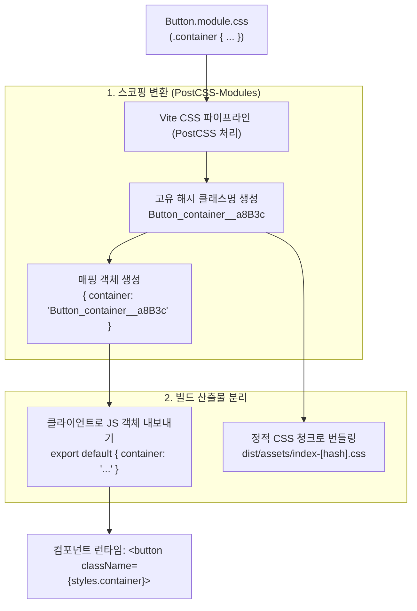

> 컴포넌트 기반 아키텍처에서 스타일 시트의 글로벌 네임스페이스 오염과 클래스 충돌 문제는 유지보수성을 저해하는 대표적인 위험 요소입니다. 본 글에서는 Vite에 기본 내장된 CSS Modules의 동작 원리와 커스텀 네이밍 해시 전략을 분석하고, PostCSS 파이프라인(Autoprefixer 및 최신 CSS 프리셋)과 연동하여 안전하고 모던한 스타일링 환경을 구성하는 실무 설정을 다룹니다.

---

## 1. 배경: 스타일 충돌의 한계와 CSS Modules의 가치

단일 페이지 애플리케이션(SPA)이 확장되면서 컴포넌트 간 스타일 격리는 필수적인 아키텍처 요구사항이 되었습니다. 초기에는 BEM(Block Element Modifier) 같은 엄격한 클래스 작명 규칙으로 충돌을 피하려 했으나, 팀 규모가 커질수록 사람이 규칙을 완벽히 지키는 데는 한계가 있었습니다.

이에 따라 등장한 CSS-in-JS(Styled-components, Emotion 등)는 완벽한 스코핑을 제공하지만 다음과 같은 런타임 트레이드오프가 수반됩니다.
- 런타임에 자바스크립트가 CSS 규칙을 파싱하고 `<style>` 태그에 주입하는 CPU 오버헤드
- React 18+ 서버 컴포넌트(RSC) 환경에서의 제약 및 SSR 수화(Hydration) 지연
- 번들 자바스크립트 파일 크기 증가

반면 **CSS Modules**는 런타임 비용이 전혀 없는 **제로 런타임(Zero Runtime)** 방식을 취합니다. 개발자는 표준 CSS 문법을 그대로 작성하고, 번들러가 빌드 타임에 클래스명을 고유한 해시 문자열로 치환하여 순수 정적 CSS 파일로 방출합니다.

Vite는 별도의 복잡한 로더 설치 없이 `*.module.css` 명명 규칙만으로 CSS Modules를 즉시 지원하며, PostCSS 전처리 파이프라인과 자연스럽게 통합됩니다.

---

## 2. Vite의 CSS Modules 처리 아키텍처

Vite 내부의 `vite:css` 및 `vite:css-post` 플러그인은 CSS Modules 파일을 마주쳤을 때 다음 단계를 거쳐 모듈을 변환합니다.



1. **파일 식별**: 확장자가 `.module.css`, `.module.scss`, `.module.less`인 파일을 감지합니다.
2. **해시 치환**: 정의된 클래스 선택자를 프로젝트 설정에 따른 고유 네이밍 패턴으로 변환합니다.
3. **JS 매핑 객체 방출**: 원본 클래스명과 해시된 클래스명을 1:1로 매핑한 자바스크립트 객체를 생성하여 컴포넌트가 import할 수 있도록 제공합니다.
4. **CSS 추출**: 변환된 CSS 규칙을 번들 CSS 파일로 분리 추출합니다.

---

## 3. 실무 설정: 커스텀 네이밍과 PostCSS 파이프라인 연동

### 3.1 `vite.config.ts` CSS Modules 커스텀 설정

기본 해시 규칙 대신 개발 환경에서는 직관적인 디버깅이 가능하고, 프로덕션 환경에서는 파일 크기를 최소화하도록 네이밍 템플릿을 분기합니다.

```typescript
// vite.config.ts
import { defineConfig } from 'vite';
import autoprefixer from 'autoprefixer';
import postcssPresetEnv from 'postcss-preset-env';

export default defineConfig(({ mode }) => {
  const isDev = mode === 'development';

  return {
    css: {
      modules: {
        // 클래스명 스코핑 템플릿
        // 개발: [파일명]_[클래스명]__[해시5자리] -> 디버깅 용이
        // 운영: _[해시8자리] -> CSS 파일 크기 극소화
        generateScopedName: isDev
          ? '[name]_[local]__[hash:base64:5]'
          : '_[hash:base64:8]',

        // kebab-case 클래스를 camelCase 프로퍼티로 변환하여 import
        // .button-container -> styles.buttonContainer
        localsConvention: 'camelCaseOnly',

        // 스코프 모드 (기본: local)
        scopeBehaviour: 'local'
      },
      postcss: {
        plugins: [
          // 1. 브라우저 지원 범위에 맞춰 벤더 프리픽스(-webkit-, -ms-) 자동 주입
          autoprefixer(),
          // 2. 최신 CSS 스펙(CSS Nesting, Custom Media 등) 하위 호환 트랜스파일
          postcssPresetEnv({
            stage: 2,
            features: {
              'nesting-rules': true
            }
          })
        ]
      }
    }
  };
});
```

### 3.2 브라우저 타깃 설정 (`.browserslistrc`)

Autoprefixer와 PostCSS가 벤더 프리픽스를 올바르게 삽입할 수 있도록 프로젝트 루트에 `.browserslistrc`를 정의합니다.

```text
# .browserslistrc
> 0.5%
last 2 versions
Firefox ESR
not dead
```

---

## 4. 컴포넌트 구현 및 TypeScript 타입 안전성

### 4.1 CSS Modules 작성 및 전역 선택자 활용

`:global` 키워드를 사용하면 CSS Modules 파일 내부에서도 특정 선택자만 스코핑에서 제외하여 전역 스타일로 유지할 수 있습니다.

```css
/* src/components/Button.module.css */
.container {
  display: inline-flex;
  align-items: center;
  justify-content: center;
  padding: 0.625rem 1.25rem;
  border-radius: 0.5rem;
  font-weight: 600;
  cursor: pointer;
  user-select: none;
  transition: all 0.2s ease-in-out;
}

.primary {
  background-color: #89b4fa;
  color: #1e1e2e;
}

/* 외부 라이브러리나 전역 아이콘과의 결합 */
.container :global(.custom-icon) {
  margin-right: 0.5rem;
  fill: currentColor;
}
```

### 4.2 React 컴포넌트에서의 사용

`localsConvention: 'camelCaseOnly'` 설정 덕분에 케밥 케이스 클래스도 객체 점 표기법으로 깔끔하게 접근할 수 있습니다.

```tsx
// src/components/Button.tsx
import React from 'react';
import styles from './Button.module.css';

interface ButtonProps {
  variant?: 'primary' | 'secondary';
  children: React.ReactNode;
  onClick?: () => void;
}

export function Button({ variant = 'primary', children, onClick }: ButtonProps) {
  return (
    <button
      type="button"
      className={`${styles.container} ${styles[variant]}`}
      onClick={onClick}
    >
      {children}
    </button>
  );
}
```

### 4.3 TypeScript 전역 타입 선언

컴포넌트에서 `*.module.css`를 불러올 때 타입 에러를 방지하기 위해 `vite-env.d.ts`에 선언을 추가합니다.

```typescript
// src/vite-env.d.ts
/// <reference types="vite/client" />

declare module '*.module.css' {
  const classes: { readonly [key: string]: string };
  export default classes;
}
```

> **Tip**: 프로젝트 규모가 크다면 `vite-plugin-sass-dts`나 `typescript-plugin-css-modules`를 도입하여 실제 작성된 CSS 클래스명에 대한 자동 완성 및 유효성 검사를 IDE 레벨에서 지원받을 수 있습니다.

---

## 5. 실행 결과 및 검증

### 5.1 프로덕션 빌드 결과 검증

`pnpm vite build` 명령을 실행하여 CSS Modules의 클래스명 치환과 번들 분리 상태를 확인합니다.


터미널 출력에서 확인할 수 있듯이:
- 빌드된 정적 CSS 파일(`dist/assets/index-E3x1o9k.css`) 내부의 클래스들이 `Button_container__a8B3c`, `Button_primary__f9D2z` 형태로 정확하게 치환되었습니다.
- 서로 다른 컴포넌트에서 동일한 이름(`.container`)을 사용하더라도 해시 접미사가 서로 다르므로 스타일 충돌이 완벽히 방지됩니다.

### 5.2 PostCSS Autoprefixer 및 최신 CSS 변환 검증

PostCSS 파이프라인이 최신 CSS 문법과 브라우저 타깃에 맞춰 벤더 프리픽스를 올바르게 삽입하는지 확인해 보았습니다.


`.modern-grid` 클래스에 작성된 `user-select`와 `backdrop-filter` 속성에 각각 `-webkit-`, `-moz-` 프리픽스가 자동으로 주입되어 다양한 브라우저 환경에서 동일한 렌더링을 보장합니다.

---

## 6. 정리

CSS Modules와 PostCSS의 조합은 다음과 같은 강력한 이점을 제공합니다.

- **안전한 스코핑**: BEM 명명 규칙에 의존하지 않고도 클래스명 충돌을 빌드 단계에서 100% 차단합니다.
- **성능 최적화**: 런타임 CSS-in-JS 라이브러리 없이 순수 브라우저 CSS로 컴파일되어 렌더링 성능과 초기 로딩 속도가 우수합니다.
- **자동화된 크로스 브라우징**: PostCSS 파이프라인을 통해 브라우저별 벤더 프리픽스와 최신 CSS 문법을 개발자의 수작업 없이 처리합니다.

복잡한 런타임 라이브러리 도입을 지양하고 가볍고 견고한 스타일링 시스템을 구축하고자 할 때, Vite의 내장 CSS Modules 파이프라인은 가장 실용적이고 안정적인 선택지입니다.
