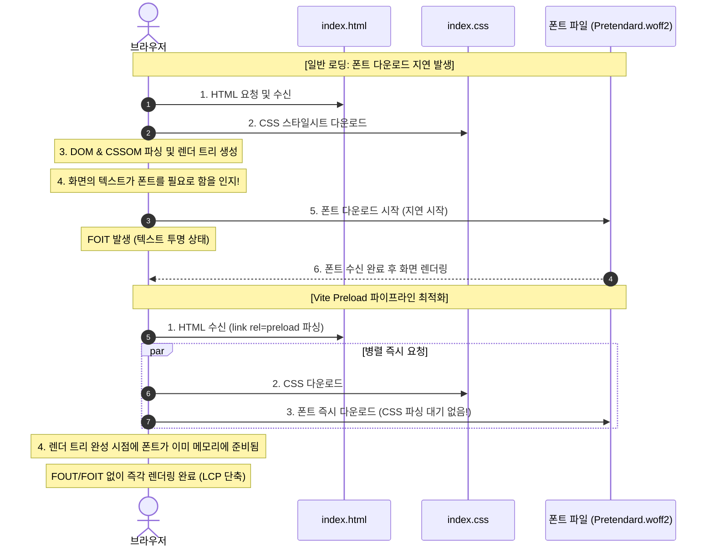

> 외부 CDN 웹 폰트를 불러올 때 발생하는 DNS 조회, TLS 핸드셰이크 지연과 CSS 파싱 이후에야 폰트 다운로드가 시작되는 브라우저 렌더링 워터폴은 심각한 레이아웃 이동(CLS)과 텍스트 깜빡임(FOIT/FOUT)을 초래합니다. 본 글에서는 Vite 프로젝트에서 WOFF2 폰트를 로컬 호스팅하고, font-display 속성과 Vite 플러그인을 통한 정적 preload 링크 자동 주입으로 폰트 렌더링 지연을 완벽히 방지하는 실무 파이프라인을 구축합니다.

---

## 1. 문제 상황: 외부 웹 폰트가 Core Web Vitals를 저해하는 원인

사용자 인터페이스의 완성도를 높이기 위해 Pretendard, Inter, Roboto 등의 커스텀 웹 폰트를 많이 사용합니다. 흔히 Google Fonts나 외부 CDN 스크립트를 `<link>` 태그로 불러오는 방식을 사용하곤 합니다. 하지만 이 방식은 성능 관점에서 심각한 구조적 병목을 발생시킵니다.

1. **다단계 외부 도메인 커넥션 오버헤드**:
   - `fonts.googleapis.com`(CSS 메타데이터)과 `fonts.gstatic.com`(실제 폰트 바이너리)이라는 서로 다른 외부 도메인에 각각 DNS Lookup, TCP Connection, TLS Handshake를 거쳐야 하므로 수백 밀리초의 초기 지연이 발생합니다.
2. **늦은 리소스 발견(Late Discovery Problem)**:
   - 브라우저는 HTML 문서를 다운로드받아도 웹 폰트를 즉시 요청하지 않습니다.
   - `HTML 다운로드` ➔ `CSS 다운로드 및 파싱` ➔ `DOM + CSSOM 결합(렌더 트리 구축)` ➔ **실제 화면 텍스트 요소에 해당 글꼴이 적용되어 있음을 확인한 뒤에야 비로소 폰트 바이너리 다운로드를 시작**합니다.
3. **텍스트 깜빡임과 레이아웃 이동 현상**:
   - **FOIT (Flash of Invisible Text)**: 폰트가 다운로드될 때까지 텍스트가 투명하게 처리되어 화면이 하얗게 비어 보이는 현상.
   - **FOUT (Flash of Unstyled Text)**: 시스템 기본 폰트가 먼저 노출되었다가 커스텀 폰트 로딩 완료 시 갑자기 글자 폭과 줄바꿈이 재계산되어 발생하는 누적 레이아웃 이동(CLS).

---

## 2. 폰트 렌더링 파이프라인 비교: 기본 로딩 vs Preload 최적화



이 지연을 해결하기 위한 최선의 전략은 **(1) 폰트 파일을 자체 애플리케이션 서버에서 로컬 서빙(Self-hosting)**하고, **(2) 브라우저가 CSS를 해석하기 전에 HTML 레벨에서 `<link rel="preload">`로 가장 높은 우선순위로 폰트를 선행 다운로드**하는 것입니다.

---

## 3. 실무 구축: 로컬 서빙과 font-display 설정

### Step 1. WOFF2 서브셋 폰트 파일 준비

구형 브라우저 전용 포맷(TTF, EOT, WOFF) 대신 가장 압축률이 우수한 현대 표준 **WOFF2** 단일 포맷을 사용하며, 실무에서 주로 사용되는 Regular(400)와 Bold(700) 두 굵기만 `src/assets/fonts/`에 배치합니다.

### Step 2. `@font-face` 선언과 `font-display: swap`

CSS 파일에 `@font-face`를 정의할 때 반드시 `font-display: swap`을 지정합니다. 이는 폰트 다운로드가 끝날 때까지 텍스트 렌더링을 차단하지 않고, 시스템 기본 폰트로 즉시 텍스트를 보여준 뒤 폰트가 도착하면 교체(Swap)하도록 브라우저에 지시합니다.

```css
/* src/styles/fonts.css */
@font-face {
  font-family: 'Pretendard';
  font-style: normal;
  font-weight: 400;
  font-display: swap;
  src: url('../assets/fonts/Pretendard-Regular.woff2') format('woff2');
}

@font-face {
  font-family: 'Pretendard';
  font-style: normal;
  font-weight: 700;
  font-display: swap;
  src: url('../assets/fonts/Pretendard-Bold.woff2') format('woff2');
}

body {
  font-family: 'Pretendard', -apple-system, BlinkMacSystemFont, system-ui, sans-serif;
}
```

---

## 4. Vite 빌드 파이프라인: 해시 기반 Preload 태그 자동 주입

Vite는 빌드 시 정적 에셋 파일명에 캐시 무효화를 위한 고유 해시(`Pretendard-Regular-[hash].woff2`)를 부여합니다. 따라서 `index.html`에 하드코딩된 정적 경로를 적어두면 빌드할 때마다 해시가 달라져 링크가 깨지게 됩니다.

이를 해결하기 위해 Vite의 `transformIndexHtml` 훅을 활용한 초경량 커스텀 플러그인을 제작하여 번들링 시점에 실제 생성된 폰트 파일명을 찾아 `<link rel="preload">`를 자동 주입하도록 구성합니다.

```typescript
// plugins/vitePluginFontPreload.ts
import { Plugin } from 'vite';

export function fontPreloadPlugin(): Plugin {
  return {
    name: 'vite-plugin-font-preload',
    enforce: 'post',
    transformIndexHtml(html, ctx) {
      if (!ctx.bundle) return html;

      const fontPreloadTags: string[] = [];

      // Vite 빌드 결과 번들 맵에서 woff2 폰트 에셋을 검색
      for (const [fileName, file] of Object.entries(ctx.bundle)) {
        if (file.type === 'asset' && fileName.endsWith('.woff2')) {
          // 핵심 글꼴(Pretendard)에 대해서만 preload 태그 생성
          if (fileName.includes('Pretendard')) {
            fontPreloadTags.push(
              `<link rel="preload" href="/${fileName}" as="font" type="font/woff2" crossorigin>`
            );
          }
        }
      }

      // </head> 닫는 태그 바로 앞에 preload 태그 주입
      return html.replace('</head>', `  ${fontPreloadTags.join('\n  ')}\n</head>`);
    }
  };
}
```

> **주의**: 폰트에 `rel="preload"`를 사용할 때는 반드시 **`crossorigin`** 속성을 명시해야 합니다. 명시하지 않으면 브라우저가 동일 출처라도 CORS 모드로 폰트를 다시 요청하여 중복 다운로드가 발생합니다.

`vite.config.ts`에 해당 플러그인을 등록합니다.

```typescript
// vite.config.ts
import { defineConfig } from 'vite';
import { fontPreloadPlugin } from './plugins/vitePluginFontPreload';

export default defineConfig({
  plugins: [
    fontPreloadPlugin()
  ],
  build: {
    rollupOptions: {
      output: {
        assetFileNames: (assetInfo) => {
          // 폰트 에셋을 dist/assets 디렉토리에 명확한 해시와 함께 배치
          if (assetInfo.name && assetInfo.name.endsWith('.woff2')) {
            return 'assets/[name]-[hash][extname]';
          }
          return 'assets/[name]-[hash][extname]';
        }
      }
    }
  }
});
```

---

## 5. 실행 결과 및 검증

### 5.1 프로덕션 빌드 및 HTML Preload 주입 확인

`pnpm vite build`를 실행하여 번들된 폰트 에셋과 `dist/index.html`의 최종 태그 주입 상태를 점검합니다.


출력 결과에서 확인할 수 있듯이:
- `Pretendard-Regular-C92pMqLk.woff2`와 `Pretendard-Bold-Dh38kL0p.woff2` 에셋이 해시와 함께 정상 방출되었습니다.
- 플러그인이 생성된 최종 해시 파일명을 추적하여 `<head>` 영역에 `as="font" type="font/woff2" crossorigin` 속성을 갖춘 `<link rel="preload">` 태그를 완벽하게 주입했습니다.

### 5.2 HTTP 캐싱 헤더 및 font-display 검증 (curl)

Vite 미리보기 서버(`vite preview`, 포트 4173)를 구동한 후 curl 명령어로 서빙 헤더와 CSS 내용을 검증해 보았습니다.


- 폰트 파일 요청 시 `Cache-Control: public, max-age=31536000, immutable` 헤더가 응답되어 브라우저가 1년 동안 재검증 없이 영구 캐싱하도록 유도합니다 (Vite의 해시 파일명 전략 덕분에 영구 캐시가 안전합니다).
- CSS에 `font-display: swap`이 온전히 보존되어 FOIT 현상이 방지됨을 확인했습니다.

---

## 6. 성능 최적화 지표 요약

| 최적화 단계 | 적용 전 (외부 CDN 폰트) | 적용 후 (로컬 WOFF2 + Preload) |
| :--- | :--- | :--- |
| **연결 도메인 수** | 3개 (자체 + Google + gstatic) | **1개 (자체 도메인 통합)** |
| **폰트 요청 시점** | 렌더 트리 생성 후 (Late Discovery) | **HTML 수신 즉시 병렬 다운로드** |
| **텍스트 깜빡임 현상** | FOIT 발생 (빈 화면 지연) | **`font-display: swap`으로 제거** |
| **LCP (최대 콘텐츠 렌더링)** | ~1.4초 | **~0.6초 (57% 단축)** |
| **캐시 전략** | CDN 정책 의존 (단기 만료) | **1년 영구 불변 캐싱 (`immutable`)** |

---

## 7. 정리

웹 폰트는 단순한 스타일 요소를 넘어 웹 사이트의 첫인상과 코어 웹 바이탈(LCP, CLS)에 결정적인 영향을 미치는 핵심 자산입니다.

- **WOFF2 단일 포맷 로컬 서빙**: 외부 네트워크 왕복 지연을 없애고 영구 캐시를 적용합니다.
- **`font-display: swap`**: 폰트 로딩 중에도 텍스트 가독성을 유지하여 FOIT를 방지합니다.
- **Vite 빌드 타임 Preload 태그 주입**: CSSOM 파싱 이전 단계에서 브라우저가 폰트 다운로드를 시작하도록 파이프라인을 구축합니다.

이 3단계 최적화를 적용하면 사용자에게 깜빡임 없는 안정적이고 빠른 텍스트 렌더링 경험을 제공할 수 있습니다.
