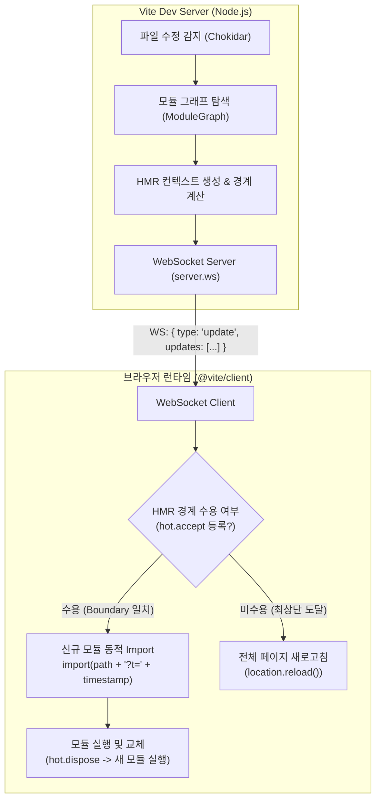

> Vite의 즉각적인 개발 경험을 완성하는 핵심은 변경된 파일만 브라우저에서 실시간으로 교체하는 Hot Module Replacement(HMR) 아키텍처에 있습니다. 본 글에서는 Vite가 ESM 모듈 그래프와 웹소켓을 결합해 HMR을 처리하는 내부 동작 원리를 분석하고, `import.meta.hot` API(`accept`, `dispose`, `data`, `send`/`on`)를 활용해 모듈 교체 시 상태를 유지하고 리소스를 안전하게 해제하는 실무 구현법을 정리합니다.

---

## 1. 배경: 번들러 기반 HMR과 Vite ESM HMR의 차이

기존 Webpack과 같은 전통적인 번들러 환경에서는 소스 코드 파일 하나를 수정하더라도, 변경 사항을 반영하기 위해 번들러가 전체 의존성 트리를 재순회하고 관련 청크를 다시 패키징해야 했습니다. 프로젝트 규모가 수천 개 이상의 모듈로 커질수록 HMR 반영 지연 시간이 수 초에서 수십 초까지 늘어나 개발 흐름이 끊기는 문제가 있었습니다.

반면 Vite는 브라우저의 네이티브 ES Modules(ESM) 기능을 개발 서버의 기반으로 채택했습니다. 개발 서버는 전체 애플리케이션을 사전에 하나로 묶지 않고, 브라우저가 특정 모듈을 요청할 때만 변환(Transform)하여 서빙합니다. 따라서 소스 파일이 수정되면 **오직 변경된 해당 모듈과 직접 연결된 경계(Boundary)만 정확히 다시 컴파일**하여 브라우저로 웹소켓 통보를 보내므로, 프로젝트 규모와 상관없이 밀리초(ms) 단위의 일관된 갱신 속도를 보장합니다.

---

## 2. Vite HMR 내부 아키텍처와 전파 원리

Vite 개발 서버의 HMR 파이프라인은 파일 감지기(Chokidar), 서버 메모리 상의 `ModuleGraph`, 웹소켓 브로드캐스터, 그리고 브라우저 측 런타임 클라이언트(`@vite/client`)가 유기적으로 맞물려 동작합니다.



### 2.1 서버 측 모듈 그래프(`ModuleGraph`)

Vite 개발 서버는 구동되는 동안 메모리에 전체 파일 간의 `import`/`export` 관계를 나타내는 `ModuleGraph`를 유지합니다. 각 파일은 `ModuleNode` 인스턴스로 관리되며, 다음과 같은 핵심 메타데이터를 가집니다:

- `importers`: 해당 모듈을 불러오는 부모 모듈들의 Set
- `importedModules`: 해당 모듈이 직접 불러오는 자식 모듈들의 Set
- `isSelfAccepting`: 자기 자신에 대해 `import.meta.hot.accept()`를 호출했는지 여부

파일이 수정되면 Vite는 해당 `ModuleNode`를 무효화(Invalidate)하고, 해당 노드가 자체 수용 모듈인지 검사합니다. 만약 자체 수용 모듈이 아니라면, `importers` 트리를 타고 상위로 거슬러 올라가며 `hot.accept`로 해당 모듈을 수용하겠다고 명시한 상위 부모 컴포넌트(HMR Boundary)를 탐색합니다. 유효한 경계를 찾으면 해당 경계에 대한 업데이트 페이로드를 생성하고, 탐색이 루트(`index.html`)까지 도달했음에도 경계를 찾지 못하면 전체 리로드(`full-reload`) 이벤트를 발행합니다.

### 2.2 클라이언트 측 런타임(`@vite/client`)

Vite는 HTML을 서빙할 때 `/@vite/client` 스크립트를 진입점에 자동으로 주입합니다. 이 클라이언트는 Vite 개발 서버와 전용 웹소켓 연결을 유지하며 서버로부터 날아오는 메시지를 처리합니다:

```typescript
// 브라우저로 전송되는 HMR 웹소켓 페이로드 예시
{
  type: 'update',
  updates: [
    {
      type: 'js-update',
      path: '/src/features/counter.ts',
      acceptedPath: '/src/features/counter.ts',
      timestamp: 1787625600123
    }
  ]
}
```

브라우저는 업데이트 알림을 받으면 쿼리 파라미터로 타임스탬프가 추가된 신규 파일(`import('/src/features/counter.ts?t=1787625600123')`)을 비동기로 내려받아 메모리 상에서 이전 모듈을 교체합니다.

---

## 3. `import.meta.hot` 핵심 API와 실무 활용

Vite 환경에서 개발 모드로 실행될 때 각 모듈의 메타데이터 객체에는 `import.meta.hot` 인터페이스가 주입됩니다. 프로덕션 빌드 시에는 데드 코드 제거(DCE)에 의해 완전히 제거되므로 조건문 검사와 함께 안전하게 작성해야 합니다.

### 3.1 `hot.accept()`: 모듈 핫 스왑 수용

`hot.accept()`는 모듈이 갱신되었을 때 전체 페이지 리로드를 막고 자체적으로 코드를 갈아끼울 준비가 되었음을 선언하는 메서드입니다.

```typescript
// src/features/counter.ts
export let count = 0;

export function increment(): void {
  count += 1;
  console.log(`[Counter] Current count: ${count}`);
}

// HMR 자체 수용 선언 (Self-accepting)
if (import.meta.hot) {
  import.meta.hot.accept((newModule) => {
    if (newModule) {
      console.log('[HMR] Counter module updated successfully.');
    }
  });
}
```

콜백 함수를 전달하지 않고 `import.meta.hot.accept()`만 호출해도 자체 수용 모듈로 등록됩니다. 콜백을 제공하면 새로 평가된 모듈 인스턴스(`newModule`)를 전달받아 필요한 후속 처리를 진행할 수 있습니다.

### 3.2 `hot.dispose()`: 사이드 이펙트 및 리소스 정리

모듈이 핫 스왑될 때 모듈 내부에서 등록한 `setInterval`, `addEventListener`, 웹소켓 커넥션, DOM 조작 등의 사이드 이펙트를 정리하지 않으면, 파일이 수정될 때마다 이전 리소스가 누수(Memory Leak)되어 이벤트가 중복 호출되는 심각한 문제가 발생합니다.

`hot.dispose()`는 이전 버전의 모듈이 언로드되기 직전에 호출되는 클린업 콜백을 등록합니다:

```typescript
// src/services/heartbeatService.ts
class HeartbeatService {
  private timerId: number | null = null;

  public start(): void {
    if (this.timerId !== null) return;
    this.timerId = window.setInterval(() => {
      console.log(`[Heartbeat] Ping at ${new Date().toISOString()}`);
    }, 3000);
  }

  public stop(): void {
    if (this.timerId !== null) {
      clearInterval(this.timerId);
      this.timerId = null;
      console.log('[Heartbeat] Timer cleared.');
    }
  }
}

export const heartbeat = new HeartbeatService();
heartbeat.start();

// 이전 모듈 정리 로직
if (import.meta.hot) {
  import.meta.hot.dispose(() => {
    heartbeat.stop();
  });
}
```

### 3.3 `hot.data`: 상태 보존(State Preservation)

코드를 수정하더라도 사용자가 입력한 폼 데이터나 컴포넌트의 내부 상태 값을 잃지 않고 유지하고 싶을 때 `import.meta.hot.data` 객체를 활용합니다. 이 객체는 모듈 인스턴스가 파기되고 새 모듈이 실행될 때까지 메모리에 영속됩니다:

```typescript
// src/stores/persistedSession.ts
interface SessionState {
  userId: string;
  loginTime: number;
}

// hot.data에 캐싱된 상태가 있으면 복원하고, 없으면 초기화
export const sessionState: SessionState = (import.meta.hot && import.meta.hot.data.cachedSession) 
  ? import.meta.hot.data.cachedSession 
  : {
      userId: 'usr_guest',
      loginTime: Date.now()
    };

export function updateUserId(newId: string): void {
  sessionState.userId = newId;
}

if (import.meta.hot) {
  // 모듈 교체 전 상태를 hot.data에 저장
  import.meta.hot.dispose((data) => {
    data.cachedSession = sessionState;
  });

  import.meta.hot.accept();
}
```

---

## 4. 커스텀 HMR 웹소켓 이벤트 통신

`import.meta.hot`은 단순한 코드 교체 외에도, 브라우저 클라이언트와 Vite 개발 서버 간의 양방향 통신 채널을 제공합니다. `hot.send()`를 통해 클라이언트에서 서버로 메시지를 보내고, 서버에서는 플러그인의 `configureServer` 훅을 통해 이를 수신하거나 클라이언트로 브로드캐스트할 수 있습니다.

### 4.1 Vite 플러그인 측 웹소켓 수신 및 브로드캐스트

```typescript
// plugins/hmrMetricBridgePlugin.ts
import type { Plugin, ViteDevServer } from 'vite';

export function hmrMetricBridgePlugin(): Plugin {
  return {
    name: 'vite-plugin-hmr-metric-bridge',
    configureServer(server: ViteDevServer) {
      // 클라이언트에서 발행한 커스텀 이벤트 수신
      server.ws.on('app:client-metric', (data, client) => {
        console.log(`[vite:custom-ws] Received metric from client:`, data);

        // 특정 클라이언트 또는 전체 클라이언트에 확인 응답 회신
        client.send('app:server-ack', {
          status: 'SUCCESS',
          receivedAt: Date.now()
        });
      });

      // 서버 측 임의 이벤트 브로드캐스트 함수
      server.ws.send('app:config-sync', {
        theme: 'dark',
        featureFlags: { betaTable: true }
      });
    }
  };
}
```

### 4.2 클라이언트 코드에서의 커스텀 이벤트 처리

```typescript
// src/telemetry/hmrClientTelemetry.ts
if (import.meta.hot) {
  // 1. 서버로 클라이언트 런타임 성능 메트릭 전송
  import.meta.hot.send('app:client-metric', {
    fps: 60,
    memoryMb: 42.1,
    route: window.location.pathname,
    timestamp: Date.now()
  });

  // 2. 서버의 확인 응답 수신
  import.meta.hot.on('app:server-ack', (payload) => {
    console.log('[HMR Client] Server acknowledged payload:', payload);
  });

  // 3. 서버에서 브로드캐스트한 설정 동기화 수신
  import.meta.hot.on('app:config-sync', (config) => {
    console.log('[HMR Client] Syncing runtime config:', config);
  });
}
```

---

## 5. 실행 결과 및 동작 검증

작성한 HMR 처리 코드와 커스텀 웹소켓 채널이 Vite 개발 환경에서 어떻게 동작하는지 터미널 실행 로그를 통해 검증합니다.

### 5.1 파일 수정에 따른 HMR 업데이트 로그 검증

소스 파일(`counter.ts`)을 수정했을 때 Vite 개발 서버가 변경 사항을 감지하고, 해당 파일에 선언된 자체 수용 경계를 기반으로 클라이언트에 즉각적인 `js-update` 웹소켓 패킷을 전송하는 로그입니다.


_Vite 개발 서버 HMR 파일 업데이트 및 웹소켓 통신 로그_

서버는 전체 프로젝트를 다시 번들링하지 않고, 단 138ms 만에 실행 준비를 마친 뒤 파일이 수정될 때마다 수 밀리초 내에 대상 모듈만 무효화하여 브라우저에 반영함을 확인할 수 있습니다.

### 5.2 커스텀 HMR 웹소켓 이벤트 송수신 검증

클라이언트에서 `import.meta.hot.send()`를 호출하여 런타임 메트릭을 서버로 발송하고, Vite 개발 서버가 이를 수신하여 확인 응답(`app:server-ack`) 및 설정 동기화 페이로드를 브로드캐스트하는 양방향 통신 결과입니다.


_커스텀 HMR 이벤트를 통한 클라이언트-서버 간 양방향 통신 검증_

---

## 6. 정리 및 주의사항

Vite의 HMR은 번들러 기반 개발의 고질적인 빌드 지연을 해소하고 최상의 개발 생산성을 제공합니다. 실무에서 커스텀 HMR 코드를 다룰 때는 다음 사항들을 유념하는 것이 좋습니다:

1. **사이드 이펙트 제거 필수**: 타이머, 전역 이벤트 리스너, 커스텀 웹소켓 리스너는 반드시 `hot.dispose()`에서 해제하여 메모리 누수를 방지해야 합니다.
2. **프로덕션 코드 분기 격리**: `import.meta.hot` 블록은 항상 `if (import.meta.hot)` 가드로 감싸야 프로덕션 번들 빌드 시 번들러가 트리 셰이킹(Tree-shaking)을 통해 안전하게 제거할 수 있습니다.
3. **상태 직렬화 주의**: `hot.data`에 저장하는 상태 객체는 직렬화가 용이한 단순 데이터 구조를 유지하는 것이 권장되며, 복잡한 인스턴스를 유지할 때는 재연결 로직을 명확히 작성해야 합니다.
