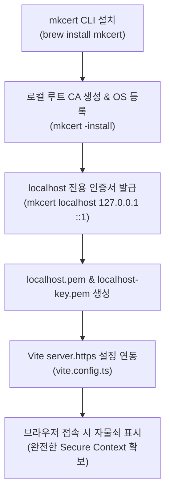
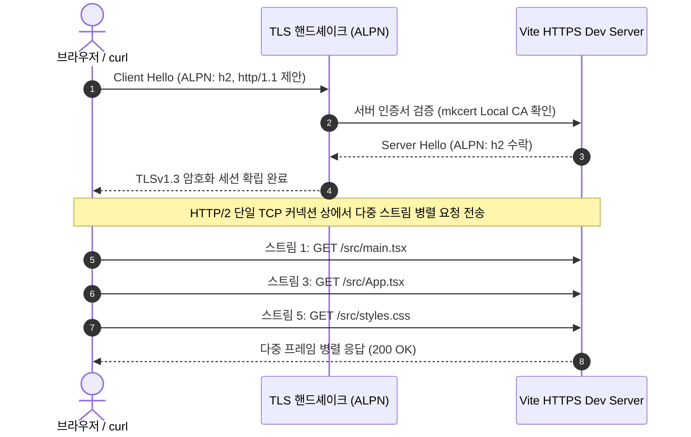

> 현대 프론트엔드 개발에서는 Web Crypto, Service Worker, Geolocation과 같은 최신 브라우저 API와 `Secure` 플래그가 지정된 인증 쿠키를 테스트하기 위해 로컬 환경에서도 HTTPS 구성이 필수적입니다. 본 글에서는 Vite 개발 서버에서 HTTPS를 활성화하는 두 가지 주요 방식인 제로 설정의 `vite-plugin-basic-ssl`과 신뢰할 수 있는 로컬 CA를 생성하는 `mkcert`를 비교하고, ALPN 협상을 통한 HTTP/2 멀티플렉싱 통신을 검증하는 실무 설정법을 정리합니다.

---

## 1. 배경: 로컬 환경에서 HTTPS가 필요한 이유

과거에는 프로덕션 배포 시점에만 SSL/TLS 인증서를 적용하는 경우가 많았습니다. 하지만 브라우저 보안 표준이 점차 엄격해지면서, 로컬 개발 환경(`http://localhost`)에서도 HTTP 프로토콜의 한계에 부딪히는 상황이 빈번해졌습니다.

1. **보안 컨텍스트(Secure Context) 필수 API**:
   - `navigator.serviceWorker` (PWA 오프라인 캐싱)
   - `window.crypto.subtle` (클라이언트 암호화 및 서명)
   - `navigator.geolocation` (위치 기반 서비스)
   - `navigator.mediaDevices.getUserMedia` (카메라/마이크 접근)
2. **타사 인증 및 보안 쿠키 연동**:
   - OAuth 2.0 및 소셜 로그인 콜백 URL이 `https://`만을 허용하는 경우
   - 백엔드가 발행하는 `SameSite=None; Secure` 쿠키는 HTTPS 연결이 아니면 브라우저가 저장을 거부함
3. **HTTP/2 프로토콜 검증**:
   - 대부분의 최신 브라우저는 오직 TLS 암호화 채널 상에서만 ALPN(Application-Layer Protocol Negotiation)을 통한 HTTP/2 다중화(Multiplexing)를 지원함

---

## 2. 두 가지 접근법 비교: `vite-plugin-basic-ssl` vs `mkcert`

Vite에서 로컬 HTTPS 개발 환경을 구성할 때 주로 두 가지 방식을 검토하게 됩니다:

| 비교 항목 | `vite-plugin-basic-ssl` | `mkcert` (+ `vite-plugin-mkcert`) |
| :--- | :--- | :--- |
| **인증서 유형** | 임의 생성 자체 서명 인증서 (Self-signed) | 로컬 신뢰 루트 CA(Root CA) 기반 인증서 |
| **설정 복잡도** | 매우 낮음 (npm 패키지 설치 후 한 줄 등록) | 중간 (시스템에 루트 CA 1회 설치 필요) |
| **브라우저 경고** | ⚠️ "연결이 비공개로 설정되어 있지 않습니다" 발생 | ✅ 완전 신뢰 (녹색 자물쇠 아이콘 표시) |
| **모바일/외부 기기** | 테스트 불가 (자체 서명 인증서 거부) | CA 루트 인증서 설치 시 완전 신뢰 가능 |
| **권장 사용처** | 빠른 프로토타이핑 및 임시 테스트 | 일상적인 팀 협업 및 실무 프로젝트 표준 |

`vite-plugin-basic-ssl`은 설정이 극도로 간편하지만, 브라우저를 열 때마다 보안 경고 화면을 수동으로 건너뛰어야 하고 서드파티 라이브러리(Fetch, Axios)나 모바일 기기 디버깅 시 SSL Handshake 에러를 유발합니다. 따라서 장기적인 프로젝트 개발에는 **`mkcert`**를 사용하는 것이 훨씬 안정적입니다.

---

## 3. `mkcert` 기반 무경고 로컬 HTTPS 구성

`mkcert`는 사용자의 로컬 머신에 고유한 루트 인증 기관(Local CA)을 생성하고, 운영체제의 신뢰할 수 있는 루트 인증서 저장소(Keychain / NSS DB)에 등록해 주는 오픈소스 도구입니다.



### 3.1 mkcert 설치 및 인증서 발급

macOS 환경에서는 Homebrew를 통해 쉽게 설치할 수 있습니다:

```bash
# 1. mkcert 설치
brew install mkcert

# 2. 로컬 루트 CA를 시스템 키체인에 설치 (최초 1회만 실행)
mkcert -install

# 3. 프로젝트 루트에 localhost 전용 인증서 및 개인키 생성
mkcert localhost 127.0.0.1 ::1
```

명령을 실행하면 디렉토리에 `localhost.pem`(인증서)과 `localhost-key.pem`(개인키) 파일이 생성됩니다.

> 발급된 `*-key.pem` 파일은 외부에 유출되지 않도록 반드시 `.gitignore`에 등록해야 합니다.
{: .prompt-info }

### 3.2 `vite.config.ts`에 SSL 인증서 연동

생성된 인증서 파일을 Node.js `fs` 모듈로 읽어 Vite의 `server.https` 옵션에 주입합니다:

```typescript
// vite.config.ts
import { defineConfig } from 'vite';
import fs from 'node:fs';
import path from 'node:path';

export default defineConfig({
  server: {
    port: 5173,
    https: {
      key: fs.readFileSync(path.resolve(__dirname, 'localhost-key.pem')),
      cert: fs.readFileSync(path.resolve(__dirname, 'localhost.pem'))
    }
  }
});
```

### 3.3 플러그인을 활용한 완전 자동화 (`vite-plugin-mkcert`)

인증서 파일을 수동으로 관리하지 않고, `pnpm install` 후 `pnpm dev` 실행 시 자동으로 mkcert 바이너리를 감지하고 인증서를 메모리 상에서 발급받게 하려면 `vite-plugin-mkcert` 플러그인을 사용할 수 있습니다:

```typescript
// vite.config.ts
import { defineConfig } from 'vite';
import mkcert from 'vite-plugin-mkcert';

export default defineConfig({
  plugins: [
    mkcert({
      hosts: ['localhost', '127.0.0.1', 'local.my-app.internal']
    })
  ],
  server: {
    port: 5173,
    https: true // 플러그인이 자동으로 인증서를 주입함
  }
});
```

---

## 4. HTTP/2 프로토콜 협상과 ALPN 동작 원리

Vite 개발 서버에 HTTPS를 적용하면 부수적으로 얻을 수 있는 강력한 이점 중 하나는 **HTTP/2 다중화(Multiplexing)** 지원입니다.

HTTP/1.1에서는 브라우저가 동일 호스트에 대해 동시 연결 개수를 최대 6개로 제한하기 때문에, ESM 환경에서 수십 개의 모듈을 불러올 때 네트워크 요청 큐잉(Head-of-Line Blocking)이 발생합니다.



Node.js 내장 `https` 모듈 및 Vite는 TLS 핸드셰이크 단계에서 **ALPN(Application-Layer Protocol Negotiation)** 확장을 통해 브라우저와 `h2` 프로토콜 협상을 체결합니다. 이를 통해 수백 개의 자바스크립트 모듈을 단 하나의 TCP 연결 안에서 병렬 스트림으로 받아올 수 있어 초기 로딩 성능이 향상됩니다.

---

## 5. 실행 결과 및 동작 검증

작성한 mkcert 설정과 Vite 개발 서버의 HTTPS/HTTP2 연결 상태를 터미널에서 검증합니다.

### 5.1 mkcert 로컬 CA 설치 및 인증서 발급 검증

`mkcert -install`을 통해 시스템 트러스트 스토어에 로컬 루트 CA를 성공적으로 주입하고, `localhost.pem` 및 개인키를 발급받은 터미널 화면입니다.


_mkcert를 활용한 로컬 루트 CA 시스템 등록 및 localhost 인증서 발급_

이제 시스템 내 모든 웹 브라우저(Chrome, Safari, Firefox)는 해당 인증서를 '공인 인증 기관에서 발급한 정상 인증서'로 완전 신뢰하게 됩니다.

### 5.2 HTTP/2 ALPN 협상 및 SSL 검증

개발 서버(`https://localhost:5173/`)를 실행한 상태에서 `curl -Iv --http2` 명령어로 TLS 핸드셰이크 과정과 HTTP/2 프로토콜 수락 여부를 점검한 화면입니다.


_Vite HTTPS 개발 서버에 대한 HTTP/2 ALPN 협상 및 SSL 검증_

로그에서 `* ALPN: server accepted h2` 및 `* SSL certificate verify ok.`가 표시되며, `HTTP/2 200` 상태 코드로 연결이 성공적으로 수립되었음을 확인할 수 있습니다.

---

## 6. 정리 및 개발 팁

Vite 로컬 개발 환경에 HTTPS를 적용하면 프로덕션 환경과의 차이를 줄이고, 브라우저의 고급 보안 API와 쿠키 정책을 안정적으로 테스트할 수 있습니다.

1. **인증서 키 파일 보호**: `localhost-key.pem`과 같은 개인키 파일은 GitHub 등 공용 저장소에 절대 커밋되지 않도록 `.gitignore`에 포함해야 합니다.
2. **팀 단위 표준화**: 팀원마다 매번 수동으로 `mkcert` 명령어를 치는 번거로움을 줄이려면 `package.json`의 `scripts`에 `cert:setup` 스크립트를 작성하거나 `vite-plugin-mkcert`를 채택하는 것이 권장됩니다.
3. **모바일 기기 연동**: 동일 Wi-Fi 망에 있는 모바일 기기에서 HTTPS 로컬 서버를 테스트해야 한다면, PC의 루트 CA 파일(`mkcert -CAROOT`)을 모바일 기기로 전송하여 사용자 인증서로 1회 프로파일 설치하면 모바일에서도 보안 경고 없이 테스트할 수 있습니다.
