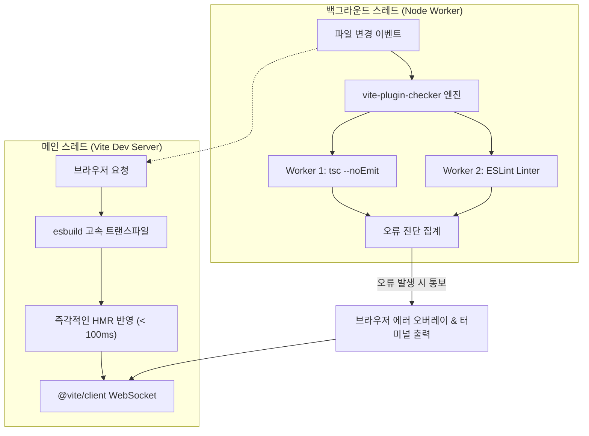

> Vite는 극단적인 개발 서버 속도를 달성하기 위해 내부 트랜스파일러인 esbuild를 통해 TypeScript의 타입 구문을 단순히 제거(Type Stripping)하기만 할 뿐, 정적 타입 검사를 수행하지 않습니다. 이로 인해 개발 중 사소한 타입 불일치가 런타임까지 누락되는 문제가 발생합니다. 본 글에서는 개발 서버의 초고속 HMR 반응성을 전혀 훼손하지 않으면서, 별도의 백그라운드 워커 스레드에서 TypeScript와 ESLint 검사를 병렬로 실행해 터미널과 브라우저 오버레이로 즉각적인 피드백을 제공하는 `vite-plugin-checker`의 도입 및 최적화 방법을 정리합니다.

---

## 1. 배경: Vite와 esbuild가 타입 검사를 건너뛰는 이유

전통적인 프론트엔드 환경에서 공식 TypeScript 컴파일러(`tsc`)를 트랜스파일러로 사용하면, 코드 변환과 전체 프로젝트의 정적 타입 체킹을 단일 프로세스에서 동시에 처리합니다. 하지만 모듈 수가 수천 개를 넘어가면 `tsc`의 타입 분석에만 수 초에서 수십 초가 소요되어 개발 생산성이 급격히 저하됩니다.

Vite는 이 병목을 해결하기 위해 Go 언어로 작성된 초고속 트랜스파일러 **esbuild**를 채택했습니다:

- **esbuild의 전략**: AST 상에서 TypeScript의 인터페이스, 제네릭, 타입 선언문만 순수하게 '제거(Strip)'하여 순수 JavaScript로 즉시 변환합니다.
- **결과**: 변환 속도는 `tsc` 대비 20~30배 이상 빠르지만, **타입 오류가 있더라도 컴파일이 아무런 경고 없이 성공**합니다.

```typescript
// src/components/UserProfile.tsx
interface UserProps {
  userId: string;
  userAge: number; // 숫자 타입 기대
}

export function UserProfile(props: UserProps) {
  return <div>{props.userId} ({props.userAge})</div>;
}

// 다른 파일에서 잘못된 호출:
<UserProfile userId="namju" userAge="thirty-two" /> 
// -> esbuild는 타입 오류를 전혀 검사하지 않고 그대로 브라우저로 내보냅니다!
```

결국 개발자가 VS Code 에디터 창의 빨간 줄을 무심코 지나치거나 빌드 파이프라인(`vite build`)을 돌려도 오류가 걸러지지 않고, 프로덕션 배포 후 런타임 `NaN`이나 렌더링 버그로 이어지는 위험이 존재합니다.

---

## 2. `vite-plugin-checker`의 아키텍처와 동작 원리

이 문제를 해결하기 위해 개발 서버 프로세스 자체에 무거운 `tsc` 검사를 동기적으로 끼워 넣으면 Vite의 가장 큰 강점인 밀리초(ms) 단위 HMR이 무너지게 됩니다.

`vite-plugin-checker`는 **멀티 스레드 워커 아키텍처(Worker Thread Architecture)**를 도입하여 이 문제를 깔끔하게 해결합니다.



- **메인 스레드 격리**: Vite 개발 서버의 파일 서빙과 esbuild 트랜스파일링은 방해받지 않고 최우선으로 즉시 실행됩니다.
- **백그라운드 워커 병렬화**: Node.js의 `worker_threads`를 활용하여 독립된 스레드에서 `tsc --noEmit`과 `eslint`를 동시에 실행합니다.
- **실시간 피드백 허브**: 워커에서 검출된 타입 불일치 및 린트 위반 내역은 터미널 콘솔뿐만 아니라 웹소켓을 통해 브라우저 화면의 플로팅 오버레이(Overlay)로 즉시 띄워줍니다.

---

## 3. 실무 설정 및 멀티 체커 구성

프로젝트에 `vite-plugin-checker` 및 관련 타입 엔진을 설치합니다:

```bash
pnpm add -D vite-plugin-checker typescript eslint
```

### 3.1 `vite.config.ts` 통합 설정

TypeScript 검사와 ESLint 검사를 동시에 활성화하고, 개발 편의성을 높이기 위한 오버레이 옵션을 구성합니다:

```typescript
// vite.config.ts
import { defineConfig } from 'vite';
import checker from 'vite-plugin-checker';

export default defineConfig({
  plugins: [
    checker({
      // 1. TypeScript 정적 타입 검사 활성화
      typescript: true, // 또는 { tsconfigPath: './tsconfig.app.json' }

      // 2. ESLint 플랫 설정 검사 활성화
      eslint: {
        useFlatConfig: true,
        lintCommand: 'eslint "./src/**/*.{ts,tsx}"'
      },

      // 3. 브라우저 화면 에러 오버레이 세부 설정
      overlay: {
        initialIsOpen: false, // 첫 로딩 시 화면을 가리지 않고 뱃지 형태로 유지
        position: 'tr',       // 화면 우측 상단(Top-Right)에 표시
        badge: true           // 에러 개수를 보여주는 미니 뱃지 표시
      },

      // 4. 터미널 출력 제어
      terminal: true,

      // 5. 프레임워크별 특화 옵션 (Vue 프로젝트인 경우)
      // vueTsc: true,
      
      // 6. Biome을 사용하는 경우
      // biome: true
    })
  ]
});
```

### 3.2 오버레이 사용성 최적화 팁

기본 설정에서는 타입 에러가 한 줄만 발생해도 브라우저 전체 화면을 붉은색 풀스크린 에러 모달로 덮어버려 UI 확인이 불편할 수 있습니다. 

위 설정처럼 `initialIsOpen: false`와 `badge: true`를 지정하면, 평소에는 우측 상단에 작은 빨간색 뱃지(`⚠️ 1 error`)로만 표시되고, 개발자가 필요할 때 클릭하여 에러 세부 스택을 펼쳐볼 수 있어 개발 흐름이 방해받지 않습니다.

---

## 4. 프로덕션 빌드 단계와의 통합 전략

`vite-plugin-checker`는 개발 서버(`serve`)뿐만 아니라 프로덕션 빌드(`vite build`) 시점에도 자동으로 타입 검사를 수행하도록 설정할 수 있습니다.

```typescript
// vite.config.ts
export default defineConfig({
  plugins: [
    checker({
      typescript: true,
      enableBuild: true // 프로덕션 빌드 시 타입 에러가 있으면 빌드를 중단함
    })
  ]
});
```

### 4.1 CI 파이프라인에서의 실무 권장 패턴

대규모 프로젝트의 CI/CD 파이프라인에서는 빌드 단계와 타입 검사를 독립된 잡(Job)으로 분리하는 것이 캐시 활용과 병렬성 면에서 유리합니다:

```json
// package.json
{
  "scripts": {
    "dev": "vite",
    "type-check": "tsc --noEmit",
    "lint": "eslint .",
    "build": "tsc --noEmit && vite build"
  }
}
```

개발자의 로컬 머신에서는 `vite-plugin-checker`의 백그라운드 워커를 통해 실시간 피드백을 받고, GitHub Actions와 같은 CI 환경에서는 `pnpm type-check`와 `pnpm lint`를 병렬 컨테이너에서 독립 실행하여 실패 지점을 명확히 구분하는 구조가 모범적입니다.

---

## 5. 실행 결과 및 동작 검증

실제 잘못된 타입 코드가 작성되었을 때와 이를 수정한 후의 동작을 터미널 로그를 통해 검증합니다.

### 5.1 백그라운드 워커의 실시간 타입 에러 감지 검증

개발 서버가 154ms 만에 초고속으로 기동된 후, 백그라운드 워커 스레드가 `UserProfile.tsx`의 타입 불일치(`TS2322: Type 'string' is not assignable to type 'number'`)를 실시간으로 포착하여 터미널에 리포팅하는 화면입니다.


_vite-plugin-checker가 워커 스레드에서 감지한 실시간 TypeScript 에러 터미널 화면_

개발 서버의 HMR 서빙이 멈추지 않는 동시에, 에디터를 확인하지 않더라도 터미널과 브라우저 오버레이를 통해 즉시 타입 버그를 인지할 수 있습니다.

### 5.2 오류 수정 후 프로덕션 빌드 통과 검증

타입 오류를 올바른 숫자형(`userAge={32}`)으로 수정한 뒤 `pnpm run build`를 실행하여 TypeScript 및 ESLint 검사를 0 error로 통과하고 최종 롤업 번들이 완성되는 화면입니다.


_타입 수정 후 TypeScript 및 ESLint 검사를 0 error로 통과한 빌드 결과_

---

## 6. 정리 및 성능 튜닝 가이드라인

`vite-plugin-checker`는 esbuild의 경이로운 속도를 누리면서도 정적 타입 안전망을 포기하지 않을 수 있는 최고의 타협점입니다. 실무 프로젝트에 도입할 때는 다음 사항들을 고려하시기 바랍니다:

1. **`tsconfig.json` 경로 분리**: 테스트 파일(`*.spec.ts`)이나 스토리북 파일이 포함된 무거운 tsconfig 대신, 소스 코드 전용인 `tsconfig.app.json`을 타깃으로 지정하면 타입 체킹 속도가 대폭 향상됩니다.
2. **ESLint 린트 범위 제한**: 개발 중 실시간 린트는 `src/` 디렉토리 내부의 소스 파일에만 한정하고, 대규모 마이그레이션 파일이나 빌드 산출물은 반드시 `.eslintignore`로 배제해야 합니다.
3. **저사양 환경 배려**: 워커 스레드가 CPU 자원을 지속 소비하므로, 리소스가 제한된 저사양 CI 러너나 컨테이너 환경에서는 `enableBuild: false`로 두고 순수 CLI 명령어로 검사하는 것이 안전합니다.
