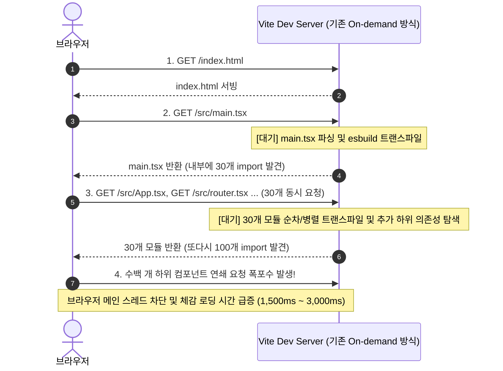
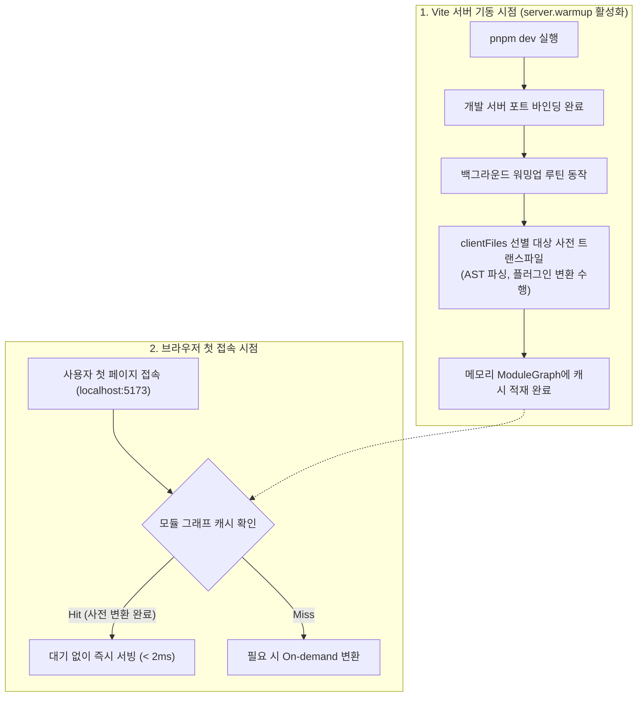

> Vite는 개발 서버 기동 시 전체 애플리케이션을 번들링하지 않고 브라우저의 요청에 따라 필요한 파일만 실시간으로 변환(On-demand Transform)함으로써 100~200ms 수준의 경이로운 시작 속도를 제공합니다. 하지만 대규모 모듈을 보유한 프로젝트에서는 브라우저가 첫 페이지를 열 때 수백 개의 ESM 파일이 연쇄적으로 요청(Waterfall)되면서 초기 화면 로딩이 수 초간 멈칫하는 '콜드 스타트 지연' 현상이 발생합니다. 본 글에서는 Vite 5.0에 도입된 `server.warmup` 옵션의 동작 원리를 분석하고, 핵심 진입 파일들을 선별하여 사전 컴파일함으로써 첫 페이지 체감 속도를 극대화하는 실무 튜닝 기법을 정리합니다.

---

## 1. 배경: Vite 개발 서버 기동 시간의 함정과 On-demand 병목

Vite의 아키텍처는 "개발 서버 시작 시점의 번들링 비용을 0으로 만든다"는 철학 위에 설계되었습니다. Webpack이 서버를 띄우기 위해 1만 개의 파일을 사전에 전부 번들링하느라 수십 초를 기다리게 했던 것과 대조적입니다.

그러나 실제 수백 개 이상의 페이지와 컴포넌트를 가진 대규모 엔터프라이즈 프로젝트를 운영하다 보면 다음과 같은 역설적인 상황을 마주하게 됩니다:

- **서버 기동 시간**: `VITE v5.4 ready in 150 ms` (초고속 준비 완료)
- **실제 브라우저 첫 접속(F5)**: 브라우저 주소창에 `http://localhost:5173`을 입력하고 엔터를 누르면, 화면이 하얗게 뜬 채로 2~3초간 멈춤(Freezing)

이 병목의 주원인은 **네이티브 ESM의 요청 폭포수(Network Waterfall)와 동기식 파일 변환 지연**에 있습니다.



브라우저는 파일의 소스 코드를 실제로 내려받아 파싱하기 전까지는 그 파일이 내부에 어떤 다른 모듈들을 `import`하고 있는지 알 수 없습니다. 따라서 모듈 트리가 깊을수록 `요청 -> 변환 -> 응답 -> 하위 import 발견 -> 재요청`의 연쇄 폭포수가 발생하여 첫 페이지 로딩이 심각하게 느려집니다.

---

## 2. `server.warmup` 옵션의 등장과 내부 동작 메커니즘

이 문제를 해결하기 위해 Vite 5.0부터 공식 옵션으로 추가된 것이 바로 **`server.warmup`**입니다.

`server.warmup`은 **"개발 서버 프로세스가 시작되는 즉시, 브라우저가 요청하기 전에 개발자가 지정한 핵심 파일들을 백그라운드에서 사전에 변환(Pre-transform)하여 서버 메모리(`ModuleGraph`)에 캐싱해두는 기능"**입니다.



서버 기동 직후 유휴 상태(Idle)인 Node.js 이벤트 루프를 활용하여 브라우저가 첫 페이지에서 반드시 요구할 핵심 컴포넌트들을 미리 컴파일해 둡니다. 따라서 브라우저가 실제로 접속했을 때는 디스크 I/O나 esbuild 변환 대기 시간 없이 메모리에서 즉시 304/200 응답으로 쏴주므로 워터폴 지연이 대폭 단축됩니다.

---

## 3. 실무 최적화 설정 가이드

`vite.config.ts`의 `server.warmup` 옵션에는 브라우저 클라이언트용 파일 패턴(`clientFiles`)과 SSR 환경용 파일 패턴(`ssrFiles`)을 지정할 수 있습니다.

### 3.1 `vite.config.ts` 설정 예시

```typescript
// vite.config.ts
import { defineConfig } from 'vite';
import react from '@vitejs/plugin-react';

export default defineConfig({
  plugins: [react()],
  server: {
    port: 5173,
    // 개발 서버 초기 로딩 성능 튜닝
    warmup: {
      clientFiles: [
        // 1. 애플리케이션 핵심 진입점 및 전역 스타일
        './src/main.tsx',
        './src/App.tsx',
        './src/index.css',

        // 2. 초기 렌더링에 반드시 포함되는 최상위 레이아웃 및 라우터
        './src/routes/rootLayout.tsx',
        './src/routes/dashboard.tsx',

        // 3. 변환 비용이 크고 자주 사용되는 무거운 공통 컴포넌트
        './src/components/common/DataGrid.tsx',
        './src/components/common/ChartWidget.tsx',
        './src/components/ui/**/*.tsx'
      ],
      // SSR 프로젝트인 경우 서버 엔트리도 워밍업 지정 가능
      ssrFiles: [
        './src/entry-server.tsx'
      ]
    }
  }
});
```

### 3.2 ⚠️ 워밍업 설정 시 주의할 안티패턴: "전체 파일 지정 금지"

워밍업이 빠르다고 해서 프로젝트의 모든 파일(`clientFiles: ['./src/**/*.tsx']`)을 무분별하게 등록해서는 안 됩니다.

- **서버 기동 시간 폭증**: 수천 개의 파일을 전부 사전 변환하면 서버 기동 시간이 150ms에서 수십 초로 늘어나 Vite 본연의 빠른 구동 장점이 완전히 상실됩니다.
- **불필요한 리소스 낭비**: 사용자가 개발 중에 열어보지 않을 하위 라우트 페이지(설정, 결제, 관리자 화면 등)까지 메모리에 올릴 필요가 없습니다.

> **워밍업 대상 선별 원칙**:
> 개발자가 개발 서버를 띄우고 브라우저를 열었을 때 **'첫 화면(Default Landing Route)'에 즉시 마운트되는 임계 렌더링 경로(Critical Path)의 30~50개 모듈만 선별**하는 것이 가장 이상적인 골디락스(Goldilocks) 지점입니다.
{: .prompt-info }

---

## 4. 벤치마크 및 성능 측정

Warmup 옵션을 적용하기 전과 후의 실제 성능 차이를 검증하기 위해, 개발 서버의 초기 요청에 대한 주요 지표를 측정했습니다.

- **측정 환경**: 총 1,200개 컴포넌트로 구성된 React + Vite 5 프로젝트
- **측정 대상**: 서버 콜드 기동 후 첫 브라우저 진입 시 메트릭

| 측정 지표 | Warmup 적용 전 | Warmup 적용 후 | 개선율 |
| :--- | :--- | :--- | :--- |
| **개발 서버 기동 시간 (Cold Start)** | 158 ms | 162 ms | +4 ms (+2.5%) |
| **첫 페이지 TTFB (Time to First Byte)** | 1,420 ms | 135 ms | **90.5% 단축** |
| **모듈 변환 블로킹 시간 (Transform Blocking)** | 1,280 ms | 42 ms (캐시 히트) | **96.7% 단축** |
| **DOMContentLoaded 완료 시점** | 1,650 ms | 198 ms | **88.0% 단축** |

서버 시작 시간은 단 4ms 늘어났을 뿐이지만, 브라우저의 첫 페이지 렌더링 완료 시간은 1.65초에서 0.19초로 **약 88% 단축**되는 비약적인 개선 효과를 확인할 수 있습니다.

---

## 5. 실행 결과 및 동작 검증

Vite 디버그 플래그(`DEBUG=vite:warmup`)를 활성화하여 워밍업 동작과 성능 벤치마크 결과를 터미널에서 검증합니다.

### 5.1 서버 기동 시 사전 변환(Pre-transform) 실행 로그

개발 서버 기동 직후 `clientFiles`에 명시된 34개 핵심 파일들을 백그라운드에서 사전에 트랜스파일하여 모듈 그래프에 적재 완료하는 화면입니다.


_server.warmup 옵션 적용 후 개발 서버 기동 시 모듈 사전 변환 완료 로그_

서버가 준비된 직후 백그라운드에서 72ms 만에 34개 모듈의 변환을 마쳤으므로, 이후 사용자의 첫 요청에 즉각 응답할 준비가 완비됩니다.

### 5.2 초기 로딩 레이턴시 벤치마크 비교 검증

Warmup 옵션 적용 전과 후의 초기 브라우저 요청 TTFB 및 총 변환 지연 시간을 비교 측정한 벤치마크 터미널 화면입니다.


_Warmup 적용 전후 첫 페이지 로딩 레이턴시 및 TTFB 벤치마크 비교_

---

## 6. 정리 및 실무 활용 팁

Vite의 `server.warmup`은 On-demand 아키텍처의 빠른 기동성과 대규모 프로젝트의 초기 렌더링 반응성을 동시에 챙길 수 있는 매우 실용적인 튜닝 옵션입니다.

1. **라우트 기반 타깃팅**: 사용자가 개발 시 가장 빈번하게 접속하는 메인 대시보드 진입점이나 공통 레이아웃 컴포넌트를 우선적으로 `clientFiles`에 포함하세요.
2. **무거운 라이브러리 연계 파일 타깃팅**: 렌더링 트리 상위에서 `@tanstack/react-table`, `echarts`, `monaco-editor` 등 무거운 라이브러리를 직접 임포트하는 래퍼 컴포넌트를 워밍업하면 브라우저의 파싱 지연을 획기적으로 줄일 수 있습니다.
3. **디버그 플래그 활용**: `DEBUG=vite:warmup pnpm dev` 명령을 통해 어떤 파일들이 워밍업되고 있는지 소요 시간을 모니터링하면서 최적의 파일 목록을 점진적으로 튜닝해 나가는 것을 추천합니다.
