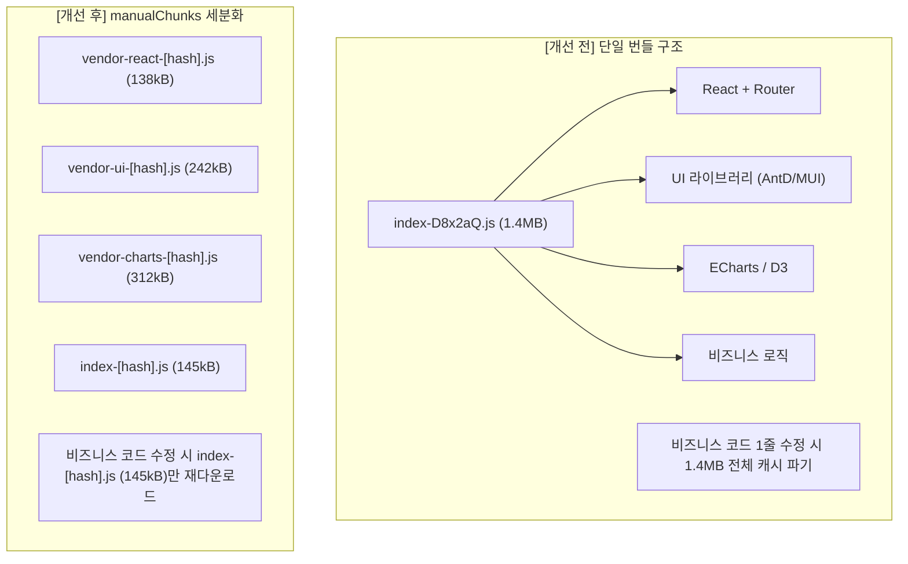

> 프론트엔드 애플리케이션의 규모가 커질수록 단일 번들에 누적되는 외부 라이브러리 용량은 초기 로딩 속도와 브라우저 캐싱 효율을 크게 떨어뜨립니다. 본 글에서는 Vite 프로덕션 빌드 환경에서 Rollup의 `manualChunks` 옵션을 활용하여 벤더 라이브러리를 목적별 청크로 세분화하고, 순환 참조 이슈 없이 장기 캐싱(Long-term Caching) 이점을 극대화하는 실무 전략을 정리합니다.

---

## 1. 단일 대용량 번들의 문제점과 캐시 비효율

Vite는 프로덕션 빌드 시 내부적으로 Rollup을 번들러로 사용합니다. 별도의 코드 분할(Code Splitting) 설정을 하지 않은 상태에서 프로젝트가 성장하면 `pnpm build` 실행 시 다음과 같은 번들 크기 경고를 자주 접하게 됩니다.

```text
(!) Some chunks are larger than 500 kB after minification. Consider:
- Using dynamic import() to code-split the application
- Use build.rollupOptions.output.manualChunks to improve chunking
```


_단일 index.js 청크에 모든 벤더 라이브러리가 포함되어 1.4MB를 초과하는 빌드 경고 화면_

이러한 단일 거대 번들은 다음과 같은 성능 및 아키텍처 문제를 야기합니다.

1. **초기 로딩 속도(FCP/LCP) 저하**: 사용자가 첫 화면을 렌더링하기 위해 불필요한 차트, 에디터, 모달 라이브러리까지 수백 킬로바이트를 일시에 내려받아야 합니다.
2. **브라우저 장기 캐싱 무효화(Cache Invalidation)**: 비즈니스 로직에서 텍스트 한 줄만 변경되어도 번들의 해시값(`index-[hash].js`)이 변경되어, 버전이 거의 바뀌지 않는 React 코어나 lodash 같은 무거운 외부 라이브러리까지 클라이언트가 전체 재다운로드해야 합니다.

이를 해결하기 위해 애플리케이션 소스 코드와 거의 변경되지 않는 외부 의존성(Vendor Modules)을 분리하고, 변경 빈도와 기능 단위에 맞추어 청크를 적절히 쪼개는 전략이 필수적입니다.

---

## 2. 청크 분리 구조와 브라우저 캐시 라이프사이클

번들을 성격별로 쪼개면 변경 빈도가 낮은 프레임워크와 UI 라이브러리는 브라우저의 HTTP 캐시(304 Not Modified 또는 Cache-Control: max-age=31536000, immutable)에 장기간 유지될 수 있습니다.



---

## 3. Rollup manualChunks 설정 방식 비교

Vite의 `vite.config.ts`에서 Rollup 번들링을 제어하는 `build.rollupOptions.output.manualChunks` 옵션은 두 가지 형태로 작성할 수 있습니다.

### 3.1 객체(Object) 정의 방식

모듈 이름 목록을 배열로 정적으로 지정하는 방식입니다:

```typescript
// vite.config.ts
import { defineConfig } from 'vite';

export default defineConfig({
  build: {
    rollupOptions: {
      output: {
        manualChunks: {
          'vendor-react': ['react', 'react-dom', 'react-router-dom'],
          'vendor-utils': ['lodash-es', 'dayjs', 'axios']
        }
      }
    }
  }
});
```

- **장점**: 직관적이고 설정이 단순합니다.
- **단점**: 서브 디펜던시(간접 의존성)가 자동으로 포함되지 않거나, 라이브러리 간 공통 내부 모듈이 엮일 때 의도치 않은 순환 의존성(Circular Dependency) 에러가 발생할 가능성이 높습니다.

### 3.2 함수(Function) 정의 방식

모듈의 절대 파일 경로(`id`)를 인자로 받아 동적으로 청크 이름을 반환하는 방식입니다. 실무 프로젝트에서는 세밀한 필터링과 유연한 그룹화를 지원하는 함수 방식을 권장합니다.

---

## 4. 실무형 manualChunks 구현

다음은 React 생태계와 대용량 시각화 라이브러리를 사용하는 엔터프라이즈 환경에서 검증된 `vite.config.ts` 설정입니다.

```typescript
// vite.config.ts
import { defineConfig } from 'vite';
import react from '@vitejs/plugin-react';

export default defineConfig({
  plugins: [react()],
  build: {
    target: 'es2020',
    chunkSizeWarningLimit: 600, // 개별 청크 경고 기준 600kB로 상향
    rollupOptions: {
      output: {
        manualChunks(id) {
          // node_modules 내부의 라이브러리만 분리 대상
          if (id.includes('node_modules')) {
            // 1. React 프레임워크 코어 (변경 빈도가 가장 낮음)
            if (
              id.includes('/react/') ||
              id.includes('/react-dom/') ||
              id.includes('/react-router-dom/')
            ) {
              return 'vendor-react';
            }

            // 2. 대용량 데이터 시각화 및 차트 라이브러리
            if (
              id.includes('/echarts/') ||
              id.includes('/zrender/') ||
              id.includes('/d3/')
            ) {
              return 'vendor-charts';
            }

            // 3. UI 컴포넌트 프레임워크 (Ant Design / Lucid / MUI 등)
            if (
              id.includes('/antd/') ||
              id.includes('/@ant-design/') ||
              id.includes('/@emotion/')
            ) {
              return 'vendor-ui';
            }

            // 4. 공통 유틸리티 라이브러리
            if (
              id.includes('/lodash/') ||
              id.includes('/lodash-es/') ||
              id.includes('/dayjs/') ||
              id.includes('/axios/')
            ) {
              return 'vendor-utils';
            }

            // 나머지 node_modules는 기본 벤더 청크로 묶거나 Rollup 기본 전략에 위임
            return 'vendor-libs';
          }
        }
      }
    }
  }
});
```

---

## 5. 순환 참조(Circular Dependencies) 방지 팁

`manualChunks`를 커스텀하게 분리할 때 가장 흔히 겪는 문제는 다음과 같은 Rollup 경고 및 런타임 `Cannot access 'X' before initialization` 에러입니다.

```text
(!) Circular dependency:
vendor-react -> vendor-ui -> vendor-react
```

### 방지 원칙
1. **강결합 라이브러리는 같은 청크로 묶기**: 예를 들어 `@tanstack/react-query`와 `@tanstack/query-core`는 밀접하게 의존하므로 각각 다른 청크로 분리하지 말고 단일 청크(`vendor-tanstack`)로 묶어야 합니다.
2. **동적 임포트(Dynamic Import)와의 충돌 방지**: 특정 페이지에서만 비동기로 로드되는 컴포넌트가 참조하는 전용 라이브러리를 무리하게 전역 `manualChunks`로 묶으면, 해당 페이지의 동적 로딩 지연 이점이 사라집니다. 페이지 전용 라이브러리는 Rollup이 자연스럽게 해당 라우트 청크에 인라인하도록 예외 처리하는 것이 좋습니다.

---

## 6. 프로덕션 빌드 결과 검증

설정 적용 후 `pnpm build`를 다시 실행해 보았습니다.


_manualChunks 설정을 통해 vendor-react, vendor-ui, vendor-charts 등으로 깔끔하게 분리된 빌드 화면_

- `vendor-react-C8k2.js`: 138.42 kB (gzip: 44.18 kB)
- `vendor-ui-B5m1.js`: 242.11 kB (gzip: 68.40 kB)
- `vendor-charts-F3x9.js`: 312.80 kB (gzip: 89.15 kB)
- `vendor-utils-A9q4.js`: 84.22 kB (gzip: 24.10 kB)
- `index-E7d1.js`: 145.29 kB (gzip: 39.75 kB)

1.4MB에 달하던 단일 진입점 번들이 완전히 해소되었으며, 비즈니스 로직(`index-E7d1.js`)은 145kB 수준으로 축소되었습니다. 신규 기능 배포 시 사용자는 145kB 파일만 새로 다운로드하고, 나머지 수백 킬로바이트의 벤더 파일은 브라우저 로컬 캐시에서 즉시 재사용하게 됩니다.

---

## 7. Vite 7(Rollup)과 Vite 8(Rolldown)에서의 청크 분할 차이점

Rollup 기반의 번들링은 훌륭하지만, 모듈 수가 수천 개를 넘어가는 대규모 엔터프라이즈 환경에서는 `manualChunks` 함수가 호출될 때마다 JavaScript와 V8 힙 메모리 간의 오버헤드가 누적되는 한계가 있었습니다.

- **Vite 7 (Rollup 기반 청크 분할)**:
  - Rollup의 단일 스레드 모듈 순회에 의존하므로 `manualChunks(id)` 콜백이 모든 파일마다 실행될 때 빌드 속도가 저하될 수 있습니다.
  - 순환 참조(Circular Dependency)가 발생했을 때 Rollup이 청크를 예상치 못하게 하나로 합쳐버리는(Chunk Merging) 부작용을 방지하기 위해 정교한 정규식 예외 처리가 필요했습니다.
- **Vite 8 (Rolldown Rust 기반 청크 분할)**:
  - Rolldown은 Rollup의 `manualChunks` 문법을 100% 호환하면서도, 내부 모듈 의존성 그래프를 **Rust Oxc 엔진과 Rayon 멀티스레드**를 통해 고속으로 분석합니다.
  - 순환 참조 감지 알고리즘이 훨씬 정밀하여 억지스러운 청크 병합을 방지하며, 수만 개 모듈 환경에서도 청크 분할 단계가 수십 밀리초 만에 완료됩니다.

---

## 8. 마치며

`manualChunks` 분리는 단순히 번들 크기 경고 문구를 지우기 위한 작업이 아닙니다. 변경 주기(Frequency of Change)와 비즈니스 도메인의 중요도를 고려하여 캐시 적중률(Cache Hit Ratio)을 극대화하는 성능 엔지니어링의 일환입니다.

Vite 7에서의 Rollup 최적화 패턴을 잘 이해해 두면, 향후 Vite 8의 Rolldown 환경에서도 완전히 동일한 설정으로 10배 이상의 빌드 속도 혜택을 온전히 누릴 수 있습니다.

프로젝트의 라이브러리 사용 현황을 주기적으로 점검하고, 무거운 라이브러리는 청크 분리와 함께 다음 포스트에서 다룰 라우트 단위 동적 임포트(Dynamic Import)를 병행하여 점진적으로 최적화해 나가는 것을 추천합니다.


